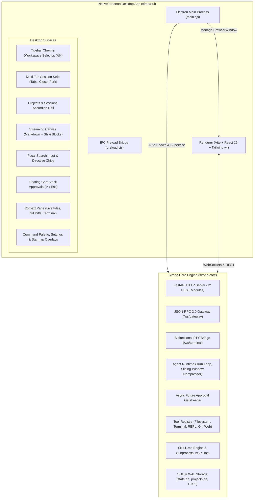

# Sirona — Autonomous Personal Developer Agent & Desktop Studio

**Sirona** is an autonomous personal developer agent engineered from Hermes Agent foundations, with all third-party chat platforms (Discord, Telegram, Slack, WhatsApp, Twitter, etc.) removed in favor of an uncompromised, hyper-focused local personal agent experience.

Sirona is packaged as a **native Electron Desktop application** and styled to the **Perplexity AI Style Reference** (*"scholar's parchment behind clean glass"*): warm Parchment canvas (`#faf8f5`), Soft Paper cards (`#fdfbfa`), hairline Warm Mist pencil borders (`#d1d1cd`), Ink typography (`#27251e`), and Deep Teal (`#016a71`) active accents.

---

## Architecture Overview



---

## Key Features

1. **Native Desktop Shell (Electron)**:
   - Dedicated desktop window with native application menus (File, Edit, View, Window, Help).
   - Auto-supervises the Python backend process and monitors readiness on `http://127.0.0.1:8000/health`.
   - IPC bridge for platform checks, native file/directory dialogs, and external URL handling.

2. **Real-Time WebSocket Gateway (`/ws/gateway`)**:
   - JSON-RPC 2.0 protocol streaming real-time tokens (`stream.token`), reasoning steps (`stream.reasoning`), and tool calls (`tool_start`, `tool_complete`).
   - Interactive CardStack approvals triggered over WebSockets with `approval_request` events.

3. **Interactive PTY Terminal Deck (`/ws/terminal`)**:
   - Native bidirectional terminal session streaming ANSI output and handling terminal window resizing.

4. **Multi-Session Tabs & Branching**:
   - Multi-tab session strip supporting concurrent chats, tab closing, tab reordering, and session forking (`GitFork`).

5. **Integrated Developer Context**:
   - **Files Explorer**: Live workspace scanning and file content viewer.
   - **Review Tab**: Live `git_diff` inspector with 2px gutter accents and old/new line numbering.
   - **Command Palette (`⌘K`)**: Quick navigation, model switching, and action runner.
   - **Settings Overlay (`⚙`)**: Provider API keys, live CPU/RAM metrics, and SQLite WAL validation.
   - **Starmap Overlay**: Visual conversation topology graph.

---

## Quick Start

### One-Click Launch (Windows)
Double-click `start.bat` or run `start.ps1` in PowerShell:
```powershell
.\start.ps1
```
*This verifies the Python backend, launches the server daemon on port 8000, and opens the native Sirona Electron Desktop application.*

### Manual Development Workflow

#### 1. Backend Service
```bash
cd sirona-core
.venv\Scripts\activate
python -m sirona.cli serve --host 127.0.0.1 --port 8000
```

#### 2. Native Electron Desktop App
```bash
cd sirona-ui
npm run electron
```

---

## Verification & Testing

- **Backend Test Suite (22/22 Passing)**:
  ```bash
  cd sirona-core
  .venv\Scripts\pytest
  ```
- **Frontend Production Build**:
  ```bash
  cd sirona-ui
  npm run build
  ```
