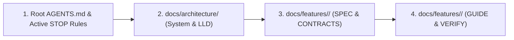

# Sirona Engineering Documentation Hub

Welcome to Sirona's canonical, spec-driven engineering documentation system.

---

## 1. Mandatory Reading Order for AI Agents & Developers

Before inspecting or altering any source code, every agent must follow this strict reading sequence:

1. **Governance & STOP Rules**: [`docs/governance/ACTIVE-STOP-RULES.md`](governance/ACTIVE-STOP-RULES.md) (All active freeze, database, and approval gates).
2. **Authority Hierarchy & ADRs**: [`docs/governance/DOCUMENTATION-AUTHORITY-HIERARCHY.md`](governance/DOCUMENTATION-AUTHORITY-HIERARCHY.md) & [`docs/governance/ARCHITECTURE-DECISION-REGISTRY.md`](governance/ARCHITECTURE-DECISION-REGISTRY.md) (Authority precedence, canonical `ADR-xxx` decisions).
3. **System Architecture**: [`docs/architecture/SYSTEM-ARCHITECTURE.md`](architecture/SYSTEM-ARCHITECTURE.md) (Monorepo boundaries, containment, IPC).
4. **Low-Level Design**: [`docs/architecture/LOW-LEVEL-DESIGN.md`](architecture/LOW-LEVEL-DESIGN.md) (Services, DB schemas, turn leases).
5. **Feature Guidance**: [`docs/features/`](features/) (Dedicated `SPEC.md`, `CONTRACTS.md`, `IMPLEMENTATION-GUIDE.md`, and `VERIFICATION.md` for each domain).
6. **Active Roadmap**: [`docs/engineering/IMPLEMENTATION-ROADMAP.md`](engineering/IMPLEMENTATION-ROADMAP.md) (P1–P8 progression).

---

## 2. Canonical Active Directories

- **[`docs/architecture/`](architecture/)**: Authoritative system architecture, low-level service design, component topologies, and runtime flows.
- **[`docs/features/`](features/)**: Self-contained, spec-driven feature guidance folders for every platform capability.
- **[`docs/engineering/`](engineering/)**: Real codebase audit, gap analysis, and dependency-ordered implementation roadmap.
- **[`docs/governance/`](governance/)**: Enforced STOP rules, documentation authority hierarchy, and risk approval ledgers.
- **[`docs/reference/`](reference/)**: Complete 148-route API surface catalog, migration 001–024 database schemas, and vendor provider manuals.
- **`docs/_archive/legacy/` (unavailable in this checkout)**: Non-authoritative archive of historical phase plans, ledgers, and obsolete scaffolds.
