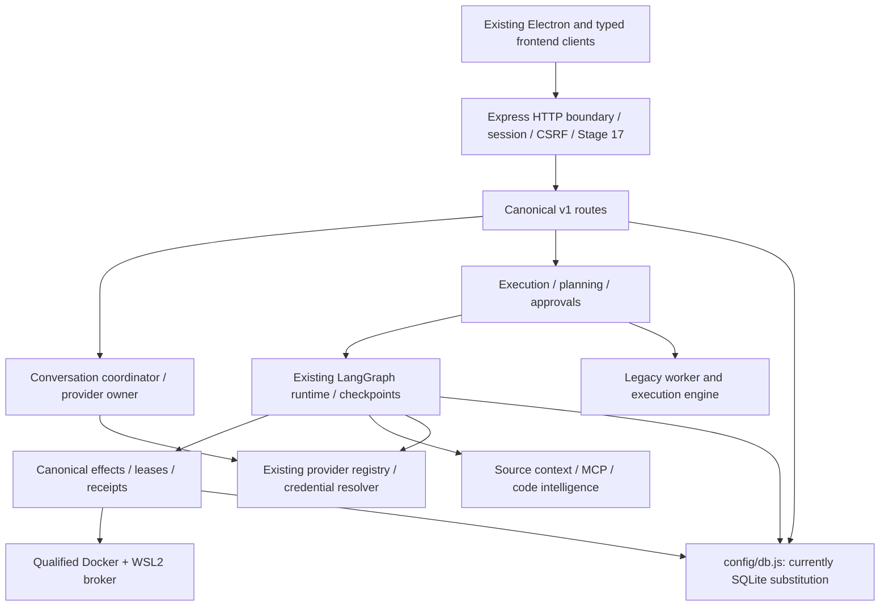

# Unified backend refactor — initial audit and independent repair

2026-10-30. **IN PROGRESS; NOT a completed refactor or production qualification.** This task implements the owner's attached master backend request. Its work items are numbered R0–R12 to avoid confusing its thirteen audit/refactor stages with the existing P0–P8 workspace plan. That plan, prior evidence and the pending P6 Gate B remain preserved.

## Audit coverage and limitations

Automated inventory/AST review covered **261 backend files, 232 JS/TS source files, 1,430 dependency edges, 242 route/mount declarations**, one computed loader, 36 cleanup-manifest candidates and 26 frontend API-family consumer references. Potential server-entrypoint reachability covers 88 modules; it is a static over/under-approximation, not runtime qualification or dead-code proof. Source hashes, import/export/dynamic-loader edges, runtime URL references, route declarations and candidates are recorded in `integration/evidence/backend-refactor-audit-20261030/source-inventory-and-dependencies.json`.

Focused manual inspection covered entrypoint/composition, HTTP/admission/authentication, project/memory routes and services, scanner, database owner, graph/legacy execution split, verification claims, sandbox selection, recovery, scheduler references, packaging, compiler/test scripts, frontend transports and the current P0–P8 reports. This is **not a claim that every function in every inventoried module has received a complete security review**. No dynamic production run was launched.

## Critical current-checkout conflict: database ownership

`backend/config/db.js` now imports and re-exports `config/sqliteDb.js`. This contradicts the selected PostgreSQL architecture and the historical qualified reports. The current adapter:

- Uses `node:sqlite` and defaults to `%APPDATA%/SironaNext/sirona.db` with additional attached namespace database files.
- Ignores the PostgreSQL config and injected Pool supplied to `createDatabaseOwner`.
- Reports `checkPostgresConnection()` as successful without checking PostgreSQL.
- Initializes tables/seeds during database initialization; transaction BEGIN/COMMIT/ROLLBACK errors are swallowed in several paths.
- Cannot establish PostgreSQL same-client transactions, RLS, advisory locks, row locks, lease fencing, schema qualification or the approved isolated-database guard through SQL string translation.

**Affected work stops under AGENTS.md §31:** restoring/changing database ownership, execution consolidation, authorization changes dependent on persistence, schema/data operations and integration acceptance. The current source cannot inherit historical PostgreSQL/P1–P6 qualification. No existing SQLite file is to be deleted, reset, renamed or automatically imported; it may contain newer user data.

The initial baseline unit invocation reached the substituted driver and failed with `ERR_SQLITE_ERROR` / “unable to open database file.” The failing evidence is retained; the obsolete assumption that these tests were DB-independent is withdrawn for this checkout. No further database-dependent tests were started. No successful current data-preservation check is claimed. No migration, production service restart, source database-owner replacement or application-data conversion was performed.

Normative-reference conflict: the `sironadocs/` directory and its relocation map/security/database/API documents referenced by root AGENTS.md are absent from this checkout. No authoritative relocated replacement was found by filename inventory. Do not reconstruct policy from historical examples or silently restore a guessed architecture. Root AGENTS.md and current owner instructions still apply.

## Findings and action register

| ID / priority | Observed source and root cause | Decision / required verification |
| --- | --- | --- |
| RISK-01 critical | `config/db.js` selects SQLite; factory/readiness/transaction semantics differ from approved PostgreSQL owner | Resolve canonical owner with owner approval before DB-dependent work; preserve both stores; no working-data migration |
| RISK-02 high | `projects.routes.js` passes project IDs without actor context to update/archive/snapshots/uploads/scan; several ProjectService methods query IDs without mandatory workspace scope | Centralize resource authorization using existing identity/session owner, migrate every caller, real two-workspace negative tests; not fixed by route authentication alone |
| RISK-03 high | Memory and automation route/service methods accept project/resource IDs without consistently requiring authenticated workspace ownership | Extend the same resource boundary to reads, writes, search, revisions, deletion, schedules, triggers and notifications; audit explicit webhook exceptions |
| RISK-04 high | `ProjectService.createProject` automatically scans a client-provided `primaryPath`; scanner performs host filesystem/Git inspection outside the qualified root/guest owner | Keep path metadata distinct from authority; reuse registered-root grants/snapshot broker; no host-Git or unqualified-execution fallback |
| RISK-05 high | Current `backend.zip` contains `backend/.env` (entry-name inspection only); backend Dockerfile has `COPY . .` with no prior `.dockerignore` | Independent packaging filters and actual npm tests delivered below; archive retained and ignored, no key values read/displayed, no automatic credential rotation |
| RISK-06 high | Artifact content route sends `artifact.storage_path` as bytes and sets a stored digest header, without verifying actual content bytes or resource ownership | Define canonical artifact-content resolver/auth scope, quarantine/size/digest handling, safe streaming and frontend compatibility before repair; do not naively open arbitrary paths |
| RISK-07 high | Legacy worker sets CRIT-BUILD and CRIT-CONTAINMENT to `pass` without executing those checks; artifact record stores root path as a verification bundle | Replace with independently bound evidence or truthful blocked/not-run outcomes; keep producer and verifier identities separate |
| RISK-08 high | Recovery service creates random simulated backup size, sets `verified=true`, and fabricates restoration timing/450 restored rows/zero data loss | Real restore requires a separate approved target; meanwhile production capability must return truthful not-configured/unverified behavior, preserving records as historical claims |
| RISK-09 high | Legacy worker/engine, generic SandboxManager and newer graph/Docker owner coexist; graph branch is selected for graph runs | Migrate use cases into existing canonical owner before retiring callers; no duplicate orchestrator or blindly replayed effects |
| RISK-10 review | `SandboxManager.resolveBackend({allowHostExecution:true})` still exposes an internal opt-in host path; default resolution is Docker/fail-closed | Audit every caller and permission source; source presence is not proof of a remotely exploitable host fallback |
| RISK-11 medium | Agent worker/engine use fixed `gemini-3.5-flash`; ProjectService has a different fixed conversation default | Migrate to exact discovered model registry IDs/capabilities; retain native chat identity, secure credentials and no fallback after output/effects |
| RISK-12 medium | One turn-route collision exists between conversation and provider routers; conversation router mounts first | Preserve canonical frontend streaming owner and leases; test route precedence before removing a duplicate |
| RISK-13 incomplete | `claimDueOccurrences` has service/test references, but no production dispatcher caller was found in inspected composition/import graph | Implement/verify actual occurrence→authorized run→outcome→notification lifecycle later; static search is not proof of any external dispatcher |
| RISK-14 incomplete | Existing P6 parsers/MCP adapters/context are partial; tools-image Gate B remains pending | Do not claim real guest Git/ripgrep/LSP/MCP or SQL qualification from installed dependencies/protocol fixtures |
| RISK-15 medium | Dockerfile uses Node 18, unpinned global PM2 and clustered startup; package requires Node 24.19.0/npm 12.0.2 | Propose a qualified packaging/lifecycle repair; do not build/release/activate a replacement image incidentally |
| RISK-16 medium | Lint scripts resolve oxlint from frontend node_modules; retired dependency files remain present | Qualify backend-owned tooling and whole-cluster cleanup after dynamic/script/test review; no indiscriminate dependency install/deletion |

The raw module checker reports **44 findings: 18 unresolved-module entries and 14 cycle entries**, plus loader-policy findings. Some are duplicate/generated-path or already reviewed adapter reports; classify individually rather than interpreting every report as a new vulnerability. Its failure remains recorded.

## Current architecture and consolidation target

Target: keep the existing modular monolith and canonical security/effect/provider/graph owners; move legacy callers toward them only after parity. PostgreSQL is the selected durable authority, subject to resolving the observed replacement and preserving newer SQLite data. No new framework, ORM takeover, second orchestration engine or directory migration was introduced.

Ask/Agent/Plan should be reviewed as **interaction intent**, separate from the existing four permission modes. This avoids allowing an “Agent” label to widen access. Simplifying small-task UX must not remove authorization, fencing or exact sensitive-effect approvals. The mutation-contract change needs a concrete compatibility/security decision before implementation.

## Implemented independent packaging repair

- Added `backend/.dockerignore` to exclude local environment/key/database/archive artifacts from backend build context, preserving `.env.example`.
- Extended backend Git/npm exclusions for environment variants, private key/database/archive artifacts, scratch data and compiled tests.
- Added root `/backend.zip` ignore because the inspected archive contains an environment file. It was not deleted, rewritten, uploaded or removed from history; `git ls-files -- backend.zip` returned no tracked path.
- Added `backend/scripts/checkPackageBoundary.mjs`: checks real `npm pack --dry-run --ignore-scripts --offline --json` output and fails on prohibited filenames without reading/printing secret contents.
- Added two real npm packaging tests against a temporary fixture and the actual backend. Temporary recursive cleanup validates the exact temporary root first.

These are file/package-boundary repairs, **not a completed credential audit, fixed Docker runtime or built-image qualification**. The old Dockerfile/version/PM2 issue remains. No provider credentials were read, revoked or rotated. If the archive was shared, treat its contained credentials as potentially exposed and rotate them through the trusted configuration process; the audit does not claim observed misuse.

## Verification

| Command | Actual result |
| --- | --- |
| `node .tmp/backend-refactor-audit-20261030/audit.cjs` | Inventory/dependency/route/consumer artifacts produced |
| `npm --prefix backend run check` | PASS |
| `npm --prefix backend run check:strict` | PASS; static result is not security/runtime qualification |
| `npm --prefix backend run check:modules` | FAIL, retained baseline |
| `npm --prefix backend run check:workspace` | PASS |
| `npm --prefix backend run build:workspace` | PASS |
| `npm --prefix backend run test:unit` | FAIL under substituted SQLite owner; error evidence retained, not PostgreSQL qualification |
| `node --test --test-concurrency=1 --test-timeout=45000 backend/tests/packageBoundary.test.js` | **2/2 PASS**, actual npm payload tests |
| `node backend/scripts/checkPackageBoundary.mjs` | PASS, 299 listed files, zero prohibited paths at that run |
| `git check-ignore backend/.env backend/.env.production backend.zip` | All three ignored |
| `npm test`, `test:workspace`, `verify`, P5/P6 DB/guest suites | **BLOCKED** by owner/guard conflict and live-provider/no-charge restrictions; no inference called |
| Actual Docker build / production backup restore / real-model workflow | **NOT RUN / UNVERIFIED** |

Evidence and changed-file hashes: `integration/evidence/backend-refactor-audit-20261030/`. Earlier P0–P8 passes remain historical evidence against their captured source, not proof for the substituted current owner.

## Preservation, rollback and remaining approval

No public route/DTO, application service, database owner, provider adapter, graph, lease, approval enforcement, migration, frontend screen or product directory was modified. No source file/dependency was deleted or moved. Only package filters, the package checker/tests and audit/handoff documentation changed; generated workspace build output was refreshed by its existing command.

Rollback is limited to the added filter rules/checker/tests and documentation overlay; preserve the sensitive archive exclusion until a safe archive policy is in place. Never reset the dirty repository, restore an old database over newer data or delete current SQLite files. Inventory hashes capture the pre-repair runtime sources.

**Concrete next decision:** approve restoration of the PostgreSQL lifecycle/query/transaction owner and review of its affected callers, with validation only on the existing isolated PostgreSQL test database. Preserve all current SQLite files, no automatic conversion, no working-data writes/migrations, no running-service restart/production activation and no paid inference. Locate the authoritative missing normative documents before changing their protected contracts. Exact canonical-owner patch and affected files must be reviewed before application. This does not approve P6 Gate B, deployment, commits or mass deletion.
