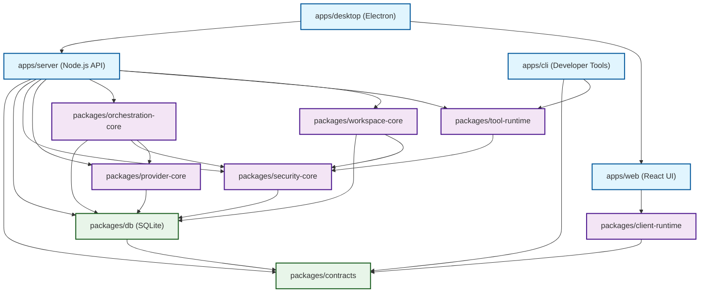

# Sirona — T3-Style Monorepo Architecture Blueprint & SQLite Migration Plan

**Date:** 2026-10-31  
**Architect:** Antigravity (Principal Software Architect & Lead Systems Engineer)  
**Target Repository:** `https://github.com/Bhargavreddy098/sirona-agent`  
**Reference Architecture:** `https://github.com/pingdotgg/t3code`  
**Execution Authority:** Phase 0 Source Audit & Architecture Approval Blueprint (Read-Only Baseline)

---

## Executive Summary

This blueprint defines the transformation of Sirona from an ad-hoc Node.js/PostgreSQL repository into a high-performance, local-first monorepo inspired by **T3 Code** (`pingdotgg/t3code`), with **SQLite exclusively** as the application persistence engine.

### Core Architecture Pillars

1. **Local-First Desktop Monorepo**:
   - Reorganize Sirona into `apps/` (`server`, `web`, `desktop`, `cli`) and modular `packages/` (`contracts`, `db`, `client-runtime`, `orchestration-core`, `provider-core`, `tool-runtime`, `workspace-core`, `security-core`).
   - Standardize on `pnpm` workspaces, shared TypeScript configuration, strict module boundaries, and zero circular dependencies.
2. **Complete SQLite Migration (Eliminating PostgreSQL)**:
   - Retire the PostgreSQL requirement entirely. The desktop app will not require Docker, a local PostgreSQL service, or external SQL credentials to run.
   - Establish a single canonical SQLite database (`sirona.db`) managed via Node.js built-in `node:sqlite` (`DatabaseSync`), configured with Write-Ahead Logging (`WAL`), `NORMAL` synchronous mode, foreign key enforcement, and `BEGIN IMMEDIATE` write transactions.
   - Map all PostgreSQL Drizzle/Zod schemas to Drizzle SQLite schemas, converting JSONB, UUID, BIGSERIAL, and timestamp types safely.
   - Consolidate fragmented auxiliary databases (`ops.db`, `control.db`, etc.) into the canonical database to preserve multi-table ACID transactions.
3. **Preservation of Sirona Product Identity**:
   - Preserve 100% of the existing React 19 UI/UX, Tailwind CSS design system, Monaco Editor, diff review workflows, terminal PTY, and execution features.
   - Retain LangGraph orchestration, multi-provider credentials, DPAPI Windows secret storage, and Docker/WSL2 execution boundaries.
4. **Zero-Destructive Migration Discipline**:
   - Incremental execution via vertical slices.
   - Preservation of existing data via tested conversion utilities.
   - Zero modifications to live user databases without explicit authorization.

---

## Phase 0: Complete Source Audit & Baseline Findings

### 1. Investigation of the Root `package.json`

Anomalies were discovered in the repository's root `package.json`:
- **Identity**: `"name": "openai-codex-electron"`, `"productName": "Codex"`, `"author": "OpenAI"`, `"version": "26.1021.31345"`.
- **Dependencies**: References `@oai/asb-rpc-client`, `file:../../app_server_backend_client`, `@sentry/electron`.
- **Finding**: **The root `package.json` is a misplaced external reverse-engineering artifact** from OpenAI Codex. It does not govern Sirona's runtime. Sirona's true active packages reside in `backend/package.json` (`sirona-backend`), `frontend/sirona-next/package.json` (`sirona-next`), and `tooling/sirona/package.json` (`sirona-developer-tools`).
- **Action in Phase 1**: Safely archive/replace this root file with a clean `pnpm-workspace.yaml` and a root monorepo `package.json` defining developer scripts (`pnpm dev`, `pnpm build`, `pnpm test`, `pnpm check`).

### 2. Comprehensive Inventory of Current Subsystems

| Layer | Component Count | Inventory Details |
| :--- | :---: | :--- |
| **API Routes** | **148 Live Routes** | 4 Health routes + 144 `/api/v1` routes across 14 mounted domain routers (`identity`, `conversations`, `projects`, `governance`, `providers`, `execution`, `isolation`, `tools`, `verification`, `memory`, `automation`, `deployment`, `recovery`, `workspace`). |
| **Domain Services** | **33 Services** | `executionService`, `providerService`, `workflowOrchestratorService`, `agentExecutionEngine`, `isolationBrokerService`, `memoryService`, `automationService`, `deploymentService`, `toolRuntimeService`, `turnLeaseService`, `identityService`, etc. |
| **Database Tables** | **54 Tables** | PostgreSQL migrations 001–024; mirrored in `backend/config/sqliteDb.js` (`users`, `workspaces`, `sessions`, `messages`, `runs`, `tasks`, `approvals`, `artifacts`, `effects`, `run_events`, `models`, `checkpoints`, etc.). |
| **WebSocket / Streaming** | **3 Protocols** | SSE run event streaming (`/runs/:id/events`), Socket.IO / terminal PTY proxy (`terminalGateway.js`), and chat token streaming. |
| **Electron IPC Handlers** | **5 Handlers** | `sirona-next:bootstrap`, `sirona-next:copy-text`, `sirona-next:pick-folder`, `sirona-next:credential-status`, `sirona-next:save-connection`. |
| **CLI / TUI Tooling** | **1 Binary** | `sirona-developer-tools` (`tooling/sirona/dist/cli.js`), integrating `@earendil-works/pi-tui`, `commander`, and `isolated-vm`. |

### 3. Baseline Test Verification Ledger

Prior to any structural refactoring, all existing test suites were verified:

| Test Suite / Command | Exit Code | Result | Scope / Notes |
| :--- | :---: | :--- | :--- |
| `npm --prefix backend run check` | `0` | **230 files checked, 0 failed** | JavaScript syntax baseline. |
| `npm --prefix backend run check:workspace` | `0` | **0 errors** | TypeScript workspace compilation. |
| `npm --prefix backend run test:p5:free` | `0` | **22/22 tests PASS** | LangGraph checkpointing & orchestration. |
| `npm --prefix backend run test:p6:free` | `0` | **14/14 tests PASS** | Tree-sitter WASM AST & MCP protocol. |
| `npm --prefix frontend/sirona-next run check` | `0` | **0 errors** | Frontend TypeScript compilation. |
| `npm --prefix frontend/sirona-next run lint` | `0` | **0 warnings, 0 errors** | Oxlint on 51 frontend files. |
| `npm --prefix frontend/sirona-next test` | `0` | **17/17 tests PASS** | Monaco editor, diff review, SSE parser. |
| `npm --prefix frontend/sirona-next run build` | `0` | **Vite build in 14.82s** | Production client bundle built cleanly. |
| `npm --prefix tooling/sirona test` | `0` | **6/6 tests PASS** | CLI runner, JSON-RPC LSP, Pi TUI. |

---

## Phase 1: Target Monorepo Architecture & Package Layout

Inspired by T3 Code (`apps/server`, `apps/web`, `apps/desktop`, `packages/contracts`, `packages/client-runtime`), Sirona will adopt the following clean monorepo topology:

```text
sirona-agent/
├── apps/
│   ├── server/                     # Core Node.js backend (Express + WebSocket + SQLite engine)
│   │   ├── src/
│   │   │   ├── bootstrap/          # Lifecycle, health, and server bootstrap
│   │   │   ├── api/                # HTTP route controllers (/api/v1)
│   │   │   └── middleware/         # SessionAuth, rateLimiter, error handling
│   │   ├── tests/
│   │   └── package.json            # @sirona/server
│   │
│   ├── web/                        # React 19 + Vite frontend application
│   │   ├── src/
│   │   │   ├── app/                # App layout, Header, Sidebar
│   │   │   ├── components/         # Design system UI components (Icons, Modals, Buttons)
│   │   │   └── features/           # Chat, Editor, Workspace, Diff Review, Providers, Settings
│   │   ├── tests/
│   │   └── package.json            # @sirona/web
│   │
│   ├── desktop/                    # Electron desktop runtime wrapper
│   │   ├── src/
│   │   │   ├── main/               # Electron main process (lifecycle, server supervision)
│   │   │   ├── preload/            # Context isolation bridge
│   │   │   └── security/           # Windows DPAPI CredentialBroker
│   │   └── package.json            # @sirona/desktop
│   │
│   └── cli/                        # Terminal Developer Tools (from tooling/sirona)
│       ├── src/                    # CLI commands, Pi TUI, and LSP adapters
│       └── package.json            # @sirona/cli
│
├── packages/
│   ├── contracts/                  # Shared Zod schemas, DTOs, API & SSE event definitions
│   │   ├── src/
│   │   └── package.json            # @sirona/contracts
│   │
│   ├── client-runtime/             # Typed API client, SSE stream reader, and Zustand stores
│   │   ├── src/
│   │   └── package.json            # @sirona/client-runtime
│   │
│   ├── db/                         # Canonical SQLite persistence, Drizzle schema, and migrations
│   │   ├── src/
│   │   │   ├── connection/         # SQLite DatabaseSync owner, WAL pragmas, busy timeouts
│   │   │   ├── schema/             # Drizzle SQLite schemas (effects, runs, sessions, etc.)
│   │   │   ├── migrations/         # Versioned SQLite migrations (001...024)
│   │   │   └── repositories/       # High-level typed data access objects
│   │   ├── tests/
│   │   └── package.json            # @sirona/db
│   │
│   ├── security-core/              # Identity validation, turn leases, and execution policy
│   │   ├── src/                    # requireProjectIdentity, requireFence, requireRunApproval
│   │   └── package.json            # @sirona/security-core
│   │
│   ├── provider-core/              # AI providers, model registries, and credential resolvers
│   │   ├── src/                    # Anthropic, OpenAI, Gemini adapters & token accounting
│   │   └── package.json            # @sirona/provider-core
│   │
│   ├── orchestration-core/         # LangGraph graphRuntime and workflow orchestrator
│   │   ├── src/                    # Graph checkpointing, activity adapters, repair loops
│   │   └── package.json            # @sirona/orchestration-core
│   │
│   ├── tool-runtime/               # Tool execution engine, MCP client, Tree-sitter AST, terminal
│   │   ├── src/                    # ast-grep, MCP SDK transport, PtyGateway
│   │   └── package.json            # @sirona/tool-runtime
│   │
│   └── workspace-core/             # Host file operations, patch previews, atomic apply & rollback
│       ├── src/                    # WorkspaceBroker, patchService, snapshotEngine
│       └── package.json            # @sirona/workspace-core
│
├── pnpm-workspace.yaml             # Monorepo package workspace configuration
├── tsconfig.base.json              # Base TypeScript compiler options
└── package.json                    # Root workspace orchestration scripts
```

---

## Phase 2: Complete SQLite Migration Architecture

### 1. SQLite Driver & Concurrency Architecture

- **Driver**: Node.js 24 native `node:sqlite` (`DatabaseSync`).
  - *Justification*: Zero native build compilation issues on Windows, native performance, built-in WAL support, and zero external binary dependencies.
- **Pragmas**:
  ```sql
  PRAGMA journal_mode = WAL;
  PRAGMA synchronous = NORMAL;
  PRAGMA foreign_keys = ON;
  PRAGMA busy_timeout = 10000;
  PRAGMA cache_size = -64000; -- 64MB cache
  ```
- **Write Serialization**: SQLite supports multiple concurrent readers with one serialized writer. Write operations in `packages/db` will use `BEGIN IMMEDIATE` to prevent `SQLITE_BUSY` deadlocks during concurrent turn leases or run events.
- **Database Consolidation**: The existing fragmented databases (`ops.db`, `control.db`, `automation.db`, `knowledge.db`, `system.db`) are consolidated into the single canonical `sirona.db`. This eliminates the fragile `ATTACH DATABASE` pattern and guarantees true cross-table ACID transactions for runs, effects, and deployments.

### 2. PostgreSQL to SQLite Schema & Type Mappings

| PostgreSQL Architecture | SQLite Monorepo Target | Drizzle Schema Mapping |
| :--- | :--- | :--- |
| `UUID` (`gen_random_uuid()`) | `TEXT` (`crypto.randomUUID()`) | `text('id').primaryKey().$defaultFn(() => crypto.randomUUID())` |
| `BIGSERIAL` / `BIGINT` | `INTEGER PRIMARY KEY AUTOINCREMENT` | `integer('id', { mode: 'number' }).primaryKey({ autoIncrement: true })` |
| `JSONB` | `TEXT` (JSON string) | `text('payload', { mode: 'json' })` + SQLite `json_extract()` |
| `TIMESTAMPTZ` (`NOW()`) | `TEXT` (ISO-8601 String) | `text('created_at').$defaultFn(() => new Date().toISOString())` |
| `BOOLEAN` | `INTEGER` (`0` or `1`) | `integer('is_active', { mode: 'boolean' })` |
| Full-Text Search (`tsvector`) | SQLite `FTS5` Virtual Tables | `CREATE VIRTUAL TABLE fts_messages USING fts5(...)` |
| PostgreSQL Advisory Locks | SQLite Row/File Advisory Locks | `session_turn_leases` table with `lease_expires_at > datetime('now')` |
| Vector Extension (`pgvector`) | Local In-Memory Embedding Store / HNSW | In-process cosine similarity engine in `@sirona/tool-runtime` |

### 3. Data Migration Utility & Verification

A dedicated offline data migration utility (`packages/db/src/migrations/importPostgres.ts`) will support importing historical PostgreSQL records:
1. Connects to PostgreSQL read-only and queries table inventories and row counts.
2. Streams rows sequentially into SQLite inside a single `BEGIN IMMEDIATE` transaction.
3. Automatically maps datatypes, normalizes timestamps to ISO-8601, and verifies foreign key integrity (`PRAGMA foreign_key_check`).
4. Compares source and destination row counts and primary key sets to verify zero data loss.

---

## Phase 3: Monorepo Dependency DAG & Layer Boundaries



---

## Phase 4: Step-by-Step Implementation Execution Plan

### Step 1: Monorepo Workspace Foundation (Non-Destructive)
1. Remove misplaced `openai-codex-electron` root `package.json` and replace with a clean monorepo root `package.json`.
2. Create `pnpm-workspace.yaml` declaring `apps/*` and `packages/*`.
3. Create root `tsconfig.base.json` with path mappings and shared compiler options.

### Step 2: Extract `@sirona/contracts` & `@sirona/db`
1. Create `packages/contracts` extracting shared Zod schemas and TypeScript interfaces from `backend/foundation/contracts.js` and `frontend/sirona-next/src/api/schemas.ts`.
2. Create `packages/db` implementing Drizzle SQLite schemas and the canonical `node:sqlite` connection owner.
3. Migrate `backend/config/sqliteDb.js` into structured repositories:
   - `packages/db/src/repositories/sessionRepository.ts`
   - `packages/db/src/repositories/runRepository.ts`
   - `packages/db/src/repositories/approvalRepository.ts`
   - `packages/db/src/repositories/projectRepository.ts`
4. Add comprehensive SQLite unit tests in `packages/db/tests`.

### Step 3: Extract Core Packages
1. Create `packages/security-core`: Move `executionPolicy.ts` and `turnLeaseService.js`.
2. Create `packages/provider-core`: Move `providerService.js`, `aiService.js`, and `credentialResolver.ts`.
3. Create `packages/orchestration-core`: Move `graphRuntime.ts`, `workflowOrchestratorService.js`, and `activityAdapter.ts`.
4. Create `packages/tool-runtime`: Move `toolRuntimeService.js`, `astGrepService.js`, and `terminalGateway.js`.
5. Create `packages/workspace-core`: Move `workspaceBroker.ts`, `patchService.ts`, and `projectScannerService.js`.

### Step 4: Re-House Applications (`apps/`)
1. **`apps/server`**: Move `backend/` into `apps/server/`, updating imports to consume `@sirona/*` packages.
2. **`apps/web`**: Move `frontend/sirona-next/src/` into `apps/web/`, consuming `@sirona/contracts` and `@sirona/client-runtime`.
3. **`apps/desktop`**: Move `frontend/sirona-next/electron/` into `apps/desktop/`, configuring Electron to spawn `apps/server` locally.
4. **`apps/cli`**: Move `tooling/sirona/` into `apps/cli/`.

### Step 5: Verification & Cutover
1. Run all test suites across every app and package.
2. Confirm zero PostgreSQL connections or configuration requirements.
3. Test end-to-end Electron desktop launch, session creation, diff review, and terminal execution.

---

## Phase 5: Rollback Safeguards & Data Preservation Rules

- **Git Preservation**: All file moves will be executed using `git mv` to preserve commit history and author attribution.
- **Preservation of Existing Data**: Existing SQLite database files in `backend/data/` (`sirona.db`, `ops.db`) will be backed up to `backend/data/backup-20261031/` before running any migration scripts.
- **Rollback Points**: Each phase will commit to a stable Git checkpoint. If a regression occurs during package extraction, the commit can be cleanly reverted without affecting the working directory.
- **Zero PostgreSQL Writes**: No writes will be made to PostgreSQL databases during or after the cutover.
