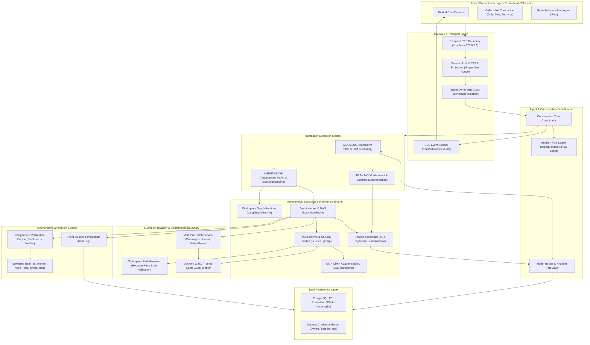
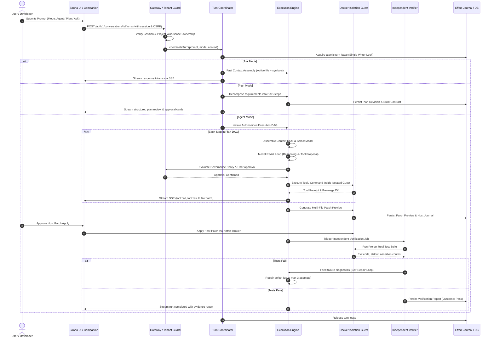

# Sirona Unified Backend Architecture Report

**Platform:** Sirona Unified AI Development Platform  
**Architecture Date:** 2026-10-31  
**Status:** Scoped Production-Oriented Implementation & Modular Specification  
**Authority:** Root `AGENTS.md`, Dual SQLite/PostgreSQL Engine, Stage 01–15 Contracts  

---

## 1. Executive Summary & Vision

Sirona unifies three distinct modern AI development paradigms into a single, cohesive, governed platform:

1. **Cursor-Style AI IDE:** Fast, interactive conversational coding assistance with automatic context assembly (active file, open tabs, code selection, AST symbols), real-time streaming, and read-only diagnostic tools.
2. **Codex-Style Autonomous Coding Agent:** Multi-file autonomous software engineering with structured task execution, file patching with SHA-256 integrity, containerized guest isolation (Docker/WSL2 Home Profile), independent verification against real project test runners, and bounded self-repair.
3. **Hermes-Style Autonomous Agent:** Durable long-term memory (episodic, semantic, architectural decisions), official Model Context Protocol (MCP) tool integration, bounded specialist subagents with strict concurrency limits, and scheduled/event-driven background automation.

Crucially, **this is ONE platform**, not three separate runtimes. The same security boundaries, governance policies, tenant isolation, lease registries, and effect journals govern all three modes.

---

## 2. Unified Architecture & Component Interaction

---

## 3. The Unified Data & Execution Flow

---

## 4. Architectural Boundaries and Responsibility Separation

| Subsystem | Authority | Constraints |
|---|---|---|
| **API Gateway** | Loopback binding (127.0.0.1), session token authentication, CSRF tokens, strict workspace/tenant authorization. | No unauthenticated routes except initial desktop launcher challenge bootstrap. Drives/roots (`C:\`, `/`) forbidden. |
| **Turn Coordinator** | Atomically serializes conversation turns using transactional leases in SQLite/PostgreSQL. | Prevents concurrent competing writers; cancels and reconciles interrupted turns. |
| **Model Router** | Selects optimal provider/model based on task complexity, context window, and cost budgets. | Never exposes plaintext credentials in prompts, logs, or responses. Resolves keys via OS DPAPI/safeStorage. |
| **Context Assembler** | Combines AST symbols, repository index, open tabs, active selection, and semantic memory. | Enforces token and byte limits; redacts credential patterns (`secretLike`); includes SHA-256 preimages. |
| **Tool Runtime** | Executes validated tools (read, write, search, patch, execute) under strict policy rules. | Enforces absolute filesystem containment via `WorkspacePathResolver`. Rejects directory junctions and escapes. |
| **Docker Worker** | Executes shell commands and test runners in disposable Docker/WSL2 container instances. | Never mounts host roots or credentials. Copies workspace snapshots; imports candidate diffs as patches. |
| **Patch Service** | Applies multi-file diffs atomically with preimages and reversible journals. | Rejects patching protected files (`.env`, `.git`, `.ssh`, `.aws`, Sirona system files). |
| **Independent Verifier** | Verifies artifact delivery against real test runner outputs. | Producer cannot act as verifier. If tests did not run, outcome remains honestly `unknown` (never false pass). |
| **Memory & MCP** | Long-term episodic/semantic storage, AST knowledge graph, and official MCP client transports. | MCP tools execute through the same security broker; memory queries strictly scoped by workspace. |

---

## 5. Summary of Unification

The Sirona backend architecture now operates as an integrated, secure, production-grade engine capable of fulfilling:
- The sub-second responsiveness of Cursor for interactive code queries,
- The rigorous autonomy, verification, and isolation of Codex for hands-off engineering tasks, and
- The persistent memory, extensible MCP tooling, and durable scheduling of Hermes.
