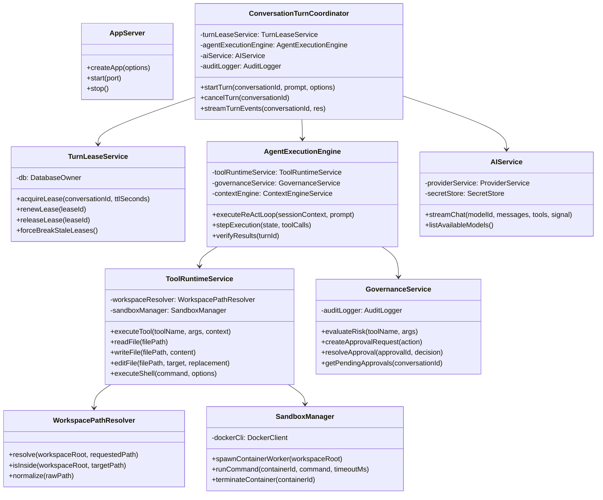
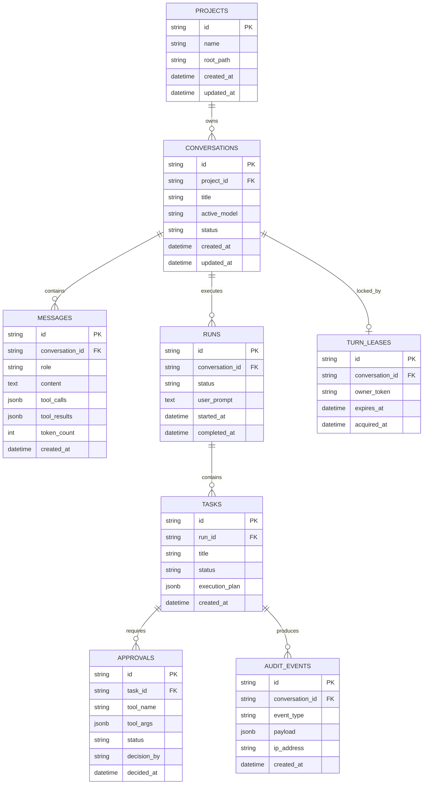

# Sirona Low-Level Design (LLD)

## 1. Subsystem Class & Service Hierarchy



---

## 2. Core Service Specifications

### 2.1 `conversationTurnCoordinator.js`
- **Location**: [`apps/server/services/conversationTurnCoordinator.js`](file:///apps/server/services/conversationTurnCoordinator.js)
- **Role**: Entrypoint and orchestrator for all agent turns. Ensures transactional turn isolation and SSE event stream dispatching.
- **Key Invariants**:
  - Exactly one turn per conversation can execute concurrently.
  - Must acquire a lease before beginning execution; releases lease on completion, error, or cancellation.
  - Emits real-time SSE frames using standard event names:
    - `turn.start`: Emitted with `turnId` and timestamp.
    - `turn.token`: Emitted with incremental text delta tokens.
    - `tool.call`: Emitted when model issues a tool request.
    - `approval.requested`: Emitted if a tool is flagged as high-risk.
    - `tool.result`: Emitted with tool execution result or error.
    - `turn.finish`: Emitted with complete usage, cost, and finish reason.

### 2.2 `turnLeaseService.js`
- **Location**: [`apps/server/services/turnLeaseService.js`](file:///apps/server/services/turnLeaseService.js)
- **Role**: Enforces concurrency limits across distributed or multi-tab requests.
- **Database Table**: `conversation_turn_leases`
- **Lease State Protocol**:
  ```
  [Unleased] ──(acquireLease)──> [Active Lease (TTL 300s)]
       │                                │
       │ (Lease timeout / crash)        ├──(renewLease)──> [Active Lease]
       ▼                                │
  [Stale Lease] ──(forceBreak)──────────┴──(releaseLease)─> [Unleased]
  ```

### 2.3 `workspacePathResolver.js`
- **Location**: [`apps/server/services/workspacePathResolver.js`](file:///apps/server/services/workspacePathResolver.js)
- **Role**: Secure filesystem sandbox boundary enforcement.
- **Algorithm**:
  1. Resolves `workspaceRoot` to canonical realpath.
  2. Resolves `requestedPath` against `workspaceRoot`.
  3. Validates that `path.relative(canonicalRoot, canonicalTarget)` does not start with `..` and does not cross drive letters.
  4. If validation fails, throws error with `code: 'PATH_OUTSIDE_WORKSPACE'`.

### 2.4 `credentialBroker.ts` & `secretStore.js`
- **Location**: [`apps/desktop/src/security/credentialBroker.ts`](file:///apps/desktop/src/security/credentialBroker.ts) and [`apps/server/services/secretStore.js`](file:///apps/server/services/secretStore.js)
- **Role**: Protected DPAPI vault.
- **Lifecycle**:
  1. User enters API key in UI settings.
  2. Frontend sends payload over authenticated IPC channel `credentials:store`.
  3. Electron main process invokes `safeStorage.encryptString(apiKey)`.
  4. Ciphertext buffer is stored in database table `provider_credentials` with unique fingerprint.
  5. When needed for an inference request, `secretStore` requests decrypt via local IPC; the key is held in memory for the duration of the request and scrubbed.

---

## 3. Database Schema Design (PostgreSQL & SQLite)

### Core Schema Tables



---

## 4. API Error Handling: RFC 7807 Problem Details

All API failures return a standardized `application/problem+json` envelope:

```json
{
  "type": "https://sirona.local/errors/PATH_OUTSIDE_WORKSPACE",
  "title": "Access Denied",
  "status": 403,
  "detail": "Path '..\\..\\Windows\\System32' resolves outside the authorized workspace boundary 'C:\\Projects\\MyApp'.",
  "code": "PATH_OUTSIDE_WORKSPACE",
  "instance": "/api/v1/tools/execute"
}
```

### Standard Status Code & Error Taxonomy
| Status | Code | Meaning |
|---|---|---|
| `400` | `INVALID_ARGUMENTS` | Payload validation failure (Zod error) |
| `403` | `PATH_OUTSIDE_WORKSPACE` | Path traversal or boundary escape attempt |
| `403` | `UNAUTHORIZED_TOOL` | Dangerous tool without approved grant |
| `409` | `TURN_LEASE_CONFLICT` | Conversation currently has an active turn |
| `429` | `RATE_LIMIT_EXCEEDED` | Request rate limit exceeded |
| `500` | `INTERNAL_ENGINE_ERROR` | Unhandled runtime failure |
| `503` | `DEPENDENCY_UNREADY` | Database, Docker, or model provider unavailable |
