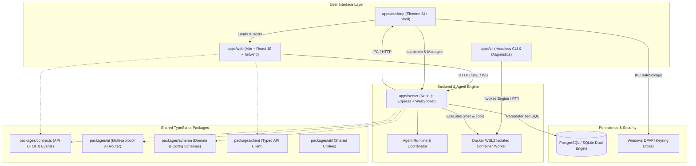
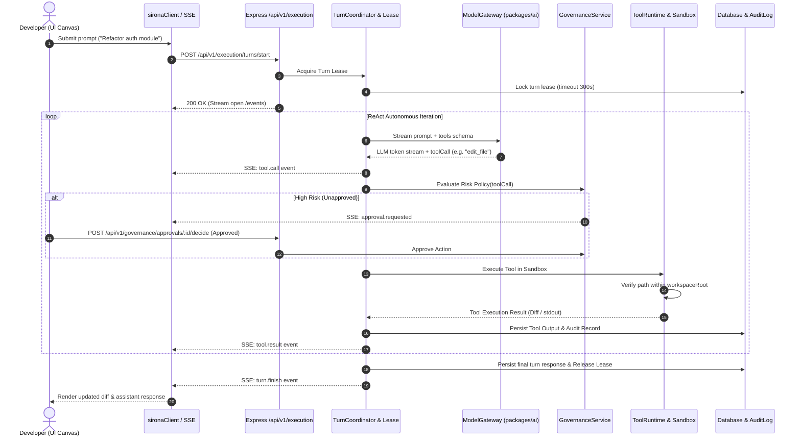

# Sirona System Architecture Specification

## 1. Executive Summary & Principles

Sirona is a local-first, Windows-native AI coding and autonomous agent workspace. The platform provides a secure environment where AI agents operate with least privilege over explicitly authorized local workspace directories, with full auditability, human-in-the-loop governance, and process containment.

### Core Architectural Invariants
1. **Local-First & Contained Execution**: Project code lives exclusively on the user's local filesystem. Tool operations are strictly contained within `workspaceRoot` by [`workspacePathResolver.js`](file:///apps/server/services/workspacePathResolver.js). Absolute paths escaping the workspace root or directory traversal attacks (`..`, symlink jailbreaks) are rejected with `PATH_OUTSIDE_WORKSPACE`.
2. **Credential Isolation via OS Keyring**: AI provider API keys never touch disk in plaintext and are never exposed to renderer processes or remote servers. On Windows, credentials are encrypted via Windows Data Protection API (DPAPI) and Electron's `safeStorage` in [`credentialBroker.ts`](file:///apps/desktop/src/security/credentialBroker.ts).
3. **Dual Database Neutrality & Transaction Isolation**: The persistence tier supports PostgreSQL and SQLite through a shared interface in [`config/db.js`](file:///apps/server/config/db.js). SQL queries adhere to cross-compatible parameterized syntax (`$1, $2`).
4. **Governed ReAct Loop**: AI tool executions run through a phased loop (Plan → Act → Observe → Verify). High-risk operations (destructive filesystem edits, shell execution, credential changes) require human approval through [`governanceService.js`](file:///apps/server/services/governanceService.js).
5. **Contract-First Monorepo**: All wire contracts, DTOs, schemas, and events are strictly defined in [`packages/contracts`](file:///packages/contracts/src/) and [`packages/schema`](file:///packages/schema/src/) before backend service or frontend UI implementation.

---

## 2. Monorepo Topology & Boundaries

The codebase is organized as a pnpm workspace monorepo:

### Module Responsibilities

| Package / Application | Role & Tech Stack | Source Directory | Primary Entrypoint |
|---|---|---|---|
| `apps/server` | Express API, WebSocket, ReAct Agent Runtime, Database Adapters | `apps/server/` | [`server.js`](file:///apps/server/server.js), [`app.js`](file:///apps/server/app.js) |
| `apps/desktop` | Electron host, DPAPI Credential Broker, Terminal WebSocket Proxy | `apps/desktop/` | [`main.cjs`](file:///apps/desktop/src/main.cjs), [`preload.cjs`](file:///apps/desktop/src/preload.cjs) |
| `apps/web` | React 19 UI, Chat Canvas, Model Selector, File Explorer, Terminal | `apps/web/` | [`src/App.tsx`](file:///apps/web/src/App.tsx), [`src/entry.tsx`](file:///apps/web/src/entry.tsx) |
| `apps/cli` | CLI commands, diagnostic runner, tools worker container | `apps/cli/` | [`src/cli.ts`](file:///apps/cli/src/cli.ts) |
| `packages/contracts` | TypeScript wire contracts, request/response DTOs, SSE events | `packages/contracts/` | [`src/index.ts`](file:///packages/contracts/src/index.ts) |
| `packages/ai` | Multi-protocol AI engine (OpenAI, Anthropic, Gemini, Vercel AI SDK) | `packages/ai/` | [`src/index.ts`](file:///packages/ai/src/index.ts) |
| `packages/schema` | Domain entities, Zod/Effect validation schemas | `packages/schema/` | [`src/index.ts`](file:///packages/schema/src/index.ts) |
| `packages/client` | Auto-reconnecting typed HTTP & SSE client | `packages/client/` | [`src/index.ts`](file:///packages/client/src/index.ts) |

---

## 3. High-Level System Layers

### 3.1 Presentation Layer (`apps/web` & `apps/desktop`)
- **Canvas & Chat**: Modern React 19 UI built on modular components:
  - [`MainCanvas.tsx`](file:///apps/web/src/components/MainCanvas.tsx): Multi-tab editor, diff viewer, task plan visualizer, and streaming chat log.
  - [`Sidebar.tsx`](file:///apps/web/src/components/Sidebar.tsx): Active conversation sessions, project selector, and workspace file navigation.
  - [`ModelSelectorModal.tsx`](file:///apps/web/src/components/ModelSelectorModal.tsx): Live model catalog selector across local & remote providers.
  - [`SettingsScreen.tsx`](file:///apps/web/src/components/SettingsScreen.tsx): Provider configuration, approval thresholds, sandbox limits.
- **IPC Security**: The Electron renderer operates with `contextIsolation: true` and `nodeIntegration: false`. The preload script exposes a minimal safe bridge (`window.sironaDesktop`) strictly typed via Electron IPC channels.

### 3.2 Gateway & Routing Layer (`apps/server/routes/v1`)
The Express backend mounts canonical `/api/v1` routes in [`apps/server/routes/index.js`](file:///apps/server/routes/index.js):
- **Identity & Session**: `/api/v1/auth`, `/api/v1/conversations`
- **Projects & Workspace**: `/api/v1/projects`, `/api/v1/workspace`
- **Execution & Turns**: `/api/v1/execution`, `/api/v1/runs`
- **Governance & Approvals**: `/api/v1/governance`, `/api/v1/approvals`
- **Model Providers**: `/api/v1/providers`, `/api/v1/models`
- **Tools & Sandbox**: `/api/v1/tools`, `/api/v1/isolation`
- **Verification & Testing**: `/api/v1/verification`
- **Memory & Intelligence**: `/api/v1/memory`
- **Deployment & Recovery**: `/api/v1/deployment`, `/api/v1/recovery`

### 3.3 Agent Execution Engine Layer
- **Turn Coordinator**: [`conversationTurnCoordinator.js`](file:///apps/server/services/conversationTurnCoordinator.js) acquires a dedicated turn lease via [`turnLeaseService.js`](file:///apps/server/services/turnLeaseService.js) to guarantee single-turn serialized execution per conversation.
- **ReAct Execution Engine**: [`agentExecutionEngine.js`](file:///apps/server/services/agentExecutionEngine.js) orchestrates model invocation, tool execution, and verification.
- **Multi-Protocol AI Engine**: [`packages/ai`](file:///packages/ai/src/) resolves credentials, applies SSRF guards, normalizes schemas, and streams token deltas to clients via SSE.

### 3.4 Tool Sandbox & Containment Layer
- **Filesystem Confinement**: [`workspacePathResolver.js`](file:///apps/server/services/workspacePathResolver.js) resolves all relative and absolute paths against the project root. Rejects all escaping traversal attempts.
- **Docker WSL2 Isolation**: Shell commands and code compilation execute inside an isolated Docker worker container (`tools-worker.Dockerfile`), governed by [`isolationBrokerService.js`](file:///apps/server/services/isolationBrokerService.js) and [`sandboxManager.js`](file:///apps/server/services/sandboxManager.js).
- **PTY Terminal Gateway**: Real-time interactive shell streams pass through [`terminalGateway.js`](file:///apps/server/services/terminalGateway.js) and desktop [`terminalProxy.cjs`](file:///apps/desktop/src/terminalProxy.cjs).

### 3.5 Persistence & Audit Tier
- **Dual-Engine Persistence**: [`config/db.js`](file:///apps/server/config/db.js) provides database abstraction over PostgreSQL (production/server) and SQLite (desktop/local embedded).
- **Audit Logging**: Every action, tool call, approval decision, and file modification is permanently recorded by [`auditLogger.js`](file:///apps/server/services/auditLogger.js) with immutable timestamps and correlation IDs.

---

## 4. End-to-End Sequence: Agent Turn Execution

---

## 5. Security & Isolation Architecture

1. **Path Traversal Defense**: All file operations (`read_file`, `write_file`, `edit_file`, `list_directory`) pass through `resolveWorkspacePath(workspaceRoot, targetPath)`. Symlinks pointing outside the workspace boundary are rejected.
2. **SSRF Guard**: When fetching remote resources or connecting to OpenAI-compatible endpoints, endpoints are validated against IP ranges to deny access to internal loopback (`127.0.0.1`, `localhost`) and link-local cloud metadata addresses (`169.254.169.254`), unless explicitly whitelisted in local development mode.
3. **Execution Containment**: Host commands run within Docker WSL2 containers using non-root container users, clamped memory/CPU quotas, and aggressive execution timeouts (default: 30s).
4. **Credential Confidentiality**: Electron's `safeStorage` encrypts keys on Windows using the machine/user DPAPI key. Decryption happens on-demand in the Electron main process; decrypted keys are never written to disk or sent to the browser renderer.
