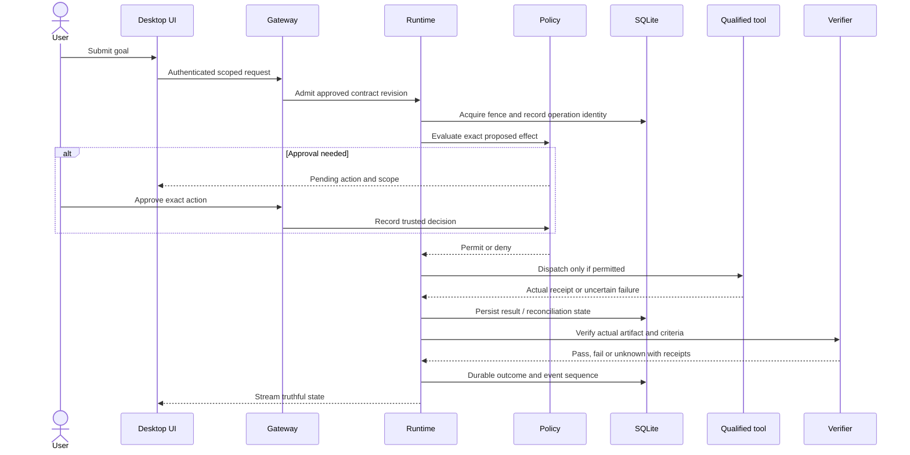

# End-to-End Integration Plan

These are proposed acceptance workflows, not completed test reports. Exact registered routes and source owners are linked through the [inventory](IP00-SOURCE-INVENTORY.md) and [ownership map](SOURCE-OWNERSHIP-MAP.md). Product tests are NOT_RUN in this documentation task.

## W01 — Provider to streaming inference

- **Dependencies:** IP02/IP03; applicable approval gates in audit.
- **Participating components:** SettingsScreen -> window.sirona.saveConnection -> DesktopCredentialBroker -> provider routes/service -> model catalog -> selected exact model ID -> conversationTurnCoordinator -> adapter -> SSE client.
- **Contract/data requirements:** provider_connections/models/model_calls; opaque credential reference; conversation ID, clientTurnId, AbortSignal, usage and terminal outcome.
- **Failure cases:** Wrong credential, empty models, exact ID mismatch, SSRF URL, 429, timeout, interrupted stream, cancel and settlement.
- **Acceptance scenario:** Use controlled upstream for failures; separately approved live inference for final qualification. Verify key never returned to renderer and lease can be reacquired..
- **Evidence:** candidate source hash, isolated target, actual transport/adapter used, command, ordered events, database/receipt assertions and sanitized screenshot/transcript where relevant.
- **Rollback:** cancel admission, preserve uncertain effects and working data; reset only owned fixtures.

## W02 — Folder to permitted command

- **Dependencies:** IP02/IP04; applicable approval gates in audit.
- **Participating components:** pickFolder IPC -> project registration -> workspace readiness/root binding -> WorkspacePathResolver -> governance -> qualified broker/terminal -> receipt -> consumer.
- **Contract/data requirements:** Project/root identity, canonical path, input digest, approval reference, invocation/effect ID, bounded stdout/stderr/exitCode.
- **Failure cases:** Cross-drive/junction traversal, stale root, rejected approval, stopped Docker, oversized output, process timeout.
- **Acceptance scenario:** Actual disposable project and qualified guest; prove no host fallback or workspace-external write; review resulting patch against base digest..
- **Evidence:** candidate source hash, isolated target, actual transport/adapter used, command, ordered events, database/receipt assertions and sanitized screenshot/transcript where relevant.
- **Rollback:** cancel admission, preserve uncertain effects and working data; reset only owned fixtures.

## W03 — Prompt to approved verified change

- **Dependencies:** IP05/IP06; applicable approval gates in audit.
- **Participating components:** Chat -> intent/clarification -> requirement revision -> plan/Build Contract -> approval -> run admission -> execution -> artifact -> trusted verifier -> result UI.
- **Contract/data requirements:** Requirement/plan/contract revision IDs; policy profile; artifact digest; immutable criteria; verifier receipt.
- **Failure cases:** Ambiguous goal, scope edit, expired approval, bad artifact, missing check, repair budget exhaustion.
- **Acceptance scenario:** Real small coding task with intentionally failing test; approved repair and independently executed tests; absent evidence must yield unknown..
- **Evidence:** candidate source hash, isolated target, actual transport/adapter used, command, ordered events, database/receipt assertions and sanitized screenshot/transcript where relevant.
- **Rollback:** cancel admission, preserve uncertain effects and working data; reset only owned fixtures.

## W04 — Tool call to continuation

- **Dependencies:** IP04/IP06; applicable approval gates in audit.
- **Participating components:** Model proposal -> schema validation -> policy -> approval -> effect journal -> tool/guest -> receipt -> context -> next model activity.
- **Contract/data requirements:** Tool revision, server-derived risk/scope, operation key, fence, input/output digests, receipt and tool message.
- **Failure cases:** Forged risk/actor, stale grant, repeated operation, malformed output, cancellation during dispatch, unknown result.
- **Acceptance scenario:** Actual effect with crash injection around dispatch/receipt boundaries; no duplicate application; context includes truthful tool result..
- **Evidence:** candidate source hash, isolated target, actual transport/adapter used, command, ordered events, database/receipt assertions and sanitized screenshot/transcript where relevant.
- **Rollback:** cancel admission, preserve uncertain effects and working data; reset only owned fixtures.

## W05 — Persistence across Electron restart

- **Dependencies:** IP01/IP02/IP10; applicable approval gates in audit.
- **Participating components:** Conversation route -> scoped owner -> SQLite -> durable message/run state -> desktop restart/bootstrap -> history lookup -> UI restoration.
- **Contract/data requirements:** Workspace/principal/session IDs, message ordering, persisted run status, event cursor; no inferred in-memory state.
- **Failure cases:** Crash mid-write, SQLITE_BUSY, broken record, expired auth, unavailable database, unfinished turn.
- **Acceptance scenario:** Isolated file database and real Electron process restart; compare durable IDs/content; no new duplicate user message..
- **Evidence:** candidate source hash, isolated target, actual transport/adapter used, command, ordered events, database/receipt assertions and sanitized screenshot/transcript where relevant.
- **Rollback:** cancel admission, preserve uncertain effects and working data; reset only owned fixtures.

## W06 — Delegation and independent review

- **Dependencies:** IP07/IP08; applicable approval gates in audit.
- **Participating components:** Run -> LangGraph -> durable admission -> max-three specialists -> proposals/artifacts -> separate reviewer -> consolidation -> approval/verification.
- **Contract/data requirements:** Parent/child identity, bounded context, shared contract revision, admission token, artifact digest and review verdict.
- **Failure cases:** Fourth concurrent request, nested delegation, sequential reuse, sibling cancellation, conflicting patch, stale review.
- **Acceptance scenario:** Real authorized model/guest workflow plus deterministic negative tests; reviewer cannot accept substituted artifact or broaden grants..
- **Evidence:** candidate source hash, isolated target, actual transport/adapter used, command, ordered events, database/receipt assertions and sanitized screenshot/transcript where relevant.
- **Rollback:** cancel admission, preserve uncertain effects and working data; reset only owned fixtures.

## W07 — Schedule to delivery

- **Dependencies:** IP11; applicable approval gates in audit.
- **Participating components:** Automation UI/CLI -> schedule store -> atomic due occurrence -> policy -> canonical run -> result -> local notification outbox -> consumer.
- **Contract/data requirements:** Timezone/recurrence, scheduled instant, occurrence uniqueness, run ID, authority revision, delivery identity.
- **Failure cases:** DST gap/fold, sleep/restart, duplicate webhook, overlap, revoked policy, failed delivery.
- **Acceptance scenario:** Real isolated SQLite clock-controlled scheduling and canonical run; one logical occurrence; retry notification without repeating execution..
- **Evidence:** candidate source hash, isolated target, actual transport/adapter used, command, ordered events, database/receipt assertions and sanitized screenshot/transcript where relevant.
- **Rollback:** cancel admission, preserve uncertain effects and working data; reset only owned fixtures.

## W08 — Failure and safe recovery

- **Dependencies:** IP06/IP10; applicable approval gates in audit.
- **Participating components:** Abort/crash -> lease and guest cleanup -> durable effect/checkpoint classification -> reconciliation -> authorized resume or safe stop -> events/UI.
- **Contract/data requirements:** Stable operation key, run epoch/lease fence, checkpoint version/digest, receipt, unknown-outcome marker.
- **Failure cases:** Crash before/after write, missing guest, stale holder, corrupted checkpoint, partial stream, failed cleanup.
- **Acceptance scenario:** Real child-process kill/restart across boundaries; no blanket exactly-once claim; uncertainty blocks retry until proof or explicit reconciliation..
- **Evidence:** candidate source hash, isolated target, actual transport/adapter used, command, ordered events, database/receipt assertions and sanitized screenshot/transcript where relevant.
- **Rollback:** cancel admission, preserve uncertain effects and working data; reset only owned fixtures.

## Governed effect sequence

Disconnect is not authorization to replay mutations. Cancellation requests stop new activities and propagate to provider/guest; a completed irreversible effect is recorded, not represented as undone. Consumer reconnect uses durable sequence and scopes, never client-owned lease authority.
