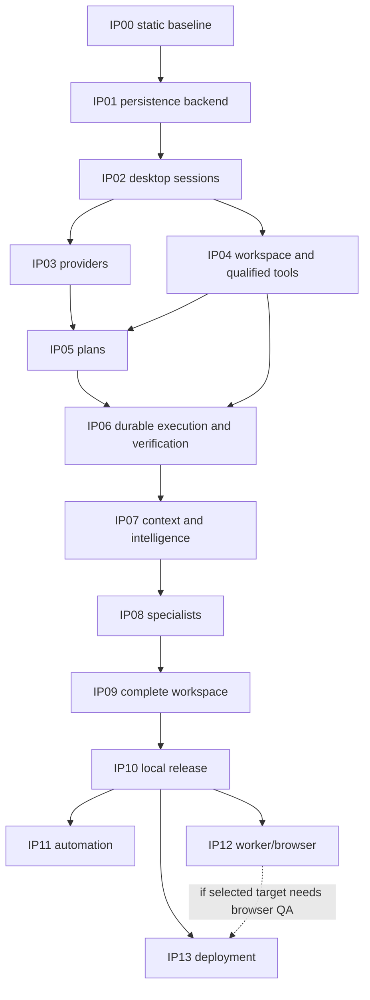

# Implementation Dependency Graph

## Milestones

Critical path: isolated SQLite correctness -> secure sessions/credentials -> real provider + qualified project tools -> immutable approved plans -> durable effects and real verifier -> contextual specialist workflow -> usable desktop -> restore/release qualification. Provider spending and guest qualification are external approval dependencies, not time-based assumptions.

Parallel lanes: IP03 and IP04 after identity contracts; parser/MCP contract design alongside IP06 (no activation); domain UI preparation after C contracts while backend B is built; backup design after IP01 while runtime is completed. Shared owners must have one active writer; parallel work does not authorize delegation or protected changes.

Task prerequisite convention: C requires listed phase prerequisites and IP00-04; B requires C and qualified IP01 persistence where used; U requires B and desktop bootstrap B; V requires B/U and explicit real-boundary gates. Foundational exceptions and milestone exits are defined in [roadmap](IMPLEMENTATION-ROADMAP.md), avoiding persistence/desktop and observability/release cycles.

Data flow: user -> authenticated gateway -> requirements/contract -> policy -> run admission -> model/context -> proposed tool -> exact authority -> guest/patch -> receipt -> independent verifier -> durable event -> UI. Every retry consults durable operation identity; every scope change invalidates prior approval.

## Exact task predecessor register

This register is authoritative for task dependencies; prose phase references describe milestones. Each row also requires the applicable approval gates. Transitive dependencies are not repeated. No cycles or undefined predecessor IDs were found in a static graph check of these 106 records. External approvals are not assumed satisfied.

| Task | Required predecessor tasks |
|---|---|
| IP00-01 | None; documentation inventory only |
| IP00-02 | IP00-01 |
| IP00-03 | IP00-01 |
| IP00-04 | IP00-02, IP00-03 |
| IP01-F03-C | IP00-04 |
| IP01-01 | IP00-04 |
| IP01-02 | IP01-01 |
| IP01-03 | IP01-02, IP01-F03-C |
| IP01-F03-B | IP01-F03-C, IP01-03 |
| IP01-F20-C | IP00-04 |
| IP01-F20-B | IP01-F20-C, IP01-03 |
| IP02-F01-C | IP01-F03-B, IP01-F20-B |
| IP02-F01-B | IP02-F01-C, IP01-03 |
| IP02-F22-C | IP01-F03-B, IP01-F20-B |
| IP02-F22-B | IP02-F22-C, IP01-03 |
| IP02-F01-U | IP02-F01-B, IP02-F22-B |
| IP02-F01-V | IP02-F01-B, IP02-F01-U |
| IP02-F02-C | IP01-F03-B, IP01-F20-B |
| IP02-F02-B | IP02-F02-C, IP01-03 |
| IP02-F02-U | IP02-F02-B, IP02-F22-B |
| IP02-F02-V | IP02-F02-B, IP02-F02-U |
| IP01-F03-U | IP01-F03-B, IP02-F22-B |
| IP01-F03-V | IP01-F03-B, IP01-F03-U |
| IP02-F22-U | IP02-F22-B |
| IP02-F22-V | IP02-F22-B, IP02-F22-U |
| IP03-F04-C | IP02-F01-V, IP02-F02-V, IP01-F03-V, IP02-F22-V |
| IP03-F04-B | IP03-F04-C, IP01-03 |
| IP03-F04-U | IP03-F04-B, IP02-F22-B |
| IP03-F04-V | IP03-F04-B, IP03-F04-U |
| IP03-F05-C | IP02-F01-V, IP02-F02-V, IP01-F03-V, IP02-F22-V |
| IP03-F05-B | IP03-F05-C, IP01-03 |
| IP03-F05-U | IP03-F05-B, IP02-F22-B |
| IP03-F05-V | IP03-F05-B, IP03-F05-U |
| IP04-F08-C | IP02-F01-V, IP02-F02-V, IP02-F22-V |
| IP04-F08-B | IP04-F08-C, IP01-03 |
| IP05-F06-C | IP03-F04-V, IP03-F05-V, IP04-F08-B |
| IP05-F06-B | IP05-F06-C, IP01-03 |
| IP05-F06-U | IP05-F06-B, IP02-F22-B |
| IP05-F06-V | IP05-F06-B, IP05-F06-U |
| IP05-F07-C | IP03-F04-V, IP03-F05-V, IP04-F08-B |
| IP05-F07-B | IP05-F07-C, IP01-03 |
| IP05-F07-U | IP05-F07-B, IP02-F22-B |
| IP05-F07-V | IP05-F07-B, IP05-F07-U |
| IP04-F08-U | IP04-F08-B, IP02-F22-B |
| IP04-F08-V | IP04-F08-B, IP04-F08-U |
| IP04-F11-C | IP02-F01-V, IP02-F02-V, IP02-F22-V |
| IP04-F11-B | IP04-F11-C, IP01-03 |
| IP04-F11-U | IP04-F11-B, IP02-F22-B |
| IP04-F11-V | IP04-F11-B, IP04-F11-U |
| IP04-F12-C | IP02-F01-V, IP02-F02-V, IP02-F22-V |
| IP04-01 | IP00-02, IP02-F02-B |
| IP04-F12-B | IP04-F12-C, IP01-03, IP04-01 |
| IP04-F12-U | IP04-F12-B, IP02-F22-B |
| IP04-F12-V | IP04-F12-B, IP04-F12-U |
| IP06-F09-C | IP05-F06-V, IP05-F07-V, IP04-F08-V, IP04-F11-V, IP04-F12-V |
| IP06-F09-B | IP06-F09-C, IP01-03 |
| IP06-F09-U | IP06-F09-B, IP02-F22-B |
| IP06-F09-V | IP06-F09-B, IP06-F09-U |
| IP06-F15-C | IP05-F06-V, IP05-F07-V, IP04-F08-V, IP04-F11-V, IP04-F12-V |
| IP06-F15-B | IP06-F15-C, IP01-03 |
| IP06-F15-U | IP06-F15-B, IP02-F22-B |
| IP06-F15-V | IP06-F15-B, IP06-F15-U |
| IP07-F13-C | IP06-F09-V, IP06-F15-V |
| IP07-F13-B | IP07-F13-C, IP01-03 |
| IP07-F13-U | IP07-F13-B, IP02-F22-B |
| IP07-F13-V | IP07-F13-B, IP07-F13-U |
| IP07-F14-C | IP06-F09-V, IP06-F15-V |
| IP07-F14-B | IP07-F14-C, IP01-03 |
| IP07-F14-U | IP07-F14-B, IP02-F22-B |
| IP07-F14-V | IP07-F14-B, IP07-F14-U |
| IP08-F10-C | IP07-F13-V, IP07-F14-V |
| IP08-F10-B | IP08-F10-C, IP01-03 |
| IP08-F10-U | IP08-F10-B, IP02-F22-B |
| IP08-F10-V | IP08-F10-B, IP08-F10-U |
| IP09-F23-C | IP08-F10-V |
| IP09-F23-B | IP09-F23-C, IP01-03 |
| IP01-F20-U | IP01-F20-B, IP02-F22-B, IP09-F23-B |
| IP01-F20-V | IP01-F20-B, IP01-F20-U |
| IP09-F23-U | IP09-F23-B, IP02-F22-B |
| IP09-F23-V | IP09-F23-B, IP09-F23-U |
| IP09-F24-C | IP08-F10-V |
| IP09-F24-B | IP09-F24-C, IP01-03 |
| IP09-F24-U | IP09-F24-B, IP02-F22-B |
| IP09-F24-V | IP09-F24-B, IP09-F24-U |
| IP10-F21-C | IP09-F23-V, IP09-F24-V |
| IP10-F21-B | IP10-F21-C, IP01-03 |
| IP10-F21-U | IP10-F21-B, IP02-F22-B |
| IP10-F21-V | IP10-F21-B, IP10-F21-U |
| IP06-01 | IP02-F01-B, IP02-F02-B |
| IP10-01 | IP02-F01-V, IP02-F02-V, IP01-F03-V, IP03-F04-V, IP03-F05-V, IP05-F06-V, IP05-F07-V, IP04-F08-V, IP06-F09-V, IP08-F10-V, IP04-F11-V, IP04-F12-V, IP07-F13-V, IP07-F14-V, IP06-F15-V, IP01-F20-V, IP10-F21-V, IP02-F22-V, IP09-F23-V, IP09-F24-V, IP06-01 |
| IP12-F16-C | IP10-01 |
| IP12-F16-B | IP12-F16-C, IP01-03 |
| IP12-F16-U | IP12-F16-B, IP02-F22-B |
| IP12-F16-V | IP12-F16-B, IP12-F16-U |
| IP11-F17-C | IP10-01 |
| IP11-F17-B | IP11-F17-C, IP01-03 |
| IP11-F17-U | IP11-F17-B, IP02-F22-B |
| IP11-F17-V | IP11-F17-B, IP11-F17-U |
| IP12-F18-C | IP10-01 |
| IP12-F18-B | IP12-F18-C, IP01-03 |
| IP12-F18-U | IP12-F18-B, IP02-F22-B |
| IP12-F18-V | IP12-F18-B, IP12-F18-U |
| IP13-F19-C | IP10-01 |
| IP13-F19-B | IP13-F19-C, IP01-03 |
| IP13-F19-U | IP13-F19-B, IP02-F22-B |
| IP13-F19-V | IP13-F19-B, IP13-F19-U |
