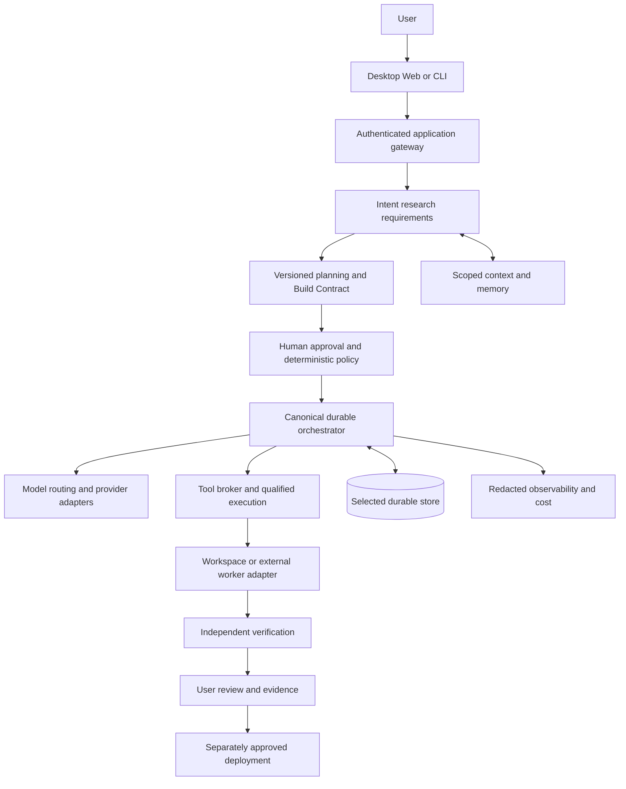
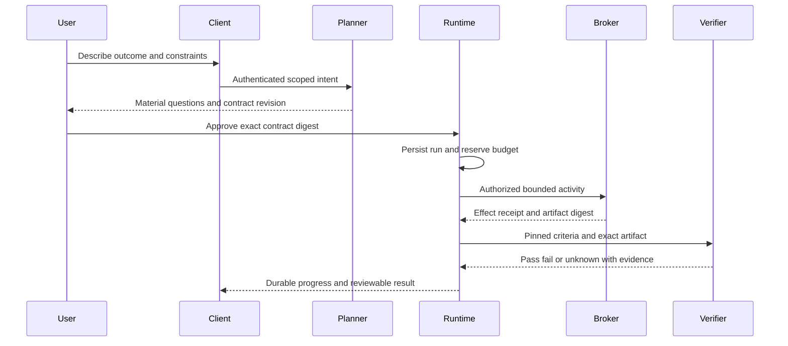
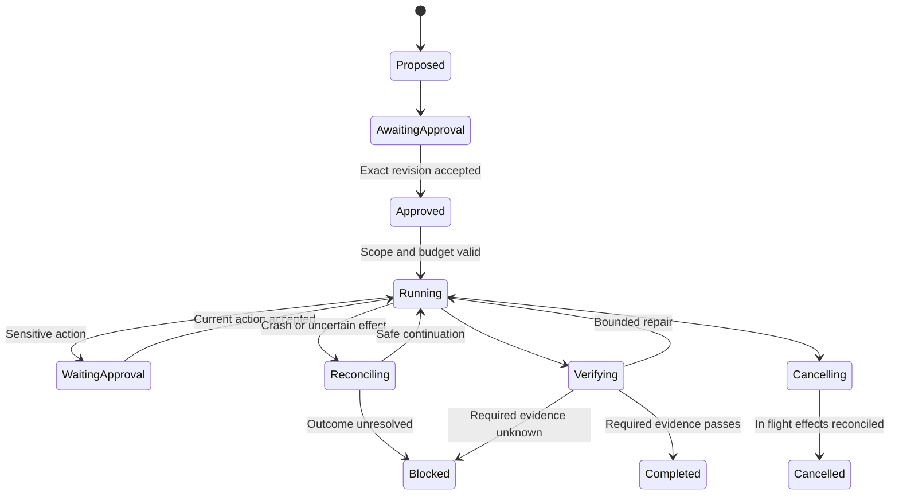
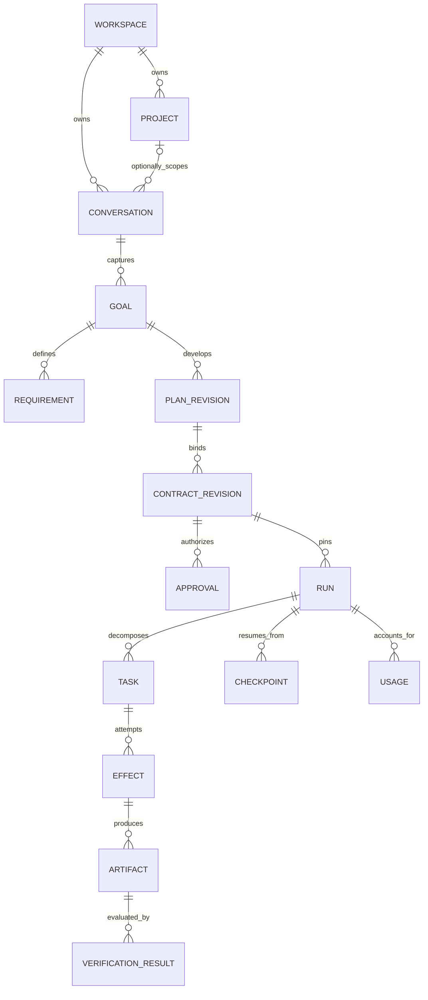

> Implementation planning now routes to [the canonical master plan](MASTER-IMPLEMENTATION-PLAN.md). This document remains a proposed documentation taxonomy, not a competing execution roadmap or activation approval.

# Sirona System Design and Spec Driven Documentation Plan

## 1 Purpose and recommendation

Sirona should become a governed creation platform that turns user intent into an approved specification, bounded execution and independently verified results. The orchestrator owns the goal, plan, permissions, budgets, recovery and completion decision. Models and external developer tools provide replaceable reasoning and execution capabilities. ASI is a product aspiration, not a scientific capability claim.

Keep the existing Windows desktop, Express backend, React frontend and shared packages. Improve the existing nine feature bundles instead of recreating the repository. Use a modular monolith with separate operating-system and execution boundaries. A documentation folder is a domain boundary, not an instruction to create a microservice or a new software framework.

This deliverable plans the documentation and its implementation handoffs. It does not approve product coding, data conversion, migrations, paid inference, tool-image activation, production deployment or deletion. Proposed paths below are targets, not claims that files already exist. Existing source presence is distinguished from real workflow qualification.

The source product idea remains an input, unchanged. Its broad vision is retained; premature implementation is deferred rather than silently removed. The immediate workflow is **idea → approved Build Contract → working local application → independent verification → user review**. Production deployment is a later, separately approved effect.

## 2 Evidence and current repository reality

Inspection date: 4 November 2026. This is focused architecture reconnaissance, not a complete security audit or a fresh runtime qualification. No model calls, working-database tests, migrations or application restarts were performed for this plan.

| Area | Observed evidence | Classification and consequence |
|---|---|---|
| Documentation foundation | `docs/INDEX.md`; nine folders under `docs/features/`, each with SPEC, CONTRACTS, IMPLEMENTATION-GUIDE and VERIFICATION | Existing. Extend and correct; do not generate a competing documentation system. |
| Monorepo | `apps/server`, `apps/desktop`, `apps/web`, `apps/cli`, `packages/contracts`, `packages/ai`, `packages/schema`, `packages/client` | Existing structure. Preserve paths and package ownership. |
| API registration | `apps/server/routes/index.js` mounts identity, conversations, projects, governance, providers, execution, isolation, tools, verification, memory, automation, deployment, recovery and workspace routers | Registered source, not evidence that every route works end to end. |
| Persistence | `apps/server/config/db.js` delegates its default owner to SQLite and supports an injected custom Pool | SQLite source observed. An injected test Pool is not proof of a production PostgreSQL profile. |
| Database authority | Root AGENTS and system architecture describe dual engines; ADR-001 describes SQLite-only; STOP-01 still describes dual-engine prerequisites | Conflicting. Record exact owner decision and align documents before DB-dependent implementation. Preserve existing stores. |
| Provider stack | `apps/server/services/providerService.js`, `aiService.js`, `packages/ai/src/providers.ts`; adapter and parity test files exist | Partial qualification in this review. Do not label every listed vendor supported merely because an adapter file exists. |
| Orchestration | `apps/server/src/orchestration/workspaceGraph.ts` contains StateGraph planning, bounded fanout, review, approval, execution and verification nodes | Implemented source; current live-provider and guest acceptance remain gated. |
| Intent requirements | `apps/server/services/intentRequirementService.js` explicitly calls itself a stub and returns an empty list | Stub. Inspect other planning owners and callers before deciding whether to replace or retire it. |
| Memory | `apps/server/services/memoryService.js` defines user, project, task, episodic, semantic, decision, failure and evaluation kinds | Source exists. Scope enforcement, freshness and real retrieval require verification. |
| Workspace paths | `apps/server/services/workspacePathResolver.js` includes canonical root and containment checks | Source exists. Security claims need adversarial filesystem tests, not comments alone. |
| CLI | `apps/cli/src/cli.ts` exposes status and read-only TUI diagnostics | Narrow implementation. Full run/approval/project CLI workflows are planned, not delivered. |
| Recovery | `apps/server/services/releaseRecoveryService.js` returns RECOVERY_NOT_CONFIGURED for backup/restore operations | Explicitly unavailable. Never document it as a qualified restore capability. |
| Documentation gaps | `apps/cli/AGENTS.md` and `packages/client/AGENTS.md` absent; provider guide references absent `apps/server/controllers/providerController.js` | Missing navigation and stale ownership reference. Fix docs from actual routes/services. |
| Status contradictions | `docs/engineering/IMPLEMENTATION-ROADMAP.md` marks P5/P6 complete; governance still blocks live-provider and Gate B qualification | Conflicting evidence levels. Preserve historical results; correct present-tense claims. |
| Docs validation | `scripts/docs.js` skips file URLs and checks a subset of links | Partial validation. A green result cannot establish source-path, frontmatter, anchor or workflow correctness. |

The repository README also points to older `sironadocs` navigation. Reconcile those pointers rather than sending agents into stale plans. A source file or green fixture must never be promoted automatically to VERIFIED IMPLEMENTATION.

## 3 Lessons from OpenClaw and OpenCode

These are reference patterns, not dependencies or instructions that override Sirona governance. Public repositories were inspected on 4 November 2026; upstream branches can change.

**OpenClaw:** root instructions route work to scoped owners; `docs/AGENTS.md` separates documentation authorship, publishing, generated references and link validation. Its docs contain gateway, concepts, providers, tools, CLI, automation, security, architecture and reference areas. Adopt focused reading paths, explicit ownership and generated reference discipline. Do not copy its channels, plugin surface or operational permissions into Sirona's local MVP. Sources: [root instructions](https://github.com/openclaw/openclaw/blob/main/AGENTS.md), [documentation instructions](https://github.com/openclaw/openclaw/blob/main/docs/AGENTS.md), [docs tree](https://github.com/openclaw/openclaw/tree/main/docs).

**OpenCode:** its repository instructions cover package dependencies and generated clients. Public user documentation lives in `packages/web/src/content/docs` with topic pages such as providers, models, permissions, server, CLI, rules, MCP, skills and SDK. Adopt a clear distinction between developer instructions, user guides and generated interface references. Do not adopt its package manager, runtime or UI merely to imitate its structure. Sources: [root instructions](https://github.com/anomalyco/opencode/blob/dev/AGENTS.md), [documentation tree](https://github.com/anomalyco/opencode/tree/dev/packages/web/src/content/docs), [project rule documentation](https://github.com/anomalyco/opencode/blob/dev/packages/web/src/content/docs/rules.mdx).

Neither inspected structure establishes a universal four-Markdown-file rule per feature. That is Sirona's useful internal specification convention. Keep public usage documentation separate from implementation authority. Runtime workspace AGENTS files, product-user instructions and the repository's contributor AGENTS files are different artifacts with different trust scopes.

## 4 Scope simplification and cleanup decisions

| Keep now | Consolidate | Defer from first release |
|---|---|---|
| Existing app/package boundaries and frontend design | Repeated architecture prose into one authoritative owner | Cloud control plane, teams, billing and collaboration |
| Canonical API clients, credential broker, approvals, effect and checkpoint owners | Provider ownership between server and `packages/ai` after caller review | Multiple cloud deployments, marketplaces and unrestricted computer control |
| Four-document feature bundles | Gateway transport and model routing terminology; they are different responsibilities | Always-running specialist swarms and recursive delegation |
| Source-backed verification and durable evidence | Conflicting phase status tables into one evidence-backed ledger | Kafka, Kubernetes, microservices, additional databases without measured need |
| Exact model IDs, native chat behavior, cancellation and usage | Duplicate roadmaps through an explicit mapping, not renumbering | All IDE vendors at once; qualify one supported worker adapter first |
| SQLite data and historical PostgreSQL stores | Twenty planning perspectives into one versioned plan with linked views | Graph database and vector infrastructure until retrieval evaluations justify them |

“Unwanted” means redundant or unjustified for the release, not merely old. Do not delete code from this plan. Before a later removal: inspect static/dynamic imports, registries, scripts, tests, migrations, public contracts, license notices and saved data. Record old path, replacement, callers, approval, source hash and rollback. Archive superseded documents with pointers; preserve approval provenance. Never delete tests to obtain a pass.

## 5 Target documentation folder architecture

This is a proposed destination. Retain existing feature names to avoid a mass move. New bundles are authored when their scope is reviewed; do not create empty directories or placeholder specifications.

```text
AGENTS.md                              # Global rules and concise navigation
apps/{server,desktop,web,cli}/AGENTS.md  # Scoped source ownership
packages/{contracts,ai,schema,client}/AGENTS.md

docs/
  AGENTS.md                            # Authoring and validation rules
  INDEX.md                             # Canonical entry and feature catalog
  governance/
    ACTIVE-STOP-RULES.md                # Active gates only, with provenance
    DOCUMENTATION-AUTHORITY-HIERARCHY.md
    ARCHITECTURE-DECISION-REGISTRY.md    # Existing ADR IDs remain stable
    APPROVAL-REGISTER.md                # Scope, revision, expiry, owner decision
  architecture/
    SYSTEM-ARCHITECTURE.md              # Boundaries, actors, deployment topology
    LOW-LEVEL-DESIGN.md                 # Owners, ports, state machines
    PRODUCT-SCOPE.md                    # MVP, V1, V2 and long-term boundaries
    DOMAIN-OWNERSHIP.md                 # One writer per domain responsibility
    DATA-OWNERSHIP.md                   # Entities, relations, durability rules
    SECURITY-THREAT-MODEL.md             # Trust boundaries and mitigations
    QUALITY-ATTRIBUTES.md               # Reliability, cost, performance targets
    diagrams/                          # Editable Mermaid source; no extra authority
  engineering/
    AUDIT-AND-GAP-ANALYSIS.md
    IMPLEMENTATION-ROADMAP.md
    EXECUTION-LEDGER.md                 # Task, owner, dependency, gate, evidence
    CONFLICT-REGISTER.md                # Contradiction and approved resolution
    REQUIREMENT-COVERAGE.md             # Product idea to feature and acceptance
    DOCUMENTATION-MIGRATION-MAP.md      # Keep, amend, merge, archive, remove
    AGENT-HANDOFF.md                    # Current bounded task and next dependency
    templates/
      SPEC.md
      CONTRACTS.md
      IMPLEMENTATION-GUIDE.md
      VERIFICATION.md
      TASK.md
      EVIDENCE.md
  features/
    gateway-and-transport/              # HTTP, SSE, WebSocket and lifecycle
    identity-and-security/              # Local identity, sessions, scope and vault
    sessions-and-persistence/           # Existing bundle; DB and conversation state
    model-providers-and-gateway/        # Existing; inference gateway only
    model-routing-and-budgets/          # Eligibility, costs, routing evaluations
    intent-research-and-requirements/   # Intent, clarification, provenance
    planning-and-build-contracts/       # Layered plans and immutable approvals
    approvals-and-governance/           # Existing; deterministic policy
    agent-runtime-and-loop/             # Existing; one canonical execution owner
    specialists-and-reviews/            # Bounded delegation and structured critique
    workspace-and-filesystem/           # Existing; roots, patches, Git and artifacts
    tool-execution-and-sandbox/         # Existing; dispatch, receipts, containment
    mcp-and-code-intelligence/          # Existing; MCP, parser, search and LSP
    context-memory-and-skills/          # Retrieval, memory, skill loading
    verification-and-product-quality/  # Independent technical and UX verification
    developer-environment-adapters/    # Replaceable external coding workers
    scheduling-events-and-notifications/
    browser-and-computer-runtime/      # Later gated capability
    deployment-and-integrations/       # Later external effects
    observability-and-evaluation/      # Traces, metrics and model evaluations
    release-backup-and-recovery/       # Installer, backup, restore, rollback
    desktop-shell-and-security/        # Existing
    frontend-canvas-and-ui/             # Existing
    cli/                               # Existing diagnostic CLI and future commands
  journeys/
    IDEA-TO-VERIFIED-APPLICATION.md
    EXISTING-REPOSITORY-CHANGE.md
    CANCEL-AND-RESUME.md
    SCHEDULED-REPOSITORY-REVIEW.md
    DEPLOYMENT-WITH-APPROVAL.md
  reference/
    API-ROUTE-SURFACE.md                # Observed routes; proposed routes separate
    DATABASE-SCHEMA-CATALOG.md          # Observed dialect/schema and migrations
    EVENT-CATALOG.md
    CONFIGURATION-CATALOG.md           # Names and safe examples, never secrets
    ERROR-CATALOG.md
    CLI-COMMANDS.md
    GLOSSARY.md
    providers/                         # Vendor-specific supported integration facts
    research/                          # Dated primary sources and limitations
  operations/
    LOCAL-SETUP.md
    DIAGNOSTICS.md
    BACKUP-AND-RESTORE.md
    UPDATE-AND-ROLLBACK.md
    INCIDENT-RESPONSE.md
  evidence/
    README.md                          # Redaction, retention and evidence format
    <feature>/<run-id>/                 # Sanitized manifest and linked artifacts
  _archive/legacy/                      # Historical, never current authority
```

Every feature folder contains the same four core files. Optional diagrams, fixtures or task files are added only when referenced and useful. Do not create a second feature README, local roadmap and local status ledger repeating the same content. Use SPEC as the feature landing page and the central execution ledger for current work.

Root AGENTS links to governance, package AGENTS and INDEX. Package AGENTS links to the features it owns. Each SPEC links back to INDEX and to prerequisite feature contracts. A docs-local AGENTS file does not automatically govern source files elsewhere; the package instruction must establish that connection.

## 6 The four document contract

### SPEC

Include feature ID, purpose, actors, user journeys, current source reality, target behavior, scope, exclusions, requirement IDs, dependencies, permissions, nonfunctional targets, failure cases, UX states, alternatives and decision gates. Separate existing, partial, stub/mock, missing, proposed, uncertain and externally dependent behavior. Each requirement has a measurable acceptance criterion. A provider list must distinguish discovered, configured, eligible and qualified states.

### CONTRACTS

For each actual or proposed interface record method/route or IPC/CLI operation, owner, request/response schemas, validation and bounds, auth/CSRF/scope, error codes, idempotency, concurrency preconditions, cancellation, deadlines, retry policy, events/replay, version compatibility and data retention. Include internal service ports and persisted state transitions, not only HTTP. Link canonical types in `packages/contracts` and runtime schemas; do not make Markdown a competing schema implementation. Label examples as illustrative and never include credentials.

### IMPLEMENTATION GUIDE

Map exact files and symbols from caller to owning service and persistence. Identify reuse before new code. Specify prerequisites, allowed edits, approval scope, migration need, source-to-target deltas, dependency-ordered tasks, frontend states, logs/metrics, failure handling, test fixtures, rollback and non-goals. Every task names its parent requirement, dependency, deliverable, proof command and completion condition. Avoid instructions such as “add a gateway” without identifying the real dispatch owner.

### VERIFICATION

Map requirement → criterion → source → test → evidence → result. Include positive, negative, concurrency, restart, cancellation, security, UI/CLI and performance checks. Record exact command, working directory, runtime, fixture/dataset, source revision/hash, environment, approval reference and result. Unit/contract tests can use explicit fixtures; product acceptance must identify the real boundary exercised. Missing provider/image/DB qualification yields BLOCKED or UNVERIFIED, not PASS. Do not run live tests from a documentation validator.

### Shared metadata and status

Retain the YAML fields required by `docs/AGENTS.md`: title, summary, read_when, owning_subsystem and primary_source_files. Add feature_id, design_status, implementation_status, verification_status, dependencies, source_revision and last_verified when evidence exists. Do not fill last_verified with an authoring date.

Design approval, implementation progress, verification and activation are separate dimensions. Use existing governance labels for design; use per-criterion PASS, FAIL, UNKNOWN, BLOCKED or NOT_RUN in evidence. A feature is VERIFIED only for the explicitly tested profile and source revision. Generated ledgers may summarize evidence but cannot grant approval.

## 7 Feature planning and implementation cards

Each card below defines what the four documents must cover and the first implementation slice. All slices are proposals. Exact affected symbols, registered routes and schema deltas must be resolved from source before implementation. They are not permission to bypass the existing gates.

### F01 Gateway and transport

Plan the distinction between application ingress and inference routing. Own server startup, readiness, HTTP/Origin/Host checks, session middleware, body limits, safe errors, SSE reconnect and WebSocket handshakes. Reuse `apps/server/app.js`, `server.js`, `routes/index.js`, `foundation/` and typed clients. Implement one authenticated request-to-service path and one ordered reconnectable event stream before broader transports. Document connection ownership, backpressure, event retention and disconnect behavior. Verify wrong Origin/Host, expired session, malformed input, slow consumer, restart replay and shutdown cleanup. Depends on F02/F03; never add another gateway service simply for naming symmetry.

### F02 Identity security and credential ownership

Plan local principal/workspace identity, session expiry/revocation, browser versus desktop authentication, worker identity and DPAPI boundary. Reuse `apps/server/services/identityService.js`, `middleware/sessionAuth.js` and `apps/desktop/src/security/credentialBroker.ts`. Implement mandatory scope checks at service/persistence boundaries and allowlisted IPC; frontend displays configuration state without reading keys back. Contracts distinguish secret references from one-time trusted submission. Verify cross-workspace access, forged worker identity, CSRF, revoked credentials, renderer isolation and safe logs. Headless credential storage is a separate design decision; do not invent a plaintext CLI fallback.

### F03 Sessions and persistence

Plan conversation/message ownership, durable operations, schema evolution and engine topology. Inspect `apps/server/config/db.js`, `config/sqliteDb.js`, `migrations/`, models and DTO serializers. First reconcile ADR-001, root instructions, STOP-01 and actual owner behavior. Then qualify an explicit isolated-store test harness before database feature tests. Document transaction ownership, cancellation, busy handling, writer serialization, constraints, 64-bit values, timestamps, JSON, close behavior and migration checksums. SQLite and PostgreSQL parameter syntax does not establish semantic equivalence. Verify rollback, crash, pool/connection reuse where applicable, disk-full behavior and preservation. No working-store conversion in this plan.

### F04 Model providers and inference gateway

Plan direct API-key, supported OAuth and local-endpoint profiles separately from coding workers. Reuse `providerService.js`, `aiService.js`, `conversationTurnCoordinator.js`, provider routes and `packages/ai`. Trace which owner authenticates, discovers, invokes and persists usage. Implement one qualified provider through the existing model picker and chat stream before expanding vendors. Preserve exact IDs and native model identity; unknown capabilities remain unknown. Contracts include text/tool/structured output events, usage, errors and AbortSignal semantics. Verify auth failure, rate limit, timeout, interrupted stream, cancel/lease release, malformed tool output and no fallback after partial effects. Live inference stays behind STOP-02 and an exact spend approval.

### F05 Routing budgets and cost intelligence

Plan hard eligibility before scoring: capabilities, privacy, context, health, exact pinning and budget. Reuse provider registry and governance budget owners. Implement deterministic routing explanations, conservative reservations and one-time usage settlement; unknown charges remain reserved. Use integer or exact decimal accounting, never binary float totals for money. Frontend shows chosen model, route reason, estimated versus reported usage and budget exhaustion. Verify concurrent reservations, retry accounting, unavailable prices, cancellation, disallowed fallback and pinned model preservation. Routing improvements require offline evaluation and reviewed policy versions; no self-editing production policy.

### F06 Intent research and requirements

Plan goal, literal request, assumptions, constraints, material unknowns and measurable outcomes. The inspected `intentRequirementService.js` is a stub; inspect other goal/planning owners before replacing it. Implement one persisted intent-to-requirement workflow with provenance and valuable clarification only. Research uses bounded trusted adapters, records source/date/claim and treats retrieved instructions as untrusted data. UI progresses from concise brief to inspectable requirements. Verify vague intent, conflicting requirements, stale sources, malicious page instructions, unanswered material questions and assumption revision. Depends on identity, persistence and provider boundaries; no immediate code generation for unapproved complex work.

### F07 Layered planning and Build Contracts

Plan all twenty perspectives from the product idea as linked views of one versioned plan: intent; product strategy; requirements; UX; functional, technical, data, API, AI, integration, security and infrastructure architecture; implementation; testing; verification; deployment; operations; cost; risk; maintenance. Do not require twenty independent documents for a one-line fix. Applicability and rationale are explicit.

Reuse goal/plan/contract owners discovered in the service and route inventory. Implement requirement coverage and dependency DAG, then immutable contract revision, digest and user approval. UI exposes executive plan, details, decisions and evidence progressively. Verify cycles, uncovered criteria, unapproved revisions, scope changes, replay and pinned-run revisions. A small task may use a compact contract, but cannot omit authority, scope, budget or acceptance. Depends on F06/F08/F05.

### F08 Approvals and governance

Plan the four permission modes: plan_only, ask_before_every_change, autonomous_coding and full_autonomous_build. Ask/Agent/Plan interaction intents must not silently change these permissions. Reuse governance service and approval UI. Implement deterministic allow/deny/approval-required decisions bound to principal, workspace, action digest, contract/policy revision, nonce and expiry. Sensitive external effects always need appropriate approval, including deployment, purchase, publication, protected merge and production data writes. Verify changed bytes, replay, revocation, expiry, wrong scope and approval races at dispatch. Approval of a plan is not blanket approval of every later external action.

### F09 Canonical runtime and durable recovery

Plan one owner for run/task/effect state, with graph and ReAct treated as implementation strategies inside that owner rather than competing engines. Reuse `src/orchestration/workspaceGraph.ts`, `graphRuntime.ts`, execution services, journals, leases and checkpoint adapters. Document queued/running/waiting/paused/cancelling/terminal transitions and the actual persisted vocabulary. Implement one accepted contract to effect receipt to verification report before retiring any legacy caller. Verify fencing, kill/restart, unknown effect outcome, cancel/reconcile, ordered SSE and duplicate delivery. Never promise exactly-once arbitrary external effects. Depends on F03/F07/F08/F12/F15.

### F10 Specialists and structured review

Plan ephemeral specialists with purpose, parent, inputs, capabilities, context, budget, deadline, output schema and termination. Reuse delegation and graph owners. Initial bounds: at most three parallel specialists, one delegation level, at most two critique rounds unless explicitly revised. Parent can delegate again after slots free; specialists cannot recursively spawn. Critique records proposal, evidence, counterproposal, risk and decision. Independent review cannot be replaced by majority confidence. Verify fourth admission, sibling isolation, parent cancellation, repeated delegation, stale result and repair exhaustion. Escalate unresolved material decisions rather than spawning more agents.

### F11 Workspace Git edits and artifacts

Plan project metadata separately from root authority. Reuse `workspacePathResolver.js`, workspace broker, patch services and Git adapter. Implement selected root → authorized snapshot → read/search → patch preview → digest-bound apply → receipt → diff/undo. Cover junctions, symlinks, Windows devices/UNC paths, races, binary files, large files, ignored/generated content and unrelated dirty changes. Artifact contracts distinguish actual bytes from storage references and require size/type/digest/quarantine. Verify conflicting edits, partial apply, restart, safe rollback and cross-project reads. Commits, pushes and PR publication remain separate effects.

### F12 Tool runtime and sandbox

Plan strict versioned tool contracts with input/output schemas, scopes, risks, time/output/resource limits, retries, cancellation and receipt semantics. Reuse tool runtime and existing Docker/WSL2 owners; do not bypass GUEST_NOT_QUALIFIED. Windows Home trusted-local execution is not hostile-code VM isolation. Timed child processes are not by themselves a security sandbox. Qualification must test mounts, network egress, credentials, process trees, memory/CPU and cleanup. First implement one contained build/test command and reconcile its receipt through F09. Preserve Gate B and future stronger isolation as explicit separate profiles.

### F13 MCP and code intelligence

Plan MCP discovery as untrusted metadata; approved calls pass through the same tool broker. Reuse `src/tools/mcpAdapter.ts`, search/LSP/Git adapters and parser/index owners. Define schema pinning, allowlists, connection lifecycle, revocation, output caps and credentials. Implement real repository search and symbol/diagnostic retrieval in the qualified environment, then scoped context assembly. Verify malformed servers, tool-list changes, cancellation, transport loss, path escapes, index staleness and actual guest tools. Installed SDKs and protocol fixtures do not qualify P6 Gate B.

### F14 Context memory skills and project intelligence

Plan user/project/task/episodic/semantic/decision/failure/evaluation memories with ownership, source, revision, confidence, correction, deletion and expiry. Reuse memory service, context assembler and project index. Keep relational facts and provenance authoritative; vector search is optional retrieval, not authorization or the whole memory model. A project graph can begin as typed relations derived from source digests; evaluate a graph store only if traversal demands it. Implement bounded relevant-code retrieval, context budgeting and provenance display first. Then skill metadata/version/discovery/explicit activation with declared permissions. Test stale indexes, cross-scope leakage, deletion propagation, prompt injection, secret exclusion and compaction retaining material decisions.

### F15 Independent verification and product quality

Plan criteria before production, and bind verification to artifact digest, contract revision, suite, environment and verifier identity. Reuse `verificationService.js` and existing graph verification ports. Implement actual build/tests/typecheck/containment results, then bounded repair and re-verification. Producers cannot alter required tests or approve their own outcome. Add UX review covering hierarchy, workflow completion, accessibility, keyboard, loading/empty/error states, responsive behavior and visual regressions. Verify seeded bad artifacts, stale evidence, swapped digest, skipped tests, malicious success text and protected-test tampering. Completion requires every required criterion; unavailable checks remain unknown.

### F16 Developer environment adapters

Plan task-in/artifacts-out ports for supported coding workers. Research one official API/CLI/protocol at a time; record supported versions, entitlement, authentication, cost, cancellation, isolation and evidence. Reuse the tool broker and effect journal. Sirona keeps plan and permission authority; the worker cannot approve itself. First qualify one adapter returning diff, logs and exit state in a bounded workspace. Verify partial result, crash, timeout, malicious output and independent rejection. Codex, Claude Code, OpenCode, Cursor and Antigravity names are candidates, not promised integrations. No browser token extraction or private API impersonation.

### F17 Scheduling events and notifications

Plan timezone/DST recurrence, missed-run policy, overlap, event deduplication, signature verification, replay windows and delivery receipts. Reuse automation owner and existing notification routes. Implement saved schedule → atomic occurrence claim → authorized run → verified result → notification with durable history. Scheduled authority is revocable and rechecked at execution; schedules cannot evade current permissions or budgets. Verify sleep/restart, duplicate webhook, revoked grants, overlapping runs, unavailable provider and failed notification. Do not send external communications merely because an agent generated a message.

### F18 Browser and computer runtime

Plan research, application QA and external administration as distinct risk profiles. Prefer deterministic DOM automation; add visual control only where necessary and measurable. Keep isolated browser state, scoped domains, download quarantine, screenshots, redacted action records and explicit submit approvals. Reuse tool/approval/effect owners; no general host-control bypass. Verify hostile page injection, cross-origin redirects, session leakage, navigation interruption and unknown form-submit outcomes. Browser sessions are not an OS sandbox. External account mutation and universal computer control are deferred beyond the local MVP.

### F19 Deployment and external integrations

Plan a single supported deployment target first, with immutable artifact/environment digest, secret references, dry run, cost ceiling, exact target approval, health checks and rollback eligibility. Reuse broker/effect/evidence owners; each provider adapter documents its official API and entitlement. Support DNS, payments, email/calendar and cloud operations only as separately scoped tools. Verify uncertain submission, denied approval, failed health, changed environment, partial provisioning and compensation limits. Production promotion is separate from local completion; SaaS account and enterprise organization features remain future work.

### F20 Observability cost reporting and evaluations

Plan correlation from conversation/goal/contract/run/task/agent to model call/tool/effect/artifact/verification. Use existing structured logging ownership and explicit redaction; never default-log prompts, source, keys or raw tool output. Persist cost and outcome facts; telemetry export must not become durable truth. Create held-out evaluation tasks for intent, planning, architecture, coding, debugging, tools, verification, cost and long-run recovery. Compare policy versions on correctness, unsafe-effect rate, false-completion rate, cost and latency. Promote routing changes only after review. Tests include exporter failure, double settlement and fabricated completion rejection.

### F21 Release backup and disaster recovery

Plan installer/update lifecycle, schema compatibility, real snapshot acquisition, integrity checks, isolated restore, retention and rollback. Current recovery APIs report not configured; retain truthful availability until real qualification. Reuse the selected database owner and desktop lifecycle; do not infer restorable backups from row metadata. Verify process kill, interrupted update, corrupt backup, wrong version, disk full and restoration into an approved isolated target. Measure RTO/RPO rather than inventing them. No automatic rollback over newer user data or silent migration downgrade.

### F22 Desktop shell and security

Plan Electron main/preload/renderer ownership, trusted folder selection, process lifecycle, loopback connection, credential IPC and platform-specific constraints. Preserve the existing shell and design. Implement allowlisted typed IPC and truthful service readiness, then restart/update handling. Verify navigation and origin restrictions, renderer compromise assumptions, forbidden IPC, credential non-disclosure, subprocess cleanup and app restart. Desktop launch must not silently expose remote listeners or mutate stores for a health check.

### F23 Frontend product surfaces

Plan Chat, Plan, Build Contract, Execution, Approvals, Artifacts, Verification, Models, Connections, Memory, Activity, Automations and Settings as progressive views of real backend state. Preserve current tokens, typography, focus and motion; new surfaces require their own approved slice. Use canonical typed transport; each action has loading, empty, running, denied, failed, stale, cancelled and success states where applicable. Monaco/xterm/React Flow and state tools must serve real paths, not demonstration panels. Verify browser/Electron journeys with reconnect, keyboard, narrow layout, approval expiry and unavailable capability states.

### F24 CLI and headless consumers

Plan stable command grammar, JSON output, exit codes, TTY detection, cancellation, configuration precedence and authenticated local backend connection. Current status/TUI diagnostics are real source; do not advertise run/approve/restore commands yet. Add scoped `apps/cli/AGENTS.md` and feature docs. Reuse `packages/client` and contracts instead of duplicating orchestration or accessing database files directly. First qualify status/auth failure and script-safe output, then an explicitly approved read-only project command. Future mutations use the same policies and approval identities as UI. Verify Ctrl+C, broken pipe, backend offline, schema mismatch, noninteractive approval and secret redaction.

## 8 Shared architecture and diagrams

Preserve one service owner per responsibility. Ports isolate provider, persistence, browser and worker details. Models can propose actions; trusted policy and runtime dispatch determine whether those actions execute.







These are conceptual target states. CONTRACTS must map them to actual stored enums before coding. Additional diagrams belong with their owner: deployment topology in system architecture, tool dispatch and trust zones in sandbox, approvals in governance, verification in quality, recovery in runtime, and ERD in data ownership. Avoid multiple contradictory versions of a state machine.

## 9 Data and Build Contract design

Prefer existing durable entities and typed boundaries. A logical entity does not automatically require a new table. Reuse revisions, artifacts and relations where their semantics fit. Resolve the storage conflict before proposing dialect-specific SQL or indexes. Retain existing migration bytes and checksums.



Proposed Build Contract fields: contractId, revision, schemaVersion, digest, workspaceId, projectId when applicable, goal, problem, expectedOutcome, assumptions, unresolvedMaterialQuestions, personas, requirements, nonfunctionalRequirements, exclusions, stack, architectureRefs, dataContracts, apiContracts, integrations, modelPolicyRef, toolsAndRevisions, permissions, privacyPolicyRef, costEstimates, budgetCaps, risks, securityBoundaries, planRevision, phases, acceptanceCriteria, verificationPolicy, deploymentTarget and autonomyMode. Record author and creation time; approval is a separate authenticated record bound to the digest. Canonical serialization and digest rules require a versioned specification.

Requirements and criteria have immutable IDs. Each criterion records verification method, required/optional status, artifact scope and expected result. Revision changes generate a human-readable diff; active runs pin the approved revision rather than following mutable “latest”. Do not place secret values or unbounded source text in contracts.

Memory data includes scope, provenance, source digest, confidence, revision, expiry and correction/deletion lineage. Events include ordered cursor, aggregate ID, type/version, causal IDs and sanitized payload. Effect identity is stable across attempts; attempt identity is separate. Cost reservations and actual settlement must be transactional and idempotent.

## 10 API and interface planning

Do not invent a second API surface from the idea. Generate an observed inventory from route registration, handlers, shared contracts and frontend/CLI callers. For each row record verb, mounted path, handler, owning service, client call, auth/scope/CSRF, request/response, errors, idempotency, events and test. Mark unmounted handlers and duplicate routes. Keep proposed additions in a separate reviewed section.

Cover all requested API domains: identity/workspaces/projects; conversations/messages; intent/goals/requirements; plans/revisions/contracts; approvals/policies; runs/tasks/agents/effects; providers/models/routing; developer connections; tools/permissions; memories/knowledge/skills; artifacts/verification; usage/budgets; events/schedules/notifications; deployments/activity/settings. Group by source owner, not one new controller per noun.

Use REST for resource queries and commands; SSE for replayable server-to-client progress; WebSocket for terminal or bidirectional sessions with scoped authorization; allowlisted Electron IPC for native broker actions; internal ports for trusted in-process operations. Never expose an arbitrary shell, SQL or worker proxy. Define terminal input separately from a run-control HTTP request.

Errors must identify safe code, retryability, whether effects are uncertain and next action. Preserve existing public DTOs until a documented compatibility change is approved. Examples must match typed contracts or be labelled proposed. A 200/202 is not proof of task completion.

## 11 Release horizons and implementation order

MVP proves one Windows local workflow on an approved trusted project with one qualified provider, one execution profile, durable approvals, real edits/tests, evidence and recovery. V1 adds reliable maintenance, memory, CLI and bounded specialist review. V2 expands supported worker/provider integrations, scheduling and browser QA. Long term adds explicitly approved deployment automation and optional remote/cloud control-plane seams. No first-release SaaS organizations, billing platform or universal agent swarm.

The following build batches map to features and existing P1–P8; they do not replace historical phase IDs. Already qualified unchanged prerequisites may be reused only with source/evidence compatibility established.

| Batch | Dependencies | Backend and contracts | Frontend or CLI | Data work | Acceptance and rollback |
|---|---|---|---|---|---|
| B00 Source and authority reconciliation | None | Inventory owners, routes, workers, gates and package paths | Map actual consumers | Inspect schema/driver facts without working writes | Resolve conflicts or mark blocked; docs-only rollback |
| B01 Persistence and identity | B00 and STOP-01 clearance | F02/F03 ownership, lifecycle and isolated harness | Truthful readiness and session states | Exact reviewed migrations only if needed | Transactions, scope, restart, no leaks; preserve original stores |
| B02 Provider and budget foundation | B01 | F04/F05 exact-ID routing, stream/cancel/usage | Existing model settings and picker | Existing provider/usage owners | Contract failures then bounded approved live proof; retain qualified adapter |
| B03 Intent requirements and contracts | B01/B02 | F06/F07/F08 revisioned planning and approval | Brief, plan and contract review | Reuse goal/revision/approval records | Requirement coverage, exact revision and denied mutation; feature disabled on failure |
| B04 Qualified workspace tools | B01/B03 and guest gate | F11/F12/F13 broker and one contained command | Read/search, preview, approval, diff | Grants/effects/receipts via existing owners | Path/egress/secret/resource tests and actual command; no host fallback |
| B05 Durable execution and verification | B02/B03/B04 | F09/F10/F15 effect/review/repair/recovery | Progress, cancel, resume, evidence | Checkpoints, leases and verifier records | Kill/restart and seeded bad artifact; reconcile uncertain effects before rollback |
| B06 First complete user journey | B05 | One canonical path across all owners | F22/F23/F24 UI journey and CLI parity | No new store | Idea to verified local app plus repository change; no deployment by default |
| B07 Context and one worker adapter | B06 | F14/F16 scoped retrieval and supported worker | Provenance, memory correction and connection status | Revisioned retrieval/index data | Stale/delete/scope tests and independent worker verification; adapter off rollback |
| B08 Scheduling and browser QA | B07 | F17/F18 durable trigger and isolated browser tools | Schedule history and action review | Occurrence and evidence records | Duplicate/DST/revocation/interruption tests; pause new claims before rollback |
| B09 Release and optional deployment | B06 plus B08 for automated operations | F19/F21 installer/restore/target adapter | Release status, exact target review | Separately approved restore/migration targets | Real restore and health/rollback evidence; no destructive downgrade |

F01 transport and F20 observability/evaluations accompany every batch. UI wiring and negative tests are part of each vertical slice, not postponed to a final frontend phase. Advanced capabilities remain off until prerequisites and exact activation gates pass.

## 12 Documentation authoring execution plan

| Task | Deliverable | Dependencies and completion criteria |
|---|---|---|
| D01 | Source/document inventory and conflict register | Resolve current database, phase status, provider ownership and source-path inconsistencies; no implied approval |
| D02 | Root/package navigation and INDEX | D01; every relevant package has a clear owner and links to features; no archive required for ordinary tasks |
| D03 | Four-file templates and traceability rules | D02; a reviewer can distinguish design, code, tests and activation evidence |
| D04 | Providers, application gateway and CLI pilot bundles | D03; exact entry-to-owner-to-client paths, concrete failures and runnable tests documented |
| D05 | Safety and local flagship feature bundles | D04; F02/F03/F06–F15/F22/F23 complete to the current approved horizon |
| D06 | Future capability specs and release boundaries | D05; F16–F21 and advanced CLI work clearly proposed, dependencies and gates explicit |
| D07 | Shared journeys, catalogs and diagrams | D05/D06; every idea requirement mapped to a feature, release or justified exclusion |
| D08 | Extend existing documentation validator and CI design | D03/D07; links/anchors/frontmatter/source references/IDs/coverage and generated drift checked |
| D09 | Cold handoff rehearsal | D08; a fresh agent can prepare an exact implementation task from the documented reading path without guessing |

D08 is a future tooling task, not implemented in this documentation-only deliverable. Improve `scripts/docs.js`; do not install a documentation framework just to check Markdown. Validate active documents separately from preserved archive bytes. Reject file URLs, missing source paths and duplicate requirement IDs. Validate anchors, required frontmatter, dependencies and feature bundles. Verify script existence without executing dangerous examples. Detect unsupported completion claims through evidence references; human review still judges evidence quality.

## 13 Implementation task and evidence formats

Every implementation task must include: task ID; feature/requirement/criterion IDs; design revision; current authorization and active gates; prerequisite evidence; exact source files/symbols; service owner; request-to-effect path; reused components; contract changes; data changes and migration approval; frontend/CLI states; failure/retry/cancel handling; observability; test commands and safe target; rollback; exclusions; acceptance and evidence path.

Example task: MPG-STREAM-01 implements cancellation through the existing conversation coordinator, provider owner and typed client. First inspect those owners and their tests. Preserve exact model identity and response DTOs. Prove upstream abort, automatic lease release, usage accounting and subsequent turn acquisition. Free fixtures prove error/cancel contracts only; live inference requires its own approved budget. Do not change the database engine, add another provider service or redesign the composer to finish this task.

Evidence manifest fields: evidenceId, taskId, criterionIds, sourceCommit or file hashes, command and cwd, runtime versions, testTarget identity, input fixture hash, environment/profile, owner approval reference, start/end time, exit status, outcome, artifact hashes, redaction notes, limitations and verifier identity. A screenshot supplements behavior tests; a test count alone is insufficient. Logs and evidence must exclude API keys, private prompts and unnecessary source content.

## 14 Risk register

Probability is an engineering estimate, not a measured incident frequency. H/M/L prioritizes investigation.

| Risk | Probability | Impact | Mitigation and detection |
|---|---|---|---|
| Contradictory authority documents | H | Critical | Reconcile decisions and link provenance; conflict register check |
| SQLite/PG semantic mismatch | H | Critical | Qualify chosen owner and dialect; real transaction/concurrency tests |
| Fabricated completion | H | Critical | Required independent criteria; seeded bad-artifact evaluations |
| Working data touched by tests | M | Critical | Explicit isolated-target guard and denied-default harness |
| Credential leakage | M | Critical | Trusted broker, redaction and canary tests |
| Prompt injection in repo/web/skills | H | High | Data/instruction separation and runtime policy tests |
| Host execution escape | M | Critical | Qualified profile, scope recheck and adversarial path/process tests |
| Replayed or stale approval | M | Critical | Exact digest/revision/nonce and dispatch-time validation |
| Duplicate effect after crash | M | Critical | Stable effect identity, receipt reconciliation and crash matrix |
| Unbounded agent or repair loop | M | High | Parent budgets/deadlines/depth/concurrency limits |
| Provider/model identity drift | M | High | Exact IDs, capability provenance and pinning tests |
| Hidden spend during retries | M | High | Atomic reserve/settle and unknown-cost accounting |
| Stale context or deleted memory | H | High | Digest/revision invalidation and deletion retrieval tests |
| Generated client/schema drift | M | High | Canonical types and generated diff checks |
| Unsupported worker integration | H | High | Official protocol/version/entitlement qualification before promise |
| Browser unknown submit outcome | M | High | Record action and reconcile, never blind replay |
| Schedule duplicate or revoked authority | M | High | Durable occurrence IDs and current grant checks |
| Backup exists but cannot restore | M | Critical | Isolated restore exercises and measured integrity/RPO/RTO |
| Over-documentation hides next task | H | Medium | Small reading paths, one owner, central ledger and handoff rehearsal |
| Premature distributed architecture | M | High | Modular monolith first; measured triggers for extraction |

## 15 Technology choices and alternatives

| Choice | Reason and alternative | Dependencies, risk and qualification |
|---|---|---|
| Existing TypeScript/JavaScript Node Express monolith | Preserves investment; microservices add operational state boundaries | B00 owner audit; test module contracts before extraction |
| Existing Electron React Vite workspace | Preserves Windows UX; a shell rewrite offers no immediate acceptance benefit | Credential/IPC tests and real UI journeys |
| LangGraph inside canonical orchestration | Reuse graph/checkpoint investment; deterministic code remains preferable for simple steps | Qualify persistence and crash behavior; no parallel Mastra engine |
| Existing provider ports with incremental AI SDK use | Preserves auth/discovery/streaming; blanket adapter replacement risks regressions | Exact-model parity and separately approved live qualification |
| Existing selected database with explicit decision reconciliation | Preserves data; dual dialect support is a tested commitment, not SQL rewriting | STOP-01; no new schema/store until decision and isolated proof |
| Existing Drizzle/Zod capabilities where actually used | Typed boundaries without forcing a whole persistence rewrite | Source-backed usage; no duplicate schemas or untested ORM takeover |
| Docker WSL2 trusted-local profile | Matches owner-selected Home environment; stronger VM profile remains optional future work | Gate B, host compatibility and honest threat model |
| MCP SDK, ripgrep, Tree-sitter and LSP | Reuse qualified tools; custom search/parser rewrites add maintenance | Real guest artifacts, performance dataset and scope tests |
| Monaco xterm React Flow and state libraries | Serve real editor/terminal/agent views, not feature checkboxes | Actual client ownership, accessibility and performance |
| Markdown and existing docs checker | Low overhead and agent-readable; a publishing platform is optional later | D08 schema/link/coverage checks |
| Relational provenance before vector/graph additions | Supports access rules and corrections; extra stores require evaluation benefit | Retrieval quality, deletion and index freshness benchmarks |
| Optional Redis BullMQ LangChain | Use only for a demonstrated integration/job/cache need | No second durable authority or duplicate orchestration |

Unsupported provider authentication, unavailable worker APIs and costly hosted browser services remain research items. Do not infer entitlement from an installed application or logged-in browser.

## 16 Open decisions and safe defaults

Only material owner decisions remain: reconcile the recorded SQLite-only versus dual-engine decision; choose the exact live-provider/model/spend ceiling when needed; approve the exact guest tools image when ready; choose the first supported external worker and deployment target for their later release slices. A plan alone cannot clear these gates.

Engineering defaults for this proposal: preserve current UI, local-only MVP, modular monolith, one qualified provider first, existing approved bounded specialist policy, no commits/pushes/deployment by default, no extra framework or database, and no destructive cleanup. Naming and routine documentation layout need no repeated approval.

## 17 Coverage of the complete product idea

| Requested master-plan part | Canonical destination or coverage in this plan |
|---|---|
| 1 Executive understanding | Sections 1 and 11; architecture/PRODUCT-SCOPE |
| 2 Repository reality | Section 2; engineering/AUDIT-AND-GAP-ANALYSIS |
| 3 Product principles | Sections 1, 4, 6 and 8; system architecture invariants |
| 4 Killer workflow | Sections 8 and 11; journeys/IDEA-TO-VERIFIED-APPLICATION |
| 5 Intelligence architecture | F06/F07/F09/F10/F14 |
| 6 System diagrams | Section 8 and owning feature diagrams |
| 7 Domain boundaries | Sections 5 and 7; architecture/DOMAIN-OWNERSHIP |
| 8 Providers and models | F04/F05 and provider reference catalog |
| 9 Developer environments | F16 |
| 10 Tool and sandbox runtime | F11/F12/F13 |
| 11 Browser and computer runtime | F18 |
| 12 Memory and project intelligence | F14 |
| 13 Durable orchestration | F09 and cancellation/recovery journey |
| 14 Agent architecture | F10 |
| 15 Verification engine | F15 |
| 16 Scheduling and events | F17 |
| 17 Deployment architecture | F19/F21; local before remote |
| 18 Security architecture | F02/F08/F12/F18 and threat model |
| 19 Data architecture | F03 and section 9; database decision conflict explicit |
| 20 API architecture | Section 10 and per-feature CONTRACTS |
| 21 Frontend product architecture | F22/F23/F24 |
| 22 Observability and cost | F05/F20 |
| 23 Evaluation framework | F20 and requirement evidence protocol |
| 24 Failure and recovery | F09/F21 and every feature failure matrix |
| 25 Technology decisions | Section 15 |
| 26 Repository target structure | Preserve apps/packages; section 5 docs tree |
| 27 Migration strategy | Sections 4 and 12; documentation migration map |
| 28 Exact implementation sequence | B00–B09 and F01–F24 cards |
| 29 MVP V1 V2 long term | Section 11 |
| 30 Top twenty risks | Section 14 |
| 31 Open questions | Section 16 |
| 32 Final roadmap | Section 18 |

This crosswalk establishes coverage and ownership. It does not claim that every proposed API, SQL migration, vendor integration or release criterion has already been engineered and qualified. Each feature bundle must complete its source-grounded contracts before coding. That is how the broad vision becomes build-ready without invented implementation details.

## 18 Next action and definition of documentation completion

Start with D01: reconcile authority and source reality. Continue D02–D04 to prove the reading path on providers, application gateway and CLI. Then author the remaining feature bundles in dependency order, update cross-feature journeys and validate a cold handoff. Product implementation follows B00–B09 only within each approved slice.

Documentation is ready for implementation when all in-scope requirements have owners, contracts, source maps, dependency gates, failure behavior and measurable tests; proposed behavior is labelled; links and commands are checked; conflicts are resolved or explicitly blocking; and another agent can produce a bounded task without inventing architecture. Product completion still requires real end-to-end evidence.

No runtime code, database, UI, migration, dependency, existing document archive or product directory was deleted or rewritten by this planning deliverable. The cleanup table is a reviewable plan. The Word System Design companion is a review summary; this Markdown is the detailed planning artifact. Neither supersedes active governance or records owner approval.
