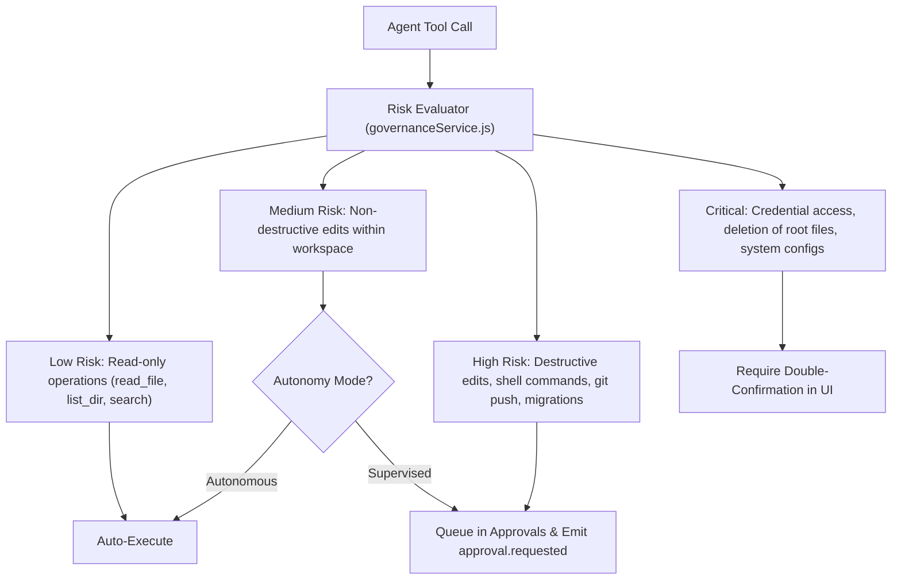

# Feature Specification: Approvals & Governance

> [!TIP]
> **Agent Context Guidance**: Load only this feature directory (`docs/features/approvals-and-governance/`), [`docs/governance/ACTIVE-STOP-RULES.md`](../../governance/ACTIVE-STOP-RULES.md), and direct cross-feature dependencies explicitly cited below. Do not load unreferenced feature specifications or legacy archives into working context.

## 1. Context & Problem Statement
Sirona supports both **Supervised** and **Autonomous** operating modes. To prevent unauthorized modifications to external infrastructure, data stores, or production code, the Governance engine classifies every planned action according to its risk level and gates sensitive operations behind human approval.

---

## 2. Risk Classification Matrix

---

## 3. Governance Invariants
1. **Unbypassable Interception**: The ReAct execution engine cannot call `toolRuntimeService.executeTool()` without first obtaining a cryptographic or DB-signed approval token from `governanceService`.
2. **Audit Immutability**: All decisions (`approved`, `rejected`, `timed_out`) and action parameters are recorded in `audit_events` with SHA-256 fingerprinting.
3. **Approval Expiration**: Pending approvals expire after 10 minutes (600s). If expired, the turn resumes with `APPROVAL_EXPIRED` rejection.
