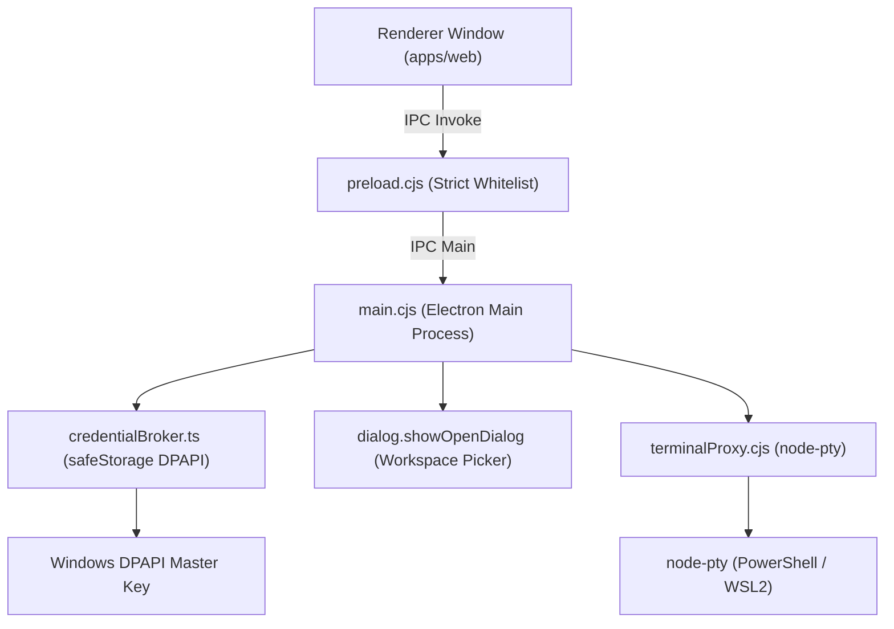

# Feature Specification: Desktop Shell & OS Security

> [!TIP]
> **Agent Context Guidance**: Load only this feature directory (`docs/features/desktop-shell-and-security/`), [`docs/governance/ACTIVE-STOP-RULES.md`](../../governance/ACTIVE-STOP-RULES.md), and direct cross-feature dependencies explicitly cited below. Do not load unreferenced feature specifications or legacy archives into working context.

## 1. Context & Problem Statement
Sirona's desktop application (`apps/desktop`) is built on Electron 34+. It bridges the browser UI to native Windows OS capabilities while enforcing a hardened sandbox:
- **Windows DPAPI Credential Broker**: Securely encrypts and decrypts provider API keys using OS credentials.
- **Native OS Dialogs**: Secure native directory chooser for workspace selection.
- **Context Isolation & CSP**: Prevents arbitrary code execution in the renderer window.
- **Terminal WebSocket Proxy**: Spawns local PTY processes and exposes a secure local WebSocket server for interactive terminals.

---

## 2. Desktop Security Architecture

---

## 3. Invariants & Security Rules
1. **Renderer Isolation**:
   - `nodeIntegration: false`
   - `contextIsolation: true`
   - `sandbox: true`
   - `webSecurity: true`
2. **IPC Whitelisting**: The preload script only forwards explicit, whitelisted channel messages (`dialog:open-directory`, `credentials:save`, `credentials:get`, `window:minimize`, `window:maximize`, `window:close`).
3. **Loopback Only**: Terminal proxy binds strictly to `127.0.0.1` and requires a cryptographically random session ticket before opening PTY I/O.
