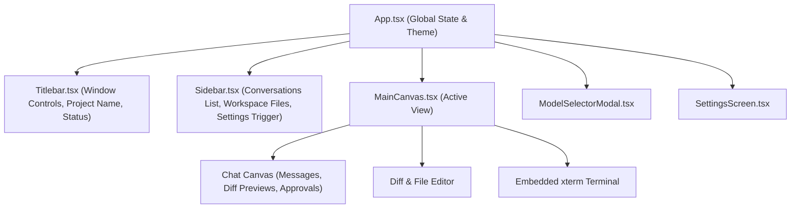

# Feature Specification: Frontend Canvas & Workspaces

> [!TIP]
> **Agent Context Guidance**: Load only this feature directory (`docs/features/frontend-canvas-and-ui/`), [`docs/governance/ACTIVE-STOP-RULES.md`](../../governance/ACTIVE-STOP-RULES.md), and direct cross-feature dependencies explicitly cited below. Do not load unreferenced feature specifications or legacy archives into working context.

## 1. Context & Problem Statement
The frontend (`apps/web`) is built with React 19, Vite, and Tailwind CSS. It serves as the primary visual IDE and interaction surface for the user, providing:
- Real-time token streaming and thought progression rendering.
- Interactive file explorer and diff editor.
- Model selector modal with capability tags.
- Human-in-the-loop approval banner.
- Unified typed API client [`sironaClient.ts`](file:///apps/web/src/api/sironaClient.ts) and custom hook [`useSirona.ts`](file:///apps/web/src/api/useSirona.ts).

---

## 2. Component Hierarchy

---

## 3. Invariants & UI Discipline
1. **Light/Dark Compact Design**: The interface adheres strictly to Sirona's compact layout guidelines defined in [`UI-FREEZE-CONTRACT.md`](file:///sironadocs/frontend/UI-FREEZE-CONTRACT.md).
2. **Zero Mock Fallbacks in Production**: If backend services or providers are unreachable, the UI surfaces explicit error messages (with retry buttons), never synthetic mock messages.
3. **Optimistic Updates with Rollback**: User prompt submissions append immediately to the local UI stream; if the turn fails to start, the prompt is restored to the input box with an error badge.
