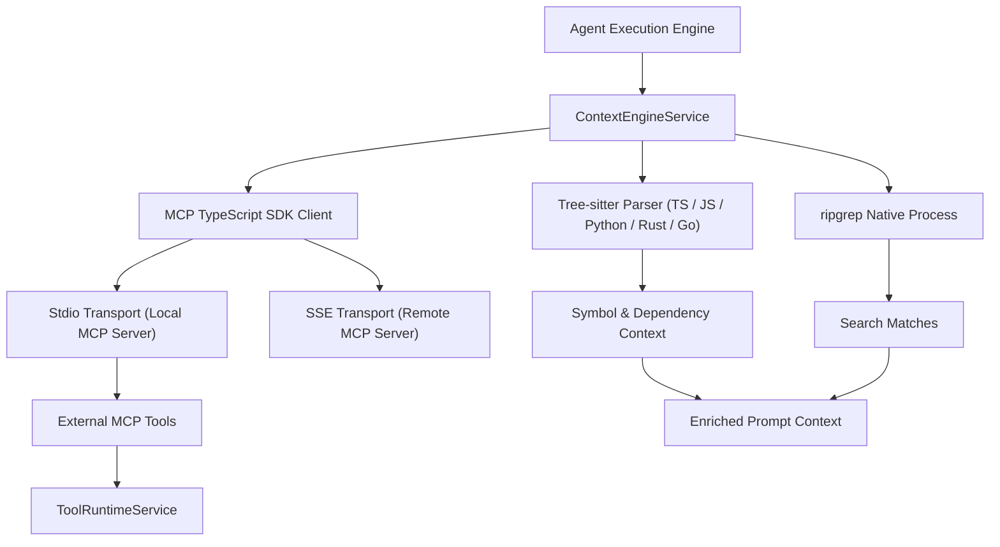

# Feature Specification: MCP & Code Intelligence

> [!TIP]
> **Agent Context Guidance**: Load only this feature directory (`docs/features/mcp-and-code-intelligence/`), [`docs/governance/ACTIVE-STOP-RULES.md`](../../governance/ACTIVE-STOP-RULES.md), and direct cross-feature dependencies explicitly cited below. Do not load unreferenced feature specifications or legacy archives into working context.

## 1. Context & Problem Statement
To make the agent a true staff software engineer, Sirona integrates:
1. **Model Context Protocol (MCP)**: Connects to local and remote MCP servers (e.g. Postgres inspector, Git tools, Playwright browser, GitHub issues) via JSON-RPC over stdio and SSE transports.
2. **Code Intelligence**: Uses Tree-sitter for AST parsing, ripgrep for lightning-fast keyword search, and context rankers to inject relevant code definitions directly into prompts.

---

## 2. Architecture & Pipeline

---

## 3. Invariants & Safety Constraints
1. **MCP Transport Isolation**: Local MCP servers run as sandboxed child processes with isolated environment variables.
2. **Schema Translation**: MCP tool schemas are validated using `@modelcontextprotocol/sdk` and converted to canonical Sirona tool descriptors.
3. **AST Query Safety**: Tree-sitter grammar queries run with memory clamps to prevent catastrophic backtracking on malformed code.
