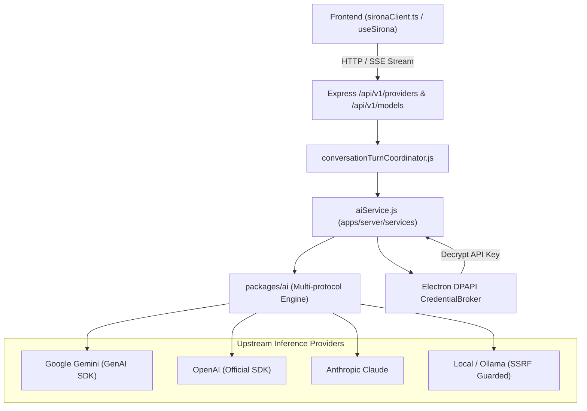

# Feature Specification: Model Providers & Gateway

> [!TIP]
> **Agent Context Guidance**: Load only this feature directory (`docs/features/model-providers-and-gateway/`), [`docs/governance/ACTIVE-STOP-RULES.md`](../../governance/ACTIVE-STOP-RULES.md), and direct cross-feature dependencies explicitly cited below. Do not load unreferenced feature specifications or legacy archives into working context.

## 1. Context & Problem Statement
Sirona needs a unified, resilient, multi-vendor AI model gateway capable of routing inference requests to multiple model providers:
- **Cloud Providers**: Anthropic Claude (Opus, Sonnet, Haiku), Google Gemini (Gemini 2.5 Pro, Flash), OpenAI (GPT-4o, o1, o3-mini).
- **Local & OpenAI-Compatible**: Ollama, vLLM, LM Studio, OpenRouter, and Vercel AI Gateway.
- **Requirements**: Secure DPAPI credential storage, automatic token streaming via Server-Sent Events (SSE), SSRF protection for local endpoints, abort/cancellation signal handling, and unified tool calling schemas across vendors.

---

## 2. Architecture & Component Interaction

---

## 3. Key Invariants & Guardrails
1. **Zero Plaintext Storage**: API keys are encrypted via Windows DPAPI before being written to disk (`provider_credentials` table). Decryption happens in memory only when forming the vendor client.
2. **SSRF Guard**: Custom OpenAI-compatible endpoints (`baseUrl`) are validated by [`packages/ai/src/protocols/ssrf-guard.ts`](file:///packages/ai/src/protocols/). Loopback addresses (`127.0.0.1`, `localhost`) are allowed ONLY when running in local development mode (`NODE_ENV === 'development'`). Cloud metadata endpoints (`169.254.169.254`) are permanently blocked.
3. **Cancellation & Lease Release**: When the client disconnects or issues a cancel signal, the abort controller terminates the upstream fetch stream immediately and releases the turn lease in a `finally` block.
4. **Schema Normalization**: Tool calling definitions are translated to the vendor's format:
   - OpenAI / Anthropic: standard JSON schema in `parameters`.
   - Gemini: uppercase types (`OBJECT`, `STRING`, `ARRAY`) with camelCase properties via `gemini-schema-converter.ts`.

---

## 4. Error Handling & Recovery
- **Rate Limit (`429`)**: Emits `provider.error` with backoff retry hint. Does not fail the entire conversation session.
- **Authentication Failure (`401`)**: Returns `CREDENTIAL_INVALID` with guidance to re-enter key in Settings.
- **Provider Outage (`503`)**: Recommends fallback model from the active model catalog.
