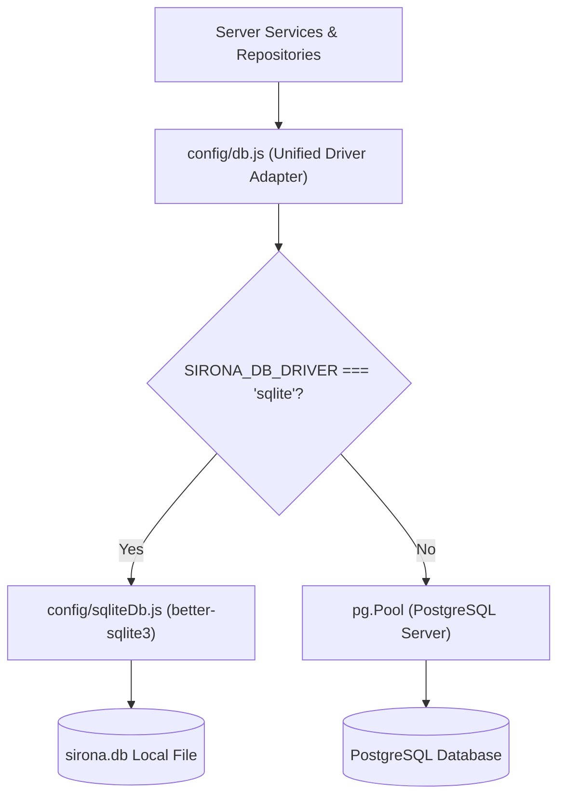

# Feature Specification: Sessions & Persistence

> [!TIP]
> **Agent Context Guidance**: Load only this feature directory (`docs/features/sessions-and-persistence/`), [`docs/governance/ACTIVE-STOP-RULES.md`](../../governance/ACTIVE-STOP-RULES.md), and direct cross-feature dependencies explicitly cited below. Do not load unreferenced feature specifications or legacy archives into working context.

## 1. Context & Problem Statement
Sirona must operate reliably across two different deployment profiles:
1. **Desktop / Embedded Local**: Uses SQLite for zero-configuration, single-file local storage (`sirona.db`).
2. **Server / Production / Multi-Tenant**: Uses PostgreSQL for high concurrency, connection pooling, and multi-user data isolation.

The persistence engine must guarantee transaction isolation, support parameterized queries (`$1, $2`), maintain schema consistency across migrations 001–024, and provide serialization locks for active conversation turns.

---

## 2. Dual Database Architecture

---

## 3. Database Invariants
1. **Parameterized Queries**: All queries must use `$1, $2` parameterized place-holders. In SQLite mode, `sqliteDb.js` translates `$1` placeholders to positional SQLite parameters transparently.
2. **Migration Discipline**: Migrations live in [`apps/server/migrations/`](file:///apps/server/migrations/) and execute sequentially in transactions. Once accepted and deployed, migrations are immutable.
3. **Turn Lease Timeout**: Turn leases in `conversation_turn_leases` carry an explicit expiration time (`expires_at`). Stale leases can be broken after TTL expires to avoid deadlocks after server crashes.
