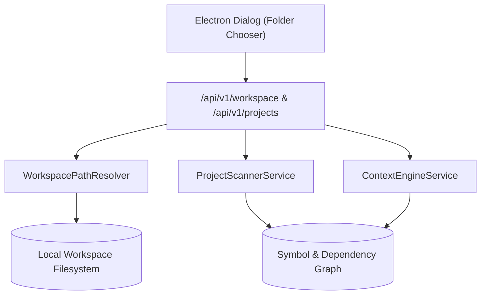

# Feature Specification: Workspace & Filesystem

> [!TIP]
> **Agent Context Guidance**: Load only this feature directory (`docs/features/workspace-and-filesystem/`), [`docs/governance/ACTIVE-STOP-RULES.md`](../../governance/ACTIVE-STOP-RULES.md), and direct cross-feature dependencies explicitly cited below. Do not load unreferenced feature specifications or legacy archives into working context.

## 1. Context & Problem Statement
Sirona operates over local project folders selected by the developer. The workspace subsystem is responsible for:
- Enforcing workspace containment boundaries.
- Project scanning, AST analysis, and symbol indexing.
- Providing virtual file trees and file watchers to the frontend canvas.
- Safely handling file diffs and rollback states.

---

## 2. Component Architecture

---

## 3. Invariants & Safety Constraints
1. **Explicit Root Binding**: An agent cannot perform any action until a valid `workspaceRoot` is authorized by the user via the native OS folder dialog.
2. **Exclusion Rules**: The project scanner and file watcher automatically ignore noise and security-sensitive paths:
   - `node_modules/`, `.git/`, `dist/`, `build/`
   - `.env`, `.env.*`, `*.pem`, `*.key`, `id_rsa`
3. **Symbol Index Caching**: AST extraction runs asynchronously in a worker thread and writes cache entries to `.sirona/cache/ast.json` without dirtying project git status.
