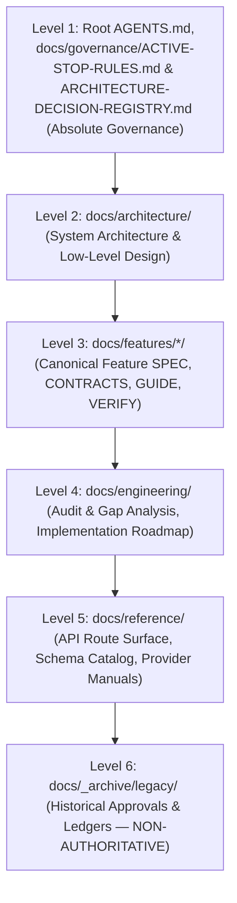

# Sirona Documentation Authority Hierarchy

> **Authority Level:** CANONICAL GOVERNANCE DIRECTIVE  
> **Status:** ACTIVE & ENFORCED

---

## 1. Authority Precedence (Strict Order)

When coding agents, reviewers, or human developers encounter ambiguous or conflicting documentation, instructions must be resolved in this exact descending order:

### Hierarchy Rules
1. **Rule of Governance**: Level 1 rules (STOP directives, security constraints, credential protection, and canonical [`ARCHITECTURE-DECISION-REGISTRY.md`](ARCHITECTURE-DECISION-REGISTRY.md)) override all other documents. Canonical `ADR-xxx` decisions take precedence over historical aliases.
2. **Rule of Architecture**: No feature specification (Level 3) may violate system invariants established in Level 2.
3. **Rule of Supersession**: Documents in `docs/_archive/legacy/` are strictly non-authoritative historical records. They may never be used to justify bypassing active rules or claiming implementation completion.

---

## 2. Documentation Status Classifications

Every document, specification, and architectural claim in Sirona must carry one of the following explicit status labels:

| Status Label | Definition | Implementation Requirement |
|---|---|---|
| `VERIFIED IMPLEMENTATION` | Code exists in `apps/` or `packages/`, unit/integration tests pass without mocks, and real execution evidence is documented. | Usable as a dependency by subsequent features. |
| `APPROVED DESIGN` | Architecture or feature design has been formally approved by the owner, but code implementation or full verification is pending. | Implementable only within approved limits; test suites must pass before marking verified. |
| `PROPOSED` | Specification, roadmap item, or architecture proposal awaiting owner review and sign-off. | **Implementation blocked.** Agents must NOT modify production code based on proposed specs. |
| `SUPERSEDED` | Historical plan, outdated ledger, or replaced document preserved for audit/lineage purposes. | **Non-authoritative.** Moved to `docs/_archive/legacy/`. Never used for runtime decisions. |

---

## 3. Reconciliation: Legacy P1–P7 vs Unified P1–P8 Roadmap

Earlier repository documents refer to various iterative phases (e.g. `P1 Scope`, `P2 Credential Broker`, `P3 Docker Plan`, `P4 Vercel AI SDK`, `P5 LangGraph Repair`, `P6 Gate A`, `P6 Gate B`, `P7 Workspace Plan`).

The authoritative roadmap is the **P1–P8 Lifecycle** defined in [`docs/engineering/IMPLEMENTATION-ROADMAP.md`](file:///docs/engineering/IMPLEMENTATION-ROADMAP.md):

| Unified Phase | Domain Scope | Legacy Mapping & Evidence | Current Authoritative Status |
|---|---|---|---|
| **Phase 1** | Persistence & DB Reconciliation | Legacy P1 (`001–024` migrations, Drizzle/SQL) | `APPROVED DESIGN` (STOP-01 active pending DB decision) |
| **Phase 2** | DPAPI Credential Broker & Vault | Legacy P2 (`credentialBroker.ts`, DPAPI) | `VERIFIED IMPLEMENTATION` |
| **Phase 3** | Docker WSL2 Sandbox Profile | Legacy P3 (`tools-worker.Dockerfile`, WSL2) | `VERIFIED IMPLEMENTATION` (Trusted-local) |
| **Phase 4** | Multi-Protocol Model Gateway | Legacy P4 (Vercel AI SDK, Gemini, OpenAI) | `VERIFIED IMPLEMENTATION` |
| **Phase 5** | Agent ReAct & LangGraph State Machine | Legacy P5 (LangGraph bounded specialists) | `APPROVED DESIGN` (22 free tests PASS; STOP-02 live inference UNVERIFIED) |
| **Phase 6** | MCP & Code Intelligence | Legacy P6 (Gate A passed, Gate B pending) | `APPROVED DESIGN` (STOP-03 active pending Gate B qualification) |
| **Phase 7** | Frontend Canvas & Workspaces | Legacy P7 (`apps/web` React 19 UI) | `VERIFIED IMPLEMENTATION` |
| **Phase 8** | Release & Disaster Recovery | Legacy P8 (End-to-end recovery tests) | `PROPOSED` (Awaiting Phases 1–7 closure) |

> [!CAUTION] Never treat historical approval of a scoped slice (e.g. P1–P5 frontend/backend wiring) as blanket authorization for remaining phases (P6–P8) or production deployment.
