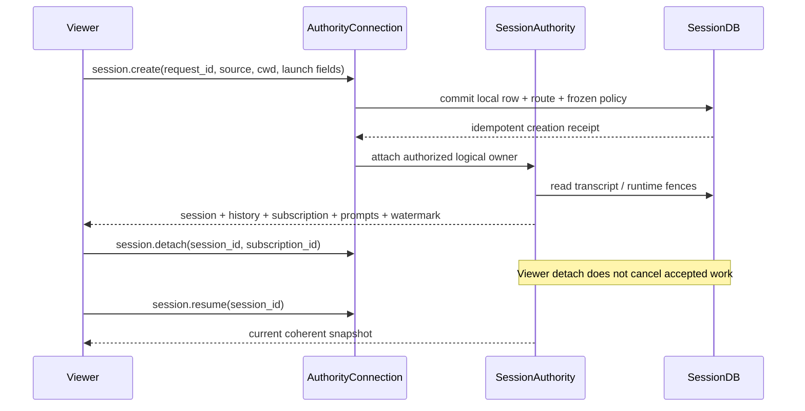
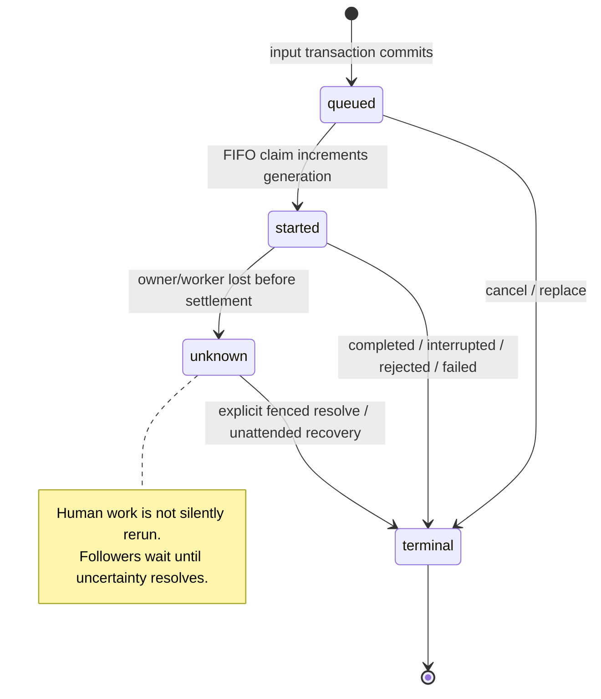
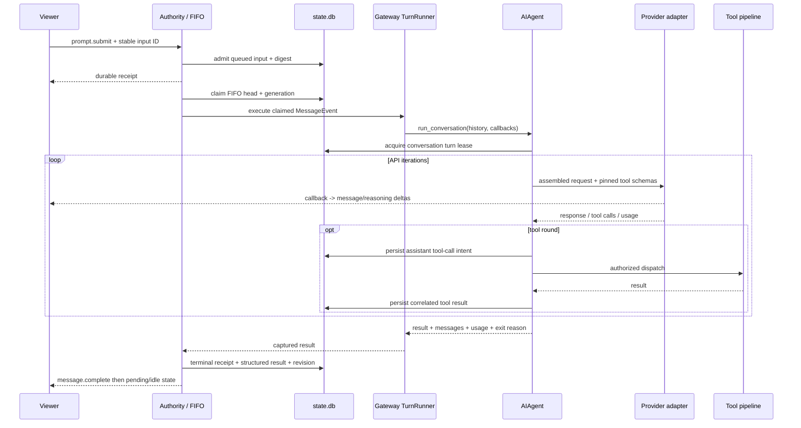
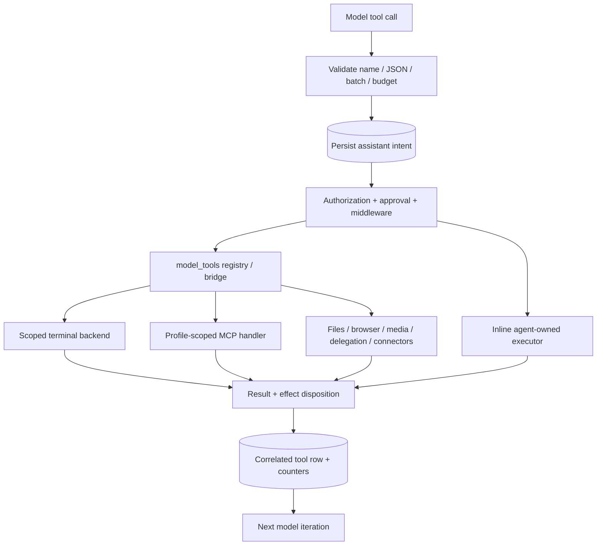
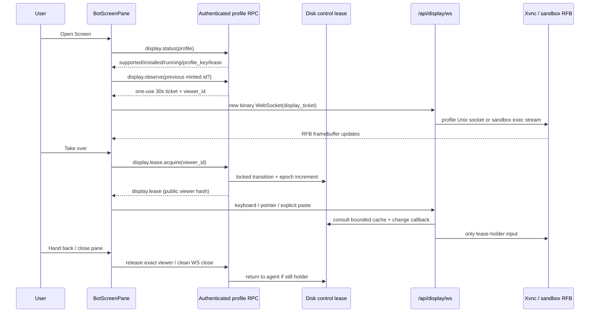
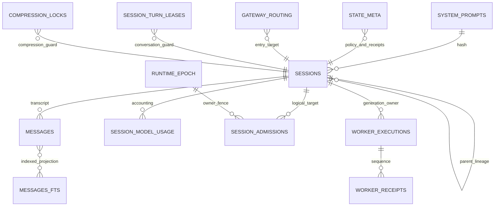
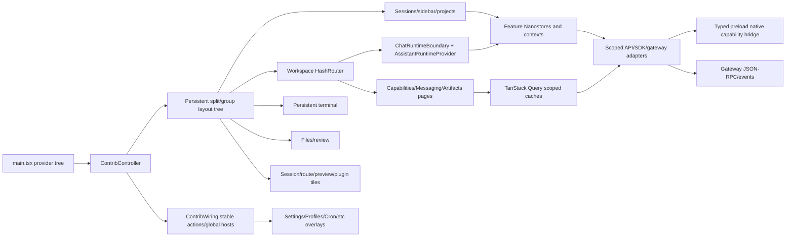
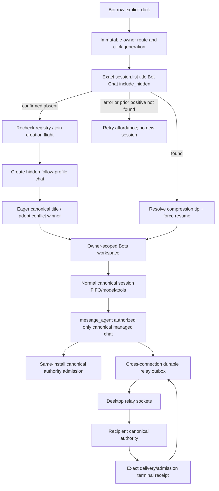
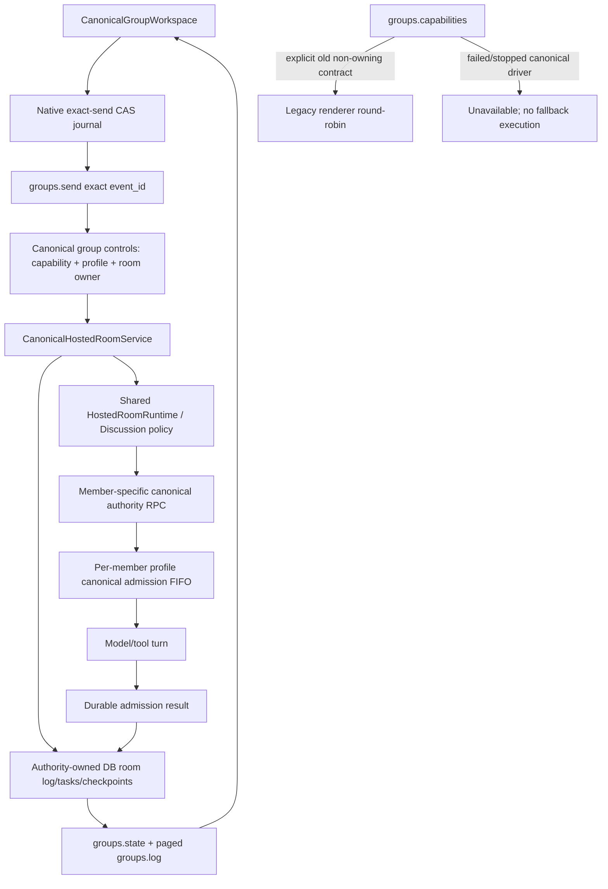

# Hermes Electron Desktop reconstruction

Local source-backed investigation,24 October2026. Target: Windows Electron Desktop and all required backend dependencies. Includes bots/groups/screens as requested.

Evidence: prior dist REA parent ev_acfed8efe6602327936be2a37e619312bbbd3460ebab758e8317822829346023; production ASAR parent ev_53c8bca35c6b25614ce432e78a50b02763551f6bb80e172b3ad117c201f4e060. Static source facts, installed schema observations, implementation recommendations and runtime UNVERIFIED claims are distinct. No target app was launched.

Detailed source ledgers are retained in [native chapter](native-shell-and-build.md), [gateway/runtime chapter](gateway-runtime-and-storage.md), and [frontend/bot/screen chapter](frontend-bots-and-screen.md). Source abbreviations are defined in those chapters; paths resolve under C:/Users/bharg/AppData/Local/hermes/hermes-agent.

## 1. Executive Architecture Summary

#### 1. Architectural ownership

The desktop shell is an Electron main process, isolated preload, and React renderer. The preload publishes **window.hermesDesktop**, not window.hermes. The main process owns native capabilities and backend routing; the renderer consumes typed methods; Python remains authoritative for execution. The current local launch asks the canonical gateway owner to attach or start. It does not create one independent serve child per profile. Old comments and compatibility helpers still mention the previous serve process model; the production call path in main.ts is decisive. [N01, N02, N03, N04]

The main process installs the Python ticket resolver during module initialization, using the runtime resolver and resolved cwd. Its source is intentionally outside the renderer graph. The current local descriptor contains an endpoint, empty token, native auth mode, and an unminted native-dial placeholder. A fresh dial obtains the private grant later. Credentials are not discovered by scraping the dashboard root page on this path. [N03, N05]

~~~mermaid
flowchart LR
  OS[OS executable / deep link] --> ENTRY[Electron entry.ts]
  ENTRY --> MAIN[Electron main.ts]
  MAIN --> PRE[Isolated preload: hermesDesktop]
  PRE <--> R[React renderer]
  R -->|private native capabilities| PRE
  MAIN -->|bounded CLI gateway ensure --json| CLI[Hermes installation launcher]
  CLI --> G[Canonical gateway owner]
  MAIN -->|private stdin/stdout or control socket| T[One-use ticket mint]
  T --> G
  R -->|WebSocket JSON-RPC / canonical adapter| G
  MAIN --> PTY[node-pty interactive terminal]
  G --> TOOL[Agent runtime and tool processes]
  MAIN --> REMOTE[Optional SSH / URL / Cloud]
~~~

This diagram is the source-derived ownership model [N01–N07, N23]. It is not a live process snapshot. PTY terminals and agent tool commands are separate execution paths; a read-only agent-output terminal is a third renderer presentation described in the broader runtime report.


## 2. Installed Filesystem Map

The installation contains both editable source and packaged output. Metadata traversal covered **170,812 files / 12,691 directories**, excluding Git internals, with no enumeration errors. Private file contents were not included.

See [full directory tree](catalogs/installation-directory-tree.txt), [all file metadata](catalogs/installation-files.json), [special artifacts](catalogs/installation-special-artifacts.json), and [ASAR members](catalogs/asar-members.json). The production archive contains 1,194 members. Main/preload/index/build metadata/guest preload hashes match the inspected dist files; see [byte comparisons](catalogs/build-package-comparison.json). Current source and packaged dependency manifests differ. Desktop dist has no source maps in the metadata scan.

## 3. Complete System Architecture

#### 1. Architectural ownership

The desktop shell is an Electron main process, isolated preload, and React renderer. The preload publishes **window.hermesDesktop**, not window.hermes. The main process owns native capabilities and backend routing; the renderer consumes typed methods; Python remains authoritative for execution. The current local launch asks the canonical gateway owner to attach or start. It does not create one independent serve child per profile. Old comments and compatibility helpers still mention the previous serve process model; the production call path in main.ts is decisive. [N01, N02, N03, N04]

The main process installs the Python ticket resolver during module initialization, using the runtime resolver and resolved cwd. Its source is intentionally outside the renderer graph. The current local descriptor contains an endpoint, empty token, native auth mode, and an unminted native-dial placeholder. A fresh dial obtains the private grant later. Credentials are not discovered by scraping the dashboard root page on this path. [N03, N05]

~~~mermaid
flowchart LR
  OS[OS executable / deep link] --> ENTRY[Electron entry.ts]
  ENTRY --> MAIN[Electron main.ts]
  MAIN --> PRE[Isolated preload: hermesDesktop]
  PRE <--> R[React renderer]
  R -->|private native capabilities| PRE
  MAIN -->|bounded CLI gateway ensure --json| CLI[Hermes installation launcher]
  CLI --> G[Canonical gateway owner]
  MAIN -->|private stdin/stdout or control socket| T[One-use ticket mint]
  T --> G
  R -->|WebSocket JSON-RPC / canonical adapter| G
  MAIN --> PTY[node-pty interactive terminal]
  G --> TOOL[Agent runtime and tool processes]
  MAIN --> REMOTE[Optional SSH / URL / Cloud]
~~~

This diagram is the source-derived ownership model [N01–N07, N23]. It is not a live process snapshot. PTY terminals and agent tool commands are separate execution paths; a read-only agent-output terminal is a third renderer presentation described in the broader runtime report.

#### 1. Process ownership, startup, transport, and authentication

##### Canonical entry and lifecycle

1. `gateway/run_bootstrap.py:start_gateway` (728) orchestrates startup. `_start_gateway_reserve_profiles` (622) reserves served homes; `_start_gateway_start_control_socket` (271) starts the private local discovery/bootstrap control listener. Failure to establish the ticket issuer aborts startup rather than silently starting an owner clients cannot attach to.
2. `gateway/runtime_ownership.py:ProfileOwnership.reserve` (152) owns the profile's `gateway.lock`. Ownership is stronger than an endpoint ticket. `start_writer` (199), `release` (191), and `close` (205) coordinate writer lifetimes and release. Maintenance obtains an explicit ownership scope; it is not a second opportunistic SQLite writer.
3. `gateway/session_authority.py:initialize_session_authority` (1374) runs after exclusive ownership and before adapters/API. It resolves the store path, increments the durable runtime epoch, recovers incomplete inputs, settles recovered unattended work, backfills legacy ownership/created-source metadata, adopts compression continuations, constructs an authority, binds cron, stamps the owning store's local epoch and restores local sessions.
4. `gateway/run_api.py:GatewayRuntimeAPI` (246) mounts native `/api/ws` alongside the existing dashboard HTTP/WebSocket gate. Its `_serve` (282) enforces ready/draining state, validates native attach provenance, selects the authority for the grant's served profile, and calls `tui_gateway.ws.handle_ws`.
5. `gateway/run_startup.py:GatewayStartupMixin` includes bounded warmup, previous-run recovery, durable reply redelivery, heartbeat/liveness tasks and hosted worker lifecycle. `gateway/run_shutdown.py` and `run_bootstrap.py:_start_gateway_shutdown_tail` (459) own the matching shutdown path. Full shutdown timing and every adapter-specific cleanup branch are **UNVERIFIED at runtime**.

```mermaid
flowchart LR
  C[Desktop / Ink / native CLI] --> B[Private bootstrap control]
  B --> T[One-use attach ticket]
  T --> W[/api/ws native gate]
  O[ProfileOwnership gateway.lock] --> G[GatewayRunner]
  G --> A[SessionAuthority per served home]
  A --> D[(profile state.db)]
  W --> X[tui_gateway.ws WSTransport]
  X --> R[AuthorityConnection]
  R --> A
  R --> F[Restricted legacy fallback]
  F --> S[tui_gateway.server registered handlers]
  U[Dashboard / remote access] --> H[Dashboard auth boundary]
  H --> X
```

##### Native grants and authority capabilities

`gateway/runtime_bootstrap.py:TicketStore` (25) stores SHA-256 digests of random URL-safe tickets, has `TTL_SECONDS=30`, `MAX_ENTRIES=1024`, validates the profile/purpose/scope, and deletes a redeemed ticket. `mint` (37) and `redeem` (55) bind tickets to the owner instance and served profile. It is not a static API key. Purpose grants are:

| Purpose | Capability scope |
|---|---|
| interactive | `session:create`, `session:read`, `session:submit`, `session:control`, `session:approve`, `session:respond` |
| native-http | `http:owner` |
| native-profile-create | `profiles:create` |
| native-profile-registry | `profiles:registry` |
| exposure | `transport:delegate` |
| worker-adoption | `worker:adopt` |

Only interactive grants may have host scope. `run_api.py:_serve` accepts native tickets at the WebSocket subprotocol boundary, requires loopback and the expected host/client/origin checks, distinguishes interactive and worker-adoption grants, and refuses unavailable profiles. It passes server-produced identity `{user_id, provider, profile_id, instance_id, capabilities, native_bootstrap, profile_scope}` to the transport; RPC parameters cannot invent this identity. Readiness refusals use WS `1013` or HTTP 503 `gateway_not_ready`; native admission refusals can use `4403`.

`gateway/session_controls.py:AuthorityConnection.__init__` (114) creates a `Principal(subject, profile_id, capabilities, transport_id)`, uses a fresh transport ID, removes any caller-supplied `session:operator`, and adds that capability only when its trusted constructor receives `operator=True`. Missing identity or an instance mismatch yields no capabilities. `host_scoped` (142) and `_sibling_for` (147) allow an authorized host grant to reach a currently served sibling authority; a foreign profile otherwise returns `profile_mismatch`.

The dashboard/remote route is separate: `hermes_cli/web_server_chat.py:_ws_auth_reason` (200) accepts the appropriate dashboard single-use ticket, internal child credential, or verified user session access token in gated mode. Legacy `_SESSION_TOKEN` is only compared in the loopback/insecure path. It stamps identity after verification. Do not collapse this into a single permissive `?token=` check. Windows private bootstrap transport lives in `gateway/runtime_bootstrap_windows.py` (named pipe peer SID/session/security checks); it must be preserved as an OS boundary, not approximated by an open localhost endpoint.

##### WS dispatch, concurrency, and legacy coexistence

`tui_gateway/ws.py:_authority_connection` (357), `_dispatch_request` (368), and `handle_ws` (406) choose the attached authority. `WSTransport` (132) is per connection and thread-safe; worker writes marshal to the event loop. It batches `message.delta`, `reasoning.delta` and `thinking.delta` on a 33 ms timer. A non-streaming frame flushes earlier token frames first. A 10-second worker-side flush wait does not itself mark the socket dead; real send backpressure has a separate 30-second deadline. These details prevent lost events and false reconnects during CPU/SQLite stalls.

The reader stays responsive while controls dispatch serially through a bounded queue (`256`). The narrow concurrent expensive-read exception is `session.context_breakdown`, with two running and eight waiting reads. JSON-RPC response frames and `clarify.lock` bypass that serial lane because the handler already occupying it may be waiting for the answer. `gateway.ready` is an event notification immediately after admission; capability/replay information allows consumers to choose recovery behavior.

`gateway/session_controls.py:handlers` (170) is the canonical method table; `dispatch` (237) validates params/results against canonical declarations first, scopes calls under the authority's profile, handles groups through the group dispatcher, and uses `DeferredReply` for work answered outside the serial lane. Error boundaries include:

| Error | Meaning |
|---|---|
| JSON-RPC `-32601` | unknown/unserved method; compatibility fallback may be considered |
| `4001 invalid_params` | canonical missing/unknown keys or invalid values |
| `4001` plus stable reason | permission/profile/revision/generation/admission/runtime refusal |
| `5001 storage_unavailable` | SQLite operation failed; source exception is logged, not leaked as successful work |
| legacy `4000` contract rejection | legacy dispatcher unknown param path; differs from canonical validation |

`tui_gateway/ws_legacy_fallback.py:legacy_fallback_allowed` (53) only permits fallback for the full interactive grant. Session/prompt/message namespaces are denied except narrow read/import exceptions; process-global stop/reload/delegation/list actions are also denied. A legacy `session.delete`, `session.branch_stored` or `session.workspace.move` must not mutate behind the authority's receipts. Account-owned connectors and other non-session sidecar services may retain legacy handlers. Secondary-profile fallback binds the ticket's own home and never silently reads launch-profile state.

The standalone path remains `tui_gateway/entry.py:_serve` (303) → `tui_gateway/rpc_dispatch.py:dispatch` (45) → registered `tui_gateway/server.py`/`methods_*.py` handlers. It is useful for compatibility analysis and isolated harnesses, not proof it is the current production owner.

##### Other HTTP doors still converge on the owner

The dashboard FastAPI session routes are `hermes_cli/web_routers/sessions.py`: list (182), search (286), bulk-delete (466), import (492), empty count/delete (511/519), stats (538), detail (560), mutation-snapshot (586), latest-descendant (601), message page (739), timeline (801), around-message (823), delete (846), owner-backfill (890), patch (926), export (941), prune (977). Literal routes precede the unconstrained `/{session_id}` routes to prevent route shadowing. `hermes_cli/web_server_sessions.py:_session_mutation_context` (85) resolves the authenticated profile/authority; its mutation helper imports and awaits the same `gateway.session_mutations.mutate_session`, rather than independently writing behind the owner. Search deduplicates compression lineage, returns the current tip, supports ID/content matches and uses FTS rather than reading all rows in the renderer. Import is stream-budgeted at 25 MiB. Exact endpoint query/body contracts belong in the HTTP catalog; the authenticated dashboard boundary applies to these routes.

The separate messaging API adapter is `gateway/platforms/api_server.py` plus siblings. `api_server_runs.py` registers POST `/v1/runs`, GET run/status/events, and POST approval/clarify/steer/resolve-unknown/stop (243–249); `_admit_run_to_authority` (683) binds accepted API runs into the session authority FIFO. OpenAI-compatible HTTP request processing is composed through `api_server_openai_routes.py`; admission/auth wrappers live at `api_server.py:_admit_api_agent_request` (829). Do not assume this aiohttp adapter and the dashboard FastAPI server are the same application just because both expose HTTP.

`api_server_authority_runs.py:respond_run` uses body `{request_id, execution_generation, choice}` for approval or `{request_id, execution_generation, answer}` for clarification, resolves the exact run's durable admission, attaches a temporary authorized actor, verifies its pending prompt, calls `authority.respond`, then detaches. `stop_run` cancels queued work or stops the claimed generation; unknown requires explicit resolution. `store_error_response` maps invalid input to 400, draining/storage/chain retry refusals to 503, and ownership/generation/identity refusals to 409. Already accepted `admission_queued` carries `x-should-retry:false`, preventing SDK retries from duplicating acceptance. Run ID, session ID, admission ID and generation must remain distinct throughout these REST projections.


## 4. Application Startup Sequence

#### 2. Startup sequence from the executable

##### 2.1 Entry and pre-ready phase

1. The package main entry is **dist/electron-main.mjs**. The build actually bundles electron/entry.ts into this output. entry.ts may relaunch on Linux to apply WSLg/Wayland/NVIDIA/platform flags before importing main. The launcher parent does not create windows or backend state; it stays alive for the child and forwards SIGINT/SIGTERM. Otherwise it imports main directly. [N08, N09]
2. main.ts chooses userData override/channel suffix before native state is consumed; reads HERMES_DESKTOP_DEV_SERVER and packaged identity; uses dist/electron-preload.js and dist/preview-guest-preload.js. Pre-ready GPU/sandbox recovery and command-line decisions happen before app ready. [N10, N11]
3. Single-instance ownership is acquired before backend machinery is permitted. A lock-losing process hard-exits with app.exit(0), so its asynchronous ready/quit path cannot reap or reconnect the existing instance's runtime. A primary cold start may persist a --profile override; second-instance argv instead routes into the existing window. [N12]
4. The Hermes data home is resolved separately from Electron userData. Explicit HERMES_HOME wins, and a home inside profiles/<name> normalizes to its parent collection home. A desktop userData override without explicit home gets an isolated hermes-home child. On Windows the resolver can read user-environment HERMES_HOME; otherwise LOCALAPPDATA/hermes is preferred, with a legacy ~/.hermes fallback only when the new directory is absent and no suffix isolation is requested. The default on POSIX is ~/.hermes. [N13]
5. main.ts derives ACTIVE_HERMES_ROOT as HERMES_HOME/hermes-agent, venv path, bootstrap marker, and HERMES_HOME/logs/desktop.log. These are source defaults, not assertions that all packaging variants execute their runtime from that mutable checkout. [N14, N30]

##### 2.2 Ready phase and first window

app.whenReady consumes pending update relaunch information, warms login-shell PATH resolution, initializes diagnostics/system CA trust, applies basic password-store handling, migrates legacy encrypted secrets once, enables accessibility unless opted out, installs media/download/custom-protocol/remote-header/preview rules, configures fonts and spellcheck, restores awake/tray preferences, starts the main-loop watchdog, sets active profile routing, registers quick-entry/screenshot/HUD actions, resumes managed SSH recovery journals, and installs the menu around first-window creation. Cold-start URLs are delivered after this wiring. [N15]

The window is created before the gateway connection needs to finish: main.ts createWindow constructs a hidden themed BrowserWindow, registers routing/tray/window lifecycle, loads the renderer URL, and the renderer's bridge connection path can call ensureBackend → startHermes. Thus the proper reconstruction is two coordinated readiness branches (native/renderer visible and gateway usable), not a strictly serial assertion that the backend completes before any window exists. [N16, N03]

createWindow restores sanitized geometry and maximization, uses a hidden title bar/native overlay and platform surface options, and stays show:false until themed reveal. The shared chat-window webPreferences are preload, contextIsolation:true, webviewTag:true, sandbox:true, nodeIntegration:false, devTools:true, autoplayPolicy:no-user-gesture-required, focusOnNavigation:false. DevTools capability is enabled even though F12 and CDP exposure have separate policies. [N16, N17]

window-reveal.ts reveals once on the preferred path or falls back **4,000 ms after scheduling**. It can report a failed first paint rather than leave an invisible process/window forever. The HTML performs a prepaint from hermes-boot-background and hermes-boot-color-scheme; transparent HUD/overlay/quick/wake windows intentionally skip opaque background prepainting. [N18, N19]

##### 2.3 Backend resolution and attach

The production chain is **preload getConnection/getConnectionFor → hermes:connection / hermes:connection:for → main ensureBackend/registry resolution → startHermes → runPrimaryBackendStartup → resolveHermesBackend/ensureRuntime → runGatewayEnsure → ensureLocalGateway**. Main also provides fresh gateway URL capabilities for subsequent WebSocket dials. Route-specific handlers are catalogued in the separate IPC index. [N01, N03, N20]

startHermes refuses non-primary instances, performs orphan handling once, checks shutdown/start fences and latched failures, reuses an in-flight connection promise, migrates missing active-profile preference, creates an attempt token, and pins one launch-profile decision for both route and argv. Async boundaries validate the attempt before publishing, so a stale success does not overwrite a newer connection choice. Login-shell PATH is merged before runtime resolution; failures retain inherited PATH. [N03]

runPrimaryBackendStartup orders: saved remote first → local update-exclusion gate → reselect registered primary → optional attach hook → prepare local backend → first-run choice → either re-resolve remote, return reset error, or ensure local runtime. **main.ts does not wire the old attachHostBackend hook**; canonical gateway ensure below is attach-or-start. A remote failure never intentionally triggers local bootstrap. [N04, N03]

| Resolver rung | Source behavior and consequence |
|---|---|
| Bundled payload | Baked stamp runtime paths under resources/agent-payload; launch commands.hermes; env adds HERMES_RUNTIME_DIR=toolsDir; ticket mint uses payload storePython and PYTHONPATH repoDir + sitePackages. No alternate payload discovery. [N21, N30] |
| Explicit source root | HERMES_DESKTOP_HERMES_ROOT, source validation, selected Python and source backend; no automatic bootstrap for a valid explicit checkout. [N21] |
| Development checkout | Unpackaged source root before mutable installed roots so local Python edits are used. [N21] |
| Explicit CLI override | HERMES_DESKTOP_HERMES; reject desktop executable mistaken for CLI; unwrap Windows launcher when applicable; trust/probe permitted CLI; retain installation root for ticket minting. [N21] |
| Active installation | Resolve and probe canonical installed runtime; a missing/stale bootstrap marker alone does not force reinstall when the runtime is usable. Repair request can bypass it. [N21] |
| Published user launcher | Discover externally located source installation through fixed user launcher; verify it rather than blindly relying on GUI PATH. [N21] |
| Bootstrap-needed sentinel | Return structured bootstrap-needed rather than throwing an unrecoverable missing-payload error; ensureRuntime chooses recovery/install flow. A bundled stamp with missing/damaged runtime refuses bootstrap and requests reinstall. [N21, N22] |

For local launch, backendArgs are **gateway ensure --json**, prepended with **--profile <chosen>** when selected. runGatewayEnsure spawns the resolved launcher with its args, cwd, parent env, HERMES_HOME, and backend.env. The passed desktop spawn overlay sets **GATEWAY_ON_ALL_ADAPTERS_DOWN=stay_alive**. Despite its stale serve-oriented comment, this helper is actively called around the gateway client setup. [N03, N81]

The CLI has its own **60 s** startup protocol deadline; Electron allows **15 s** grace, so default child deadline is **75 s**. It reads at most 65,536 stdout characters and retains the final 4,096 stderr characters. On expiry it kills this bounded client, then attempts SIGKILL/reject after 1 s; it never retains or kills the detached gateway owner. parseGatewayEnsureOutput parses the actual protocol result. ensureLocalGateway validates a usable endpoint or reports the state/reason/detail and suggested gateway status/restart recovery. [N05]

Stale source-owner code can request one restart per owner-profile/gateway-code/client-code tuple per desktop process. The restart tries **--profile P gateway restart --detach**, falls back without --detach only for the exact old-argument refusal, and re-ensures while restart runs, polling at **1 s**. A draining owner in restart_after_turn_wait remains attachable so pending approval/clarify can finish. This is deliberate: awaiting full owner exit first could deadlock the question only this UI can answer. [N05]

~~~mermaid
sequenceDiagram
  participant OS
  participant E as Electron entry/main
  participant W as BrowserWindow/preload
  participant R as Renderer
  participant C as Hermes launcher
  participant G as Canonical gateway owner
  OS->>E: Launch / argv / deep link
  E->>E: Paths, identity, pre-ready flags, instance lock
  E->>W: Create hidden chat window + isolated preload
  W->>R: Load dev URL or dist index
  R->>E: getConnection / routed connection
  E->>E: Remote choice or runtime resolution + first-run gate
  E->>C: [--profile P] gateway ensure --json
  C->>G: Attach or start canonical owner
  C-->>E: Credential-free endpoint verdict
  R->>E: Fresh gateway WebSocket URL
  E->>G: Private one-use ticket mint
  E-->>R: Ephemeral dial URL
  R->>G: WebSocket canonical protocol + ticket subprotocol
  G-->>R: gateway.ready / session snapshots / events
  W->>W: Themed reveal or bounded fallback
~~~

The diagram's renderer, connection and reveal branches may overlap. It intentionally does not assert a fixed gateway port; the descriptor supplies api_origin. [N03, N05, N16–N20, N24]


## 5. Electron Main Process

#### 5. Windows, guests, navigation and OS interaction

Session windows are one extra OS window per session registry key; reopening reuses/focuses the existing one. They launch with minimum **420×620** and query flags before the hash (win=secondary, optional watch=1/profile/connectionId); watch spectator views resume lazily. Full instance windows use a different peer marker and ordinary shell; browser/HUD/overlay/quick/wake have specialized presentation. Their native lifecycle cannot be reconstructed as only React tabs. [N17, N16]

createWindowOpenHandler **always returns deny**. The exact Skills Hub origin can delegate an allowed external URL as a side effect through the audited opener; other guest/frame popups do not open OS browsers. Main-frame navigation stays on dev-server prefix or file: in production; other navigation is prevented and audited externally. Hub subframes remain pinned to the picker URL. [N46, N47]

Only the persist:hermes-preview webview partition gets the guest preload; applyPreviewGuestAttachPrefs also disables background throttling for that guest. Guest preload forwards a trusted primary-button click on a target=_blank anchor through sendToHost, and the host admits permitted schemes before native external open. Synthetic clicks cannot forge isTrusted. The full popup and trusted-origin exceptions must be preserved together; broadly calling openExternal from window-open would change the security behavior. [N47, N48, N49]

The native external opener allows http/https/mailto, routes file: and bare local paths through injected audited file resolvers, reports failures once for renderer fallback, and has a WSL→Windows cmd.exe start route. A local missing-file pre-stat error is separately classified so it is not falsely reported as no handler. [N50]

Media permission request/check hooks grant audio/video capture, fullscreen and automatic-fullscreen; absent media metadata is accepted for Windows compatibility, while other permission strings are denied by the predicate. Clipboard sanitized-write is separately limited to Hub origin. OS capture permissions remain separate from Electron grants. This is not an app-level modal for every getUserMedia call. [N51, N47]

hermes-media supports GET/HEAD and an explicit streaming extension list, forwards only accept/conditional/range headers, resolves local streams or remote profile/connection streams, and rejects unsupported methods/types/routes. This avoids forcing large media into data URLs and preserves seeking. [N52]

minimizeToTray registers primary windows with closeToTray:true and persisted preferences; second-instance/dock/tray activation restores minimized/hidden windows then focuses them. Ambient callbacks use a separate non-stealing focus policy. Linux notification implementation is distinct; ordinary Electron Notification support is checked elsewhere. Native notification dedupe is **1 s** by kind + session/tag; actions route to the original renderer, and runtime actions are not redirected to an unrelated fallback window. [N39, N40, N53]

Deep links use hermes in production and hermes-dev in dev (dev accepts both). They arrive via cold argv, second-instance argv, or macOS open-url and can queue until renderer readiness. Installation-shaped deep links require the renderer's explicit confirmation flow; the URL handler itself parses kind/name/params and routes rather than blindly installs. --close-preview is an additional second-instance escape hatch. [N12]


## 6. Preload & IPC

#### 4. Preload, IPC and renderer privilege

preload.ts imports a limited Electron surface and exposes hermesDesktop. It reads small synchronous native facts (translucency/HUD/feature flags/local skin) before publishing. Methods use ipcRenderer.invoke/send or carefully wrapped subscriptions returning listener-removal functions. The ordinary renderer cannot import Node/Electron directly under the chat window settings; the bridge grants explicit powers, including substantial filesystem/git/terminal access. Therefore context isolation does not make renderer compromise harmless: the security review must evaluate each exposed capability and argument validation. [N01, N17]

| Capability family | Real operation / semantic boundary |
|---|---|
| Backend routes/API | getConnection, connection-for, ws-url-for, api and profile routes reach native authentication/routing; never let a caller's unscoped profile bypass grant selection. [N01, N20, N27] |
| Windows | Session/window/browser popouts and relay need connection/profile identity and native focus policy, not just route strings. [N01, N17] |
| Files | readDir/readText/readDataUrl/save/select/reveal/rename/write/trash; these are explicit native capabilities and must retain path resolver checks. fs-ipc.ts injects resolver/path/open implementations. [N01, N37] |
| Git | Worktrees, branches, repo status/diff, stage/unstage/revert, commit/push and PR use native git/gh resolution, not browser emulation. [N01, N38] |
| Terminal | start/attach/write/resize/cwd/dispose and keyed output/exit subscriptions host real PTYs. [N01, N23] |
| Auth/Cloud | Sign in, logout, discovery, per-source credentials and MCP OAuth callback listeners remain native/service-dependent. [N01, N33, N36] |
| OS | Clipboard, dialogs, notifications, microphone, keep-awake, tray, zoom, shortcut and context menu hooks. [N01, N39, N40] |
| Updates/recovery | Checks, apply, handoffs, boot state and logs are install-shape dependent; they cannot be replaced with a single npm updater call. [N41–N45] |

The exhaustive IPC index should be used for endpoint arguments/results/callers. This semantic report does not assert that every bridge method has been dynamically exercised or that every handler performs equivalent validation.

#### 3. Authentication and ticket boundary

##### 3.1 Canonical local WebSocket

localGatewayDial resolves the routed endpoint/profile and mints an interactive ticket for that exact home. redialLocalGateway retries **once**, and only after errors classified as stale gateway control (including missing ticket control, invalid response/pointer, noncanonical profile). Unsafe ownership/permission/type failures demand repair rather than an endless ensure loop. [N05]

createLocalGatewayDials reserves a random native_dial nonce with ticket, requesting webContents ID, exact origin/path and **25 s** expiry. Its header modifier consumes that binding and only removes Origin on a matching one-use native dial. Plugin dials can use X-Hermes-Gateway-Ticket. This restriction must survive a fork; removing Origin globally would widen the trust boundary. [N25]

HermesGateway's socketFactory extracts the transient ticket before WebSocket construction and uses **hermes-gateway-v1** plus **hermes-gateway-ticket.<ticket>** subprotocols, so a reservation URL is not the final persistent WebSocket credential carrier. The ordinary shared client delegates construction through this configured socketFactory; it does not itself implement that ticket transformation. The parent protocol report documents the full frame shape. [N24, N26]

##### 3.2 REST and profile operations

nativeGatewayHttpHeaders checks descriptor/base URL origin agreement, resolves the profile selector from URL or body, chooses purpose by route and HTTP verb, and mints **X-Hermes-Gateway-Ticket**. Purposes are interactive, native-http, native-profile-create, native-profile-registry. POST /api/profiles and named-profile PATCH/DELETE have dedicated grants. The owner boundary is not safely reproduced by handing all renderer requests a reusable dashboard token. [N27]

##### 3.3 Private control transport and Python helper

POSIX privateNode uses lstat, file-type/uid/mode checks; no symlink masquerading as socket/pointer is accepted. Non-home control objects are owner-only; other-writable homes are refused. Group-writable homes are delegated to Python because Node cannot establish ACL/NSS private-group facts. Direct socket mint has a **5,000 ms** deadline, a 65,536-character response bound, protocol 1/id 1/session-ticket request, and validates reply profile/instance/protocol/ticket type. [N28]

Windows mints through the installed runtime's Python control client, which owns pipe PID/SID validation. Electron's TicketBridge executes **python -P -u -c <fixed script>**, exchanges JSON lines over private stdin/stdout, validates canonical home/runtime protocol in Python, imports hermes_cli.gateway_client._session_ticket and gateway_runtime_discovery._private_node, bounds request/output at 65,536 bytes/characters, and has a **10 s** request deadline and **30 s** idle retirement. EOF retires it when desktop exits. If the launcher is not a bare interpreter, --print-runtime-command is resolved under a **30 s** bound. Closing ticket bridges increments a generation and kills helpers. These are helper processes, not ownership of the gateway daemon. [N29]

##### 3.4 Remote authentication and local secret policy

URL connections support token mode and OAuth/cookie/native bearer paths; SSH and Cloud are additional source routes. A fresh remote OAuth WebSocket ticket is minted each dial; main.ts explicitly notes ~30 s single-use tickets. Confirmed auth rejection and transient network failure are distinguished. Programmatic SSH uses BatchMode and bounded connect/exec/forward defaults of **15 s / 20 s / 15 s**; remote probe default is **15 s**. [N31, N32]

Native OAuth runNativeLogin opens the system browser after binding **127.0.0.1:0**, builds PKCE/state, accepts callback code/error, verifies state, exchanges code with verifier, returns normalized tokens, and always closes the listener. Overall timeout **5 min**; token POST **15 s**. A browser page contains only completion HTML, never tokens. [N33]

**Encryption is opt-in and OFF by default in this source**, despite older encrypted-store module comments. secure-token-storage.json owns the on/migrated decision; OFF writes encoding plain without safeStorage touches. One legacy safeStorage decrypt→rewrite migration is attempted and recorded; unreadable stale encrypted blobs subsequently classify as absent. ON uses strict encryption with authoritative write failures. This source policy is an important product decision, not a guarantee that local token files are encrypted. [N34, N35, N15]

OAuth cookie partitions are connection-scoped for non-primary registered OAuth remotes. Primary/v1/cloud keep the legacy persist:hermes-remote-oauth jar for compatibility/cascade. Non-primary partition IDs deliberately avoid additional colons/percent escapes because Windows cookie persistence previously failed for those names. A new fork must choose and document its own migration/compatibility policy rather than rename these jars silently. [N36]


## 7. Complete React Frontend

#### 2. Frontend bootstrap and composition

`D/main.tsx` first imports CSS and side-effect stores for active work/quit guard, battery/AC state, translucency, user bubble transparency, chat text scale and keep-awake. Dev instrumentation is imported before React DOM so its hooks observe commits. Clipboard and selection-copy-color shims install before rendering. The performance probe is included in non-production mode or explicit `VITE_PERF_PROBE=1`; ordinary production builds exclude that opt-in path.

The root branches by `?win=`:

| Window kind | Renderer root | Consequence |
|---|---|---|
| `overlay` | dynamically imported pet-overlay root | standalone transparent surface |
| `quick` | quick-entry root | standalone transparent entry surface |
| `wake` | wake-indicator root | standalone transparent indicator |
| `hud` | ordinary provider tree, HUD-aware shell | document title becomes Hermes HUD; transparent host styling |
| main, secondary, browser | ordinary provider tree | shell selects corresponding window experience |

Transparent root styling is applied before dynamically importing those roots so the theme stylesheet does not flash an opaque full-window rectangle. `secondary` and `browser` are explicitly opaque. Ordinary roots also install renderer animation pause state.

```text
StrictMode
└─ RootErrorBoundary
   └─ QueryClientProvider(queryClient)
      └─ ProfileI18nProvider
         └─ ThemeProvider
            └─ HapticsProvider
               └─ RootTooltipProvider (one global provider)
                  └─ HashRouter(useTransitions=false)
                     └─ ContribController
                        ├─ ContribWiring (gateway/session actions and global hosts)
                        ├─ fixed titlebar contribution slots
                        ├─ SidebarProvider / LayoutTreeRoot
                        │  ├─ sessions → SidebarSurface → ChatSidebar
                        │  ├─ workspace → ChatRoutesSurface → ChatView/pages
                        │  ├─ terminal → TerminalSurface → TerminalPaneChrome
                        │  ├─ files → FilesPane (idle mounted)
                        │  ├─ review → ReviewPaneContent (idle mounted)
                        │  └─ dynamically registered session/route/preview/plugin tiles
                        └─ StatusbarSurface
```

`HashRouter useTransitions={false}` is deliberate: route changes should not starve behind streaming updates. The one tooltip provider avoids per-tip provider churn. These are fidelity/performance requirements, not cosmetic details. Sources: `D/main.tsx`; `D/app/contrib/controller.tsx:140`; `D/app/contrib/surfaces.tsx:42`.

`D/app/contrib/wiring.tsx:305` owns connection/session orchestration and exposes stable actions through `ContribWiringContext`. `surfaces.tsx` memoizes each pane and subscribes at feature leaves; status polling does not need to re-render chat or terminal. `ChatRuntimeBoundary` in `D/app/chat/index.tsx:250` bridges the selected session view into `useIncrementalExternalStoreRuntime`, a message repository and `AssistantRuntimeProvider`. It also supplies composer scope, transcript-window state, history-window loading and transcript retention. `ChatView:472` gives every chat surface its own composer-surface identity; tiles must not share a single implicit composer owner.

##### Shell behavior that must survive reconstruction

`D/app/contrib/layout-presets.ts` defines actual presets:

- Default: sessions left, workspace dominant, review/files beside one another on the right, terminal below the right tooling region; weights `[1, 3.4, 1.25]` at the root.
- Basic: sessions + workspace; terminal below workspace and review/files in their own resting right slots.
- Focus: sessions and workspace; files/review stack behind workspace, terminal remains a separate collapsed rail.
- Terminal deck: terminal across the bottom; files/review stacked together to the right above.
- Quad: sessions/files stack upper left, workspace upper right, terminal/review below.
- Simple mode exposes sidebar-left/right variants of Basic; advanced mode exposes the named decks. First-run demo is workspace alone with no tab strip.

Visibility and lifetime differ. Boot-hidden expensive panes idle-mount, then remain mounted while hidden. Terminal state, browser JS/cookies/history, RFB viewing and live tools must not be destroyed merely by hiding a pane. The tree store supports split/reorder/dock, hide-only standing chrome, dismissal, active/hovered group, tab strip visibility, close current/other/right/all, tab cycling/numeric activation, reload epochs and collapsed sides. See `D/components/pane-shell/tree/store.ts:72,203,367,491,650,716,854,898,1065`.

Workspace/session tabs can drag into a composer as session references or into zones/edges to split/stack. `workspaceDragPayload` and `workspaceTabDrag` in `controller.tsx:160` do not fabricate a session for a fresh draft or full-page route. Preview panes are dynamic panes placed beside the current file tree, not hard-coded members of the layout preset.

##### Global hosts, auxiliary surfaces and quiet state

`D/app/contrib/wiring.tsx:1288–1441` mounts remote-display banner, installer/onboarding overlays, shared-metrics consent, free-tier sign-in, model/session pickers, model visibility, updates, gateway connecting/boot-failure/update-hold, command palette, plugin install, pet generation, session switcher, file-action dialogs, MCP deep-link install, remote folder picker, find bar, notifications, confirmations, send diagnostics and external-open-failed dialog. Floating pet and tips are excluded from HUD/browser windows. `PersistentTerminal` is outside conditional route views and receives terminal-selection-to-chat actions. A replacement root must retain these independent hosts.

#### 3. Routes and screens

Exact route definitions: `D/app/routes.ts:15–83`; actual React routes: `D/app/contrib/surfaces.tsx:202`; overlay rendering: `D/app/contrib/wiring.tsx:1342`.

| Route/surface | Rendering and ownership | Important state and contract |
|---|---|---|
| `/` | fresh ChatView | a genuine new-chat route returns null for durable composer selection; never inherits the old selected session by accident |
| `/:sessionId` | stored ChatView | single decoded path segment only; reserved/contributed paths are excluded from session parsing |
| `/capabilities` | workspace page | `?tab=skills|plugins|connectors|toolsets`; capability scope selector; embedded/fixed-profile/fixed-connection mode for plugin dialogs |
| `/messaging` | workspace page | messaging page, not terminal embedding |
| `/artifacts` | workspace page | `?tab=all|…` artifact filter; recent transcript indexing, search, pagination |
| `/settings` | overlay | `?tab=…&page=…`, provider/key/billing subview params; scoped configuration |
| `/command-center` | overlay | command center view |
| `/session-import` | overlay | session import workflow |
| `/cron` | overlay | schedule/jobs surface with open-session callback |
| `/profiles` | overlay | profile management |
| `/agents` | overlay | agents view |
| `/starmap` | overlay | starmap view |
| `/webhooks` | overlay | webhooks management |
| contributed one-segment route | workspace page | registered in `routes` area; cannot override a reserved route; bounded by ContribBoundary |
| `/new` | redirect | replace with `/` |
| `/sessions/:sessionId` | legacy redirect | replace with canonical `/:sessionId` |
| unknown path | redirect | replace with `/` |
| Bot Chat, group, Screen, preview/session/route tiles | workspace surfaces | not equivalent to a new global URL route |

`syncWorkspaceRoute` and `navigateToWorkspacePage` (`routes.ts:301,324`) front the workspace pane for full-page routes, including re-clicks; an active session tile must not obscure an otherwise successful navigation. `$workspaceIsPage` suppresses the ordinary zone header while a page owns the workspace. Overlay views float over the underlying workspace and hide titlebar control clusters without destroying the session. Contributed page headers use `workspace.pageHeader`; titlebar slots remain separate and mounted.

##### Conversation component contract

Sources: `D/app/chat/index.tsx:746`; `D/app/chat/composer/`; `D/components/assistant-ui/`; `D/app/chat/session-view.ts`; `D/app/chat/runtime-repository.ts`.

The conversation view contains backdrop, optional session header/actions, prompt overlays, runtime boundary, thread and composer, plus setup/intro/recovery handling. It reads a session-local view (`$runtimeId`, `$storedId`, `$messages`, `$cwd`, `$model`, `$provider`, busy/awaiting state) rather than assuming the foreground global socket owns every visible tile. Session focus and hover select keyboard ownership. A read-only transcript, exhausted resume, runtime gone, missing backend, hydration in progress, fresh draft ready and a live running turn are distinct states; a single generic spinner would be behaviorally wrong.

Composer is a feature cluster: file drops and uploads, image/screenshot capture, microphone recording and voice conversation, slash/at/emoji completions, command middleware, per-chat unsent draft, input history/undo, queued prompts, status drawer, subagent snapshots/control, goals/heartbeat/loop controls, preview/coding status rows, inline session/file/terminal references and popout/drag. Discovery and execution of slash commands are distinct gates (`D/lib/desktop-slash-commands.ts`, `D/app/session/hooks/use-prompt-actions/slash.ts`). Skill/quick-command extensions pass through curation even when not in the built-in allow-list; built-in terminal-only or messaging-only commands are hidden from Desktop discovery. Typed extension commands still dispatch.

##### Major view implementation contract

| View | Load/empty/error/running and keyboard/persistence details |
|---|---|
| Chat | session-local transcript + composer scope; partial history/window loading; streaming messages update incremental runtime; hidden panes reduce subscriptions; draft adoption follows durable ID creation; recovery overlays distinguish exhausted resume from a blank new chat; focus owns cancel/submit keys |
| Sidebar | sessions/projects/profile/connection grouping, archive/pin/order/filter/row density and metadata preferences; backend membership is cached, not inferred solely from cwd; existing hidden canonical Bot Chats stay out; opening a group/project alone does not necessarily open a session |
| Capabilities | lazy tabs with per-feature query keys; explicit scope selector can target another registered gateway; embedded state stays local instead of changing route params; refresh invalidates relevant capabilities/slash caches; a fixed bot profile pins the entire view |
| Artifacts page | null data means loading; failed global refresh notifies then sets empty array; partial session-read failures are surfaced, not silently declared complete; kind filter lives in route; query and pages are local; image pages have 24 items, file/link pages 100 |
| Settings | overlay navigation/search; invalid tab/page redirects to valid defaults; current config is loaded with serving-origin binding; writes retain that exact owner; config import/export/reset are explicit; device capability gates hide unsupported native rows |
| Bot roster | last known roster and owner-qualified selection; offline/removed-source states are distinguishable from absence; click resolves canonical registry, metadata edits can be optimistic with CAS/retry; row activity/preview use canonical identity |
| Canonical group | mount freezes connection/profile/room identity; poll only while visible; hydrated exact-send journal locks composer until user resolves pending intent; read errors keep last successful content; errors are inline with refresh; Stop, exact approvals, retry and discard have separate semantics |
| Screen | unknown/loading, method unavailable, unsupported, missing stack/install, stopped/blocker/image switch, attaching/live/error, watching/self-controlled/other-controlled and evicted states; noVNC canvas focuses when control is acquired; hidden pane stays attached; explicit closure hands back |
| Preview | file/URL/artifact targets share tab entry point; source/render switch, missing-file tombstone, load error vs unreachable remote loopback, browser history/console, devtools, annotations; saved tabs omit transient bytes and generated artifact content |


## 8. Frontend State Architecture

#### 4. Frontend state authority and persistence

`D/lib/persisted.ts:61` creates a Nanostore from the storage choke point and persists changes only. The initial subscribe emission is skipped to avoid writing a temporary empty bootstrap snapshot over durable data. Codecs sanitize booleans, text, arrays, string maps and JSON. Do not replace this with unconditional subscription writeback.

| Concern/store family | Authority | Durable/cached/UI meaning | Major consumer |
|---|---|---|---|
| `store/gateway*.ts`, `connections*.ts`, connection registry | Electron + gateway | renderer connection/cache state; registry capability descriptors are not credentials | boot, wiring, scoped APIs, bots |
| `store/profile.ts:55,60,296,307,320,484,494` | backend/Electron for actual owner; renderer for view scope | active/known profiles, new-chat route/profile/connection, swap/hydration target; per-connection profile map prevents collisions | settings, sidebar, composer, routing |
| `store/session.ts`, `session-states.ts`, transcript/tail/sync | backend | foreground/session-tile caches; durable and runtime IDs differ; cached messages are not an authoritative new resume | ChatView, tiles, sidebar |
| `store/composer.ts:86,239` | renderer | current draft and attachment occurrences; text drafts persisted under `hermes:composer-drafts:v3`; blobs/upload state memory-only; fresh-draft key persisted separately | composer and per-tile scopes |
| `store/composer-queue.ts:175,225,299,345,697` | backend for supported server queue, renderer fallback otherwise | `hermes.desktop.composerQueue.v1`, cross-window storage updates and drain claim; terminal selection content is never serialized; bounded auto drain attempts = 4 | queue UI and prompt drain |
| prepared submission/native journal | Electron durable file owner | exact intent exists before transmission; per-room CAS prevents windows replacing each other's send | canonical group send and normal prepared prompts |
| layout tree/store layout/panes/tab strip | renderer | mode-scoped persisted tree/preset/dismissal/collapse/strip choices, focus/drag refs transient | shell |
| `store/projects.ts:64–85`, `project-tree.ts` | per-profile backend | cached explicit projects and authoritative project/repo/lane tree; availability loading flags separate | grouped sidebar, project dialogs |
| `store/project-scope.ts:20` | renderer | localStorage `hermes.desktop.projectScope`; not the backend active-project pointer | sidebar, new-chat cwd |
| `store/artifacts.ts:51` | transcript durable; renderer registry | in-memory versioned generated content, rebuilt from messages | code cards, artifact preview |
| `store/preview.ts:259`, `preview-ownership.ts:23,29` | renderer with backend file facts | persisted file/URL tab descriptors; per-connection/profile/session scope, pending runtime and compression rotation mapping; transient/artifact bytes omitted | preview panes, popouts |
| approval/clarify/server-requests/parked-card-answers | gateway/runtime | cached request lifecycle + UI response state; a card must respond to its exact request/owner | prompt overlays/HITL |
| model/favorite/visibility/pricing/custom/preset stores | mixed | backend model choice/provider facts; renderer picker preferences; do not conflate friendly display names with provider identity | model menus, settings |
| `themes/context.tsx:122,492,505`, I18n contexts | profile preference/config + renderer preview | profile-qualified theme/mode and pre-paint restore; theme preview differs from committed theme; locale scopes to owner | all surfaces |
| notifications/native notifications/completion sound | renderer/Electron | toast host, native delivery and preference gating | wiring, completion/error listeners |
| `B/bot-state.ts`, `B/data.ts:192` | renderer cache plus profile backend | selected bot highlight persisted; profile UI metadata in server YAML/assets + local migration cache; no chat-ID pin | roster/routines/mentions |
| `B/screen-state.ts:22` | backend status/lease | memory-only per-bot cache/viewer capability; request generations reject stale status and lease epochs reject stale control | Screen portal/pane |
| `B/group-chat.ts` | legacy renderer room log + gateway mirror | legacy local storage/tombstones/holds; not the canonical driver execution authority | legacy group workspace only |
| `B/canonical-group-registry.tsx:8` | backend room identity | memory-only resolved aliases; re-query after restart; connection/profile-qualified binding | canonical group open |

This table is not a claim that every store declaration has been manually traced; the generated all-file/store catalog provides the remaining symbol-level inventory. IndexedDB as a first-party state authority is **UNVERIFIED** in this manual slice. Third-party libraries may use browser storage internally; no blanket negative claim is made.


## 9. Session Architecture

#### 2. Session identity, create, attach, switch, mutate, and retire

##### Identity types must remain distinct

`gateway/session_contract.py` declares `Principal`, `SessionRef`, `SessionHandle`, `Submission`, `AdmissionReceipt`, `PendingAdmission`, and `SubscriptionSnapshot` as the public owner boundary. The native protocol name is `hermes-gateway-v1`. A handle has profile/session ref, owner instance, authority epoch, runtime revision, execution generation, and state (`idle|running|waiting|unknown|terminal`). A viewer's transport/session tab, routing peer, durable logical conversation, physical compression transcript, input retry ID, admission ID, execution generation, and event sequence are **different identities**.

- `hermes_state_keys.py:local_identity` derives canonical local identity from profile, principal and create request; the exact algorithm is retained in the source appendix. `session_local.py:stage_local_session` (238) uses it and builds the server-owned source/routing key.
- `gateway/session.py:SessionSource` describes platform/chat/thread/user/profile/scope routing. Server-registered local source object identity is checked by `session_local.py:LocalSessionAdapter.authorize_source` (30) and `authorize_local_source` (117); a client cannot submit an arbitrary source descriptor to gain a route.
- Compression may move the physical transcript tip while retaining a logical authority owner and route. `session_local_recovery.py:transcript_target` (201), `local_history` (282), `restore_local_session` (137), and `hermes_state_compression.py:get_compression_tip` (895) bridge them.
- `conversation_generations` is a non-prunable monotonic routing-peer counter, specifically preventing identity reuse after resets/deletion. It is not `sessions.runtime_generation`, which fences one execution.

##### Create and attach chain

Canonical `session.create` → `AuthorityConnection.create` (421) → `_create` (434) → `stage_local_session` → `hermes_state_local.commit_local_session` (12) → `restore_local_session` → `resume` (562).

The frozen launch policy is built by `gateway/session_policy.py:build_policy` (415), with a closed `CREATE_FIELDS` set (15). Supported launch surface labels are `cli`, `tui`, `gui`, `acp`, `tool`, `oneshot`; GUI maps to desktop platform capability. The policy governs cwd, route/model, toolsets, safe/bypass settings, prompt/skill context, hooks and per-session MCP/editor selections. Secrets and editor transport credentials must not be copied into a public receipt. Launch-only credentials have owner-memory references, explicit rebind/revocation rules and restart limitations.

`commit_local_session` reserves session row, routing entry and immutable local policy in the **same** epoch-checked write transaction. The `state_meta` key is `gateway.local_policy.v1:<sid>`. Exact retries compare profile/principal/request/session/route and the frozen create request; changed payload is refused. A retired-ID tombstone prevents a deleted create request resurrecting its conversation. On-create publication is withdrawn if transaction creation loses/fails. Creation does not need to construct the model agent merely to give the UI a new tab.

`_create` supports titled create convergence under an authority lock, hidden sessions, one-time launch skill rendering, accepted hook consent, and Bot Chat policy-follow behavior. A first named `Bot Chat` can follow profile config; safe-mode/bypass decisions and exact retried frozen requests retain their own rules. This is required even when the chat is hidden from the sidebar.

`session.resume` may select a session ID, title or latest/workspace target. It resolves abbreviated local IDs, local compression tips/legacy migration and messaging lineage owner. It optionally rebinds editor MCP or launch key with control permission, authorizes read, refreshes eligible settled launch policy, then attaches a subscriber. Merely opening an ended row leaves it ended; the next admitted real turn reopens it.

Resume returns history, optional display projection, running state, authority/replay epochs, sequence watermark, subscription ID, revision/generation, pending admission receipts, pending prompts, info, pending connector and restored todo state. `SessionAuthority.attach` (323) synchronizes the history/pending/prompts snapshot with event subscription; client code should not fetch pieces independently and assume they share a point in time.



Switching a desktop tab is therefore detach/attach/activate behavior in the client against the same logical owner, not a reason to instantiate an unrelated backend or silently copy transcript rows. `session.detach` (658) verifies the caller's exact subscription; optional validated `end_reason` means closing a conversation, with final row closure only when the last viewer leaves and the FIFO becomes idle. A transport disappearing alone is not an implicit destructive session stop.

##### Mutations and side effects

Canonical `session.mutate` (`AuthorityConnection.mutate`, 772) requires `{session_id, request_id, expected_revision, operation, payload}` and optional `expected_generation`; policy actions require the generation fence; the store also requires it for delete, rewind, reset, branch and compress. `gateway/session_mutations.py:mutate_session` (101) shields the owned task from socket cancellation; `_owned_mutation` (110), `_mutate_session` (142), `write_mutation` (195) prepare, commit, and publish under the proper locks. Exact retries return the durable receipt and repair runtime projection without repeating effects.

| Operation | Durable/effective behavior |
|---|---|
| rename | user-sourced title update through title/lineage helpers |
| archive | boolean archive metadata across affected lineage |
| sidebar | closed subset of title, archived, hidden, pinned, unread; unread maps to last_read_at |
| model | prepared route resolution and optional confirmation; running turn keeps its route and a pick can defer to the next boundary |
| reasoning | session effort override/reset; preserves the current turn's route |
| workspace | updates frozen execution policy and metadata coherently, rather than only changing sessions.cwd |
| editor_mcp | owner memory retains transport credentials; receipt stores selection fingerprint |
| edit_policy | `ask`, `workspace_session`, or `session` policy |
| branch | independent child route, receipt, policy, transcript copy and title; no shared editor-MCP connection scope |
| compress | prepare summary off-loop, fenced transcript/policy commit and publication |
| rewind | validated active message boundary and compaction-aware transcript guard |
| reset | replacement conversation prepared in receipt transaction |
| delete | retire routing/live owners, transcript/media cleanup, durable terminal/adoption tombstones |
| import | authorized new history rows, not an unguarded overwrite |

The closed payload validator and action dispatch are `hermes_state_mutations.py:validate_action` (8), `_valid_branch_payload` (58), `_valid_compress_payload` (79), `apply_action` (89). The runtime receipt transaction is `hermes_state_runtime.py:mutate_runtime_session` (483). Refusals include `session_busy`, `revision_conflict`, `stale_generation`, `permission_denied`, `runtime_coordination_required`; fresh fences can ride revision/generation conflict responses so a client can retry without a separate read.

Branch: `hermes_state_mutation_branch.py:branch_in_transaction` (52) resolves the physical target, requires idle, creates a child identity/route, clones active message rows up to the requested boundary, includes directly following tool-result rows for an assistant tool-call boundary, copies prompt hash/counters, derives/sets a unique title, and writes a child local policy and routing entry. `_child_policy` (34) resets edit approval to ask and prepares separate editor MCP scope. `AuthorityConnection.mutate` automatically attaches the resulting child so its first submit is authorized.

Compression: `gateway/session_mutation_compress.py:prepare_compress` (31) resolves the session's actual provider, supports preview/full/partial/keep-last/focus options, protects configured head/tail, calls the compressor in the session policy scope, and may return preview/noop without a receipt. It refuses incompatible checkpoint/runtime coordination modes. `hermes_state_mutation_compress.py:compress_in_transaction` (6) commits either in-place or a new physical segment according to the prepared policy. `SessionCompressionMixin.publish_compression_child` (371) and `_publish_compression_child_on_conn` (400) maintain lineage; locks/leases prevent competing writers. Post-compaction hooks run only for newly committed compaction. A generic string claiming history was preserved is not equivalent.

Delete: `hermes_state_mutation_retirement.py:delete_in_transaction` owns terminal tombstones and related graph deletion. `gateway/session_mutations.py:_project_result` (281), `_project_committed` (325), `retire_live_sessions` (370) reconcile live sources, subscriptions and agent caches. Metadata operations can act on lineage owners; transcript/policy operations require their own idleness and coordination rules.


## 10. Messaging & Streaming

#### 3. Durable prompt admission and execution

##### Submit is acceptance, not final response

`AuthorityConnection.submit` (690) parses `submission` (750), requires that the viewer is subscribed, and forwards to `SessionAuthority.submit` (636). Minimal canonical request is:

```json
{"jsonrpc":"2.0","id":17,"method":"prompt.submit","params":{"session_id":"<logical-owner>","text":"Inspect this project","submission_id":"<stable-client-input-id>"}}
```

The closed allowed fields include `input_id` as retry-ID compatibility, queued/attachments/finite/unattended/surface/voice/display/title/turn-author/api-text/model-override/clarify-batch fields. These are validated and transformed by the owner; arbitrary source/routing/credential fields are refused. Canonical payload is `text`, whereas Sirona's current prototype sends `prompt`. Do not implement this as a long RPC that returns an assistant answer.

The response is an `AdmissionReceipt`: admission ID/ref, FIFO sequence, status, outcome, authority epoch, execution generation. The durable uniqueness key is **authenticated principal + target logical session + request ID**. `hermes_state_runtime.py:admit_session_input` (124) hashes normalized input plus intent, returns an exact existing receipt without new work, raises `admission_conflict` on changed payload, enforces queued cap 32, and inserts a queued row. Captured attachments are leased/canonicalized before commit; a failed admission releases its capture rather than leaving orphan blobs.



`SessionAuthority._schedule` (428) starts a per-session drain. `_claim_next` (1006) takes claim/mutation gates, checks unknown head and current authorization, applies deferred model/reasoning at boundaries, refreezes editor MCP when authorized, reopens ended local rows at real execution, and checks native/API source provenance. `claim_session_input` (200) atomically checks epoch/head/current worker exclusion, changes queued→started and increments `sessions.runtime_generation`. It records a transcript high-water mark. One exact generation owns each turn's effects and callbacks.

`_execute_claimed` (1145) → `gateway/session_finite.py:execute_finite_admission` (71) → `gateway/session_ingress.py:execute_admission` (226). That dispatcher handles unviewed completion notes, cron policy, managed worker policy, restored native media/envelopes or local MessageEvent, and calls `GatewayRunner._handle_message` under owner/profile/turn scopes. This is the common message execution pipeline, not a separate toy loop for desktop.

The turn flows through gateway inbound/admission/routing to `gateway/run_turn.py:GatewayTurnMixin._handle_message_with_agent` (215), `_run_agent` (994), `_run_agent_inner` (2293), and `gateway/run_turn_runner.py:TurnRunner`. `session_execution.py:_resolve_turn_agent` (191) chooses reusable cached agent versus fresh construction, checks dead/changed agent state and the frozen route. `_build_fresh_agent` (151) constructs the agent with that policy. A source/route-owned cache is not a global singleton selected by whichever tab is currently visible.

##### Turn loop and model calls

`TurnRunner._run_sync_scoped` (1203) prepares history, wiring, media, route and callbacks; `_run_conversation_with_approval` (944) calls `AIAgent.run_conversation`. `run_agent.py:AIAgent` is a mixin facade; `agent/turn_facade.py:TurnFacadeMixin.run_conversation` (22) acquires the durable session-turn lease through `agent/turn_facade_lease.py:admit_durable_turn_lease` (297), binds accounting/cache/interrupt/parent scopes, then calls `agent/conversation_loop.py:run_conversation` (1785). The facade's balanced finally path releases leases/scopes and closes out instrumentation.

`conversation_loop.py:_run_conversation_turn` (1623) coordinates preflight/iteration phases. Relevant phase siblings are request preparation, API call/retry, response intake/check, tool round, overflow/truncation, context compaction, stop gates, usage, final response and finalizer. The system prompt and resolved tool schema prefix are pinned per conversation; `conversation_loop.py:_restore_or_build_system_prompt` (817), `_restore_pinned_tools` (764) and `tools/mcp_tool_agent.py` preserve this invariant on resume. Rebuilding all system instructions/tools at every token or tab switch is not parity.

Provider resolution is `hermes_cli/runtime_provider.py:resolve_runtime_provider` (1041), its ladder helpers, `resolve_runtime_with_fallback` (1152), and `runtime_provider_backends.py`. It returns a concrete provider, endpoint, API mode, credential source and model route. Explicit route/launch policy, configured custom routes, OAuth pools and fallback rules are not interchangeable with a hardcoded model-name substring router. `gateway/session_policy.py:policy_scope` (1066) binds home, secret and terminal scope; `client_lifecycle.py` handles primary/request clients, provider headers, refresh, rotation and abort/close ownership.

`agent/turn_api_request.py:build_api_request` (93) assembles messages/tools/provider kwargs. `agent/turn_api_call.py:perform_api_call` (72) routes streaming versus interruptible non-streaming through relay and LLM execution middleware. `agent/client_lifecycle.py` and API adapters handle OpenAI-compatible chat completions, Responses/Codex, Anthropic messages, Bedrock and other configured provider modes; Codex app-server has a dedicated turn branch (`conversation_loop.py:_codex_app_server_turn`, 1605). **UNVERIFIED:** which of these are configured, healthy or used by this installation. This document establishes extension and execution seams, not a validated compatibility result for every provider.



##### Streaming, completion, stop and recovery

`TurnRunner._setup_stream_consumer` (214) publishes viewer text via `message.delta` (282). `_wire_turn_agent_callbacks` (431) supplies stream/tool/status/clarify callbacks. `gateway/run_turn_progress.py:combined_tool_start_callback` (847) publishes ID-bearing `tool.start`; `combined_tool_complete_callback` (859) publishes `tool.complete`, error and optional todo projection; step/status/notifications have their own events. This is distinct from legacy human-readable `tool.started` progress formatting. Results must correlate on tool-call ID rather than tool name alone.

`SessionAuthority.publish_execution` (964) only publishes for the currently executing generation, preventing late timed-out threads from adding output after completion. `gateway/session_events.py:SessionEvents.publish` (38) stamps session ID, epoch/seq and current execution stamps; the replay cache uses a private lifetime lookup key so equal session IDs in different profiles cannot read one another's frames. Bounded per-peer fanout overflow retires that subscription and emits `session.replay_gap`.

`SessionEvents.since` (77) returns events only if epoch/watermark/ring coverage is intact; otherwise `truncated`/`snapshot_required` tell the client to resume a coherent snapshot. Replay is memory-bounded, not an unbounded durable token journal. Durable transcript/admission state survives restart; streamed token history and open in-memory request machinery have different lifetimes.

`gateway/session_settlement_recovery.py:commit_and_publish` (166) / `settle_with_retry` commit result and terminal state before publishing completion; `completion_payload` (53) builds UI status/text/usage/persisted-turn binding and warning/error surface. `hermes_state_runtime.py:settle_session_input` (239) checks owner epoch/generation, retires linked workers, writes compact structured result under state_meta, marks terminal outcome and increments runtime revision. `_drain` (1182) publishes pending/idle after completion, resolves waiters and owed delivery, and clears execution stamp. It does not manufacture success when persistence fails.

`session.interrupt` is generation-bound, including managed workers. `prompt.cancel` cancels a queued admission or interrupts the exact claim if it raced into execution; `prompt.receipt` can return committed final result/usage; `prompt.resolve_unknown` requires the exact admission and generation. `recover_session_inputs` (447) marks lost started work unknown, and explicit resolution (`resolve_unknown_session_input`, 651) advances without blindly reexecuting side effects. Managed-worker registration/adoption/persist receipts add execution-ID and sequence/digest fencing (`hermes_state_runtime.py:register_worker_execution`, 728; `adopt_worker_execution`, 759; `apply_worker_receipt`, 947).

`gateway/session_managed_worker.py:managed_policy` (36) does **not** make every GUI turn a child process: bypass/config-only sessions and Kanban policies use managed execution, while ordinary local managed execution needs the explicit supported custom-provider CLI opt-in. It is the frozen creation policy that decides. The managed child introduces itself before receiving bootstrap data, has a 60-second hello budget and a 30-second Stop acknowledgement budget, carries its own execution/owner identity and scoped environment, and is supervised independently of viewer lifetime. A lost child can yield `ManagedExecutionUnknown` rather than forged failure or automatic retry.

##### Busy input, queued edit, detached side work, and ancillary state

`gateway/session_busy_controls.py:handlers` serves `session.steer`/`session.redirect` and session-scoped busy/verbose/show-reasoning/service-tier/YOLO controls. Busy mode is `interrupt|steer|queue`; TUI defaults queue while other surfaces retain framework behavior unless configured. A config model write is explicitly refused (`use_session_mutation_model`) because a model selection requires revision-fenced `session.mutate`. These preferences must not rebuild a running conversation's system prompt or schemas.

`gateway/session_queued_controls.py:handlers` serves `prompt.steer_queued` and `prompt.replace_queued`. Steer transfers only eligible plain-text interactive input to the exact running generation; it can revert to its original FIFO place if never delivered. Replace retires the original and binds a durable replacement identity. Attachment/automation/finite/native rows are not silently stripped into text. The snapshot advertises allowed controls, so the renderer does not invent a reorder/edit operation unsupported by that owner. There is no arbitrary FIFO reorder verb in this implementation.

`gateway/session_tui_ops.py:handlers` owns save/export, reload-env, delegation pause, rollback list/diff/restore/session-diff, context breakdown and session history. Export returns client-writable content (JSON/Markdown/HTML) so remote clients save on their own machine; save writes a snapshot in the owning profile. These canonical wrappers reuse underlying helpers with owner/profile controls rather than invoking old sidecar-global operations. `gateway/session_tui_side.py:handlers` owns background/btw/preview-restart: immediate `{task_id}` response, later `background.complete`/`btw.complete`, separate side agent under the launch policy. It is not a parent FIFO admission or a new row inside the parent transcript, though the side agent can have its own task transcript. Its daemon-thread lifetime is not the same durability contract as accepted main prompts.

Replay caps from `tui_gateway/event_replay.py` are 512 events, 4 MiB serialized bytes per session, 64 retained sessions, and 64 MiB process total. These are hard bounds on retained event frames; a client that falls outside them must hydrate a snapshot.


## 11. Gateway Architecture

#### 1. Process ownership, startup, transport, and authentication

##### Canonical entry and lifecycle

1. `gateway/run_bootstrap.py:start_gateway` (728) orchestrates startup. `_start_gateway_reserve_profiles` (622) reserves served homes; `_start_gateway_start_control_socket` (271) starts the private local discovery/bootstrap control listener. Failure to establish the ticket issuer aborts startup rather than silently starting an owner clients cannot attach to.
2. `gateway/runtime_ownership.py:ProfileOwnership.reserve` (152) owns the profile's `gateway.lock`. Ownership is stronger than an endpoint ticket. `start_writer` (199), `release` (191), and `close` (205) coordinate writer lifetimes and release. Maintenance obtains an explicit ownership scope; it is not a second opportunistic SQLite writer.
3. `gateway/session_authority.py:initialize_session_authority` (1374) runs after exclusive ownership and before adapters/API. It resolves the store path, increments the durable runtime epoch, recovers incomplete inputs, settles recovered unattended work, backfills legacy ownership/created-source metadata, adopts compression continuations, constructs an authority, binds cron, stamps the owning store's local epoch and restores local sessions.
4. `gateway/run_api.py:GatewayRuntimeAPI` (246) mounts native `/api/ws` alongside the existing dashboard HTTP/WebSocket gate. Its `_serve` (282) enforces ready/draining state, validates native attach provenance, selects the authority for the grant's served profile, and calls `tui_gateway.ws.handle_ws`.
5. `gateway/run_startup.py:GatewayStartupMixin` includes bounded warmup, previous-run recovery, durable reply redelivery, heartbeat/liveness tasks and hosted worker lifecycle. `gateway/run_shutdown.py` and `run_bootstrap.py:_start_gateway_shutdown_tail` (459) own the matching shutdown path. Full shutdown timing and every adapter-specific cleanup branch are **UNVERIFIED at runtime**.

```mermaid
flowchart LR
  C[Desktop / Ink / native CLI] --> B[Private bootstrap control]
  B --> T[One-use attach ticket]
  T --> W[/api/ws native gate]
  O[ProfileOwnership gateway.lock] --> G[GatewayRunner]
  G --> A[SessionAuthority per served home]
  A --> D[(profile state.db)]
  W --> X[tui_gateway.ws WSTransport]
  X --> R[AuthorityConnection]
  R --> A
  R --> F[Restricted legacy fallback]
  F --> S[tui_gateway.server registered handlers]
  U[Dashboard / remote access] --> H[Dashboard auth boundary]
  H --> X
```

##### Native grants and authority capabilities

`gateway/runtime_bootstrap.py:TicketStore` (25) stores SHA-256 digests of random URL-safe tickets, has `TTL_SECONDS=30`, `MAX_ENTRIES=1024`, validates the profile/purpose/scope, and deletes a redeemed ticket. `mint` (37) and `redeem` (55) bind tickets to the owner instance and served profile. It is not a static API key. Purpose grants are:

| Purpose | Capability scope |
|---|---|
| interactive | `session:create`, `session:read`, `session:submit`, `session:control`, `session:approve`, `session:respond` |
| native-http | `http:owner` |
| native-profile-create | `profiles:create` |
| native-profile-registry | `profiles:registry` |
| exposure | `transport:delegate` |
| worker-adoption | `worker:adopt` |

Only interactive grants may have host scope. `run_api.py:_serve` accepts native tickets at the WebSocket subprotocol boundary, requires loopback and the expected host/client/origin checks, distinguishes interactive and worker-adoption grants, and refuses unavailable profiles. It passes server-produced identity `{user_id, provider, profile_id, instance_id, capabilities, native_bootstrap, profile_scope}` to the transport; RPC parameters cannot invent this identity. Readiness refusals use WS `1013` or HTTP 503 `gateway_not_ready`; native admission refusals can use `4403`.

`gateway/session_controls.py:AuthorityConnection.__init__` (114) creates a `Principal(subject, profile_id, capabilities, transport_id)`, uses a fresh transport ID, removes any caller-supplied `session:operator`, and adds that capability only when its trusted constructor receives `operator=True`. Missing identity or an instance mismatch yields no capabilities. `host_scoped` (142) and `_sibling_for` (147) allow an authorized host grant to reach a currently served sibling authority; a foreign profile otherwise returns `profile_mismatch`.

The dashboard/remote route is separate: `hermes_cli/web_server_chat.py:_ws_auth_reason` (200) accepts the appropriate dashboard single-use ticket, internal child credential, or verified user session access token in gated mode. Legacy `_SESSION_TOKEN` is only compared in the loopback/insecure path. It stamps identity after verification. Do not collapse this into a single permissive `?token=` check. Windows private bootstrap transport lives in `gateway/runtime_bootstrap_windows.py` (named pipe peer SID/session/security checks); it must be preserved as an OS boundary, not approximated by an open localhost endpoint.

##### WS dispatch, concurrency, and legacy coexistence

`tui_gateway/ws.py:_authority_connection` (357), `_dispatch_request` (368), and `handle_ws` (406) choose the attached authority. `WSTransport` (132) is per connection and thread-safe; worker writes marshal to the event loop. It batches `message.delta`, `reasoning.delta` and `thinking.delta` on a 33 ms timer. A non-streaming frame flushes earlier token frames first. A 10-second worker-side flush wait does not itself mark the socket dead; real send backpressure has a separate 30-second deadline. These details prevent lost events and false reconnects during CPU/SQLite stalls.

The reader stays responsive while controls dispatch serially through a bounded queue (`256`). The narrow concurrent expensive-read exception is `session.context_breakdown`, with two running and eight waiting reads. JSON-RPC response frames and `clarify.lock` bypass that serial lane because the handler already occupying it may be waiting for the answer. `gateway.ready` is an event notification immediately after admission; capability/replay information allows consumers to choose recovery behavior.

`gateway/session_controls.py:handlers` (170) is the canonical method table; `dispatch` (237) validates params/results against canonical declarations first, scopes calls under the authority's profile, handles groups through the group dispatcher, and uses `DeferredReply` for work answered outside the serial lane. Error boundaries include:

| Error | Meaning |
|---|---|
| JSON-RPC `-32601` | unknown/unserved method; compatibility fallback may be considered |
| `4001 invalid_params` | canonical missing/unknown keys or invalid values |
| `4001` plus stable reason | permission/profile/revision/generation/admission/runtime refusal |
| `5001 storage_unavailable` | SQLite operation failed; source exception is logged, not leaked as successful work |
| legacy `4000` contract rejection | legacy dispatcher unknown param path; differs from canonical validation |

`tui_gateway/ws_legacy_fallback.py:legacy_fallback_allowed` (53) only permits fallback for the full interactive grant. Session/prompt/message namespaces are denied except narrow read/import exceptions; process-global stop/reload/delegation/list actions are also denied. A legacy `session.delete`, `session.branch_stored` or `session.workspace.move` must not mutate behind the authority's receipts. Account-owned connectors and other non-session sidecar services may retain legacy handlers. Secondary-profile fallback binds the ticket's own home and never silently reads launch-profile state.

The standalone path remains `tui_gateway/entry.py:_serve` (303) → `tui_gateway/rpc_dispatch.py:dispatch` (45) → registered `tui_gateway/server.py`/`methods_*.py` handlers. It is useful for compatibility analysis and isolated harnesses, not proof it is the current production owner.

##### Other HTTP doors still converge on the owner

The dashboard FastAPI session routes are `hermes_cli/web_routers/sessions.py`: list (182), search (286), bulk-delete (466), import (492), empty count/delete (511/519), stats (538), detail (560), mutation-snapshot (586), latest-descendant (601), message page (739), timeline (801), around-message (823), delete (846), owner-backfill (890), patch (926), export (941), prune (977). Literal routes precede the unconstrained `/{session_id}` routes to prevent route shadowing. `hermes_cli/web_server_sessions.py:_session_mutation_context` (85) resolves the authenticated profile/authority; its mutation helper imports and awaits the same `gateway.session_mutations.mutate_session`, rather than independently writing behind the owner. Search deduplicates compression lineage, returns the current tip, supports ID/content matches and uses FTS rather than reading all rows in the renderer. Import is stream-budgeted at 25 MiB. Exact endpoint query/body contracts belong in the HTTP catalog; the authenticated dashboard boundary applies to these routes.

The separate messaging API adapter is `gateway/platforms/api_server.py` plus siblings. `api_server_runs.py` registers POST `/v1/runs`, GET run/status/events, and POST approval/clarify/steer/resolve-unknown/stop (243–249); `_admit_run_to_authority` (683) binds accepted API runs into the session authority FIFO. OpenAI-compatible HTTP request processing is composed through `api_server_openai_routes.py`; admission/auth wrappers live at `api_server.py:_admit_api_agent_request` (829). Do not assume this aiohttp adapter and the dashboard FastAPI server are the same application just because both expose HTTP.

`api_server_authority_runs.py:respond_run` uses body `{request_id, execution_generation, choice}` for approval or `{request_id, execution_generation, answer}` for clarification, resolves the exact run's durable admission, attaches a temporary authorized actor, verifies its pending prompt, calls `authority.respond`, then detaches. `stop_run` cancels queued work or stops the claimed generation; unknown requires explicit resolution. `store_error_response` maps invalid input to 400, draining/storage/chain retry refusals to 503, and ownership/generation/identity refusals to 409. Already accepted `admission_queued` carries `x-should-retry:false`, preventing SDK retries from duplicating acceptance. Run ID, session ID, admission ID and generation must remain distinct throughout these REST projections.


## 12. RPC/API Catalog

# Complete declared gateway wire catalog

Exact shapes are in master-rpc-contract.json and gateway-openrpc.json, copied from generated local OpenRPC. Call links are static literal sites, not proof of runtime use. Canonical entries override matching shared names; do not count same-name entries as two independently active endpoints.

| Catalog | Method/event/request | Input | Output | Literal frontend sites | Purpose |
|---|---|---|---|---:|---|
| methods | agents.list | AgentsListParams | AgentsListResult | 0 | Registry-wide background process summary for ``/agents``. |
| methods | approval.pending | ApprovalPendingParams | ApprovalPendingResult | 0 | Replay the approvals still waiting on this session (reconnect / polling). |
| methods | approval.received | ApprovalReceivedParams | ApprovalReceivedResult | 0 | Tell the backend the card is on screen, so its timeout clock starts. |
| methods | approval.respond | ApprovalRespondParams | ApprovalRespondResult | 0 | Deliver the user's decision on a dangerous command (falls back to durable identity on a stale sid). |
| methods | billing.auto_reload | BillingAutoReloadParams | BillingMutationResult | 0 | Enable/disable auto top-up with its threshold and reload amount (billing:manage). |
| methods | billing.charge | BillingChargeParams | BillingChargeResult | 0 | Start a one-off top-up charge (billing:manage, idempotent). |
| methods | billing.charge_status | BillingChargeStatusParams | BillingChargeStatusResult | 0 | Poll one charge by id. |
| methods | billing.keep_going_on_credits | BillingKeepGoingOnCreditsParams | BillingMutationResult | 0 | Window plans: turn 'Keep going on credits' on/off (billing:manage). |
| methods | billing.state | ProfileParams | BillingStateResult | 0 | Read-only billing view (no scope); the Nous free tier is answered locally without a portal call. |
| methods | billing.step_up | BillingStepUpParams | BillingStepUpResult | 0 | Run the billing:manage device flow; the URL/code arrive via billing.step_up.verification. |
| methods | bot_relay.deliver | BotRelayDeliverParams | BotRelayDeliverResult | 0 | Deliver a relayed DM into a Bot Chat on this gateway and return the one-turn reply (blocking). |
| methods | bot_relay.outbox.drain | BotRelayOutboxDrainParams | BotRelayOutboxDrainResult | 0 | Atomically claim every pending cross-connection envelope queued on this gateway. |
| methods | bot_relay.reply | BotRelayReplyParams | OkResult | 0 | Write a relayed reply and/or typed error for an envelope so the sender-side waiter resolves. |
| methods | bot_relay.roster.sync | BotRelayRosterSyncParams | BotRelayRosterSyncResult | 0 | Replace this gateway's view of agents on other connections; answers the accepted row count. |
| methods | browser.controller.detach | BrowserControllerParams | BrowserControllerDetachResult | 0 | Hard-detach only the controller owned by this authenticated transport. |
| methods | browser.controller.heartbeat | BrowserControllerParams | OkResult | 0 | Acknowledge a heartbeat only for this transport's own attached controller. |
| methods | browser.controller.register | BrowserControllerRegisterParams | BrowserControllerRegisterResult | 0 | Attach this connection as the browser controller for one session; fails closed (4403). |
| methods | browser.controller.result | BrowserControllerResultParams | BrowserControllerResultResult | 0 | Deliver one command result to the broker; accepted is false for unknown or settled command ids. |
| methods | browser.manage | BrowserManageParams | BrowserManageResult | 0 | Inspect, attach to, or drop the CDP browser the tools use, or switch Browser Use mode (``use``, applies to new sessions); ``messages`` narrate a connect. |
| methods | clarify.lock | ClarifyLockParams | ClarifyLockResult | 0 | Lock one answer of a batch clarify request (editable until every question is locked). |
| methods | cli.exec | CliExecParams | CliExecResult | 1 | Run ``hermes <argv>`` non-interactively and capture its output; ``blocked`` explains a refusal. |
| methods | client.capabilities | ClientCapabilitiesParams | ClientCapabilitiesResult | 2 | What the calling client handles, sent once per connection (after gateway.ready); returns the server→client request methods this backend may send. |
| methods | clipboard.paste | ClipboardPasteParams | AttachedImageResult | 0 | Save the host clipboard image into the session and queue it for the next turn. |
| methods | command.dispatch | CommandDispatchParams | CommandDispatchResult | 0 | Run a quick/plugin/bundle/skill/built-in slash command and answer a structured directive. |
| methods | command.resolve | CommandResolveParams | CommandResolveResult | 0 | Canonical registry command for a name or alias. |
| methods | commands.catalog | CommandsCatalogParams | CommandsCatalogResult | 0 | Categorized slash metadata (registry, quick, plugin, skill) for completion menus. |
| methods | complete.path | CompletePathParams | CompletionItemsResult | 0 | Path / @-reference completions for the composer (files, folders, profiles, plugin providers). |
| methods | complete.slash | CompleteSlashParams | CompleteSlashResult | 0 | Ranked slash-command / skill completions for a ``/`` token. |
| methods | config.get | ConfigGetParams | ConfigGetResult | 0 | Read one normalised config value (or the whole effective config) the way the UIs render it. |
| methods | config.set | ConfigSetParams | ConfigSetResult | 1 | Change one config key (persisted or session-scoped) and read back the normalised value. |
| methods | config.show | ConfigShowParams | ConfigShowResult | 0 | Masked, display-ready config summary (model / agent / environment rows). |
| methods | connection.respond | ConnectionRespondParams | ConnectionRespondResult | 1 | Per-target outcomes from the card, and an optional Continue. |
| methods | connectors.accounts | ConnectorAccountsParams | ConnectorAccountsResult | 0 | The scoped member's hosted connector accounts, optionally filtered by connector slug. |
| methods | connectors.accounts.remove | ConnectorAccountsRemoveParams | ConnectorAccountsRemoveResult | 0 | Remove one hosted connector account owned by the scoped member. |
| methods | connectors.accounts.rename | ConnectorAccountsRenameParams | ConnectorAccountRow | 0 | Name or rename one hosted connector account owned by the scoped member. |
| methods | connectors.catalog | ProfileParams | ConnectorsCatalogResult | 0 | The hosted connector catalog available to the scoped member. |
| methods | connectors.connect | ConnectorsConnectParams | ConnectorsConnectResult | 0 | Start or re-initiate authorization for named connectors on a session or account operation. |
| methods | connectors.list | ConnectorsListParams | ConnectorsListResult | 0 | Connector catalog + connection state for one session or profile account owner. |
| methods | connectors.operation.status | ConnectionOperationParams | ConnectionOperationStatus | 0 | The current snapshot of one open session or account operation. |
| methods | connectors.operation.wake | ConnectionOperationParams | ConnectionWakeResult | 0 | The browser leg came back (hermes://connections/done): read the accounts now, not at the next tick. |
| methods | connectors.policy.get | ProfileParams | ConnectorPolicyGetResult | 0 | Policy layers for the scoped member, from organization to member scope. |
| methods | connectors.policy.set | ConnectorPolicySetParams | ConnectorPolicySetResult | 0 | Apply one scoped member connector or tool-list policy change. |
| methods | connectors.tools | ConnectorToolsParams | ConnectorToolsResult | 0 | The scoped profile's cached or current tool list for one connector. |
| methods | cron.manage | CronManageParams | CronManageResult | 0 | List/add/remove/pause/resume cron jobs in the (optionally profile-scoped) cron store. |
| methods | delegation.pause | DelegationPauseParams | DelegationPauseResult | 0 | Block/unblock NEW spawns globally (active children keep running); returns the new state. |
| methods | delegation.status | ProfileParams | DelegationStatusResult | 0 | Running subagent tree plus the spawn pause flag and limits. |
| methods | diagnostics.share_nous | DiagnosticsShareNousParams | DiagnosticsShareNousResult | 1 | Upload a force-redacted debug bundle to Nous-internal diagnostics storage. |
| methods | display.install | ProfileParams | DisplayInstallResult | 0 | Run the distro package install on the gateway host; progress streams as display.install.log/.done. |
| methods | display.lease.acquire | DisplayLeaseAcquireParams | DisplayLeaseResult | 0 | Take over: the human named by a viewer id this connection minted controls the screen. |
| methods | display.lease.release | DisplayLeaseReleaseParams | DisplayLeaseResult | 0 | Hand back. Without a viewer id the release is refused while a human holds unless force. |
| methods | display.observe | DisplayObserveParams | DisplayObserveResult | 0 | Mint a single-use ticket for /api/display/ws and the server-minted viewer id for this connection. |
| methods | display.start | ProfileParams | DisplayStatus | 0 | Start this profile's Xvnc + Xfce (idempotent); blocks until the display is published. |
| methods | display.status | ProfileParams | DisplayStatus | 2 | Runtime + lease snapshot for this profile's screen. |
| methods | display.stop | DisplayStopParams | DisplayStopResult | 0 | Stop the screen. Refused (5300, code viewer_mismatch) while a human holds unless force. |
| methods | display.switchSandboxImage | DisplaySwitchSandboxImageParams | DisplaySwitchSandboxImageResult | 0 | Decide the pending default sandbox image switch for this profile; refused when none is pending. |
| methods | display.thumbnail | ProfileParams | DisplayThumbnailResult | 0 | One JPEG grab of the bot's screen; read-only, never changes the lease. |
| methods | file.attach | FileAttachParams | FileAttachResult | 0 | Stage a non-image file into the session workspace and hand back its @file: ref. |
| methods | free_tier.ack_notice | ProfileParams | FreeTierAckNoticeResult | 0 | Mark the one-time availability notice as shown on the free-tier identity. |
| methods | free_tier.challenge_result | FreeTierChallengeResultParams | FreeTierChallengeResult | 0 | Report a browser window outcome for the matching pending attempt; mint remains authoritative. |
| methods | free_tier.claim_nudge | FreeTierClaimNudgeParams | FreeTierClaimNudgeResult | 0 | Claim the due sign-in offer; true for exactly one caller each time an offer comes due. |
| methods | free_tier.provision | ProfileParams | FreeTierProvisionResult | 0 | Explicit retry of the free-tier identity mint when the boot bootstrap could not create it. |
| methods | free_tier.status | ProfileParams | FreeTierStatusResult | 0 | Pure read of the focused profile's free-tier identity state (no network, no side effects). |
| methods | gateway.capabilities | PingParams | GatewayCapabilitiesResult | 0 | What THIS build enforces (a client withholds a feature unless advertised). |
| methods | groups.approve | GroupsApproveParams | GroupsApproveResult | 0 | Resolve one exact pending approval raised by a local or peer room member. |
| methods | groups.capabilities | GroupsCapabilitiesParams | GroupsCapabilitiesResult | 0 | Describe the hosted-room protocol implemented by this gateway. |
| methods | groups.create | GroupsCreateParams | GroupsCreateResult | 0 | Create a hosted room idempotently; authority is this gateway's stable install identity. |
| methods | groups.demote | GroupsDemoteParams | GroupsDemoteResult | 0 | Fence this gateway's stale room authority against a proven newer epoch. |
| methods | groups.disband | GroupsDisbandParams | GroupsDisbandResult | 0 | Permanently tombstone a hosted room id after stopping its work and revoking peer routes. |
| methods | groups.list | GroupsListParams | GroupsListResult | 0 | List rooms hosted by this gateway, most recently changed first. |
| methods | groups.log | GroupsLogParams | GroupsLogResult | 0 | A monotonic room-log delta after since_seq, bounded by count and page bytes. |
| methods | groups.peer.invite | GroupsPeerInviteParams | GroupsPeerInviteResult | 0 | Mint one target-issued room/profile grant for a prospective room home. |
| methods | groups.peer.register | GroupsPeerRegisterParams | GroupsPeerRegisterResult | 0 | Register and probe one scoped peer route on the room home. |
| methods | groups.peer.revoke | GroupsPeerRevokeParams | GroupsPeerRevokeResult | 0 | Revoke one target-issued grant using its exact profile scope. |
| methods | groups.promote | GroupsPromoteParams | GroupsPromoteResult | 0 | Continue a replicated room on this gateway at epoch + 1; requires confirm=true. |
| methods | groups.rename | GroupsRenameParams | GroupsRenameResult | 0 | Rename one hosted room atomically with its replay event. |
| methods | groups.replica_state | GroupsReplicaStateParams | GroupsReplicaStateResult | 0 | The local replica's coverage and authority lineage for one room. |
| methods | groups.replicate | GroupsReplicateParams | GroupsReplicateResult | 0 | Persist one authority-stamped replay page into the local replica store; idempotent. |
| methods | groups.retry | GroupsRetryParams | GroupsRetryResult | 0 | Retry one indeterminate room task after explicit user confirmation. |
| methods | groups.send | GroupsSendParams | GroupsSendResult | 0 | Append one inert message.user event idempotently; the actor is server-owned. |
| methods | groups.state | GroupsStateParams | GroupsStateResult | 0 | One hosted room's replay cursor and fenced authority state, plus live driver status. |
| methods | groups.stop | GroupsStopParams | GroupsStopResult | 0 | Durably cancel queued or running work for one hosted room. |
| methods | handoff.fail | HandoffFailParams | HandoffFailResult | 0 | Fail a not-yet-claimed handoff (client poll timeout); CAS against the watcher. |
| methods | handoff.request | HandoffRequestParams | HandoffRequestResult | 0 | Queue a handoff to a messaging platform's home channel; the gateway watcher claims it. |
| methods | handoff.state | SessionParams | HandoffStateResult | 0 | Poll the handoff row for this session. |
| methods | i18n.catalog | I18nCatalogParams | I18nCatalogResult | 0 | Pack + overlay messages for one language and surface; the renderer merges them over its bundled catalog. |
| methods | i18n.languages | ProfileParams | I18nLanguagesResult | 0 | Every language some layer supplies (bundled ∪ user overlay ∪ plugin packs), en first. |
| methods | image.attach | ImageAttachParams | AttachedImageResult | 0 | Queue a gateway-visible image file for the next turn. |
| methods | image.attach_bytes | ImageAttachBytesParams | AttachedImageResult | 0 | Queue an image uploaded as base64 (remote client); reply mirrors image.attach. |
| methods | image.detach | ImageDetachParams | ImageDetachResult | 0 | Drop a queued image before the turn is sent. |
| methods | image.generate | ImageGenerateParams | ImageGenerateResult | 4 | Generate an image through the tool's provider dispatcher and hand the renderer a data URL. |
| methods | input.detect_drop | InputDetectDropParams | InputDetectDropResult | 0 | Recognise a terminal file drop pasted into the composer and turn it into an attachment. |
| methods | insights.get | InsightsGetParams | InsightsGetResult | 0 | Session/message counts over the last ``days`` for the (optionally scoped) profile store. |
| methods | learning.delete | LearningNodeParams | LearningMutationResult | 0 | Archive a skill (restorable via curator) or remove a memory chunk. |
| methods | learning.detail | LearningNodeParams | LearningDetailResult | 0 | Node content (SKILL.md or memory chunk) for an edit prefill. |
| methods | learning.edit | LearningEditParams | LearningMutationResult | 0 | Rewrite a node's content (SKILL.md or memory chunk). |
| methods | learning.frames | LearningFramesParams | LearningFramesResult | 0 | Pre-render the /journey timeline (frames + legend/summary) so the TUI walks it locally. |
| methods | llm.oneshot | LlmOneshotParams | LlmOneshotResult | 0 | Stateless one-shot LLM completion (titles, ideas) on the session's or the task backend. |
| methods | machine.facts | Params | MachineFactsResult | 0 | Facts about the machine running this backend and its OS account, for the desktop first run. |
| methods | mcp.catalog | ProfileParams | McpCatalogResult | 0 | Curated MCP presets with per-profile installed/enabled state and the env keys each needs. |
| methods | mcp.servers.add | McpServersAddParams | McpServersAddResult | 0 | Add a server to the profile's config from a catalog preset and/or an explicit config. |
| methods | mcp.servers.list | ProfileParams | McpServersListResult | 0 | Configured MCP servers for the (scoped) profile, secrets redacted to env-key names. |
| methods | mcp.servers.oauth.callback | McpOauthCallbackParams | McpOauthCallbackResult | 0 | Relay a client-captured redirect into a client_redirect_uri flow. |
| methods | mcp.servers.oauth.cancel | McpOauthFlowParams | McpOauthCancelResult | 0 | Cancel a flow owned by the resolved profile, waking its callback worker. |
| methods | mcp.servers.oauth.poll | McpOauthFlowParams | McpOauthPollResult | 0 | Poll a flow; approved persists tokens for the profile and returns the probed tools. |
| methods | mcp.servers.oauth.start | McpOauthStartParams | McpOauthStartResult | 0 | Begin a PKCE OAuth flow; the client opens auth_url and polls mcp.servers.oauth.poll. |
| methods | mcp.servers.remove | McpServerNameParams | McpServersRemoveResult | 0 | Drop a server from the profile's config.yaml. |
| methods | mcp.servers.set_api_key | McpServersSetApiKeyParams | McpServersSetApiKeyResult | 0 | Store a credential in the profile's .env and reference it from the server config (header or env). |
| methods | mcp.servers.status | ProfileParams | McpServersStatusResult | 0 | Cached runtime state per configured server; never connects, probes, or starts auth. |
| methods | mcp.servers.test | McpServerNameParams | McpServersTestResult | 0 | Connect, list tools, disconnect — an OAuth server with no token on disk is reported as not ok. |
| methods | message.react | MessageReactParams | MessageReactResult | 0 | Set/clear one author's emoji reaction on a message; returns the row's full reaction list. |
| methods | model.disconnect | ModelDisconnectParams | ModelDisconnectResult | 0 | Remove every credential (env keys and OAuth state) for a provider. |
| methods | model.options | ModelOptionsParams | ModelOptionsResult | 0 | Provider/model inventory for the picker, layered over the session's live provider when given. |
| methods | model.save_key | ModelSaveKeyParams | ModelSaveKeyResult | 0 | Save an API key for a provider and return its refreshed inventory row. |
| methods | onboarding.set_run | OnboardingSetRunParams | OnboardingRunStateResult | 0 | Write onboarding.run in the root profile's config.yaml; answers the new state. |
| methods | onboarding.skip | OnboardingSkipParams | OnboardingSkipResult | 0 | Skip setup: end the session's onboarding run and close the card that waits. |
| methods | onboarding.start | OnboardingStartParams | OnboardingStartResult | 0 | Open the onboarding chat in the default profile: create it, write its run record and play the opening. |
| methods | onboarding.state | OnboardingStateParams | OnboardingRunStateResult | 0 | Whether desktop first-run onboarding is due, and the chat in progress; reads the root profile's config. |
| methods | paste.collapse | PasteCollapseParams | PasteCollapseResult | 0 | Spill a large paste to a file and hand back the inline placeholder. |
| methods | pdf.attach | PdfAttachParams | PdfAttachResult | 0 | Render a PDF's pages to PNG and queue them as images for the next turn. |
| methods | pet.cancel | PetCancelParams | PetCancelResult | 0 | Stop an in-flight pet generate/hatch by token (idempotent). |
| methods | pet.cells | PetCellsParams | PetCellsResult | 0 | Half-block cell frames (or a kitty placement) for one pet state. |
| methods | pet.disable | ProfileParams | OkResult | 0 | Turn the pet display off from the desktop picker. |
| methods | pet.export | PetSlugParams | PetExportResult | 0 | Export an installed pet as a re-importable .zip. |
| methods | pet.gallery | PetGalleryParams | PetGalleryResult | 1 | Petdex gallery + local install state (installed-only offline); localOnly skips the remote manifest. |
| methods | pet.generate | PetGenerateParams | PetGenerateResult | 0 | Candidate base looks for a new pet (draft step); drafts also stream via pet.generate.progress. |
| methods | pet.generate.status | ProfileParams | PetGenerateStatusResult | 0 | Whether pet generation is possible (a reference-capable image backend) and which providers. |
| methods | pet.hatch | PetHatchParams | PetHatchResult | 0 | Turn a base draft into a full spritesheet pet; progress streams via pet.hatch.progress. |
| methods | pet.info | PetInfoParams | PetInfoResult | 0 | Active pet for sprite renderers: spritesheet (base64) + frame geometry + state-row taxonomy. |
| methods | pet.info.meta | ProfileParams | PetInfoMetaResult | 0 | Cheap active-pet metadata used to avoid full payload refreshes. |
| methods | pet.remove | PetSlugParams | PetSlugResult | 0 | Uninstall a pet (delete its directory); if it was active, turn the display off. |
| methods | pet.rename | PetRenameParams | PetSlugResult | 0 | Rename a pet's display name + realign its slug/dir; follows the active slug in config. |
| methods | pet.scale | PetScaleParams | PetScaleResult | 0 | Persist display.pet.scale (clamped to engine bounds) from the desktop slider. |
| methods | pet.select | PetSlugParams | PetSlugResult | 0 | Adopt a pet: install (if needed) + activate; writes display.pet.* to config. |
| methods | pet.thumb | PetThumbParams | PetThumbResult | 1 | Idle-frame PNG data URI for the picker (desktop CSP breaks CDN ). |
| methods | ping | PingParams | PingResult | 3 | Cheapest liveness probe; answered on the WS reader thread even while every agent is mid-turn. |
| methods | plugins.catalog.lookup | PluginCatalogLookupParams | PluginCatalogLookupResult | 0 | One curated plugin-catalog entry by name, from the backend's live catalog (cached, with the in-tree fallback and kill list); backs hermes://plugin/install?catalog= deep links. |
| methods | plugins.list | PluginsListParams | PluginsListResult | 0 | Loaded plugin manager entries (legacy flat view); the Plugins Hub uses plugins.manage list. |
| methods | plugins.manage | PluginsManageParams | PluginsManageResult | 0 | Plugins Hub backend: list installed plugins, toggle, git-install, re-pin a catalog install, or remove a user install. |
| methods | preview.restart | PreviewRestartParams | TaskIdResult | 0 | Spawn a hidden agent that brings the desktop preview's dev server back up. |
| methods | process.kill | ProcessKillParams | ProcessKillResult | 0 | Kill one background process the caller's session owns and return its output snapshot. |
| methods | process.list | ProcessListParams | ProcessListResult | 0 | Background processes owned by the caller's session (desktop status stack poll). |
| methods | process.stop | ProcessStopParams | ProcessStopResult | 0 | ``/stop``: on the shared owner, kill the background processes ``session_id`` owns (required); a standalone sidecar kills every process it holds. Answers the count killed. |
| methods | profiles.configure | ProfilesConfigureParams | ProfilesConfigureResult | 2 | Editor Save: apply any subset of a profile's sections and report each one. |
| methods | profiles.create | ProfilesCreateParams | ProfilesCreateResult | 0 | Create a profile (ws twin of POST /api/profiles), mirroring launch credentials by default. |
| methods | profiles.describe | ProfileNameParams | ProfilesDescribeResult | 1 | Everything the profile editor shows: soul, model pin, skills, toolsets, MCP servers. |
| methods | profiles.get_asset | ProfilesGetAssetParams | ProfilesGetAssetResult | 1 | A profile asset as a data URL. |
| methods | profiles.list | ProfilesListParams | ProfilesListResult | 3 | Roster of profiles with previews so a client paints without N follow-up calls. |
| methods | profiles.set_asset | ProfilesSetAssetParams | ProfilesSetAssetResult | 2 | Store or clear a profile asset (avatar) atomically. |
| methods | project.facts | ProjectFactsParams | ProjectFactsResult | 0 | Structured project facts for a cwd so UIs don't re-sniff the workspace. |
| methods | projects.add_folder | ProjectsAddFolderParams | ProjectResult | 0 | Attach a folder to a project (optionally as its primary path). |
| methods | projects.archive | ProjectsArchiveParams | ProjectsPayload | 0 | Archive (or with ``restore`` un-archive) a project; answers the full listing. |
| methods | projects.create | ProjectsCreateParams | OptionalProjectResult | 0 | Create a project from a name + folders; duplicate primary paths are refused (5063). |
| methods | projects.delete | ProjectIdParams | ProjectsPayload | 0 | Delete a project and its folders; answers the full listing. |
| methods | projects.discover_repos | ProjectsDiscoverReposParams | ProjectsDiscoverReposResult | 0 | Repos for the desktop overview: scanned-from-disk (cached) ∪ session-derived. |
| methods | projects.for_cwd | ProjectsForCwdParams | ProjectsForCwdResult | 0 | Which project (if any) owns a directory, plus the resolved cwd and its git branch. |
| methods | projects.get | ProjectIdParams | ProjectResult | 0 | One stored project with its folders. |
| methods | projects.list | ProfileParams | ProjectsPayload | 0 | Every project of the profile (archived included) plus which one is active. |
| methods | projects.project_sessions | ProjectsProjectSessionsParams | ProjectsProjectSessionsResult | 0 | Fully hydrated lanes for one project, from the same grouping as projects.tree. |
| methods | projects.record_repos | ProjectsRecordReposParams | ProjectsRecordReposResult | 0 | Persist repo roots found by the client's (desktop-side) scan; return the merged list. |
| methods | projects.remove_folder | ProjectFolderParams | ProjectResult | 0 | Detach a folder from a project. |
| methods | projects.set_active | ProjectsSetActiveParams | ActiveIdResult | 0 | Switch (or clear) the active project for the profile. |
| methods | projects.set_primary | ProjectFolderParams | ProjectResult | 0 | Make one attached folder the project's primary path. |
| methods | projects.tree | ProjectsTreeParams | ProjectsTreeResult | 0 | Project → repo → lane overview with counts and a few preview sessions per project. |
| methods | projects.update | ProjectsUpdateParams | ProjectResult | 0 | Patch a project's display fields; answers the refreshed project. |
| methods | prompt.background | SideAgentParams | TaskIdResult | 0 | Run a task on a fresh agent in the background; the answer arrives as background.complete. |
| methods | prompt.btw | SideAgentParams | TaskIdResult | 0 | Side question over a snapshot of the live conversation; the answer arrives as btw.complete. |
| methods | prompt.submit | PromptSubmitParams | PromptSubmitResult | 1 | Send a user turn to a live session; busy sessions queue / steer / redirect instead of refusing. |
| methods | reload.env | ReloadEnvParams | ReloadEnvResult | 0 | Re-read ~/.hermes/.env (CLI /reload parity); built agents keep their pool until /new. |
| methods | reload.mcp | ReloadMcpParams | ReloadMcpResult | 0 | Tear down and rediscover MCP servers for every live session (prompt cache is invalidated). |
| methods | request.answer | RequestAnswerParams | RequestAnswerResult | 0 | Answer an open server→client request from a client that never received the frame. |
| methods | rollback.diff | RollbackDiffParams | RollbackDiffResult | 0 | Diff between a checkpoint and the working tree, with an ANSI rendering sized to the TUI. |
| methods | rollback.list | RollbackListParams | RollbackListResult | 0 | Checkpoints for the session's cwd; ``enabled: false`` when checkpointing is off. |
| methods | rollback.restore | RollbackRestoreParams | RollbackRestoreResult | 0 | Restore the working tree (or one file) to a checkpoint by hash or 1-based index. |
| methods | session.activate | SessionActivateParams | SessionActivateResult | 0 | Attach the frontend to a live session without closing the previously focused one. |
| methods | session.active_list | SessionActiveListParams | SessionActiveListResult | 0 | Live sessions in this process, insertion order (not a DB browser). |
| methods | session.archive | SessionArchiveParams | SessionArchiveResult | 0 | Set/clear archived (soft-hide, messages kept) on a session + lineage; Desktop PATCH parity. |
| methods | session.branch | SessionBranchParams | SessionBranchResult | 0 | Fork a live session into a new stored child that shares the parent's history so far. |
| methods | session.branch_stored | SessionBranchStoredParams | SessionBranchStoredResult | 0 | Whole-session branch of a stored parent: the owning backend reads and copies the transcript, which never crosses the wire (a separate method so an older gateway fails loudly, not with an empty branch). |
| methods | session.branch_whole | SessionBranchWholeParams | SessionBranchWholeResult | 0 | session.branch of the whole history without echoing the copied transcript back. |
| methods | session.close | SessionCloseParams | SessionCloseResult | 0 | Tear down a live session (its stored row stays resumable). |
| methods | session.compress | SessionCompressParams | SessionCompressResult | 0 | Manual /compress of an idle session, optionally focused on a topic. |
| methods | session.context_breakdown | SessionContextBreakdownParams | SessionContextBreakdownResult | 0 | Cursor-style split of the context window by category. |
| methods | session.control | SessionControlParams | SessionControlResult | 0 | Run one allowlisted goal / loop / subgoal / heartbeat action and return the exact resulting snapshot. |
| methods | session.control.read | SessionControlReadParams | SessionControlReadResult | 0 | Stable, allowlisted snapshot of one live session's goal / loop / heartbeat state. |
| methods | session.create | SessionCreateParams | SessionCreateResult | 0 | Mint a live session (agent builds after the reply); a DB row appears on the first prompt unless seeded. |
| methods | session.cwd.set | SessionCwdSetParams | SessionCwdSetResult | 0 | Change a live, idle session's working directory. |
| methods | session.delete | SessionDeleteParams | SessionDeleteResult | 0 | Delete a stored session + transcripts; refused while it is live here. |
| methods | session.events.since | SessionEventsSinceParams | SessionEventsSinceResult | 1 | Replay events after a seq watermark on WS reconnect; truncated means refetch state. |
| methods | session.events.stats | SessionEventsStatsParams | SessionEventsStatsResult | 0 | Replay-buffer occupancy telemetry (ops/debug). |
| methods | session.foreign.import | SessionForeignIdParams | SessionForeignImportResult | 0 | Import a foreign session into this profile's history (idempotent per origin). |
| methods | session.foreign.list | SessionForeignListParams | SessionForeignListResult | 0 | One page of Claude Code / Codex sessions found on the serving backend. |
| methods | session.foreign.preview | SessionForeignIdParams | SessionForeignPreviewResult | 0 | Preview a foreign session's tail before importing it. |
| methods | session.history | SessionHistoryParams | SessionHistoryResult | 0 | The durable display transcript (ancestors included, row ids attached). |
| methods | session.interrupt | SessionInterruptParams | SessionInterruptResult | 0 | Stop the running turn (and streaming TTS); retires the crash-recovery marker. |
| methods | session.list | SessionListParams | SessionListResult | 0 | Human-facing stored sessions, most recent first (sub-agent / kanban sources denied). |
| methods | session.most_recent | SessionMostRecentParams | SessionMostRecentResult | 0 | Most recent human-facing session; errors fold into a null session_id. |
| methods | session.redirect | SessionCorrectionParams | SessionCorrectionResult | 0 | Redirect the active turn (queued for the next turn while the agent is still building). |
| methods | session.resume | SessionResumeParams | SessionResumeResult | 3 | Attach to a stored session: reuse it if live here, else lazy / deferred / cold / eager rebuild. |
| methods | session.save | SessionSaveParams | SessionSaveResult | 0 | Export the transcript to ~/.hermes/sessions/saved (classic /save). |
| methods | session.set_hidden | SessionSetHiddenParams | SessionSetHiddenResult | 0 | Set/clear hidden (out of the default list, still resumable by its owner) on a session + lineage. |
| methods | session.status | SessionStatusParams | SessionStatusResult | 0 | Rendered /status text for the session. |
| methods | session.steer | SessionCorrectionParams | SessionCorrectionResult | 0 | Inject text into the next tool result without interrupting the turn. |
| methods | session.title | SessionTitleParams | SessionTitleResult | 0 | Read or set a live session's title; a title set before the row exists is queued. |
| methods | session.undo | SessionUndoParams | SessionUndoResult | 0 | Drop the last user turn (and everything after it) from an idle session. |
| methods | session.usage | SessionUsageParams | SessionUsageResult | 0 | Token / context / cost counters for the session (+ Nous credit lines when available). |
| methods | session.workspace.move | SessionWorkspaceMoveParams | SessionWorkspaceMoveResult | 0 | Re-home a stored session's workspace; git identity is replaced and a live agent follows. |
| methods | setup.runtime_check | SetupRuntimeCheckParams | SetupRuntimeCheckResult | 0 | Strict provider check through the same runtime resolution the agent uses on session creation. |
| methods | setup.status | ProfileParams | SetupStatusResult | 0 | Loose provider check: is ANY provider auth state discoverable for the (launch or named) profile. |
| methods | shared_metrics.desktop_daily | SharedMetricsDesktopDailyParams | SharedMetricsDesktopDailyResult | 0 | Record one finished Desktop day (mode use + button presses); recorded=false keeps it for a retry. |
| methods | shared_metrics.desktop_dislike | SharedMetricsDesktopDislikeParams | OkResult | 0 | Count one Desktop dislike signal (fire-and-forget; capped per signal per day; a no-op unless on). |
| methods | shared_metrics.desktop_feature_use | SharedMetricsDesktopFeatureUseParams | OkResult | 0 | Count one Desktop area used today (fire-and-forget; once per area per UTC day; a no-op unless on). |
| methods | shared_metrics.desktop_friction | SharedMetricsDesktopFrictionParams | OkResult | 0 | Count one Desktop friction event (fire-and-forget; capped per day; a no-op unless on). |
| methods | shared_metrics.desktop_onboarding | SharedMetricsDesktopOnboardingParams | OkResult | 0 | Count one Desktop first-run step transition (fire-and-forget; once per step+event; a no-op unless on). |
| methods | shared_metrics.set | SharedMetricsSetParams | SharedMetricsConsentResult | 0 | Write both shared-metrics opt-ins at once (send requires collection) and reconcile consent windows. |
| methods | shared_metrics.slash_command | SharedMetricsSlashCommandParams | SharedMetricsSlashCommandResult | 0 | Count one user-typed slash command (fire-and-forget; a no-op unless shared metrics are on). |
| methods | shared_metrics.startup_latency | SharedMetricsStartupLatencyParams | SharedMetricsStartupLatencyResult | 0 | Record one client launch-to-ready latency (fire-and-forget; a no-op unless shared metrics are on). |
| methods | shared_metrics.status | ProfileParams | SharedMetricsConsentResult | 0 | Pure read of the focused profile's shared-metrics opt-ins (collection, upload, answered). |
| methods | shared_metrics.update_run | SharedMetricsUpdateRunParams | SharedMetricsUpdateRunResult | 0 | Count one Desktop packaged self-update outcome (fire-and-forget; a no-op unless shared metrics are on). |
| methods | shell.exec | ShellExecParams | ShellExecResult | 0 | Run a safe (non-dangerous) shell command captured for ``!cmd`` / inline substitution. |
| methods | skills.manage | SkillsManageParams | SkillsManageResult | 2 | Skills hub backend: list the profile's skills or search / browse / inspect / install from the hub. |
| methods | skills.reload | SkillsReloadParams | SkillsReloadResult | 0 | Re-scan skill dirs; the pre-rendered ``output`` is what /reload-skills prints. |
| methods | slash.exec | SlashExecParams | SlashExecResult | 0 | Execute a slash command against the session's slash worker (or a live/plugin shortcut). |
| methods | spawn_tree.list | SpawnTreeListParams | SpawnTreeListResult | 0 | Saved spawn-tree snapshots, newest first. |
| methods | spawn_tree.load | SpawnTreeLoadParams | SpawnTreeLoadResult | 0 | Read one saved spawn-tree snapshot (path must be under the spawn-trees root). |
| methods | spawn_tree.save | SpawnTreeSaveParams | SpawnTreeSaveResult | 0 | Persist a finished delegation tree snapshot under the session's spawn-trees dir. |
| methods | subagent.interrupt | SubagentIdParams | SubagentInterruptResult | 0 | Hard-interrupt one owned child; ``found`` is false when it already finished. |
| methods | subagent.list | SessionParams | SubagentListResult | 0 | Live children owned by this session (other sessions' children never leak). |
| methods | subagent.steer | SubagentSteerParams | SubagentSteerResult | 0 | Queue steering text into a live delegated child owned by this session. |
| methods | subagent.tail | SubagentIdParams | SubagentTailResult | 0 | Last 16KB of an owned child's live transcript. |
| methods | subscription.change | SubscriptionChangeParams | BillingPendingChangeResult | 0 | Schedule a downgrade / same-price change or a period-end cancellation. |
| methods | subscription.preview | SubscriptionPreviewParams | SubscriptionPreviewResult | 0 | Chargeless quote of what a plan change would do (billing:manage). |
| methods | subscription.resume | ProfileParams | BillingPendingChangeResult | 0 | Clear a scheduled downgrade / cancellation (re-enables recurring spend). |
| methods | subscription.state | ProfileParams | SubscriptionStateResult | 0 | Current plan, tier catalog and usage for the picker; fail-open when logged out. |
| methods | subscription.upgrade | SubscriptionUpgradeParams | SubscriptionUpgradeResult | 0 | Prorate, charge and flip the plan (billing:manage, idempotent). |
| methods | system.battery | SystemBatteryParams | SystemBatteryResult | 0 | Host battery for the status bar; always resolves, ``available: false`` when unreadable. |
| methods | terminal.resize | TerminalResizeParams | TerminalResizeResult | 0 | Record the client's column width for server-side rendering. |
| methods | tools.configure | ToolsConfigureParams | ToolsConfigureResult | 0 | Persist a toolset / MCP enable-disable change and rebuild the session agent so it takes effect now. |
| methods | tools.list | _SessionScoped | ToolsetsListResult | 0 | Every toolset with its resolved tool names, flagged against the session's (or config's) enabled set. |
| methods | tools.show | _SessionScoped | ToolsShowResult | 0 | The /tools listing grouped by toolset, including tools deferred behind the tool_search bridge. |
| methods | toolsets.list | _SessionScoped | ToolsetsListResult | 0 | Toolset summaries (no tool names) for the desktop Toolsets tab. |
| methods | usage.bars | ProfileParams | UsageModel | 0 | Two-bar dollar usage view shared by /usage, /topup and /subscription; fail-open to unavailable. |
| methods | vault.add | VaultAddParams | VaultAddResult | 0 | Add a login / payment / address item to the local vault. |
| methods | vault.list | ProfileParams | VaultListResult | 0 | Metadata-only listing across the local vault and every unlocked password manager. |
| methods | vault.lock | VaultLockParams | VaultLockResult | 0 | Forget a manager's session token (every manager when no name is given). |
| methods | vault.remove | VaultRemoveParams | VaultRemoveResult | 0 | Remove a local vault item by id. |
| methods | vault.source.set | VaultSourceSetParams | VaultSourceSetResult | 0 | Enable or disable an external password manager (disabling also locks it). |
| methods | vault.sources | ProfileParams | VaultSourcesResult | 0 | Status of every login source (local vault + detected password managers). |
| methods | vault.unlock | VaultUnlockParams | VaultUnlockResult | 0 | Unlock a password manager for this session with its master password. |
| methods | verification.status | VerificationStatusParams | VerificationStatusResult | 0 | Best known verification evidence for a cwd/session; read-only, never runs checks. |
| methods | voice.record | VoiceRecordParams | VoiceRecordResult | 0 | VAD-bounded push-to-talk; the transcript arrives as a voice.transcript event. |
| methods | voice.toggle | VoiceToggleParams | VoiceToggleResult | 0 | /voice parity: report, flip voice mode on/off, or toggle speech output. |
| methods | voice.tts | VoiceTtsParams | VoiceTtsResult | 0 | Speak text through the backend TTS engine (barge-in aware). |
| methods | wake.feed | WakeFeedParams | WakeFeedResult | 1 | Push client-captured PCM into the armed detector (mic-less remote backends). |
| methods | wake.pause | WakeControlParams | WakePauseResult | 1 | Release the mic (e.g. while the desktop's browser captures audio). |
| methods | wake.resume | WakeControlParams | WakeResumeResult | 0 | Reclaim the mic after a pause; no-op if the listener isn't armed. |
| methods | wake.start | WakeStartParams | WakeStartResult | 0 | Arm the wake-word listener for the calling surface; refusals explain why. |
| methods | wake.status | WakeStatusParams | WakeStatusResult | 0 | Everything a client needs to draw the wake-word state and decide whether to (re)arm. |
| methods | wake.stop | WakeStopParams | WakeStopResult | 0 | Stop this surface's listener; persist also writes wake_word.enabled: false. |
| x-canonical-methods | a2a.forward | A2aForwardParams | A2aForwardResult | 0 | Forward one A2A input into the conversation its identity tuple names. |
| x-canonical-methods | approval.respond | CanonicalApprovalParams | PromptResponseResult | 0 |  |
| x-canonical-methods | bot_relay.deliver | CanonicalBotDeliverParams | CanonicalBotDeliverResult | 0 |  |
| x-canonical-methods | bot_relay.settle | CanonicalBotDeliverParams | CanonicalBotDeliverResult | 0 |  |
| x-canonical-methods | clarify.lock | ClarifyLockParams | ClarifyLockResult | 0 | Lock one answer of the owner's batch clarify request (editable until every question is locked); only a viewer attached to that session with session:respond may lock. |
| x-canonical-methods | clarify.respond | ClarifyRespondParams | PromptResponseResult | 1 | Generation-fenced answer to a pending clarify prompt (empty answer = skipped). |
| x-canonical-methods | command.observe | CommandObserveParams | CommandObserveResult | 0 | Fire-only: a recognized command the classic CLI or the TUI runs itself; the gateway fires `pre_command` for it in the session's profile after replying (`queued` false: not fired). |
| x-canonical-methods | config.get | ConfigGetParams | CanonicalConfigGetResult | 0 |  |
| x-canonical-methods | config.set | CanonicalConfigSetParams | ConfigSetResult | 1 |  |
| x-canonical-methods | cron.cancel | CronAdmissionParams | CronCancelResult | 0 | Cancel a queued cron admission or latch cancellation on a started one. |
| x-canonical-methods | cron.recover | CronRunParams | CronStatusResult | 0 | Re-observe a firing after a scheduler restart (same request identity). |
| x-canonical-methods | cron.status | CronAdmissionParams | CronStatusResult | 0 | Status and, once terminal, the result of one cron admission. |
| x-canonical-methods | cron.submit | CronRunParams | CronSubmitResult | 0 | Admit one cron firing into the owning profile's durable FIFO. |
| x-canonical-methods | groups.approve | CanonicalRoomApproveParams | GroupsApproveResult | 0 |  |
| x-canonical-methods | groups.attachment.download | GroupsAttachmentDownloadParams | RoomAttachmentBytes | 0 | Read one committed attachment for a live room viewer. |
| x-canonical-methods | groups.attachment.upload | GroupsAttachmentUploadParams | RoomAttachment | 0 | Store one attachment for a later groups.send manifest (idempotent per upload_id). |
| x-canonical-methods | groups.create | CanonicalRoomCreateParams | GroupsCreateResult | 0 |  |
| x-canonical-methods | groups.discard | GroupsDiscardParams | GroupsDiscardResult | 0 | Discard one indeterminate room task after explicit user confirmation. |
| x-canonical-methods | groups.retry | CanonicalRoomAttemptParams | GroupsRetryResult | 0 |  |
| x-canonical-methods | image.attach_bytes | ImageAttachBytesParams | CanonicalAttachedImageResult | 0 |  |
| x-canonical-methods | kanban.run | KanbanRunParams | KanbanRunResult | 0 | Native-owner only: admit the dispatcher's current claim on a kanban task. |
| x-canonical-methods | profiles.list | CanonicalProfilesParams | CanonicalProfilesResult | 3 |  |
| x-canonical-methods | prompt.cancel | PromptCancelParams | AdmissionStatus | 0 | Retire a still-queued admission; a started one is unaffected. |
| x-canonical-methods | prompt.receipt | PromptReceiptParams | PromptReceiptResult | 0 | Current receipt of one admission the caller submitted (or controls). |
| x-canonical-methods | prompt.replace_queued | CanonicalReplaceQueuedParams | AdmissionStatus | 0 | Cancel a still-queued admission and admit the edited prompt as a new admission at the back of the FIFO, in one write bound to the replaced admission. Refusals: admission_started, admission_conflict (the submission_id replaced another admission), queue_full, unsupported_control, not_found. |
| x-canonical-methods | prompt.resolve_unknown | PromptResolveUnknownParams | AdmissionStatus | 0 | Acknowledge a turn lost across an owner restart; the FIFO behind it resumes. Never requeues the lost input. |
| x-canonical-methods | prompt.steer_queued | CanonicalSteerQueuedParams | AdmissionStatus | 0 | Hand a still-queued admission's text to the running turn's agent as a steer. The admission reads 'started' with that turn (pending snapshots mark it 'steering') and never runs on its own; it settles terminal 'steered' when the turn completes with its text, else 'interrupted' (its completion frame says 'cancelled', as an interrupted turn's does); a text the turn never consumed goes back to its queue place. Refusals: admission_started, session_idle, steer_unavailable (no agent to take it: the admission stays queued), unsupported_control, not_found. |
| x-canonical-methods | prompt.submit | CanonicalSubmitParams | CanonicalSubmitResult | 1 |  |
| x-canonical-methods | rollback.session_diff | RollbackSessionDiffParams | RollbackSessionDiffResult | 0 | The classic CLI's /diff session: everything changed since the session's earliest retained checkpoint, as data for its terminal renderer. |
| x-canonical-methods | runtime.describe | RuntimeDescribeParams | RuntimeDescribeResult | 0 | Owner identity and the canonical capabilities a client may rely on. |
| x-canonical-methods | session.automation | SessionAutomationParams | SessionAutomationResult | 0 | The classic CLI's /goal, /subgoal, /loop, /heartbeat manager calls (state writes, the goal judge, quality gates), run by the owner on the session's row. |
| x-canonical-methods | session.create | CanonicalCreateParams | CanonicalSnapshot | 0 |  |
| x-canonical-methods | session.detach | SessionDetachParams | SessionDetachResult | 0 | Drop this connection's subscription; a stale subscription id answers detached=false. end_reason (snake_case): the viewer is closing the conversation; the last viewer leaving an idle local session ends its row with that reason. |
| x-canonical-methods | session.events.since | CanonicalEventsParams | CanonicalEventsResult | 1 |  |
| x-canonical-methods | session.export | SessionExportParams | SessionExportResult | 0 | The /save transcript rendered for the client to write (the gateway writes nothing). |
| x-canonical-methods | session.info | CanonicalSessionInfoParams | CanonicalSessionInfo | 0 | Frozen launch policy projection of one local session. |
| x-canonical-methods | session.interrupt | CanonicalControlParams | CanonicalSessionHandle | 0 |  |
| x-canonical-methods | session.list | CanonicalListParams | CanonicalListResult | 0 |  |
| x-canonical-methods | session.mutate | SessionMutateParams | SessionMutateResult | 0 | Revision-fenced, retry-idempotent session edit (rename, archive, sidebar, branch, delete, rewind, reset, model, reasoning, workspace, edit_policy, compress, import). |
| x-canonical-methods | session.prune | SessionPruneParams | SessionPruneResult | 0 | Local operator only: the owner deletes the ended sessions `hermes sessions prune` selected, skipping busy sessions and retained reset owners. |
| x-canonical-methods | session.redirect | CanonicalCorrectionParams | CanonicalCorrectionResult | 0 |  |
| x-canonical-methods | session.resume | CanonicalResumeParams | CanonicalSnapshot | 3 |  |
| x-canonical-methods | session.stats | SessionStatsParams | SessionStats | 0 | The session.usage dict on demand: what main's classic CLI read off its agent. |
| x-canonical-methods | session.steer | CanonicalCorrectionParams | CanonicalCorrectionResult | 0 |  |
| x-canonical-methods | shell.exec | CanonicalShellExecParams | ShellExecResult | 0 | Ink ``!cmd`` / ``{!cmd}`` on the shared owner: one safe command for a local session, in its frozen launch cwd (``gateway/session_shell.py``). |
| x-canonical-methods | worker.adopt | WorkerScopeParams | WorkerExecution | 0 | Adopt a registered execution after verifying the live producer claim. |
| x-canonical-methods | worker.persist | WorkerPersistParams | WorkerPersistResult | 0 | Sequence-fenced typed persistence write from an adopted worker. |
| x-canonical-methods | worker.register | WorkerRegisterParams | WorkerExecution | 0 | Register a compute worker execution on an idle session. |
| x-server-requests | approval | ApprovalRequestParams | ApprovalResult | 0 | A dangerous command awaits the user's decision. |
| x-server-requests | clarify | ClarifyRequestParams | ClarifyResult | 0 | The clarify tool: ask the user 1-5 questions. |
| x-server-requests | display.install.sudo | DisplayInstallSudoParams | ValueResult | 0 | Masked sudo password for the Bot Screen package install; app-level (empty session). |
| x-server-requests | preview.act | PreviewActRequestParams | ValueResult | 0 | Click / type / scroll / annotate inside the in-app browser preview. |
| x-server-requests | preview.read | ReadRangeRequestParams | ValueResult | 0 | Read the in-app browser preview's text (JSON text answer). |
| x-server-requests | secret | SecretRequestParams | ValueResult | 0 | Masked value for a named env var (skills / setup flows). |
| x-server-requests | setup_beat | SetupBeatRequestParams | SetupBeatResult | 0 | The onboarding chat's card for one beat; blocks setup_beat until answered (300 s). |
| x-server-requests | sudo | SudoRequestParams | ValueResult | 0 | Masked sudo password for the terminal tool. |
| x-server-requests | terminal.read | ReadRangeRequestParams | ValueResult | 0 | Read the visible in-app terminal buffer (JSON text answer). |
| x-server-requests | theme.apply | ThemeApplyRequestParams | ValueResult | 0 | Apply set_theme values in the window showing the session (JSON text answer). |
| x-server-requests | theme.pick | ThemePickRequestParams | ThemePickResult | 0 | Show an accent or layout picker card in the chat and wait for the pick. |
| x-server-requests | tour | TourRequestParams | ValueResult | 0 | Drive a guided tour highlight in the desktop renderer. |
| x-server-requests | vault.code | VaultCodeRequestParams | ValueResult | 0 | A one-time / 2FA code the user reads from their device. |
| x-server-requests | vault.save_login | VaultSaveLoginRequestParams | ValueResult | 0 | Save a login for a site the agent is about to fill; the answer is JSON {identifier, password}. |
| x-server-requests | vault.unlock_prompt | VaultUnlockRequestParams | ValueResult | 0 | Master password to unlock an external password manager for this session. |
| x-server-requests | window.read | EmptyRequestParams | ValueResult | 0 | Enumerate the native window below the app (JSON text answer). |
| x-notifications | agent.print | AgentPrintPayload | — | 0 | A status line the agent printed during a local viewer's turn. |
| x-notifications | agent.terminal.output | TerminalOutputPayload | — | 0 | Output chunk from an agent-owned background process. |
| x-notifications | approval.cancelled | ApprovalCancelledPayload | — | 0 | Pending gateway approvals were dropped by interrupt/reap/teardown; the wait resolved as deny (not a user refusal). |
| x-notifications | background.complete | SideAgentCompletePayload | — | 0 | A /background side agent finished. |
| x-notifications | billing.step_up.verification | BillingStepUpVerificationPayload | — | 1 | Device-flow URL + code for the billing scope step-up; the client opens the browser. |
| x-notifications | bot_relay.outbox.pending | ChangeSignalPayload | — | 1 | A bot-relay outbox envelope is queued; drain it. |
| x-notifications | browser.controller.cancel | BrowserControllerCancelPayload | — | 0 | Withdraw a pending controller command. |
| x-notifications | browser.controller.command | BrowserControllerCommandPayload | — | 0 | Dispatch one browser action to the attached controller. |
| x-notifications | browser.progress | BrowserProgressPayload | — | 0 | Browser (CDP) connect / install progress line. |
| x-notifications | btw.complete | SideAgentCompletePayload | — | 0 | A /btw side question was answered. |
| x-notifications | connection.request | ConnectionRequestPayload | — | 0 | A connection operation opened on this session; the desktop renders its card. |
| x-notifications | connection.update | ConnectionUpdatePayload | — | 0 | One transition or the settlement of an open connection operation. |
| x-notifications | cron.changed | ChangeSignalPayload | — | 0 | cron/jobs.json moved; refetch the cron list. |
| x-notifications | display.install.done | DisplayInstallDonePayload | — | 1 | The install ended (0 ok, -1 cancelled, -2 no sudo: the command to run by hand was streamed). |
| x-notifications | display.install.log | DisplayInstallLogPayload | — | 1 | One line of package-manager output. |
| x-notifications | display.lease | DisplayLeasePayload | — | 2 | The takeover lease changed hands; every client repaints. |
| x-notifications | display.status | DisplayStatusPayload | — | 2 | This profile's screen started or stopped (also for transitions made outside hermes serve). |
| x-notifications | error | ErrorPayload | — | 46 | A session-level failure outside a turn (agent init, model switch, compression, resume). |
| x-notifications | free_tier.challenge | FreeTierChallengePayload | — | 0 | The account service wants a browser challenge cleared before the free-tier token exchange (broadcast); the desktop loads ``url`` in a hidden window. |
| x-notifications | gateway.ready | GatewayReadyPayload | — | 0 | First frame of a connection: the resolved skin, the change-event capability and the replay epoch. |
| x-notifications | message.complete | MessageCompletePayload | — | 0 | The turn ended: final text, usage and outcome. |
| x-notifications | message.delta | MessageDeltaPayload | — | 0 | One streamed chunk of the assistant reply (null text: segment boundary). |
| x-notifications | message.interim | MessageInterimPayload | — | 0 | Interim assistant commentary (text beside tool calls) sealed as its own segment. |
| x-notifications | message.reaction | MessageReactionPayload | — | 0 | The agent reacted to a message; paint it live. |
| x-notifications | message.start | MessageStartPayload | — | 0 | A turn began streaming; an automation turn carries its async-result card. |
| x-notifications | moa.aggregating | MoaAggregatingPayload | — | 0 | The MoA aggregator started. |
| x-notifications | moa.phase | MoaPhasePayload | — | 0 | MoA phase transition (currently only ``aggregator``). |
| x-notifications | moa.progress | MoaProgressPayload | — | 0 | MoA reference fan-out progress (n/total). |
| x-notifications | moa.reference | MoaReferencePayload | — | 0 | One MoA reference model's output. |
| x-notifications | notice | NoticePayload | — | 0 | Informational one-liner for the session (capabilities refreshed). |
| x-notifications | notification.clear | NotificationClearPayload | — | 0 | Withdraw the notice with this key. |
| x-notifications | notification.show | NotificationShowPayload | — | 0 | Show / replace a keyed out-of-band notice (toast or status bar). |
| x-notifications | onboarding.ended | OnboardingEndedPayload | — | 0 | A first-run onboarding run ended; sent to every connected window. |
| x-notifications | pairing.changed | ChangeSignalPayload | — | 0 | Pairing state moved; refetch pairing. |
| x-notifications | pane.reveal | PaneRevealPayload | — | 0 | Focus / reveal a named desktop pane. |
| x-notifications | pet.changed | PetChangedPayload | — | 0 | The active pet / its spritesheet changed (watcher). |
| x-notifications | pet.generate.progress | PetGenerateProgressPayload | — | 1 | Pet base-draft generation progress. |
| x-notifications | pet.hatch.progress | PetHatchProgressPayload | — | 1 | Pet hatch (row drawing) progress. |
| x-notifications | platforms.changed | ChangeSignalPayload | — | 0 | gateway_state.json moved; refetch platform status. |
| x-notifications | preview.close | PreviewClosePayload | — | 0 | Close the preview pane or one tab. |
| x-notifications | preview.open | PreviewOpenPayload | — | 0 | Open a URL / file in the desktop preview pane. |
| x-notifications | preview.restart.complete | SideAgentCompletePayload | — | 0 | The hidden preview-restart agent finished. |
| x-notifications | preview.restart.progress | PreviewRestartProgressPayload | — | 0 | Progress line from the preview-restart agent. |
| x-notifications | projects.changed | ChangeSignalPayload | — | 0 | projects.db moved; refetch the project list + tree. |
| x-notifications | reaction | ReactionPayload | — | 0 | Affection reaction detected in the user's message (hearts etc.). |
| x-notifications | reasoning.available | StreamDeltaPayload | — | 0 | A completed reasoning block (non-streaming providers). |
| x-notifications | reasoning.delta | StreamDeltaPayload | — | 0 | One streamed chunk of the model's reasoning. |
| x-notifications | request.cancel | RequestCancelPayload | — | 0 | The backend withdrew an open server→client request; clear the matching card only. |
| x-notifications | review.summary | ReviewSummaryPayload | — | 0 | Background review of the last turn finished. |
| x-notifications | session.control.update | SessionControlUpdatePayload | — | 0 | Persisted goal / loop / heartbeat state changed. |
| x-notifications | session.info | SessionLiveInfo | — | 0 | Live session settings snapshot (``server._session_info``); also the ``info`` of create/resume/activate. |
| x-notifications | session.reclaimed | SessionReclaimedPayload | — | 1 | The backend reclaimed a live session out from under its clients. |
| x-notifications | session.resume_progress | SessionResumeProgressPayload | — | 0 | Deferred resume hydration progress. |
| x-notifications | session.title | SessionTitlePayload | — | 0 | Auto-titling renamed the session (``session_id`` is the stored key). |
| x-notifications | session.usage | SessionUsagePayload | — | 0 | Mid-turn usage tick; message.complete carries the authoritative final usage. |
| x-notifications | sessions.changed | ChangeSignalPayload | — | 0 | state.db moved; refetch the session list. |
| x-notifications | setup.ready | SetupReadyPayload | — | 0 | The free-tier bootstrap finished (broadcast); the desktop's setup gate reads the record. |
| x-notifications | skills.changed | ChangeSignalPayload | — | 0 | A skill root moved (installed/removed elsewhere); refetch commands.catalog from the gateway. |
| x-notifications | skin.changed | SkinPayload | — | 0 | The active skin moved (name switch or live colour edit); repaint from this palette. |
| x-notifications | status.update | StatusUpdatePayload | — | 0 | Transient status line (kind: status, lifecycle, compacting, goal, loop, heartbeat, process, …). |
| x-notifications | subagent.complete | SubagentEventPayload | — | 0 | A child finished (status + observability rollup). |
| x-notifications | subagent.progress | SubagentEventPayload | — | 0 | Batched tool-name progress from a child. |
| x-notifications | subagent.spawn_requested | SubagentEventPayload | — | 0 | delegate_task accepted a child goal (before the child starts). |
| x-notifications | subagent.start | SubagentEventPayload | — | 0 | A delegated child started running. |
| x-notifications | subagent.thinking | SubagentEventPayload | — | 0 | A child's reasoning chunk. |
| x-notifications | subagent.tool | SubagentEventPayload | — | 0 | A child called a tool. |
| x-notifications | terminal.close | TerminalClosePayload | — | 0 | An agent-owned background process closed. |
| x-notifications | thinking.delta | StreamDeltaPayload | — | 0 | Legacy thinking-text chunk (thinking_callback). |
| x-notifications | tip.show | TipShowPayload | — | 0 | Point at a desktop element with a one-line tip bubble. |
| x-notifications | todo.updated | TodoUpdatedPayload | — | 0 | Full todo snapshot after a todo tool ran. |
| x-notifications | tool.complete | ToolCompletePayload | — | 0 | A tool call finished: parsed result, summary, optional diff / todo snapshot. |
| x-notifications | tool.generating | ToolGeneratingPayload | — | 0 | The model is emitting a tool call's arguments. |
| x-notifications | tool.output_risk | ToolOutputRiskPayload | — | 0 | Tool output was classified as risky (prompt-injection / secret findings). |
| x-notifications | tool.progress | ToolProgressPayload | — | 0 | Live progress of a running tool call (MCP notifications/progress). |
| x-notifications | tool.start | ToolStartPayload | — | 1 | A tool call began (stable id + full args). |
| x-notifications | voice.interrupted | inline | — | 0 | Barge-in: the spoken interjection interrupted the turn; no payload. |
| x-notifications | voice.partial | VoicePartialPayload | — | 0 | Live STT text so far while the user is still speaking. |
| x-notifications | voice.status | VoiceStatusPayload | — | 0 | Voice recorder state changed. |
| x-notifications | voice.transcript | VoiceTranscriptPayload | — | 0 | A voice capture produced text (or a stop phrase / silence limit). |
| x-notifications | wake.detected | WakeDetectedPayload | — | 0 | A wake phrase fired. |

## 13. Runtime Architecture

#### 3. Durable prompt admission and execution

##### Submit is acceptance, not final response

`AuthorityConnection.submit` (690) parses `submission` (750), requires that the viewer is subscribed, and forwards to `SessionAuthority.submit` (636). Minimal canonical request is:

```json
{"jsonrpc":"2.0","id":17,"method":"prompt.submit","params":{"session_id":"<logical-owner>","text":"Inspect this project","submission_id":"<stable-client-input-id>"}}
```

The closed allowed fields include `input_id` as retry-ID compatibility, queued/attachments/finite/unattended/surface/voice/display/title/turn-author/api-text/model-override/clarify-batch fields. These are validated and transformed by the owner; arbitrary source/routing/credential fields are refused. Canonical payload is `text`, whereas Sirona's current prototype sends `prompt`. Do not implement this as a long RPC that returns an assistant answer.

The response is an `AdmissionReceipt`: admission ID/ref, FIFO sequence, status, outcome, authority epoch, execution generation. The durable uniqueness key is **authenticated principal + target logical session + request ID**. `hermes_state_runtime.py:admit_session_input` (124) hashes normalized input plus intent, returns an exact existing receipt without new work, raises `admission_conflict` on changed payload, enforces queued cap 32, and inserts a queued row. Captured attachments are leased/canonicalized before commit; a failed admission releases its capture rather than leaving orphan blobs.


`SessionAuthority._schedule` (428) starts a per-session drain. `_claim_next` (1006) takes claim/mutation gates, checks unknown head and current authorization, applies deferred model/reasoning at boundaries, refreezes editor MCP when authorized, reopens ended local rows at real execution, and checks native/API source provenance. `claim_session_input` (200) atomically checks epoch/head/current worker exclusion, changes queued→started and increments `sessions.runtime_generation`. It records a transcript high-water mark. One exact generation owns each turn's effects and callbacks.

`_execute_claimed` (1145) → `gateway/session_finite.py:execute_finite_admission` (71) → `gateway/session_ingress.py:execute_admission` (226). That dispatcher handles unviewed completion notes, cron policy, managed worker policy, restored native media/envelopes or local MessageEvent, and calls `GatewayRunner._handle_message` under owner/profile/turn scopes. This is the common message execution pipeline, not a separate toy loop for desktop.

The turn flows through gateway inbound/admission/routing to `gateway/run_turn.py:GatewayTurnMixin._handle_message_with_agent` (215), `_run_agent` (994), `_run_agent_inner` (2293), and `gateway/run_turn_runner.py:TurnRunner`. `session_execution.py:_resolve_turn_agent` (191) chooses reusable cached agent versus fresh construction, checks dead/changed agent state and the frozen route. `_build_fresh_agent` (151) constructs the agent with that policy. A source/route-owned cache is not a global singleton selected by whichever tab is currently visible.

##### Turn loop and model calls

`TurnRunner._run_sync_scoped` (1203) prepares history, wiring, media, route and callbacks; `_run_conversation_with_approval` (944) calls `AIAgent.run_conversation`. `run_agent.py:AIAgent` is a mixin facade; `agent/turn_facade.py:TurnFacadeMixin.run_conversation` (22) acquires the durable session-turn lease through `agent/turn_facade_lease.py:admit_durable_turn_lease` (297), binds accounting/cache/interrupt/parent scopes, then calls `agent/conversation_loop.py:run_conversation` (1785). The facade's balanced finally path releases leases/scopes and closes out instrumentation.

`conversation_loop.py:_run_conversation_turn` (1623) coordinates preflight/iteration phases. Relevant phase siblings are request preparation, API call/retry, response intake/check, tool round, overflow/truncation, context compaction, stop gates, usage, final response and finalizer. The system prompt and resolved tool schema prefix are pinned per conversation; `conversation_loop.py:_restore_or_build_system_prompt` (817), `_restore_pinned_tools` (764) and `tools/mcp_tool_agent.py` preserve this invariant on resume. Rebuilding all system instructions/tools at every token or tab switch is not parity.

Provider resolution is `hermes_cli/runtime_provider.py:resolve_runtime_provider` (1041), its ladder helpers, `resolve_runtime_with_fallback` (1152), and `runtime_provider_backends.py`. It returns a concrete provider, endpoint, API mode, credential source and model route. Explicit route/launch policy, configured custom routes, OAuth pools and fallback rules are not interchangeable with a hardcoded model-name substring router. `gateway/session_policy.py:policy_scope` (1066) binds home, secret and terminal scope; `client_lifecycle.py` handles primary/request clients, provider headers, refresh, rotation and abort/close ownership.

`agent/turn_api_request.py:build_api_request` (93) assembles messages/tools/provider kwargs. `agent/turn_api_call.py:perform_api_call` (72) routes streaming versus interruptible non-streaming through relay and LLM execution middleware. `agent/client_lifecycle.py` and API adapters handle OpenAI-compatible chat completions, Responses/Codex, Anthropic messages, Bedrock and other configured provider modes; Codex app-server has a dedicated turn branch (`conversation_loop.py:_codex_app_server_turn`, 1605). **UNVERIFIED:** which of these are configured, healthy or used by this installation. This document establishes extension and execution seams, not a validated compatibility result for every provider.


##### Streaming, completion, stop and recovery

`TurnRunner._setup_stream_consumer` (214) publishes viewer text via `message.delta` (282). `_wire_turn_agent_callbacks` (431) supplies stream/tool/status/clarify callbacks. `gateway/run_turn_progress.py:combined_tool_start_callback` (847) publishes ID-bearing `tool.start`; `combined_tool_complete_callback` (859) publishes `tool.complete`, error and optional todo projection; step/status/notifications have their own events. This is distinct from legacy human-readable `tool.started` progress formatting. Results must correlate on tool-call ID rather than tool name alone.

`SessionAuthority.publish_execution` (964) only publishes for the currently executing generation, preventing late timed-out threads from adding output after completion. `gateway/session_events.py:SessionEvents.publish` (38) stamps session ID, epoch/seq and current execution stamps; the replay cache uses a private lifetime lookup key so equal session IDs in different profiles cannot read one another's frames. Bounded per-peer fanout overflow retires that subscription and emits `session.replay_gap`.

`SessionEvents.since` (77) returns events only if epoch/watermark/ring coverage is intact; otherwise `truncated`/`snapshot_required` tell the client to resume a coherent snapshot. Replay is memory-bounded, not an unbounded durable token journal. Durable transcript/admission state survives restart; streamed token history and open in-memory request machinery have different lifetimes.

`gateway/session_settlement_recovery.py:commit_and_publish` (166) / `settle_with_retry` commit result and terminal state before publishing completion; `completion_payload` (53) builds UI status/text/usage/persisted-turn binding and warning/error surface. `hermes_state_runtime.py:settle_session_input` (239) checks owner epoch/generation, retires linked workers, writes compact structured result under state_meta, marks terminal outcome and increments runtime revision. `_drain` (1182) publishes pending/idle after completion, resolves waiters and owed delivery, and clears execution stamp. It does not manufacture success when persistence fails.

`session.interrupt` is generation-bound, including managed workers. `prompt.cancel` cancels a queued admission or interrupts the exact claim if it raced into execution; `prompt.receipt` can return committed final result/usage; `prompt.resolve_unknown` requires the exact admission and generation. `recover_session_inputs` (447) marks lost started work unknown, and explicit resolution (`resolve_unknown_session_input`, 651) advances without blindly reexecuting side effects. Managed-worker registration/adoption/persist receipts add execution-ID and sequence/digest fencing (`hermes_state_runtime.py:register_worker_execution`, 728; `adopt_worker_execution`, 759; `apply_worker_receipt`, 947).

`gateway/session_managed_worker.py:managed_policy` (36) does **not** make every GUI turn a child process: bypass/config-only sessions and Kanban policies use managed execution, while ordinary local managed execution needs the explicit supported custom-provider CLI opt-in. It is the frozen creation policy that decides. The managed child introduces itself before receiving bootstrap data, has a 60-second hello budget and a 30-second Stop acknowledgement budget, carries its own execution/owner identity and scoped environment, and is supervised independently of viewer lifetime. A lost child can yield `ManagedExecutionUnknown` rather than forged failure or automatic retry.

##### Busy input, queued edit, detached side work, and ancillary state

`gateway/session_busy_controls.py:handlers` serves `session.steer`/`session.redirect` and session-scoped busy/verbose/show-reasoning/service-tier/YOLO controls. Busy mode is `interrupt|steer|queue`; TUI defaults queue while other surfaces retain framework behavior unless configured. A config model write is explicitly refused (`use_session_mutation_model`) because a model selection requires revision-fenced `session.mutate`. These preferences must not rebuild a running conversation's system prompt or schemas.

`gateway/session_queued_controls.py:handlers` serves `prompt.steer_queued` and `prompt.replace_queued`. Steer transfers only eligible plain-text interactive input to the exact running generation; it can revert to its original FIFO place if never delivered. Replace retires the original and binds a durable replacement identity. Attachment/automation/finite/native rows are not silently stripped into text. The snapshot advertises allowed controls, so the renderer does not invent a reorder/edit operation unsupported by that owner. There is no arbitrary FIFO reorder verb in this implementation.

`gateway/session_tui_ops.py:handlers` owns save/export, reload-env, delegation pause, rollback list/diff/restore/session-diff, context breakdown and session history. Export returns client-writable content (JSON/Markdown/HTML) so remote clients save on their own machine; save writes a snapshot in the owning profile. These canonical wrappers reuse underlying helpers with owner/profile controls rather than invoking old sidecar-global operations. `gateway/session_tui_side.py:handlers` owns background/btw/preview-restart: immediate `{task_id}` response, later `background.complete`/`btw.complete`, separate side agent under the launch policy. It is not a parent FIFO admission or a new row inside the parent transcript, though the side agent can have its own task transcript. Its daemon-thread lifetime is not the same durability contract as accepted main prompts.

Replay caps from `tui_gateway/event_replay.py` are 512 events, 4 MiB serialized bytes per session, 64 retained sessions, and 64 MiB process total. These are hard bounds on retained event frames; a client that falls outside them must hydrate a snapshot.


## 14. Providers & Models

#### 3. Durable prompt admission and execution

##### Submit is acceptance, not final response

`AuthorityConnection.submit` (690) parses `submission` (750), requires that the viewer is subscribed, and forwards to `SessionAuthority.submit` (636). Minimal canonical request is:

```json
{"jsonrpc":"2.0","id":17,"method":"prompt.submit","params":{"session_id":"<logical-owner>","text":"Inspect this project","submission_id":"<stable-client-input-id>"}}
```

The closed allowed fields include `input_id` as retry-ID compatibility, queued/attachments/finite/unattended/surface/voice/display/title/turn-author/api-text/model-override/clarify-batch fields. These are validated and transformed by the owner; arbitrary source/routing/credential fields are refused. Canonical payload is `text`, whereas Sirona's current prototype sends `prompt`. Do not implement this as a long RPC that returns an assistant answer.

The response is an `AdmissionReceipt`: admission ID/ref, FIFO sequence, status, outcome, authority epoch, execution generation. The durable uniqueness key is **authenticated principal + target logical session + request ID**. `hermes_state_runtime.py:admit_session_input` (124) hashes normalized input plus intent, returns an exact existing receipt without new work, raises `admission_conflict` on changed payload, enforces queued cap 32, and inserts a queued row. Captured attachments are leased/canonicalized before commit; a failed admission releases its capture rather than leaving orphan blobs.


`SessionAuthority._schedule` (428) starts a per-session drain. `_claim_next` (1006) takes claim/mutation gates, checks unknown head and current authorization, applies deferred model/reasoning at boundaries, refreezes editor MCP when authorized, reopens ended local rows at real execution, and checks native/API source provenance. `claim_session_input` (200) atomically checks epoch/head/current worker exclusion, changes queued→started and increments `sessions.runtime_generation`. It records a transcript high-water mark. One exact generation owns each turn's effects and callbacks.

`_execute_claimed` (1145) → `gateway/session_finite.py:execute_finite_admission` (71) → `gateway/session_ingress.py:execute_admission` (226). That dispatcher handles unviewed completion notes, cron policy, managed worker policy, restored native media/envelopes or local MessageEvent, and calls `GatewayRunner._handle_message` under owner/profile/turn scopes. This is the common message execution pipeline, not a separate toy loop for desktop.

The turn flows through gateway inbound/admission/routing to `gateway/run_turn.py:GatewayTurnMixin._handle_message_with_agent` (215), `_run_agent` (994), `_run_agent_inner` (2293), and `gateway/run_turn_runner.py:TurnRunner`. `session_execution.py:_resolve_turn_agent` (191) chooses reusable cached agent versus fresh construction, checks dead/changed agent state and the frozen route. `_build_fresh_agent` (151) constructs the agent with that policy. A source/route-owned cache is not a global singleton selected by whichever tab is currently visible.

##### Turn loop and model calls

`TurnRunner._run_sync_scoped` (1203) prepares history, wiring, media, route and callbacks; `_run_conversation_with_approval` (944) calls `AIAgent.run_conversation`. `run_agent.py:AIAgent` is a mixin facade; `agent/turn_facade.py:TurnFacadeMixin.run_conversation` (22) acquires the durable session-turn lease through `agent/turn_facade_lease.py:admit_durable_turn_lease` (297), binds accounting/cache/interrupt/parent scopes, then calls `agent/conversation_loop.py:run_conversation` (1785). The facade's balanced finally path releases leases/scopes and closes out instrumentation.

`conversation_loop.py:_run_conversation_turn` (1623) coordinates preflight/iteration phases. Relevant phase siblings are request preparation, API call/retry, response intake/check, tool round, overflow/truncation, context compaction, stop gates, usage, final response and finalizer. The system prompt and resolved tool schema prefix are pinned per conversation; `conversation_loop.py:_restore_or_build_system_prompt` (817), `_restore_pinned_tools` (764) and `tools/mcp_tool_agent.py` preserve this invariant on resume. Rebuilding all system instructions/tools at every token or tab switch is not parity.

Provider resolution is `hermes_cli/runtime_provider.py:resolve_runtime_provider` (1041), its ladder helpers, `resolve_runtime_with_fallback` (1152), and `runtime_provider_backends.py`. It returns a concrete provider, endpoint, API mode, credential source and model route. Explicit route/launch policy, configured custom routes, OAuth pools and fallback rules are not interchangeable with a hardcoded model-name substring router. `gateway/session_policy.py:policy_scope` (1066) binds home, secret and terminal scope; `client_lifecycle.py` handles primary/request clients, provider headers, refresh, rotation and abort/close ownership.

`agent/turn_api_request.py:build_api_request` (93) assembles messages/tools/provider kwargs. `agent/turn_api_call.py:perform_api_call` (72) routes streaming versus interruptible non-streaming through relay and LLM execution middleware. `agent/client_lifecycle.py` and API adapters handle OpenAI-compatible chat completions, Responses/Codex, Anthropic messages, Bedrock and other configured provider modes; Codex app-server has a dedicated turn branch (`conversation_loop.py:_codex_app_server_turn`, 1605). **UNVERIFIED:** which of these are configured, healthy or used by this installation. This document establishes extension and execution seams, not a validated compatibility result for every provider.


##### Streaming, completion, stop and recovery

`TurnRunner._setup_stream_consumer` (214) publishes viewer text via `message.delta` (282). `_wire_turn_agent_callbacks` (431) supplies stream/tool/status/clarify callbacks. `gateway/run_turn_progress.py:combined_tool_start_callback` (847) publishes ID-bearing `tool.start`; `combined_tool_complete_callback` (859) publishes `tool.complete`, error and optional todo projection; step/status/notifications have their own events. This is distinct from legacy human-readable `tool.started` progress formatting. Results must correlate on tool-call ID rather than tool name alone.

`SessionAuthority.publish_execution` (964) only publishes for the currently executing generation, preventing late timed-out threads from adding output after completion. `gateway/session_events.py:SessionEvents.publish` (38) stamps session ID, epoch/seq and current execution stamps; the replay cache uses a private lifetime lookup key so equal session IDs in different profiles cannot read one another's frames. Bounded per-peer fanout overflow retires that subscription and emits `session.replay_gap`.

`SessionEvents.since` (77) returns events only if epoch/watermark/ring coverage is intact; otherwise `truncated`/`snapshot_required` tell the client to resume a coherent snapshot. Replay is memory-bounded, not an unbounded durable token journal. Durable transcript/admission state survives restart; streamed token history and open in-memory request machinery have different lifetimes.

`gateway/session_settlement_recovery.py:commit_and_publish` (166) / `settle_with_retry` commit result and terminal state before publishing completion; `completion_payload` (53) builds UI status/text/usage/persisted-turn binding and warning/error surface. `hermes_state_runtime.py:settle_session_input` (239) checks owner epoch/generation, retires linked workers, writes compact structured result under state_meta, marks terminal outcome and increments runtime revision. `_drain` (1182) publishes pending/idle after completion, resolves waiters and owed delivery, and clears execution stamp. It does not manufacture success when persistence fails.

`session.interrupt` is generation-bound, including managed workers. `prompt.cancel` cancels a queued admission or interrupts the exact claim if it raced into execution; `prompt.receipt` can return committed final result/usage; `prompt.resolve_unknown` requires the exact admission and generation. `recover_session_inputs` (447) marks lost started work unknown, and explicit resolution (`resolve_unknown_session_input`, 651) advances without blindly reexecuting side effects. Managed-worker registration/adoption/persist receipts add execution-ID and sequence/digest fencing (`hermes_state_runtime.py:register_worker_execution`, 728; `adopt_worker_execution`, 759; `apply_worker_receipt`, 947).

`gateway/session_managed_worker.py:managed_policy` (36) does **not** make every GUI turn a child process: bypass/config-only sessions and Kanban policies use managed execution, while ordinary local managed execution needs the explicit supported custom-provider CLI opt-in. It is the frozen creation policy that decides. The managed child introduces itself before receiving bootstrap data, has a 60-second hello budget and a 30-second Stop acknowledgement budget, carries its own execution/owner identity and scoped environment, and is supervised independently of viewer lifetime. A lost child can yield `ManagedExecutionUnknown` rather than forged failure or automatic retry.

##### Busy input, queued edit, detached side work, and ancillary state

`gateway/session_busy_controls.py:handlers` serves `session.steer`/`session.redirect` and session-scoped busy/verbose/show-reasoning/service-tier/YOLO controls. Busy mode is `interrupt|steer|queue`; TUI defaults queue while other surfaces retain framework behavior unless configured. A config model write is explicitly refused (`use_session_mutation_model`) because a model selection requires revision-fenced `session.mutate`. These preferences must not rebuild a running conversation's system prompt or schemas.

`gateway/session_queued_controls.py:handlers` serves `prompt.steer_queued` and `prompt.replace_queued`. Steer transfers only eligible plain-text interactive input to the exact running generation; it can revert to its original FIFO place if never delivered. Replace retires the original and binds a durable replacement identity. Attachment/automation/finite/native rows are not silently stripped into text. The snapshot advertises allowed controls, so the renderer does not invent a reorder/edit operation unsupported by that owner. There is no arbitrary FIFO reorder verb in this implementation.

`gateway/session_tui_ops.py:handlers` owns save/export, reload-env, delegation pause, rollback list/diff/restore/session-diff, context breakdown and session history. Export returns client-writable content (JSON/Markdown/HTML) so remote clients save on their own machine; save writes a snapshot in the owning profile. These canonical wrappers reuse underlying helpers with owner/profile controls rather than invoking old sidecar-global operations. `gateway/session_tui_side.py:handlers` owns background/btw/preview-restart: immediate `{task_id}` response, later `background.complete`/`btw.complete`, separate side agent under the launch policy. It is not a parent FIFO admission or a new row inside the parent transcript, though the side agent can have its own task transcript. Its daemon-thread lifetime is not the same durability contract as accepted main prompts.

Replay caps from `tui_gateway/event_replay.py` are 512 events, 4 MiB serialized bytes per session, 64 retained sessions, and 64 MiB process total. These are hard bounds on retained event frames; a client that falls outside them must hydrate a snapshot.


## 15. Tools

#### 4. Tool dispatch, shell families, MCP, and human input

##### Tool pipeline and side-effect ordering

`tools/registry.py:discover_builtin_tools` (121; imported and invoked by `model_tools.py`) and `get_tool_definitions` expose the installed registry/toolset selection; `toolsets.py:TOOLSETS` and `_HERMES_CORE_TOOLS` decide model-visible bundles. Registry discovery alone does not expose a tool. Toolsets and capability selection are per session; reachability and credential checks are per profile. A desktop connected remotely must still receive its desktop UI/project capabilities without assuming `HERMES_DESKTOP=1` exists on the backend.

`agent/turn_tool_round.py:run_tool_round` (49) validates/caps/deduplicates calls and **persists the assistant tool-call intent before executing effects**. Failed canonical append ends the round. `agent/tool_executor.py` parses args, checkpoints files, serializes authorization, handles sequential/concurrent/segmented batches, emits correlated lifecycle callbacks, commits results and flushes after progress. Agent-owned inline tools go through `agent/inline_tool_executors.py` before generic dispatch. Generic `model_tools.py:handle_function_call` (873) passes through guards, pre/post hooks, middleware, bridge dispatch/registry handler, result transformations and sanitized errors. Porting only `registry[name](args)` loses these behaviors.

Major families evidenced by source/toolset architecture include terminal and process management; files/checkpoints; browser/computer/display/preview control; web/search/vision/media; skills/prompts; memory/todo/session search; delegation/MOA; cron/kanban; connectors; platform messaging/admin; project/desktop UI; MCP. Their exact names/schemas and feature availability must come from the generated contract/tool inventory and source registration, not this summary. Bot/group/relay execution shares these underlying scope and generation contracts.

Terminal chain: `tools/terminal_tool.py` → `_check_all_guards` (163), scoped task/cwd/environment selection, `tools/terminal_tool_backends.py:_create_environment` (274), backend execute, result/background process registration. Backend factories include local, docker, modal, SSH and plugin sandbox environments. `tools/environments/local.py:build_subprocess_env` / `served_profile_child_env` prevent launch-profile secrets or TERMINAL policy leaking into a child acting for another profile. Sudo is a separate interactive prompt bridge. Background processes, read/close terminal tools and process registry ownership are distinct from a single synchronous shell call. This document does not claim actual Bash, ConPTY or remote sandbox execution was observed.

MCP chain: `tools/mcp_tool_config.py` resolves per-profile config; `mcp_tool_discovery.py` discovers/joins server startup; `mcp_tool_transport.py` and `mcp_tool_server_run.py` own connections/requests; `mcp_tool_registration.py:_register_server_tools` (432) filters schemas/collisions, registers handlers and records profile-scoped trust/cost metadata; `mcp_tool_handlers.py` executes via trust gate, maps errors/content, and incorporates the tool into registry/toolsets; `mcp_tool_agent.py` freezes/restores the session's schema prefix. Lifecycle, OAuth, content conversion, health, sampling and node ABI are split into named siblings. Editor-provided MCP transport credentials remain private and are re-frozen under session policy rules; global reload is not permitted as an arbitrary sidecar fallback on a multi-session owner.



##### Approvals are a native queue, projected to attached viewers

`tools/approval.py` manages actual waiters and grants: `register_gateway_notify` (126), `resolve_gateway_approval` (142), `list_gateway_approvals` (196), `_human_decision` (796), `_run_approval_gate` (968), `check_dangerous_command` (1095), `request_tool_approval` (1121). It includes explicit user deny, floor/smart policies, once/session/permanent choices and context-specific unattended behavior. Do not implement every tool as always-approve or every command as the same boolean modal.

`TurnRunner._approval_notify_sync` (677) / `_render_approval_sync` (688) project the active native approval into the owner. `SessionAuthority.register_approval` (978) validates generation; `PendingControls.register` (18) redacts displayed command/description, derives choices (`once`, `deny`, and permitted `session`/`always`; edits only once/deny), records `prompt_id` from the existing native request ID and publishes `approval.request`. An approval is present before a viewer tries to answer it.

`approval.respond` requires exactly session, execution_generation, prompt_id and choice. `SessionAuthority.respond` (990) requires approve/respond capability and an attached actor; it rejects stale generations. `PendingControls.respond` (66) validates kind/choice, resolves the exact native request, supports remote responders, and emits settled state through its snapshot reconciliation. A repeated already-completed response returns `already_resolved`; it cannot accidentally approve the next item in a FIFO. Responses containing secret/sudo material are not journaled in this public approval projection.

##### Clarification supports whole batches and per-question routing

`tools/clarify_tool.py:clarify_tool` (111), `_normalize_questions` (50), `_result` (95) define the model contract: 1–5 independent questions, up to four choices each, optional multi-select, open-ended question when choices omitted, stable `q0...` IDs, recommended label applied to first option, free-text Other at UI, and explicit answered/skipped/unanswered results with outcome. Question choice length cap is 8000 characters. The actual callback is supplied by the surface; answer text stays in the tool result rather than the observer notification.

`TurnRunner._clarify_callback_sync` (553) chooses finite behavior, native batch or question-by-question messaging delivery. `gateway/session_clarify_batch.py:ask_clarify_batch` (16) sends the whole normalized form through `session_server_requests.ask_viewer_result`, with revisitable/locked qids and interrupt/timeout handling. `gateway/session_clarify_lock.py` authorizes incremental answer locks. `tools/clarify_gateway.py:register` (49), `wait_for_response` (61), `resolve_gateway_clarify` (103), text coercion and `clear_session` support adapter cards/text capture. `PendingControls.register_clarify` (40) / canonical `clarify.respond` expose a generation-bound question projection for native waiters. These request and event paths coexist; they are not a single interchangeable boolean approval API.

Generic canonical viewer requests are `gateway/session_server_requests.py:ask_viewer_result` (103), `_ask` (153), `resolve` (74), `may_settle` (51). The legacy machinery is separately `tui_gateway/server_requests.py:ServerRequest` (51), `send` (191), `resolve_response` (281), `lock_answer` (319), `cancel` (339), `open_requests` (365). It uses JSON-RPC server→client request IDs `srq-<n>`, advertises `client.capabilities {server_requests:true}`, fails fast when the client cannot answer, and withdraws questions with `request.cancel`. Open requests replay on reconnect. The owner validates which attached viewer may settle its request. Sudo/secret/vault and read/act browser/desktop bridges use related request mechanisms with their own typed result contracts.

```mermaid
sequenceDiagram
  participant Tool as Tool / approval gate
  participant Core as TurnRunner
  participant A as Generation-bound owner
  participant UI as Attached viewer
  Tool->>Core: needs human input
  Core->>A: register native prompt OR ask viewer request
  A-->>UI: approval.request / clarify.request OR JSON-RPC request
  Note over Tool,Core: Agent thread waits; WS reader stays available
  UI->>A: exact generation + prompt choice OR matching response ID
  A->>A: capability + subscriber + identity + generation validation
  A-->>Tool: resolve exact waiter / locked batch result
  A-->>UI: settled / cancellation event
  Tool-->>Core: authorized result / denial / answer / timeout
```

Finite context differs intentionally: `session_finite.py:admit_finite` (44) prevents arbitrary desktop clients requesting unattended autoapproval. Only the trusted native CLI principal on its own CLI policy may select that path. Finite clarification returns a structured unavailable/undelivered notice rather than waiting for a nonexistent person. This privilege must not become a generic GUI checkbox backed by an unchecked payload.

#### 6. Terminal/process contract

registerTerminalIpc owns a session map and native PTY lifecycle. Start resolves local or SSH connection, cols/rows/cwd and shell family; output is gated so exit follows buffered output, attach reconnects a consumer, destroyed webContents disposes owned sessions, and app quit kills all PTYs before native environment teardown. [N23]

| Context | Shell and lifetime |
|---|---|
| Windows interactive pane | Explicit HERMES_DESKTOP_SHELL if valid; otherwise pwsh → Windows PowerShell → COMSPEC/cmd. PowerShell args -NoLogo; cmd empty args. [N23] |
| POSIX interactive pane | Explicit override or SHELL; otherwise /bin/zsh → /bin/bash → /bin/sh. bash/zsh use -il, other shells -i. [N23] |
| Windows MSYS override | applyWindowsMsysBashEnvDefaults normalizes defaults for explicit Git Bash/MSYS use. User pane is not inherently the agent's Bash shell. [N23] |
| Agent terminal tool | Python tools/environments/local.py resolves PM-owned bash; actual backend may be local/Docker/SSH/Modal/Daytona/plugin. Persistent cwd/export/tool job management remains backend behavior. [N54] |

terminalShellEnv removes npm config/package residue and NO_COLOR/FORCE_COLOR/COLORFGBG, sets COLORTERM=truecolor, TERM=xterm-256color, TERM_PROGRAM=Hermes, app version, LC_CTYPE, and HERMES_DESKTOP_TERMINAL=1. LC_CTYPE chooses existing value, macOS UTF-8, otherwise LANG or C.UTF-8. live cwd is read via /proc/PID/cwd on Linux or lsof with **2 s** timeout on macOS; Windows returns null/falls back. [N23]

| Process/service | Creator and communication | Lifetime / teardown |
|---|---|---|
| Electron main | OS package/launcher | App lifecycle and instance lock; guarded quit. [N08, N12, N16] |
| Chat/peer/helper renderer | BrowserWindow | Window lifecycle; process may be Chromium shared internally; exact OS process sharing UNVERIFIED. Source installs common crash policy per window. [N17, N55] |
| GPU/Chromium utility | Electron | Failure ladder below; actual live process inventory UNVERIFIED. [N11] |
| Canonical gateway owner | gateway ensure runtime/supervisor | Detached owner survives Desktop close; explicit gateway lifecycle/update operation owns stopping it. [N03, N05, N06] |
| gateway ensure/restart client | Electron resolved installation command | Bounded CLI client, 75 s ensure default / **120 s main restart client**; detached daemon is not its owned-child handle. [N05, N56] |
| Ticket helper | Python TicketBridge | stdin/stdout, 10 s request + 30 s idle; killed during will-quit. [N29] |
| Interactive PTY shell / SSH pane | node-pty | Tab explicit close or owner destruction, app quit; hidden UI must not imply process close. [N23] |
| SSH command/tunnel | SshConnection | Programmatic commands bounded; persistent forwarding owns its tunnel lifecycle. Managed update recovery can outlive app. [N32, N06] |
| Installer | Bootstrap runner PowerShell/Bash | Staged install with progress events, cancellation signal; runtime re-resolved after success. [N22, N57] |
| Detached update/relaunch waiter | Updater strategy | Outside package; captures PID/start time/package identity; waits for swap and reopens. [N44, N45] |
| Agent tools/MCP/browser/virtual desktop | Python execution providers | Backend-owned, not renderer-owned; documented recursively in runtime/tool reports. [N54] |


## 16. Approvals / Human-in-the-loop

#### 4. Tool dispatch, shell families, MCP, and human input

##### Tool pipeline and side-effect ordering

`tools/registry.py:discover_builtin_tools` (121; imported and invoked by `model_tools.py`) and `get_tool_definitions` expose the installed registry/toolset selection; `toolsets.py:TOOLSETS` and `_HERMES_CORE_TOOLS` decide model-visible bundles. Registry discovery alone does not expose a tool. Toolsets and capability selection are per session; reachability and credential checks are per profile. A desktop connected remotely must still receive its desktop UI/project capabilities without assuming `HERMES_DESKTOP=1` exists on the backend.

`agent/turn_tool_round.py:run_tool_round` (49) validates/caps/deduplicates calls and **persists the assistant tool-call intent before executing effects**. Failed canonical append ends the round. `agent/tool_executor.py` parses args, checkpoints files, serializes authorization, handles sequential/concurrent/segmented batches, emits correlated lifecycle callbacks, commits results and flushes after progress. Agent-owned inline tools go through `agent/inline_tool_executors.py` before generic dispatch. Generic `model_tools.py:handle_function_call` (873) passes through guards, pre/post hooks, middleware, bridge dispatch/registry handler, result transformations and sanitized errors. Porting only `registry[name](args)` loses these behaviors.

Major families evidenced by source/toolset architecture include terminal and process management; files/checkpoints; browser/computer/display/preview control; web/search/vision/media; skills/prompts; memory/todo/session search; delegation/MOA; cron/kanban; connectors; platform messaging/admin; project/desktop UI; MCP. Their exact names/schemas and feature availability must come from the generated contract/tool inventory and source registration, not this summary. Bot/group/relay execution shares these underlying scope and generation contracts.

Terminal chain: `tools/terminal_tool.py` → `_check_all_guards` (163), scoped task/cwd/environment selection, `tools/terminal_tool_backends.py:_create_environment` (274), backend execute, result/background process registration. Backend factories include local, docker, modal, SSH and plugin sandbox environments. `tools/environments/local.py:build_subprocess_env` / `served_profile_child_env` prevent launch-profile secrets or TERMINAL policy leaking into a child acting for another profile. Sudo is a separate interactive prompt bridge. Background processes, read/close terminal tools and process registry ownership are distinct from a single synchronous shell call. This document does not claim actual Bash, ConPTY or remote sandbox execution was observed.

MCP chain: `tools/mcp_tool_config.py` resolves per-profile config; `mcp_tool_discovery.py` discovers/joins server startup; `mcp_tool_transport.py` and `mcp_tool_server_run.py` own connections/requests; `mcp_tool_registration.py:_register_server_tools` (432) filters schemas/collisions, registers handlers and records profile-scoped trust/cost metadata; `mcp_tool_handlers.py` executes via trust gate, maps errors/content, and incorporates the tool into registry/toolsets; `mcp_tool_agent.py` freezes/restores the session's schema prefix. Lifecycle, OAuth, content conversion, health, sampling and node ABI are split into named siblings. Editor-provided MCP transport credentials remain private and are re-frozen under session policy rules; global reload is not permitted as an arbitrary sidecar fallback on a multi-session owner.


##### Approvals are a native queue, projected to attached viewers

`tools/approval.py` manages actual waiters and grants: `register_gateway_notify` (126), `resolve_gateway_approval` (142), `list_gateway_approvals` (196), `_human_decision` (796), `_run_approval_gate` (968), `check_dangerous_command` (1095), `request_tool_approval` (1121). It includes explicit user deny, floor/smart policies, once/session/permanent choices and context-specific unattended behavior. Do not implement every tool as always-approve or every command as the same boolean modal.

`TurnRunner._approval_notify_sync` (677) / `_render_approval_sync` (688) project the active native approval into the owner. `SessionAuthority.register_approval` (978) validates generation; `PendingControls.register` (18) redacts displayed command/description, derives choices (`once`, `deny`, and permitted `session`/`always`; edits only once/deny), records `prompt_id` from the existing native request ID and publishes `approval.request`. An approval is present before a viewer tries to answer it.

`approval.respond` requires exactly session, execution_generation, prompt_id and choice. `SessionAuthority.respond` (990) requires approve/respond capability and an attached actor; it rejects stale generations. `PendingControls.respond` (66) validates kind/choice, resolves the exact native request, supports remote responders, and emits settled state through its snapshot reconciliation. A repeated already-completed response returns `already_resolved`; it cannot accidentally approve the next item in a FIFO. Responses containing secret/sudo material are not journaled in this public approval projection.

##### Clarification supports whole batches and per-question routing

`tools/clarify_tool.py:clarify_tool` (111), `_normalize_questions` (50), `_result` (95) define the model contract: 1–5 independent questions, up to four choices each, optional multi-select, open-ended question when choices omitted, stable `q0...` IDs, recommended label applied to first option, free-text Other at UI, and explicit answered/skipped/unanswered results with outcome. Question choice length cap is 8000 characters. The actual callback is supplied by the surface; answer text stays in the tool result rather than the observer notification.

`TurnRunner._clarify_callback_sync` (553) chooses finite behavior, native batch or question-by-question messaging delivery. `gateway/session_clarify_batch.py:ask_clarify_batch` (16) sends the whole normalized form through `session_server_requests.ask_viewer_result`, with revisitable/locked qids and interrupt/timeout handling. `gateway/session_clarify_lock.py` authorizes incremental answer locks. `tools/clarify_gateway.py:register` (49), `wait_for_response` (61), `resolve_gateway_clarify` (103), text coercion and `clear_session` support adapter cards/text capture. `PendingControls.register_clarify` (40) / canonical `clarify.respond` expose a generation-bound question projection for native waiters. These request and event paths coexist; they are not a single interchangeable boolean approval API.

Generic canonical viewer requests are `gateway/session_server_requests.py:ask_viewer_result` (103), `_ask` (153), `resolve` (74), `may_settle` (51). The legacy machinery is separately `tui_gateway/server_requests.py:ServerRequest` (51), `send` (191), `resolve_response` (281), `lock_answer` (319), `cancel` (339), `open_requests` (365). It uses JSON-RPC server→client request IDs `srq-<n>`, advertises `client.capabilities {server_requests:true}`, fails fast when the client cannot answer, and withdraws questions with `request.cancel`. Open requests replay on reconnect. The owner validates which attached viewer may settle its request. Sudo/secret/vault and read/act browser/desktop bridges use related request mechanisms with their own typed result contracts.

```mermaid
sequenceDiagram
  participant Tool as Tool / approval gate
  participant Core as TurnRunner
  participant A as Generation-bound owner
  participant UI as Attached viewer
  Tool->>Core: needs human input
  Core->>A: register native prompt OR ask viewer request
  A-->>UI: approval.request / clarify.request OR JSON-RPC request
  Note over Tool,Core: Agent thread waits; WS reader stays available
  UI->>A: exact generation + prompt choice OR matching response ID
  A->>A: capability + subscriber + identity + generation validation
  A-->>Tool: resolve exact waiter / locked batch result
  A-->>UI: settled / cancellation event
  Tool-->>Core: authorized result / denial / answer / timeout
```

Finite context differs intentionally: `session_finite.py:admit_finite` (44) prevents arbitrary desktop clients requesting unattended autoapproval. Only the trusted native CLI principal on its own CLI policy may select that path. Finite clarification returns a structured unavailable/undelivered notice rather than waiting for a nonexistent person. This privilege must not become a generic GUI checkbox backed by an unchecked payload.


## 17. Projects & Workspaces

#### 5. Projects and workspaces: full authority chain

`D/store/projects.ts` explicitly describes first-class named multi-folder projects, per-profile `projects.db` and gateway-owned project membership. `$projects` is a cache; `$projectTree` is the authoritative overview projection fetched from `projects.tree`. The backend tree supplies repos, worktree/branch lanes and session counts; drill-in fetches `projects.project_sessions` lazily. `$projectOwnerBySessionId` is derived from that same tree, avoiding multiple competing cwd classifiers.

`enterProject:108` scopes the sidebar and best-effort calls `setActiveProject` only for actual persisted IDs (`p_<hex>`). Auto repo projects have path IDs and the synthetic Home bucket has no durable project row. Entering does not open a conversation. `goToProject:133` optionally creates a new draft/tab at the project root. `followEnteredProjectCwd:191` updates cwd only for a fresh draft; a stored conversation retains its own cwd/files/review context.

New-chat cwd precedence (`resolveNewSessionCwd:164`): explicit entered project root → configured default workspace directory; Home means detached and wins over the default. It does not inherit the most recently resumed conversation's cwd. `projectIdForCwd:204` longest-path matching includes repo roots and worktree-lane paths, so sibling worktrees outside a repo root still belong to that project.

Trace:

```text
Sidebar project creation / folder picker
 → D/store/projects.ts createProject:1107
 → captured gateway/profile request projects.create (name,folders,primary_path,…)
 → S/tui_gateway/methods_projects.py _projects_method / handler:91
 → S/hermes_cli/projects_db.py create_project / projects_db_path:23
 → <owning profile HERMES_HOME>/projects.db
 → {project} response, guarded against stale connection/profile generations
 → cached projects/tree refresh; UI reports created-in-previous-context when needed
```

`methods_projects.py:27` wraps every endpoint in profile scope, closes DB handles and maps errors: 5061 generic, 5062 missing project, 5063 invalid arguments. Routes include list/get/create/update/archive/delete/set_active/for_cwd/add_folder/remove_folder/set_primary, plus registered discovery/tree/session projection methods. `create` optionally `use`s the project. `for_cwd` resolves backend cwd and branch. This family is a shared metadata service called through Desktop's scoped gateway surface; the master gateway report establishes the exact canonical delegation entry.

Schema, `S/hermes_cli/projects_db.py:28`: `projects(id PK,slug UNIQUE,name,description,icon,color,board_slug,primary_path,created_at,archived DEFAULT 0)`, `project_folders(project_id FK ON DELETE CASCADE,path,label,is_primary,added_at; PK project_id/path)`, path index, `project_meta(key,value)` with `active_id`, and `discovered_repos(root PK,label,last_seen)`. Additive migrations restore optional columns; sqlite utility handles WAL with DELETE fallback.

Native/remote files and Git are selected through `D/lib/desktop-fs.ts` and `D/lib/desktop-git.ts`. `projects.ts:873` asks the connected backend to scan its roots in remote mode rather than scanning the user's Windows machine for a remote project. Operations include cached repo discovery, named-project updates, folder additions/removal, auto-project appearance, move-session-to-project, branch/base-branch listing, worktree creation/removal, reveal/copy paths, opening folders and project idea generation. Optimistic edits snapshot and restore caches on authoritative failure; async result generations prevent a save into one context from painting another.


## 18. Artifacts & Preview

#### 6. Artifacts, files, browser and preview

There are **two different artifact concepts**:

1. Global Artifacts page (`D/app/artifacts/index.tsx:123` and `artifact-utils.ts`) indexes images/files/links from recent sessions and their messages. It initially lists 30 recent sessions across profiles, loads transcript pages oldest-first including compacted content, sorts by timestamp, warns on partial session failures/safe-load caps, and provides kind/search filtering. It opens files/media or their source chat. This is not the generated-code artifact registry.
2. Generated artifact registry (`D/store/artifacts.ts`) promotes substantial HTML/SVG/code produced in transcript cards into versioned content. Identity is `(sessionId,slug)` where slug derives from kind/language/title; repeated dashboard generations become versions of one artifact. Content hash deduplicates identical versions. The transcript remains durable; localStorage does not duplicate generated megabytes.

Registry bounds: 24 artifacts/session, 20 versions/artifact, 40 sessions, four million UTF-16 code units retained content. Pruning first removes globally oldest historical versions, then old whole records, while retaining the newest record even if oversized. Explicit selected versions follow content hash after pruning, falling back to newest if evicted. Sources: `artifacts.ts:55–73,132,198`.

`D/store/preview.ts:48` `PreviewTarget` is discriminated by `kind='artifact'|'file'|'url'` and includes source/url/label, optional path/mime/language/byte size/render mode/preview kind/transient data URL/missing tombstone. All entry points use `openPreview:920`. Tab descriptors (`:87`) include session ownership and explicit pinning. Focused session tabs plus pinned tabs are visible; hidden sessions retain their tabs. Draft tabs are adopted on first durable ID, runtime-only ownership bridges pre-persistence opens, and compression rotates ownership through explicit mappings. Profile/connection scope migrations and removals are implemented, not optional cleanup.

Saved tabs use `hermes.desktop.previewTabs.v2` per scope. Restore drops artifact targets because their memory registry does not exist yet; transient image bytes/data URLs are omitted, confirmed missing files are not endlessly re-probed after restart. Legacy unscoped rows are migrated to pinned. Browser tab location and page title are tracked separately. Browser popout marks IDs so the docked and popped views do not both own the same active surface (`preview.ts:742–802`).

`D/app/chat/right-rail/preview-pane.tsx:259` provides live URL/HTML browser guest, browser bar, console state, annotations/cards, page reader/script runner/input/nav registration, context menus, DevTools state, load-error recovery, source/render mode and external-browser handoff. A webview always runs on the user's computer; a remote gateway's `localhost` needs reachability handling and cannot be interpreted as the user's loopback (`:177`). Browser instance is created once and navigated with `loadURL`; ordinary navigation should not remount it and erase cookies/forms/history.

At `preview-pane.tsx:1139`, guest partition is exactly `persist:hermes-preview`, preferences `contextIsolation=yes,nodeIntegration=no,sandbox=yes`; no `allowpopups`. Guest events include console-message, trusted guest IPC external-open, context-menu, DevTools open/closed, did-fail-load, did-navigate/in-page, did-start/stop-loading, title and DOM-ready. Print is disabled with guidance to an external browser. Only trusted guest link intent admitted by the explicit external URL gate reaches OS openExternal; arbitrary page popup attempts are not permission to launch a browser.

Generated HTML uses `<iframe sandbox="allow-scripts" srcDoc=…>` with opaque origin, no same-origin/top navigation/popups; SVG is DOMPurify-sanitized with SVG/SVG-filter profile. It forces a white/light content canvas independent of app theme. Sources: `preview-artifact.tsx:77–106`. This differs from sandbox-empty iframes used for other preview cases; preserve the content-specific boundary. `preview-file.tsx` supports text/source, Markdown, images, HTML source/render, PDF and binary states and attachment/reference actions; the PDF path avoids Chromium's large data-URL issue. Full MIME-specific runtime behavior remains **UNVERIFIED**.

##### Preview reconstruction checks

- Open same artifact twice, regenerate it, select old version, prune and reload: tab identity/content selection stays coherent.
- Two sessions with identical URL/file paths retain correct ownership; pinned tabs are cross-session explicitly.
- Draft/first send, compression and profile rename/remove transfer/drop tabs using owner scope.
- Hide browser pane and return: guest cookies/history/form/JS state survive.
- Remote localhost produces remote-aware recovery; a failed image or missing file does not produce a silently blank pane.
- Foreign guest popup/script cannot trigger OS browser; trusted HTTP(S) click can use the admitted external-open path.


## 19. Desktop Bot Features

#### 8. Bot Mode: identity, roster and complete click-to-chat trace

##### Registration and visible surfaces

`B/plugin.tsx:110` registers plugin `ID`, localized labels, face clock, cross-connection relay, opt-in Screen auto-raise, mention completion, Bot roster pane, focused-bot routines pane, empty-chat contribution and palette/middleware contributions. It hydrates bot metadata, selected roster highlight, activity-toast preference (default off), old group logs/tombstones and user sections. Disposal removes clocks/listeners/timers/relay/auto-raise. Turning a plugin off must stop its work, not only hide the pane.

The routines pane follows the **focused chat's owner** (`$focusedBotOwner`) rather than the primary socket's launch profile; multiple profiles may stream while the shell keeps the primary connection. Sidebar profile headers get a `ProfileGroupScreenPortal`. Opening Screen reuses a single workspace tab per `botSelectionKey` (`B/screen-open.tsx:18`), minimum width 28rem, with close bookkeeping. An already-open Screen is revealed rather than duplicated.

Bot UI includes custom title/description/soul/model/capabilities, vector face color/shape/eyes, image/pet avatar, creation/duplication/deletion, hidden/pinned rows, user sections/group memberships/order, unread/activity/error attention, routines and Screen portal. Exact row context-menu actions include Open Bot Chat, Screen, Screen auto-open checkbox, Pin/Unpin, Hide/Unhide, Edit Profile, Manage Groups, Duplicate, New chat with agent, Open Recent Session (disabled when absent), Move to existing/new section, remove from section and non-default deletion. The recent-session affordance is separate from canonical row click. Group rows offer open/pin/section move/delete. Roster toolbar has activity-toasts toggle, New Bot, capability-gated New Group Chat (at least two seatable bots), New Section, search and kind/activity/gateway filters. `BotRow` receives menu callbacks and reads roster/meta/focus/attention instead of fetching arbitrary session history. Sources: `B/bot-row.tsx:126,332,626`; `B/roster-pane-toolbar.tsx:34,76`; profile mutation/asset details `B/profile-ops.ts` and `B/data.ts:420`.

Roster identity is source-qualified. Two gateways' `default` profiles cannot borrow title/avatar/pin/group/unread or canonical chat identity. `routing.ts` resolves explicit immutable owner routes and alias `targetProfile`, rewrites profile-sensitive RPC operands, fails on a removed owner, and coerces malformed RPC error objects into string-named Errors for React Query. Explicit writes get foreground spawn priority (`profiles.configure/create/set_asset`); passive roster warmup does not consume the user's reserved foreground dial slot.

`B/data.ts:887` `useRoster` reads the rich active-source roster and union host routes; `primeRoster` seeds mention discovery before the Bots pane ever mounts. `profiles.list` supplies `canonical_session`, `last_session`, worker state and metadata. In `S/tui_gateway/methods_profiles.py:162`, the canonical registry reads exact title and compression tip; UI metadata and revisions/has-avatar are separate (`:257`). Current canonical gateway profile listing also has an authority-specific implementation in `S/gateway/session_group_controls.py` below its group dispatch. Do not assume the old method module alone owns current session admission.

##### Canonical chat algorithm

`B/canonical-chat.ts` establishes `CANONICAL_CHAT_TITLE='Bot Chat'`, `PROFILE_SESSION_LIST_LIMIT=200`. The exact-title lookup is not the first 200 recent chats; the backend indexed title query must find hidden/old canonical rows.

```text
BotRow click
 → B/roster-actions.ts openRosterBot (generation/selection ownership)
 → prepareBotSource (validate routed-request capability; no global re-home)
 → B/canonical-chat.ts openBotCanonicalChat:610
 → findExistingCanonicalChat:280
 → B/routing.ts requestForBot
 → host.requestProfile(captured route,'session.list',
      {profile: backend target,title:'Bot Chat',limit:200,include_hidden:true},
      foreground priority)
 → exact registry row or confirmed absence
 → openStoredBotChat:118 with resolved_id || id
 → host.openSession(route, profile, intent:'in-place', forceResume:true,
      workspaceMode:'bots', workspaceOwnerKey, tabTitle:'Bot Chat',
      keepAllProfilesScope:true, awaitHydration:true,
      bot hydration budget or 60s fallback, retryHydrationTimeoutOnce:true)
 → normal Desktop resume/session view/streaming path
```

Lookup failure **throws**; it never becomes absence. A successful empty list is also unconfirmed absence if the roster already proved `canonical_session.id`; this avoids forking during backend restart/warm-up. A stale click generation cannot navigate after another click. Both durable registry ID and resolved lineage-tip ID are returned; comparing focus against only the old registry ID breaks compressed Bot Chats. Stale old-tip tiles are discarded owner-scoped without fronting unrelated background work.

Confirmed no row triggers `createCanonicalChat:408`:

1. Join one in-flight creation per owner. Re-run exact lookup before minting, adopting a concurrently created winner.
2. `session.create {profile,title:'Bot Chat',hidden:true,follow_profile_config:true}`. Bot chat model config follows the profile's current choice instead of restoring an obsolete stored provider pin.
3. Eager `session.title {session_id:runtime,title:'Bot Chat'}` materializes/labels a lazy row before UI open or intro; this prevents an untitled gap that could let a second click mint another canonical chat.
4. If title uniqueness says already in use, re-query/adopt winner and abandon the zero-message loser. Do not use auto-titler recency or repeatedly create.
5. Mount stored ID with owner route before submitting intro so the stream has a surface. New bot creation opts into localized kickoff; ordinary first open of an eagerly titled row lets the user speak first. Older eager-title-incompatible backends use prompt submission to persist the lazy row. Intro waits 400ms and uses `prompt.submit {session_id:runtime,text:kickoffText()}`.
6. Registry stays authoritative if the intro/open fails; next click resolves it. No stored pointer is updated.

Background refresh (`background:true`) uses refresh-in-place and never creates a missing chat. Canonical rows are always hidden in Sessions; reconciliation hide sweep also repairs legacy visible rows. Side chats started with New chat with this agent are normal visible sessions, never row-click target. Legacy `ui_meta['hermes-bots'].chat` is ignored/stripped.

##### Bot metadata and assets

`B/data.ts:420` `saveBotMeta` paints local state, persists plugin cache, then writes profile `ui_meta['hermes-bots']`; avatar image bytes go through `profiles.set_asset` rather than bloating metadata returned on every roster query. Metadata uses server per-key revisions/CAS when available, protects local writes from older roster snapshots, and retries conflicts against fresh state. `S/tui_gateway/methods_profiles.py:605` merge holds a profile UI-meta lock, validates expected revisions, caps metadata at 64KB and returns `applied`/conflicts/revisions. Vector face rasterization backfills a 160px PNG for inter-agent notice avatars without replacing the live animated vector face in the roster. Migration from bare-name v1 to source-qualified v2 commits only under provable sole-local topology; ambiguous mixed topology does not smear names across connections.

##### Mention behavior and bot delivery

`B/plugin.tsx:144` offers up to eight @ completions from cached union roster, matches friendly name/tag/handle, excludes the focused active bot, and connection-qualifies ambiguous tags. `default` surfaces as Hermes. Only own-source rows suppress duplicate raw gateway completions; same-named remote rows retain distinct routing. Composer middleware resolves mentioned teammates and inserts messaging context; it does not silently retarget an ambiguous handle.

Agent tool `message_agent` is not a core registry/toolset addition. `S/tools/bot_mode_dm.py:141` authorizes only protocol-enabled managed canonical Bot Chat sessions and `ensure_message_agent_tool` injects both schema and valid-tool-name dispatch state. The schema is stable per conversation to preserve model prompt cache. Message cap is 16,000 chars. Delivery is fire-and-forget with an acknowledgement/delivery ID; a background process completion carries reply/failure (or explicit poll fallback). Target resolution prefers exact handle/profile, supports friendly names and `handle@connection`, fails ambiguous identities, applies author attribution server-side and rechecks dispatch gate.

**Current execution authority:** `S/tools/bot_live_delivery.py:72` uses already-running gateway discovery/private session ticket and `GatewayClient` to call authority bot relay; no fallback owner is spawned. `S/gateway/session_bot.py` alone admits canonical Bot Chat delivery into the session FIFO. Old live-owner mailbox records are receipts/migration inputs, not a second execution queue. `PreDialError` distinguishes definite no-send before the RPC from ambiguous post-send failure. A current reply is tied to delivery/admission identity; a transient failure can receive one derived-ID retry. Deprecated module docstrings describing CLI chat commands do not override these active function calls.

##### Cross-connection relay

`B/relay.ts` owns renderer relay lifecycle. Every supported gateway sees other connections' agents via `bot_relay.roster.sync`. `bot_relay.outbox.pending` triggers a 250ms debounced drain; 30s drain tick is backward-compatibility backstop, and roster refresh cadence is 60s. Route retention keeps reused profile sockets alive. Drains first claim all senders' durable envelopes, then deliver without holding the drain; target lanes serialize work. Claimed-but-unacknowledged envelopes remain pending across renderer restarts via sender storage and replay semantics.

```text
message_agent on gateway A
 → S/tools/bot_relay.py remote target + durable outbox
 → bot_relay.outbox.pending event
 → B/relay.ts claim bot_relay.outbox.drain on A
 → host.requestProfile(target route B,'bot_relay.deliver',exact envelope,
      timeout from relay-budget.ts)
 → B authority bot ingress / canonical session FIFO / model turn
 → same delivery/admission terminal receipt
 → bot_relay.reply on A, durable acknowledgement
 → sender background waiter wakes with reply/error
```

`S/tools/bot_relay.py` constants: 900s default queued-envelope TTL, 120s fallback turn wait, 600s per-attempt budget, max two attempts, 180s settlement margin; Desktop delivery deadline therefore 1500s. Re-offer is after that plus 60s, wait budget outlives replay and another full deadline, stale artifacts sweep after six hours, remote roster freshness 600s. These long waits are receipt/recovery policy, not permission to run duplicate model turns. The master protocol catalog should preserve these as source constants. Tool/runtime use and actual liveness are **UNVERIFIED**.

##### Routines pane: scoped scheduled work

`B/cron.tsx:1171` resolves routine owner from the focused authoritative chat owner first, exact roster row required; absent authoritative row fails closed. Non-authoritative focus can fall through to explicitly selected bot. `RoutinesPane:1203` subscribes roster so late hydration unblocks the surface, renders ScreenHero and schedules, and pins an inspector by job ID rather than stale object snapshot. Queries refresh approximately every 20s; stale cached jobs can remain with a stale notice, distinct from loading/empty/read failure.

`loadRoutines:105` calls captured `requestForBot(owner,'cron.manage',{action:'list',include_disabled:true,profile})`. It detects old delegated-routine prefixes and attempts to pause unsafe old jobs. A failed pause does not turn a successful list into failure or falsely paint the job paused; only confirmed paused IDs get the local overlay. This is an active compatibility mutation, not just display filtering. Old backends that ignored profile scope are bounded by `[bot:<profile>]` name filtering.

`CreateRoutineDialog:955` collects title/instruction/schedule, validates them, captures bot owner, supports one-shot/daily/weekly/monthly/interval/advanced schedules and finite repeat count, and optional continuity (default false). Output destination defaults to run history; choosing Bot Chat sets `deliver:'bot-chat'`, which injects the run result into that bot's canonical chat and can cost an additional agent turn. Add request is `cron.manage {action:'add',name:'[bot:<profile>] <title>',schedule,prompt: routinePrompt(...),profile,repeat?,continuity?,deliver?}`; after ACK it invalidates only that routine owner, notifies success and clears/closes the form. Row controls use cron.manage, detail rows show schedule/next/last/run/delivery/model facts, and error/stale/legacy-unsafe status remains explicit. Backend scheduling, durable job store and output injection are the master runtime/cron annex's responsibility.


## 20. Groups / Multi-agent

#### 9. Groups: canonical versus old Desktop coordinator

##### Capability-selected architecture

`B/canonical-group-capabilities.ts:9` returns:

- `canonical` only on `driver===true`.
- `legacy` only on explicit `driver===false && persistent_process===false` **without** protocol_version/authority_gateway_id/groups.create/canonical-owner markers.
- `unavailable` on malformed capability, failure, missing method or a room-owning authority whose driver is stopped.

Failure does not authorize falling back to a second coordinator. Group creation is fenced to connection/profile/socket activation epoch. Canonical picker permits same-connection seats only and honors authority `seatable_profiles`, excluding parked/retiring/unaddressable profiles and ghost rows. New canonical rooms require name, two to six members, unique profile IDs and unique non-reserved handles (`all`/`everyone` reserved). `B/canonical-groups.ts:115` validates same authority and sends UUID room ID plus local member targets.

`B/group-chat-view.tsx:594–699` first resolves saved canonical binding/room from `groups.list`; failed lookup is not missing. Binding keys include encoded connection/profile + room ID, name aliases are separately scoped, and free-text names resembling `canonical:…` are not parsed as keys unless the caller declares origin `'key'`. Restarted in-memory bindings rehydrate from authoritative list. Legacy history is shown with an explicit create-new-gateway-room offer; it is not replayed into the new room automatically.

##### Canonical end-to-end send and recovery

`B/canonical-group-workspace.tsx` remounts on `(connectionId,profile,roomId)`, freezes captured authority, loads exact pending send intent and polls `groups.state` + paged `groups.log` while visible. Poll completes, then schedules next in 2s; pages request 100 and require monotone cursor. Stale/unmounted results drop. Read failures remain inline while last successful room/log stays usable.

```text
User sends text/committed attachment manifests
 → prepareCanonicalGroupSend (B/canonical-group-send.ts:88)
 → native preparedSubmissions.compareAndSet key
      ['canonical-group-send-v1',connection,profile,room]
 → exact event_id + payload(thread_id defaults to event_id) durably published
 → canonicalGroupRequest -> host.requestProfile(exact descriptor)
 → groups.send {room_id,event_id,payload,profile}
 → S/gateway/session_group_controls.py dispatch_group_control
 → capability/profile/path/field validation and room-principal authorization
 → CanonicalHostedRoomService.send
 → durable hosted-room user event + Discussion policy/task planning
 → HostedRoomRuntime executes fenced task
 → member-specific HostedRoomAuthorityRPC / HostedRoomOwnerRPC
 → owning profile canonical session FIFO authority.submit
 → member model/tools/result, durable admission result
 → fenced room event/task settlement
 → groups.state/log polling -> rendered history/status/actions
 → definitive Send ACK retires ONLY matching prepared event_id by CAS
```

Timeout/unknown retains identical send intent for explicit retry; another window's pending intent wins the room's one slot and this window holds its unsent draft for later. Native journal write failures never fall back to less-durable localStorage. Browser-only localStorage fallback guarantees reload recovery, not process-crash safety. Group composer disables while hydration/upload/send/pending state demands it.

`S/gateway/session_group_controls.py:13–45` canonical method/capability contract:

| Method | Capability | Fields (plus optional validated profile) |
|---|---|---|
| groups.capabilities | session:read | none; returns driver/persistent_process/protocol/authority/features/methods/max log/seatable profiles |
| groups.list | session:read | limit,offset,include_disbanded; actor-visible pagination |
| groups.state | session:read | room_id,include_disbanded; room + driver status/actions |
| groups.log | session:read | room_id,since_seq,limit,include_disbanded |
| groups.create | session:control | room_id,name,members |
| groups.rename | session:control | room_id,event_id,name |
| groups.disband | session:control | room_id,cancel_id |
| groups.send | session:submit | room_id,event_id,payload |
| groups.attachment.upload | session:submit | room_id,upload_id,kind,name,mime,data_base64 |
| groups.attachment.download | session:read | room_id,event_id,attachment_id |
| groups.stop | session:control | room_id,cancel_id |
| groups.retry / discard | session:control | room_id,member_id,task_id,execution_generation |
| groups.approve | session:approve | same exact attempt + choice once/deny + request_id |

Unknown fields and mismatched authority/profile/DB parent are refused. Room operations require exact principal ownership; create ownership is claimed in the insert transaction. A stopped driver returns runtime coordination failure for execution controls; metadata operations cannot silently destroy active/unknown work. Canonical service DB is **`authority.db.db_path`** (`S/gateway/session_hosted_service.py:17–22`), and control dispatch verifies that exact DB identity. The old standalone `tui_gateway/HostedRoomService` default `shared-state.db` path is a different lane; do not apply it indiscriminately to canonical groups.

`HostedRoomAuthorityRPC` (`S/gateway/session_hosted_rpc.py:23`) deterministically derives a member-session identity from room/member/profile; it creates/recovers hidden `Group: <roomId>` sessions with source/platform `bot_room`. A room has no clarification response API, so the trusted policy disables clarify; member questions must be regular room replies. It submits idempotently by task + execution generation, checks membership/owner against the FIFO writer snapshot, routes sibling profiles through attested owner RPC and recovers durable terminal receipts. It does not construct a legacy TUI session server.

Stop uses durable cancel IDs. `HostedControls` in `S/gateway/session_hosted_controls.py:9` verifies exact room/member/task/execution generation and current membership. Deferred idle tasks can retry. Indeterminate execution cannot be treated as definitely not run: explicit discard commits the canonical unknown outcome before the driver cancellation. Pending controls appear in `driver_status`; UI copies exact IDs, shows confirmation before discard and offers allow-once/deny for exact approval request. Group attachment upload commits an upload receipt before Send; Send uses only its manifest, later downloads must name the event-bound attachment. Download lifetimes abort on room/view change. Sources: `B/canonical-group-attachments.tsx:36–95`; `S/gateway/session_hosted_attachments.py`.

##### Required shared backend and legacy distinction

Shared backend modules remain load-bearing: `S/gateway/hosted_rooms.py` durable room/log/authority, `hosted_room_driver.py` task generations/leases, `hosted_room_discussion.py` deterministic discussion policy, `hosted_room_policy_checkpoint.py`, attachments and member transport helpers; `S/tui_gateway/hosted_room_service.py` and `hosted_room_driver.py` are extended/reused by canonical service. Names containing `tui` do not make them presentation-only.

The old `B/group-rounds.ts` driver is active only in capability-approved legacy mode. It uses one plugin-owned ordered log, deterministic @mentions, bounded serial round-robin (not parallel or LLM routing), per-member persistent group sessions, watermarks of seen messages, `(pass)`/empty/failure silence, per-turn hard caps, thread stop/holds and stranded-reply harvesting. `B/group-chat.ts` persists old room maps, sessionOwners, holds, external cursors, image/order/pin/section, epoch/running ephemeral state and tombstones. On hydrate epoch/running reset; holds persist. Disband remembers tombstone before remote sync so a stale gateway mirror cannot resurrect a room; deleting a connection annotates orphaned members instead of silently removing history. These compatibility paths must be classified, not accidentally promoted to canonical behavior.

Legacy backend group endpoint has peer invite/revoke/register, log replica/promote/demote APIs (`S/tui_gateway/methods_groups.py`). Canonical capability explicitly says RoomLink disabled/canonical_driver_required and exposes its own current method list. Presence of peer-replica code is not proof that current canonical Desktop can create arbitrary cross-gateway peer rooms. That feature's active exposure is **UNVERIFIED**; current frontend create enforces same-connection seats.


## 21. Remote Desktop / noVNC

#### 10. Screen/noVNC: complete implementation trace

##### RPC/stream split and identity

`B/screen-connection.ts:122` `displayRequest` resolves the bot owner, injects backend target profile at the single choke point, and calls `host.requestProfile`. Supplied params cannot override route profile. Screen events match **connection ID + profile_key**; two hosts with identical home paths are not the same screen. A removed owner settles to no screen; a legacy unscoped local row may use bare profile fallback. Profile socket is retained for the viewer/install lifetime so lease/install push events continue after a request returns.

`BotScreenPane` (`B/screen-pane.tsx:80`) starts with cached status/lease, refreshes with per-bot generation token, subscribes display.lease/status and renders explicit availability states. `$screenState` rejects lower lease epochs and stale delayed status responses; authoritative mutation/event invalidates outstanding status generations. It never persists raw viewer capability.

Attach (`screen-pane.tsx:170`): load noVNC before creating WebSocket → retain gateway profile socket → `display.observe` with this pane's prior minted viewer ID if present → receive ticket/viewer ID/status/lease → SHA-256 viewer ID to first 12 hex → resolve sibling `/api/display/ws`, stripping original gateway credential → append one-use `display_ticket` → binary WebSocket → `new RFB(host,ws,{shared:true})`. Settings: scaleViewport true, resizeSession false, focusOnClick true, transparent background, quality 7, viewOnly according to matching holder hash. Each attach generation owns its cleanup so delayed imports/dials cannot revive a closed pane.

`S/tui_gateway/methods_display.py:160` observe rejects a stopped screen, mints viewer ID per JSON-RPC transport connection and calls `dashboard_auth.ws_tickets.mint_ticket(provider='bot-desktop',extra={hermes_home,viewer_id})`. Ticket is single-use, 30s and profile-bound. A requested prior viewer ID is honored only if the same connection minted it; invented/stolen IDs cannot acquire control. Status/public lease returns viewer hash, not raw holder capability.

The active canonical-to-shared handler connection is source-established: `S/tui_gateway/ws.py:368` `_dispatch_request` first asks `AuthorityConnection.dispatch`; `S/gateway/session_controls.py:238` returns JSON-RPC -32601 for methods outside canonical handlers. Only that exact unknown-method response, and only `legacy_fallback_allowed(actor,method)`, permits `ws.py:384` to run `dispatch_legacy` in a thread. `S/tui_gateway/ws_legacy_fallback.py:52` requires the full interactive capability grant and excludes authority-owned session/prompt/message writers and process-global commands. `dispatch_legacy:147` carries the ticket's profile home into sidecar dispatch; server `_profile_scoped` consumes `connection_profile_home` for sessionless display methods (`S/tui_gateway/server.py:641`), and module registration at `server.py:2173` includes display methods/watch. Thus a shared module named legacy is **actively required for display**, while canonical session mutation is explicitly denied that fallback. The same scoped shared-services ladder covers project metadata and other non-session sidecars; it does not authorize a second session execution owner.

##### Lease and trusted input

`S/tools/bot_desktop/lease.py` persists `<profile home>/bot-desktop/lease.json` with owner-only files/parent directory and sibling fcntl lock. Lease fields: holder agent/human, viewer_id, since, reason, epoch. Default absence means agent. Corrupt/unreadable existing file fails closed to human control. Writes use temp+replace; every real transition increments epoch. Public view removes raw viewer_id and gives 12-hex SHA-256 hash. Local callbacks and cross-process read agree on disk truth.

- `display.lease.acquire {viewer_id,reason?}` requires ID minted for this transport. Last human acquisition wins; same holder acquisition is no-op without epoch bump.
- `display.lease.release {viewer_id}` only releases matching holder. Empty-ID release cannot yank another human unless explicit `force:true`. Stale foreign supplied IDs are refused. `display.stop` similarly refuses while human holds unless forced, with atomic check-and-transition.
- `tools/computer_use/tool.py:332,360` and `tools/browser_tool_session.py:846` call `assert_agent_may_act`; screen actions **and captures** refuse while a human may type secrets. Post-admission epoch checks suppress stale results when control changes mid-action. Browser vault has the same fence (`browser_vault_tool.py:153`).
- This is a tool-level cooperative fence, not OS isolation from processes run as the same user. A manually started shell/script pointed at DISPLAY/XAUTHORITY remains inside the documented same-user trust boundary. Do not claim the lease is a kernel sandbox.

`S/hermes_cli/web_routers/display.py:71` checks ordinary Host/Origin/client-IP policy before WS accept. It accepts before ticket/state validation to send meaningful close codes: 4401 bad/spent/expired ticket, 4001 desktop gone, 4403 denied policy, 1003 nonbinary/protocol violation, 4000 control taken. It consumes only `provider='bot-desktop'` ticket with home, binds profile identity, opens profile Unix RFB socket or sandbox relay, and pumps 64KiB binary frames with awaited send/drain backpressure. It does not launch a public unauthenticated VNC port or websockify.

`RfbClientFilter` (`S/tools/bot_desktop/rfb_filter.py:45`) parses arbitrary fragmented client byte streams; it does not assume WS-frame/message alignment. It forces shared ClientInit. Nonholders can negotiate pixel format/encodings/frame updates/continuous updates/fence; keyboard(4), pointer(5), clipboard(6), desktop resize(251), QEMU extended key(255) are input-gated. Unknown unframeable message type closes the stream rather than blindly forwarding. Clipboard length is capped 256KiB including extended negative-length framing. Gateway input-gate state refreshes on local lease callback and at most 250ms after another process's disk change. noVNC viewOnly is an additional UX gate.

##### Control handover/reconnect/cleanup

Pane uses explicit native paste event only, without clipboard polling/logging; sends text through `clipboardPasteFrom` only while current RFB client is not view-only and within cap. The Xvnc launcher explicitly sets `-SendCutText=0`: remote desktop clipboard is not broadcast out to viewers, while explicit paste into the screen remains supported. Acquiring control focuses canvas. UI resize scales viewport and does not automatically resize framebuffer.

A holder evicted by another human closes with 4000; the pane auto-observes afresh in watch mode, clears frozen frame and shows control-taken notice. More than three rapid evictions within 10s stops the loop in error with Reconnect. Ordinary stream loss reports error and refreshes status. Hidden pane stays attached; only unmount calls `detach(true)` and sends clean code 1000 before noVNC disconnect. Server clean close 1000/1001 releases only if that viewer still holds. Dropped network/1006 **keeps human lease** so agent cannot resume into a half-entered credential. Reconnect can reuse ID only while its retained authenticated RPC connection still proves it; reload may require explicit forced hand-back.

Bridge cancellation waits all pumps, unsubscribes lease callback, closes/drains writer and kills only sandbox exec relay client (the sandbox Xvnc remains). Pure watchers are not repeatedly evicted; handing back clears old held-history. Attached viewers stamp activity at most once/60s so idle stop does not terminate a watched screen. `methods_display_watch.py:16` daemon polls served homes every 0.5s for cross-process lease epoch/runtime file/liveness changes, emits `display.lease`/`display.status`, and stages one-shot agent context notes behind cached prompt prefix. Idle screen check is 30s cadence. Default idle stop is 30 minutes; a human-held screen is not stopped (`runtime.py:419,452`).

##### Runtime, placement and process tree

`S/tools/bot_desktop/runtime.py:79` host support is Linux. Requirements include Xvnc, Xfce components, dbus-run-session and X11 utilities. Distro install supports apt/dnf/pacman with package mappings and installable/missing-binaries status. `display.install` launches a daemon installer worker under copied context, atomically claims install lock, asks masked `display.install.sudo` via `_ask` with 300s timeout, streams `display.install.log`, and ends with `display.install.done {code,status}`. It refuses gateway package install for sandbox placement. No package installation was run in this investigation.

`placement.py:78` reads terminal backend and `bot_desktop.placement` (`auto` default, `terminal`, `gateway`). Local terminal implies gateway host. Docker/SSH and compatible stream-capable plugin backends follow terminal sandbox in auto. Modal/Daytona/Vercel or opaque isolated plugin environment without usable stream resolves refused instead of quietly running computer/browser outside chosen sandbox. Explicit gateway setting opts into host placement. Current recorded sandbox owner wins for stopping even after policy changes.

Host start `runtime.py:655` checks support/packages/resource budget, locks profile start and global display allocation, validates/reuses recorded display when free or scans allocation band, reaps only identity-proven orphan Xvnc, and starts `bash launcher.sh` in own process session. It records PID + creation time, environment/display/Xauthority/RFB socket, waits up to 15s; timed-out launch tears down owned process group and removes stale publication. Stop sends TERM then KILL after grace to launcher session (Xvnc/dbus/Xfce) and guards against PID reuse. The child starts from `served_profile_child_env(inherit_credentials=False)`, restores real HOME for launched apps, removes inherited DISPLAY/XAUTHORITY/Wayland/DBus/session manager, and supplies explicit `HERMES_BD_PROFILE`, DISPLAY_NUM, SOCKET, XAUTH, ENV_FILE, CONFIG_HOME, GEOMETRY and optional resolved browser launch line. `launcher.sh` configures Xvnc with Unix RFB socket 0600, `-rfbport -1`, `-SecurityTypes None`, `-AlwaysShared`, `-AcceptSetDesktopSize`, `-FrameRate 30`, `-SendCutText=0`, `-MaxCutText 262144`; desktop-size acceptance still input-gated at bridge. Default launcher geometry is 1440x900 at depth 24/DPI 96. It pre-seeds profile-private Xfce settings and wallpaper, disables locker/screen saver/power-manager autostarts, starts components under private DBus instead of the full xfce4-session/login manager, and supervises Xvnc with EXIT cleanup. Browser has separate per-profile persistent directory and sandbox-aware executable invocation.

Sandbox `sandbox_host.py` copies same launcher into `<sandbox tmp>/hermes-bot-desktop/<profile>`, uses isolated browser/home, starts default display :20 under desktop user `pn`, records sandbox owner marker and proxies RFB through docker/SSH/streaming backend exec stdio. `_open_rfb` in HTTP router wraps relay pipes in asyncio streams; stopping relay is not stopping screen. Sandbox desktop stack/image prerequisites are surfaced as blocker/image-switch/install guidance rather than silently installing packages on the Windows/gateway host.




## 22. Persistence & Database Schemas

#### 5. State store, schema, migrations and persistence invariants

`hermes_state.py:SessionDB` is the public SQLite facade assembled from sibling mixins. `hermes_state_common.py:SCHEMA_VERSION` (289) is **32 in this snapshot**; the main declared schema starts at `SCHEMA_SQL` (451). These are source facts, not an observation of the user's installed personal database schema. `hermes_state_schema.py:SessionSchemaMixin._init_schema` (940), `_reconcile_columns` (772), `_run_data_migrations` (1050), `apply_declared_schema` (1379), `reconcile_state_schema` (1392) define additive reconciliation, historical data migrations, primary-key repair and FTS recovery/version behavior. Copying only a create-tables string is insufficient for upgrading an existing install.

| Table | Role |
|---|---|
| schema_version | durable data migration level |
| system_prompts | hash-deduplicated frozen system prompt text |
| sessions | runtime revision/generation, source/origin/routing, model/prompt/cwd/git, parent/end/title/display/read state, usage/cost/compression metadata, frozen tool names and transcript revision |
| messages | ordered roles/content/tool calls/results; reasoning/provider-native items; active/compacted and API/display projections; stable message/tool-call UIDs |
| session_model_usage | per-session/model/provider/base-url/billing-mode/task token/cache/cost accounting |
| runtime_epoch | owner instance plus monotonically incrementing authority epoch |
| session_admissions | durable FIFO, retry identity/digest, normalized input payload, generation/status/outcome |
| worker_executions | generation-bound registered/running/unknown/terminal external/managed work |
| worker_receipts | exact execution sequence/payload-digest/result deduplication |
| state_meta | versioned local policies, mutation/results/retirement/migration records and other key/value state |
| gateway_routing | scoped routing-peer key to SessionEntry JSON; authority owns updates |
| gateway_hygiene_state | conversation hygiene failure streak |
| conversation_generations | non-prunable monotonic source/routing-key identity generation |
| gateway_heartbeats | backend PID/start/profile/host liveness for orphan recovery |
| compression_locks | timed compression holder |
| session_turn_leases | timed per-conversation execution lease, preventing cross-process interleaving |
| async_delegations | dispatch/result/delivery/owner/process/execution metadata for delegated work |

FTS tables/layouts and deferred indexes are declared separately in `hermes_state_common.py`; main/CJK/trigram search layouts and their source view/trigger versions have their own migration/recovery rules. The parent's separate read-only schema observation confirms `messages_fts` and `messages_fts_trigram` plus SQLite-managed shadow tables in the installed `state.db`. No search query or result content was executed/read here.

The separate [installed schema observation](installed-database-schemas.md) and [full schema catalog](catalogs/installed-database-schemas.json) record 28 tables/88 objects in installed `state.db`, four tables/10 objects in `projects.db`, 15 tables/35 objects in `shared-state.db`, and one table/five objects in `cron/executions.db`. These were schema-only transactions, with no conversation/credential/application rows. The state store's 28 includes FTS shadow tables and `sqlite_sequence`; it does not imply 28 independently authored business tables. Shared-state hosted-room and project/cron models are separate databases and must not be conflated with SessionDB's declared 17 main tables.

Three version values are distinct: source `SCHEMA_VERSION=32` is the application's target migration level; catalog `schema_version` is SQLite's `PRAGMA schema_version` schema-change cookie (76 for this observed `state.db`); `PRAGMA user_version=0` is a separate user-managed SQLite header field. The installed value inside the application `schema_version` **table** was not read and remains **UNVERIFIED**. Neither PRAGMA proves the application migration version.



Some edges above are logical rather than SQL foreign keys (state_meta, routing, leases and FTS). Never add cascades based only on this diagram. `conversation_generations` deliberately survives transcript pruning. Admissions/workers use restrictive foreign-key deletion because retirement first preserves terminal retry/adoption identities as tombstones.

Transcript writes: `agent/session_persistence.py:_db_flush_collect` (257), `_db_flush_write` (298), `SessionPersistenceMixin._persist_session` (443), `_flush_messages_to_session_db` (477), and `hermes_state_messages.py:SessionMessagesMixin` encode/guard/append rows and update session counts. Intrinsic `_DB_PERSISTED_MARKER` deduplicates a message object only while its content equals durable content; meaningful mutation must clear that marker. Ephemeral retry scaffolding is filtered. User display/API content, native image blocks, model reasoning and physical row identity survive as separate fields. `_close_durable_failed_turn` (`conversation_loop.py:1889`) closes accepted user turns even on early failure when needed.

Storage handling is broader than WAL: `hermes_state_wal.py`, `hermes_state_dbfile.py`, `hermes_state_holders.py`, `hermes_state_lockguard.py`, `hermes_state_health.py` and error classification detect replaced/unlinked generations, corruption, locks and WAL ownership. Writes use guarded `_execute_write` transactions; off-loop tracked writes keep one contended store from freezing every session and outlive canceled request sockets until commit/publication is accounted for. Read-only readers have a separate admission/connection path. Do not share a raw SQLite handle freely between arbitrary worker threads or reconstruct the store as an in-memory dict.

##### Durable write matrix

| Trigger | Write boundary and persisted effect |
|---|---|
| gateway starts as owner | begin_runtime_epoch; lost-admission/worker recovery and compatibility backfills |
| create local conversation | commit_local_session: sessions + gateway_routing + immutable policy receipt atomically |
| attach/resume | primarily coherent reads/subscription; eligible policy/hook refresh has explicit owner writes; ended row is not reopened merely by read |
| submit | normalized input capture + session_admissions queued row and payload digest |
| claim | generation increment + started owner epoch/generation; high-water mark returned |
| tool call | assistant tool-call intent persisted before effects; tool result flush afterward |
| model iteration | usage/cost/model accounting and transcript checkpoints at defined phases |
| final result | structured final result + terminal status/outcome + runtime_revision; then completion event |
| mutation | fenced/idempotent receipt with operation-specific transcript/policy/metadata effect; then live projection |
| compression | guarded in-place rewrite or continuation child + lineage metadata/policy target; post-compaction hook after commit |
| worker persist | execution sequence + digest receipt + guarded operation; retry never duplicates append |
| delete | retired terminal receipt/worker tombstones, route/live retirement, graph/media cleanup |
| crash recovery | unknown execution fence for uncertain human work; no blind replay; unattended exceptions follow their own policy |


[Actual installed schema observations](installed-database-schemas.md) include 48 tables across four databases; full DDL, columns, indexes and foreign keys are in [schema JSON](catalogs/installed-database-schemas.json). Source application migration version, SQLite schema cookie and PRAGMA user_version are different values. No application rows were queried.

## 23. Settings & Configuration

#### 7. Settings and capability contract

`D/app/settings/index.tsx:77` builds valid settings views from configuration sections plus providers/gateway/connections alias/keybinds/keys/vault/notifications/billing/sessions/plugins/about. Default is `config:model`. `tab=connections` redirects to gateway; moved old MCP links redirect to Capabilities. `page` selects a validated subpage; old `field`, `setting`, `aux`, archived-session/vault parameters map to current pages. `pview`, `kview`, `bview` carry provider/key/billing subview. Navigation mutates a single search snapshot and clears page-scoped params to avoid sequential stale-query overwrite.

| Setting family | Exact frontend subpages / fields |
|---|---|
| Appearance | general (language, intro splash, model pricing, resume-last-session, tips/tours); theme; typography (UI scale, chat scale/font, terminal font); window-layout (simple/advanced, density, strip/app actions, tray, translucency/backdrop, files-on-start, composer popout); chat-display (bubble alpha, text direction, timeline, reactions/hearts, tool display, diffs, reasoning collapse, embeds); pet |
| Model | main: `model`, `model_context_length`, `agent.reasoning_effort`, `agent.service_tier`; fallbacks: `fallback_providers`; auxiliary: `auxiliary.*`; delegation: `delegation.*`; MoA: `moa.*` |
| Chat | behavior: `display.personality`, `timezone`, `display.show_reasoning`; attachments: `agent.image_input_mode` |
| Workspace | projects: `terminal.cwd`, `desktop.repo_scan_*`; shell: `terminal.persistent_shell`, `terminal.env_passthrough`; files: `code_execution.mode`, `file_read_max_chars` |
| Safety | approvals `command_allowlist`, `approvals.*`; privacy `security.*`; checkpoints `checkpoints.*` |
| Browser | real-profile `browser.use_real_profile`; network `browser.allow_private_urls`, `browser.auto_local_for_private_urls` |
| Memory | persistent `memory.*`; context `context.*`, `compression.*`, `auxiliary.compression.*` |
| Voice | conversation `voice.voice_chat_mode`, `voice.max_recording_seconds`, `voice.client_direct`, `voice.gpt_live.*`; transcription `stt.*`; speech `voice.auto_tts`, `tts.*` |
| Advanced | desktop `updates.*`, keep-awake, disable-F12, quick-entry enable/shortcut; runtime max turns/API retries/service tier; tools `toolsets`, `agent.tool_use_enforcement`; terminal `terminal.*`; output `tool_output.*`/checkpoints |
| Gateway | connection, devices, managed-updates |
| Keys/provider/vault | provider accounts/API keys; tool keys; vault credentials/sources; secrets use dedicated endpoint paths, not a promise that config JSON contains them |
| Other | keybind shortcuts/HUD gesture/screen capture; notification master enable/per-kind toggles/mute sounds/completion sound; sessions archived/auto-archive/default-directory; gateway keychain-encryption/diagnostics; chat attachment-size limit; billing overview/plans capability-gated; plugin settings; about updates/uninstall |

Source: `D/app/settings/config-subpages.ts`, `appearance-subpages.ts`, `other-subpages.ts`, `settings-manifest.ts`. The manifest defines hand-built searchable rows, deep-link IDs and capability gates; dynamic config-schema fields, credential entries and plugin settings index themselves. This is not a finite hard-coded settings list independent of backend schema/plugins. Defaults are backend-schema dependent; **UNVERIFIED** defaults must not be invented from labels. Source-manifest extraction in the master catalog is the exact row inventory.

Configuration read/write trace: `D/api/config.ts:166` resolves capability-scoped `(connectionId,profile)` → private preload HTTP API → GET `/api/config` (optional `include_defaults=false`) → record gets a WeakMap origin binding → derived records preserve origin → `saveHermesConfig:196` / `saveHermesConfigRecord` PUT `{config}` back to the captured owner. An explicit connection/profile pin wins; an unbound reset-to-defaults uses live scope. This avoids saving a stale dialog's config into the gateway the user switched to meanwhile. Schema/defaults/status/logs/env have distinct API paths and timeouts. A failed authoritative save is an error, not a successful local preference update.

Settings supports JSON export via Blob/download, import and confirmation before reset. Appearance's device-level capabilities are distinct from backend profile settings; e.g. translucency and tray rows depend on preload support. Bot advanced dialogs embed the real Capabilities surface with `fixedProfile`/`fixedConnection`; they do not duplicate connector/toolset configuration logic.


[Default setting fields](catalogs/config-default-fields.json):851 leaves,825 literal defaults and26 expressions. [Schema overrides](catalogs/config-schema-overrides.json), [frontend definitions](catalogs/frontend-settings-definitions.json), and [literal consumers](catalogs/literal-setting-reference-index.json) preserve source locations. Dynamic provider/plugin settings are not a closed static list.

## 24. Process Model

#### 6. Terminal/process contract

registerTerminalIpc owns a session map and native PTY lifecycle. Start resolves local or SSH connection, cols/rows/cwd and shell family; output is gated so exit follows buffered output, attach reconnects a consumer, destroyed webContents disposes owned sessions, and app quit kills all PTYs before native environment teardown. [N23]

| Context | Shell and lifetime |
|---|---|
| Windows interactive pane | Explicit HERMES_DESKTOP_SHELL if valid; otherwise pwsh → Windows PowerShell → COMSPEC/cmd. PowerShell args -NoLogo; cmd empty args. [N23] |
| POSIX interactive pane | Explicit override or SHELL; otherwise /bin/zsh → /bin/bash → /bin/sh. bash/zsh use -il, other shells -i. [N23] |
| Windows MSYS override | applyWindowsMsysBashEnvDefaults normalizes defaults for explicit Git Bash/MSYS use. User pane is not inherently the agent's Bash shell. [N23] |
| Agent terminal tool | Python tools/environments/local.py resolves PM-owned bash; actual backend may be local/Docker/SSH/Modal/Daytona/plugin. Persistent cwd/export/tool job management remains backend behavior. [N54] |

terminalShellEnv removes npm config/package residue and NO_COLOR/FORCE_COLOR/COLORFGBG, sets COLORTERM=truecolor, TERM=xterm-256color, TERM_PROGRAM=Hermes, app version, LC_CTYPE, and HERMES_DESKTOP_TERMINAL=1. LC_CTYPE chooses existing value, macOS UTF-8, otherwise LANG or C.UTF-8. live cwd is read via /proc/PID/cwd on Linux or lsof with **2 s** timeout on macOS; Windows returns null/falls back. [N23]

| Process/service | Creator and communication | Lifetime / teardown |
|---|---|---|
| Electron main | OS package/launcher | App lifecycle and instance lock; guarded quit. [N08, N12, N16] |
| Chat/peer/helper renderer | BrowserWindow | Window lifecycle; process may be Chromium shared internally; exact OS process sharing UNVERIFIED. Source installs common crash policy per window. [N17, N55] |
| GPU/Chromium utility | Electron | Failure ladder below; actual live process inventory UNVERIFIED. [N11] |
| Canonical gateway owner | gateway ensure runtime/supervisor | Detached owner survives Desktop close; explicit gateway lifecycle/update operation owns stopping it. [N03, N05, N06] |
| gateway ensure/restart client | Electron resolved installation command | Bounded CLI client, 75 s ensure default / **120 s main restart client**; detached daemon is not its owned-child handle. [N05, N56] |
| Ticket helper | Python TicketBridge | stdin/stdout, 10 s request + 30 s idle; killed during will-quit. [N29] |
| Interactive PTY shell / SSH pane | node-pty | Tab explicit close or owner destruction, app quit; hidden UI must not imply process close. [N23] |
| SSH command/tunnel | SshConnection | Programmatic commands bounded; persistent forwarding owns its tunnel lifecycle. Managed update recovery can outlive app. [N32, N06] |
| Installer | Bootstrap runner PowerShell/Bash | Staged install with progress events, cancellation signal; runtime re-resolved after success. [N22, N57] |
| Detached update/relaunch waiter | Updater strategy | Outside package; captures PID/start time/package identity; waits for swap and reopens. [N44, N45] |
| Agent tools/MCP/browser/virtual desktop | Python execution providers | Backend-owned, not renderer-owned; documented recursively in runtime/tool reports. [N54] |

#### 10. Screen/noVNC: complete implementation trace

##### RPC/stream split and identity

`B/screen-connection.ts:122` `displayRequest` resolves the bot owner, injects backend target profile at the single choke point, and calls `host.requestProfile`. Supplied params cannot override route profile. Screen events match **connection ID + profile_key**; two hosts with identical home paths are not the same screen. A removed owner settles to no screen; a legacy unscoped local row may use bare profile fallback. Profile socket is retained for the viewer/install lifetime so lease/install push events continue after a request returns.

`BotScreenPane` (`B/screen-pane.tsx:80`) starts with cached status/lease, refreshes with per-bot generation token, subscribes display.lease/status and renders explicit availability states. `$screenState` rejects lower lease epochs and stale delayed status responses; authoritative mutation/event invalidates outstanding status generations. It never persists raw viewer capability.

Attach (`screen-pane.tsx:170`): load noVNC before creating WebSocket → retain gateway profile socket → `display.observe` with this pane's prior minted viewer ID if present → receive ticket/viewer ID/status/lease → SHA-256 viewer ID to first 12 hex → resolve sibling `/api/display/ws`, stripping original gateway credential → append one-use `display_ticket` → binary WebSocket → `new RFB(host,ws,{shared:true})`. Settings: scaleViewport true, resizeSession false, focusOnClick true, transparent background, quality 7, viewOnly according to matching holder hash. Each attach generation owns its cleanup so delayed imports/dials cannot revive a closed pane.

`S/tui_gateway/methods_display.py:160` observe rejects a stopped screen, mints viewer ID per JSON-RPC transport connection and calls `dashboard_auth.ws_tickets.mint_ticket(provider='bot-desktop',extra={hermes_home,viewer_id})`. Ticket is single-use, 30s and profile-bound. A requested prior viewer ID is honored only if the same connection minted it; invented/stolen IDs cannot acquire control. Status/public lease returns viewer hash, not raw holder capability.

The active canonical-to-shared handler connection is source-established: `S/tui_gateway/ws.py:368` `_dispatch_request` first asks `AuthorityConnection.dispatch`; `S/gateway/session_controls.py:238` returns JSON-RPC -32601 for methods outside canonical handlers. Only that exact unknown-method response, and only `legacy_fallback_allowed(actor,method)`, permits `ws.py:384` to run `dispatch_legacy` in a thread. `S/tui_gateway/ws_legacy_fallback.py:52` requires the full interactive capability grant and excludes authority-owned session/prompt/message writers and process-global commands. `dispatch_legacy:147` carries the ticket's profile home into sidecar dispatch; server `_profile_scoped` consumes `connection_profile_home` for sessionless display methods (`S/tui_gateway/server.py:641`), and module registration at `server.py:2173` includes display methods/watch. Thus a shared module named legacy is **actively required for display**, while canonical session mutation is explicitly denied that fallback. The same scoped shared-services ladder covers project metadata and other non-session sidecars; it does not authorize a second session execution owner.

##### Lease and trusted input

`S/tools/bot_desktop/lease.py` persists `<profile home>/bot-desktop/lease.json` with owner-only files/parent directory and sibling fcntl lock. Lease fields: holder agent/human, viewer_id, since, reason, epoch. Default absence means agent. Corrupt/unreadable existing file fails closed to human control. Writes use temp+replace; every real transition increments epoch. Public view removes raw viewer_id and gives 12-hex SHA-256 hash. Local callbacks and cross-process read agree on disk truth.

- `display.lease.acquire {viewer_id,reason?}` requires ID minted for this transport. Last human acquisition wins; same holder acquisition is no-op without epoch bump.
- `display.lease.release {viewer_id}` only releases matching holder. Empty-ID release cannot yank another human unless explicit `force:true`. Stale foreign supplied IDs are refused. `display.stop` similarly refuses while human holds unless forced, with atomic check-and-transition.
- `tools/computer_use/tool.py:332,360` and `tools/browser_tool_session.py:846` call `assert_agent_may_act`; screen actions **and captures** refuse while a human may type secrets. Post-admission epoch checks suppress stale results when control changes mid-action. Browser vault has the same fence (`browser_vault_tool.py:153`).
- This is a tool-level cooperative fence, not OS isolation from processes run as the same user. A manually started shell/script pointed at DISPLAY/XAUTHORITY remains inside the documented same-user trust boundary. Do not claim the lease is a kernel sandbox.

`S/hermes_cli/web_routers/display.py:71` checks ordinary Host/Origin/client-IP policy before WS accept. It accepts before ticket/state validation to send meaningful close codes: 4401 bad/spent/expired ticket, 4001 desktop gone, 4403 denied policy, 1003 nonbinary/protocol violation, 4000 control taken. It consumes only `provider='bot-desktop'` ticket with home, binds profile identity, opens profile Unix RFB socket or sandbox relay, and pumps 64KiB binary frames with awaited send/drain backpressure. It does not launch a public unauthenticated VNC port or websockify.

`RfbClientFilter` (`S/tools/bot_desktop/rfb_filter.py:45`) parses arbitrary fragmented client byte streams; it does not assume WS-frame/message alignment. It forces shared ClientInit. Nonholders can negotiate pixel format/encodings/frame updates/continuous updates/fence; keyboard(4), pointer(5), clipboard(6), desktop resize(251), QEMU extended key(255) are input-gated. Unknown unframeable message type closes the stream rather than blindly forwarding. Clipboard length is capped 256KiB including extended negative-length framing. Gateway input-gate state refreshes on local lease callback and at most 250ms after another process's disk change. noVNC viewOnly is an additional UX gate.

##### Control handover/reconnect/cleanup

Pane uses explicit native paste event only, without clipboard polling/logging; sends text through `clipboardPasteFrom` only while current RFB client is not view-only and within cap. The Xvnc launcher explicitly sets `-SendCutText=0`: remote desktop clipboard is not broadcast out to viewers, while explicit paste into the screen remains supported. Acquiring control focuses canvas. UI resize scales viewport and does not automatically resize framebuffer.

A holder evicted by another human closes with 4000; the pane auto-observes afresh in watch mode, clears frozen frame and shows control-taken notice. More than three rapid evictions within 10s stops the loop in error with Reconnect. Ordinary stream loss reports error and refreshes status. Hidden pane stays attached; only unmount calls `detach(true)` and sends clean code 1000 before noVNC disconnect. Server clean close 1000/1001 releases only if that viewer still holds. Dropped network/1006 **keeps human lease** so agent cannot resume into a half-entered credential. Reconnect can reuse ID only while its retained authenticated RPC connection still proves it; reload may require explicit forced hand-back.

Bridge cancellation waits all pumps, unsubscribes lease callback, closes/drains writer and kills only sandbox exec relay client (the sandbox Xvnc remains). Pure watchers are not repeatedly evicted; handing back clears old held-history. Attached viewers stamp activity at most once/60s so idle stop does not terminate a watched screen. `methods_display_watch.py:16` daemon polls served homes every 0.5s for cross-process lease epoch/runtime file/liveness changes, emits `display.lease`/`display.status`, and stages one-shot agent context notes behind cached prompt prefix. Idle screen check is 30s cadence. Default idle stop is 30 minutes; a human-held screen is not stopped (`runtime.py:419,452`).

##### Runtime, placement and process tree

`S/tools/bot_desktop/runtime.py:79` host support is Linux. Requirements include Xvnc, Xfce components, dbus-run-session and X11 utilities. Distro install supports apt/dnf/pacman with package mappings and installable/missing-binaries status. `display.install` launches a daemon installer worker under copied context, atomically claims install lock, asks masked `display.install.sudo` via `_ask` with 300s timeout, streams `display.install.log`, and ends with `display.install.done {code,status}`. It refuses gateway package install for sandbox placement. No package installation was run in this investigation.

`placement.py:78` reads terminal backend and `bot_desktop.placement` (`auto` default, `terminal`, `gateway`). Local terminal implies gateway host. Docker/SSH and compatible stream-capable plugin backends follow terminal sandbox in auto. Modal/Daytona/Vercel or opaque isolated plugin environment without usable stream resolves refused instead of quietly running computer/browser outside chosen sandbox. Explicit gateway setting opts into host placement. Current recorded sandbox owner wins for stopping even after policy changes.

Host start `runtime.py:655` checks support/packages/resource budget, locks profile start and global display allocation, validates/reuses recorded display when free or scans allocation band, reaps only identity-proven orphan Xvnc, and starts `bash launcher.sh` in own process session. It records PID + creation time, environment/display/Xauthority/RFB socket, waits up to 15s; timed-out launch tears down owned process group and removes stale publication. Stop sends TERM then KILL after grace to launcher session (Xvnc/dbus/Xfce) and guards against PID reuse. The child starts from `served_profile_child_env(inherit_credentials=False)`, restores real HOME for launched apps, removes inherited DISPLAY/XAUTHORITY/Wayland/DBus/session manager, and supplies explicit `HERMES_BD_PROFILE`, DISPLAY_NUM, SOCKET, XAUTH, ENV_FILE, CONFIG_HOME, GEOMETRY and optional resolved browser launch line. `launcher.sh` configures Xvnc with Unix RFB socket 0600, `-rfbport -1`, `-SecurityTypes None`, `-AlwaysShared`, `-AcceptSetDesktopSize`, `-FrameRate 30`, `-SendCutText=0`, `-MaxCutText 262144`; desktop-size acceptance still input-gated at bridge. Default launcher geometry is 1440x900 at depth 24/DPI 96. It pre-seeds profile-private Xfce settings and wallpaper, disables locker/screen saver/power-manager autostarts, starts components under private DBus instead of the full xfce4-session/login manager, and supervises Xvnc with EXIT cleanup. Browser has separate per-profile persistent directory and sandbox-aware executable invocation.

Sandbox `sandbox_host.py` copies same launcher into `<sandbox tmp>/hermes-bot-desktop/<profile>`, uses isolated browser/home, starts default display :20 under desktop user `pn`, records sandbox owner marker and proxies RFB through docker/SSH/streaming backend exec stdio. `_open_rfb` in HTTP router wraps relay pipes in asyncio streams; stopping relay is not stopping screen. Sandbox desktop stack/image prerequisites are surfaced as blocker/image-switch/install guidance rather than silently installing packages on the Windows/gateway host.


## 25. Error Recovery

#### 8. Recovery matrix

| Failure | Detection / state | Automatic behavior and user consequence | Source |
|---|---|---|---|
| Missing source runtime | Resolver returns bootstrap-needed | First-run installer/recovery; re-resolve after completion. | N21, N22, N57 |
| Missing bundled payload | Baked bundled shape, no runtime available | Refuse source bootstrap, report reinstall required. | N22, N30 |
| Local boot failure | latchedBootFailure/start attempt | Latched until recovery rather than repeating multi-minute installs on every API call. Remote transient failures classified separately. | N03 |
| Stale gateway descriptor | Ticket-control error | Forget descriptor and re-ensure once; next failure surfaces. | N05 |
| Stale owner code | code identity mismatch | One restart per tuple, re-ensure/preserve after-turn question access; attach as-is if unmovable. | N05 |
| Unsafe control permissions | lstat uid/type/mode/ACL policy | Explicit repair error; no repeated identical retry. | N28, N29 |
| Renderer crash/OOM/killed | render-process-gone | Reload live window within shared **3 reloads / 60 s** budget; intentional teardown suppressed; exhausted/unrecoverable termination gets visible recovery/error affordance. | N55 |
| Main-frame load failure | did-fail-load; excludes ERR_ABORTED (-3) | Primary opted-in bounded reload; exhausted budget shows error; helper/OAuth log-only unless opted in. | N55 |
| Unresponsive renderer | Electron event | Log only; no forced reload while busy. | N55 |
| Hidden window never painted | Reveal controller | 4 s fallback after load path; failed first paint explicit error path. | N18 |
| Sandbox/GPU boot loop | Versioned sticky marker, crash signatures | Windows/Linux sandbox ladder can append --no-sandbox after repeated boot aborts or recognized signatures; app update reprobes. Separate GPU/SwiftShader/stack-cookie policies exist. **Do not claim always sandboxed.** | N11, N61 |
| Auth code/state/timeout failure | Native login listener/token result | Reject and close listener; no persisted success. | N33 |
| OS keychain unavailable | Secret policy ON | Authoritative save failure; OFF avoids safeStorage after one migration attempt. | N34, N35 |
| Update fails after stop | Packaged handoff catch | Cancel pending relaunch, restore backend if stopped, surface aggregate failures. | N43 |
| Quit child never exits | Owned-child exit verification | Retain ownership/report failure; broader bounded quit/finalization remains. | N59, N60 |
| Power resume/stale network | Main resume listener + shared client | Main registers power resume hooks; shared WebSocket client has connect/replay/heartbeat mechanisms; full reconnect event protocol belongs to protocol report. | N24, N15 |

This table records source decisions. None of these failure paths was triggered against the installed app during this investigation.

#### 12. Recovery and security matrix for this slice

| Failure | Detection and UI | Correct recovery / persistent effect |
|---|---|---|
| stale owner config save | captured read-origin binding | write to original owner; never ambient new gateway |
| project write after context swap | captured generation/connection/profile | complete original operation, do not repaint foreign context; explicit previous-context notice |
| project RPC unsupported | -32601/missing-method classification | mark unavailable and offer stale backend guidance, not local invented project authority |
| canonical bot lookup timeout/error | findExistingCanonicalChat throws | retry, never create duplicate |
| exact bot lookup empty despite known canonical row | roster positive ID guard | fail closed; hidden history preserved |
| concurrent bot creation/title collision | creation flight + registry recheck + title unique conflict | adopt winner; abandon zero-message loser |
| slow bot hydration | force resume / SDK bot hydration budget | retry same wait once before exhausted overlay |
| background bot wake | background refresh option | refresh in place, no focus/navigation/new chat |
| missing remote bot owner | typed route status / lifecycle remove push | no local fallback; annotate orphaned group members |
| group send ACK lost | prepared intent still durable | retry same event/payload; never new ID automatically |
| group execution unknown | indeterminate task + canonical unknown admission | explicit discard, cannot retry as definitely unexecuted |
| group deferred task | exact pending action | user retry only after generation/idle checks |
| group driver stopped | capabilities/driver_status | unavailable; do not start legacy coordinator |
| stale group mirror after disband | durable tombstone before publish | never resurrect old room via cache merge |
| Screen unavailable/method missing | -32601 + managed-cloud distinction | settled unavailable UI; do not give impossible self-update instruction to managed backend |
| Screen packages missing | status.installable/missing/blocker | explicit install or sandbox-image path, not unrequested host install |
| human takeover | lease epoch + public viewer hash | atomically block agent actions/captures; server gates RFB input |
| lease corrupt/unreadable | disk parse/read error | human-held fail closed, explicit hand-back can repair |
| RFB drop | close code/reason | retain human exclusion on dropped link; exact minted identity reconnect if connection still valid |
| repeated control eviction | 3 rapid evictions/10s budget | stop retry loop; Reconnect affordance |
| Xvnc crash | runtime file/liveness watcher | publish stopped status; identity-checked orphan cleanup before restart |
| malicious preview popup | no allowpopups / Electron deny handler / trusted click gate | no OS launch without admitted trusted HTTP(S) intent |
| oversized/unknown RFB input framing | server parser | protocol close; no blind passthrough/buffer bomb |


## 26. Security Model

#### 3. Authentication and ticket boundary

##### 3.1 Canonical local WebSocket

localGatewayDial resolves the routed endpoint/profile and mints an interactive ticket for that exact home. redialLocalGateway retries **once**, and only after errors classified as stale gateway control (including missing ticket control, invalid response/pointer, noncanonical profile). Unsafe ownership/permission/type failures demand repair rather than an endless ensure loop. [N05]

createLocalGatewayDials reserves a random native_dial nonce with ticket, requesting webContents ID, exact origin/path and **25 s** expiry. Its header modifier consumes that binding and only removes Origin on a matching one-use native dial. Plugin dials can use X-Hermes-Gateway-Ticket. This restriction must survive a fork; removing Origin globally would widen the trust boundary. [N25]

HermesGateway's socketFactory extracts the transient ticket before WebSocket construction and uses **hermes-gateway-v1** plus **hermes-gateway-ticket.<ticket>** subprotocols, so a reservation URL is not the final persistent WebSocket credential carrier. The ordinary shared client delegates construction through this configured socketFactory; it does not itself implement that ticket transformation. The parent protocol report documents the full frame shape. [N24, N26]

##### 3.2 REST and profile operations

nativeGatewayHttpHeaders checks descriptor/base URL origin agreement, resolves the profile selector from URL or body, chooses purpose by route and HTTP verb, and mints **X-Hermes-Gateway-Ticket**. Purposes are interactive, native-http, native-profile-create, native-profile-registry. POST /api/profiles and named-profile PATCH/DELETE have dedicated grants. The owner boundary is not safely reproduced by handing all renderer requests a reusable dashboard token. [N27]

##### 3.3 Private control transport and Python helper

POSIX privateNode uses lstat, file-type/uid/mode checks; no symlink masquerading as socket/pointer is accepted. Non-home control objects are owner-only; other-writable homes are refused. Group-writable homes are delegated to Python because Node cannot establish ACL/NSS private-group facts. Direct socket mint has a **5,000 ms** deadline, a 65,536-character response bound, protocol 1/id 1/session-ticket request, and validates reply profile/instance/protocol/ticket type. [N28]

Windows mints through the installed runtime's Python control client, which owns pipe PID/SID validation. Electron's TicketBridge executes **python -P -u -c <fixed script>**, exchanges JSON lines over private stdin/stdout, validates canonical home/runtime protocol in Python, imports hermes_cli.gateway_client._session_ticket and gateway_runtime_discovery._private_node, bounds request/output at 65,536 bytes/characters, and has a **10 s** request deadline and **30 s** idle retirement. EOF retires it when desktop exits. If the launcher is not a bare interpreter, --print-runtime-command is resolved under a **30 s** bound. Closing ticket bridges increments a generation and kills helpers. These are helper processes, not ownership of the gateway daemon. [N29]

##### 3.4 Remote authentication and local secret policy

URL connections support token mode and OAuth/cookie/native bearer paths; SSH and Cloud are additional source routes. A fresh remote OAuth WebSocket ticket is minted each dial; main.ts explicitly notes ~30 s single-use tickets. Confirmed auth rejection and transient network failure are distinguished. Programmatic SSH uses BatchMode and bounded connect/exec/forward defaults of **15 s / 20 s / 15 s**; remote probe default is **15 s**. [N31, N32]

Native OAuth runNativeLogin opens the system browser after binding **127.0.0.1:0**, builds PKCE/state, accepts callback code/error, verifies state, exchanges code with verifier, returns normalized tokens, and always closes the listener. Overall timeout **5 min**; token POST **15 s**. A browser page contains only completion HTML, never tokens. [N33]

**Encryption is opt-in and OFF by default in this source**, despite older encrypted-store module comments. secure-token-storage.json owns the on/migrated decision; OFF writes encoding plain without safeStorage touches. One legacy safeStorage decrypt→rewrite migration is attempted and recorded; unreadable stale encrypted blobs subsequently classify as absent. ON uses strict encryption with authoritative write failures. This source policy is an important product decision, not a guarantee that local token files are encrypted. [N34, N35, N15]

OAuth cookie partitions are connection-scoped for non-primary registered OAuth remotes. Primary/v1/cloud keep the legacy persist:hermes-remote-oauth jar for compatibility/cascade. Non-primary partition IDs deliberately avoid additional colons/percent escapes because Windows cookie persistence previously failed for those names. A new fork must choose and document its own migration/compatibility policy rather than rename these jars silently. [N36]

#### 4. Preload, IPC and renderer privilege

preload.ts imports a limited Electron surface and exposes hermesDesktop. It reads small synchronous native facts (translucency/HUD/feature flags/local skin) before publishing. Methods use ipcRenderer.invoke/send or carefully wrapped subscriptions returning listener-removal functions. The ordinary renderer cannot import Node/Electron directly under the chat window settings; the bridge grants explicit powers, including substantial filesystem/git/terminal access. Therefore context isolation does not make renderer compromise harmless: the security review must evaluate each exposed capability and argument validation. [N01, N17]

| Capability family | Real operation / semantic boundary |
|---|---|
| Backend routes/API | getConnection, connection-for, ws-url-for, api and profile routes reach native authentication/routing; never let a caller's unscoped profile bypass grant selection. [N01, N20, N27] |
| Windows | Session/window/browser popouts and relay need connection/profile identity and native focus policy, not just route strings. [N01, N17] |
| Files | readDir/readText/readDataUrl/save/select/reveal/rename/write/trash; these are explicit native capabilities and must retain path resolver checks. fs-ipc.ts injects resolver/path/open implementations. [N01, N37] |
| Git | Worktrees, branches, repo status/diff, stage/unstage/revert, commit/push and PR use native git/gh resolution, not browser emulation. [N01, N38] |
| Terminal | start/attach/write/resize/cwd/dispose and keyed output/exit subscriptions host real PTYs. [N01, N23] |
| Auth/Cloud | Sign in, logout, discovery, per-source credentials and MCP OAuth callback listeners remain native/service-dependent. [N01, N33, N36] |
| OS | Clipboard, dialogs, notifications, microphone, keep-awake, tray, zoom, shortcut and context menu hooks. [N01, N39, N40] |
| Updates/recovery | Checks, apply, handoffs, boot state and logs are install-shape dependent; they cannot be replaced with a single npm updater call. [N41–N45] |

The exhaustive IPC index should be used for endpoint arguments/results/callers. This semantic report does not assert that every bridge method has been dynamically exercised or that every handler performs equivalent validation.

#### 5. Windows, guests, navigation and OS interaction

Session windows are one extra OS window per session registry key; reopening reuses/focuses the existing one. They launch with minimum **420×620** and query flags before the hash (win=secondary, optional watch=1/profile/connectionId); watch spectator views resume lazily. Full instance windows use a different peer marker and ordinary shell; browser/HUD/overlay/quick/wake have specialized presentation. Their native lifecycle cannot be reconstructed as only React tabs. [N17, N16]

createWindowOpenHandler **always returns deny**. The exact Skills Hub origin can delegate an allowed external URL as a side effect through the audited opener; other guest/frame popups do not open OS browsers. Main-frame navigation stays on dev-server prefix or file: in production; other navigation is prevented and audited externally. Hub subframes remain pinned to the picker URL. [N46, N47]

Only the persist:hermes-preview webview partition gets the guest preload; applyPreviewGuestAttachPrefs also disables background throttling for that guest. Guest preload forwards a trusted primary-button click on a target=_blank anchor through sendToHost, and the host admits permitted schemes before native external open. Synthetic clicks cannot forge isTrusted. The full popup and trusted-origin exceptions must be preserved together; broadly calling openExternal from window-open would change the security behavior. [N47, N48, N49]

The native external opener allows http/https/mailto, routes file: and bare local paths through injected audited file resolvers, reports failures once for renderer fallback, and has a WSL→Windows cmd.exe start route. A local missing-file pre-stat error is separately classified so it is not falsely reported as no handler. [N50]

Media permission request/check hooks grant audio/video capture, fullscreen and automatic-fullscreen; absent media metadata is accepted for Windows compatibility, while other permission strings are denied by the predicate. Clipboard sanitized-write is separately limited to Hub origin. OS capture permissions remain separate from Electron grants. This is not an app-level modal for every getUserMedia call. [N51, N47]

hermes-media supports GET/HEAD and an explicit streaming extension list, forwards only accept/conditional/range headers, resolves local streams or remote profile/connection streams, and rejects unsupported methods/types/routes. This avoids forcing large media into data URLs and preserves seeking. [N52]

minimizeToTray registers primary windows with closeToTray:true and persisted preferences; second-instance/dock/tray activation restores minimized/hidden windows then focuses them. Ambient callbacks use a separate non-stealing focus policy. Linux notification implementation is distinct; ordinary Electron Notification support is checked elsewhere. Native notification dedupe is **1 s** by kind + session/tag; actions route to the original renderer, and runtime actions are not redirected to an unrelated fallback window. [N39, N40, N53]

Deep links use hermes in production and hermes-dev in dev (dev accepts both). They arrive via cold argv, second-instance argv, or macOS open-url and can queue until renderer readiness. Installation-shaped deep links require the renderer's explicit confirmation flow; the URL handler itself parses kind/name/params and routes rather than blindly installs. --close-preview is an additional second-instance escape hatch. [N12]

#### 17. Native crash/update metrics and backend transmission

registerDesktopSharedMetrics wires a once-per-main-process startup latency claim, UpdateRunRecorder and RendererCrashRecorder. Startup latency uses main-process uptime from executable launch to the first renderer attach claim; later windows, reconnects and renderer reloads cannot claim another sample. Main records renderer loss through its common window-lifecycle callback, and update apply/progress flow through the recorder wrappers. [N72, N73]

Renderer crash collection is explicitly **per-window consent**: renderer reports the current profile's collection switch and scope; main hashes that scope to 16 hex SHA-256 characters and records only the bucketed reason crash/oom/killed/other, excluding clean-exit. It stores at most **20** entries in userData/renderer-crash-pending.json. take/ack lets only the appropriate profile/window claim its reasons; a same-window reload may reclaim, a second window cannot steal an outstanding claim, failure retains entries, and opting out deletes only that profile's entries. Raw titles, exit codes, profile names and paths are not stored by this recorder. [N74]

Update-run bookkeeping differs: UpdateRunRecorder persists a local **update-metric-pending.json** before packaged apply starts, because successful handoff may terminate Electron before the promise resolves. This local pending record is not described as consent-gated in its native constructor. Undefined mechanism (source checkout handoff) skips this native record because hermes update owns its own receipt. It records mechanism, start/version/optional commit date and sanitized outcome/stage/duration. An unresolved handed-off record becomes success only when next app version differs, otherwise failed/apply. Pending TTL is **30 days**; take/ack removes only after successful RPC resolution; no error text is sent in UpdateRunReport. Renderer reportPendingUpdateRun forwards **shared_metrics.update_run** and acknowledges only after the request resolves. Backend collection/send policy remains the final authority. [N75, N76]

The shared-metrics backend has separate explicit **telemetry.shared_metrics.enabled** (local collection) and **.send** (upload) flags; neither is inferred from mere use of the app. consent_state returns enabled/send/decided/reask, and set_answer forces send off when collection is off. shared_metrics.set writes/reconciles this answer and purges designated pending onboarding/process receipts on opt-out. Closed schema/counter dimensions, not arbitrary UI text, are the intended exported representation. The renderer's broader feature/day/friction gate is documented in the parent telemetry appendix. [N77, N78]

The local shared store is **<profile-home>/telemetry/shared_metrics/metrics.sqlite3** with outbox sibling; constructor requests 0700 directories and 0600 database, with retention **30 days**. Source schema tables include telemetry_state, counter_aggregates, package_outbox, send_consent_windows and consent_marks. This is a separate metrics database, not conversation history. Exact effective Windows ACLs remain UNVERIFIED. [N79]

Transmission default is **https://telemetry.nousresearch.com/v1/telemetry**, configurable through profile config, deliberately not an inherited endpoint env var. Unsafe non-HTTPS destinations are refused unless localhost HTTP. Sender bounds request timeout **30 s**, **3** in-process attempts per package/pass with full jitter exponential factor 5 from 1 s, maximum **20** packages/pass, **300 s** claim lease, **15 min** failed-pass backoff, **25** cumulative attempts, and gzip for payloads above **4096 bytes**. HTTP 202 marks sent; 400/413 reject permanently; 429 honors clamped Retry-After; network/timeouts/other statuses defer. Consent is rechecked before every claimed package and failures establish no consent. Package period must fit a recorded send-consent window, preventing later opt-in from silently authorizing all earlier collection. Relay's sender worker additionally rechecks that current endpoint is the one the pass was started for. [N80]

The default telemetry destination is a concrete external-service dependency. A fork should retain the consent semantics and select its own explicitly disclosed collection/export destination, or keep sending disabled. Copying upstream metrics code without that product decision would silently retain a vendor-bound service. This is a proposed fork requirement, not an assertion that any metrics were sent from this machine.


## 27. Dependency Inventory

#### 11. Material dependencies and why they are required

This is a purpose grouping, not an assertion that all source dependencies ship identically. Exact source versions are in package.json/package-lock.json; exact release-manifest versions belong to the parent artifact-identity ledger. [N08, N63]

| Category | Libraries | Purpose established by source usage |
|---|---|---|
| Desktop host | Electron, electron-updater, electron-builder | Native windows/preload/IPC/sessions, signed package updates, OS installers. [N17, N45, N67] |
| Native terminal | node-pty; xterm + Fit/Serialize/Unicode/WebLinks/WebGL addons | Shell pseudo-terminal, terminal display/resize/serialization/copy/link/accelerated rendering. [N23, N08] |
| Renderer/runtime | React/ReactDOM, React Router, Vite, TypeScript, esbuild | Components, hash/window routes, renderer compile and native bundling. [N08, N09, N17, N66] |
| State/server cache | nanostores/@nanostores/react, TanStack Query/Virtual | Feature state, authoritative request cache, large lists/transcripts. [N08, N26] |
| Conversation | assistant-ui, streamdown/math/code, Shiki, KaTeX, Mermaid, remark/unified | Transcript integration and rich response/code/math/diagram rendering. Exact per-consumer inventory in frontend report. [N08] |
| UI/layout | @nous-research/ui, Radix, cmdk, icons, Tailwind, motion, dnd-kit/react-dnd/react-arborist | Shared controls, command palette, pane/sort/tree interactions, styling. [N08] |
| Editors | CodeMirror family/Lezer | In-app source/editable content surfaces; consumer tree in frontend inventory. [N08] |
| Native git | simple-git, argv parser, git and gh binaries | Git IPC and worktrees/review/PR functions. [N38] |
| Transport | ws, proxy-agent/proxy-from-env; Node net/http/https | Native probes, ticket transport, proxied network and helper protocols. [N24, N28, N29, N32] |
| Remote desktop | @novnc/novnc | RFB browser client; full display server/auth chain in bot-screen report. [N08] |
| OS integration | optional get-windows, dbus-native | Native window-under read and Linux notifications; platform availability is explicit. [N08, N39] |
| Tooling/tests | Vitest/jsdom/Testing Library, Playwright, ESLint/Prettier, electron/rebuild, tsx, wait-on, concurrently | Pure native policy tests, UI tests, packaged/Electron E2E, code checks, native ABI rebuild, dev orchestration. [N08] |


[Exact dependency declarations and import usage](catalogs/node-dependency-usage.json); [Node/Python manifests](catalogs/source-dependency-manifests.json). Source declarations must not be substituted for packaged versions.

## 28. Build System

#### 10. Build pipeline and outputs

The root is an npm workspace monorepo (apps/*, ui-tui, ui-tui/packages/*, web, tests-js). Desktop depends on file:../shared and root lockfile/tool resolution. Source package engines permit Node ^22.22.0, ^24.11.0 or >=26.0.0. These are current source declarations, not a proof of the installed launcher Node version. [N08, N63]

##### Development

Desktop dev runs renderer and Electron concurrently: clean renderer → Vite **127.0.0.1:5174**; Electron TypeScript build → wait-on URL → esbuild main/preloads --dev → Electron with HERMES_DESKTOP_DEV_SERVER and XCURSOR_SIZE=24. Mock server and fake boot modes are separate scripts. CDP is exposed only on dev-server unpackaged runs, default **127.0.0.1:9222**; HERMES_DESKTOP_CDP_PORT can opt out or select 1024–65535. Packaged and non-dev-server dist smoke runs keep it closed regardless of override. [N08, N64]

##### Source production compilation

buildSourceDesktop resolves repo, asserts root install, stamps identity **before flavored icons modify assets**, prepares native inputs when receipt incomplete, then invokes scripts/build/desktop.mjs with source/icons/stamp/native-deps/out. Compiler validates target-native node-pty binding and required mac helper, may reuse renderer only with matching input/output receipts, compiles Vite otherwise, bundles main/preloads regardless because stamp is baked there, copies native runtime tree, validates dist and records product receipt. Optional typecheck forces an actual renderer compiler pass. It does not rebuild Python dependencies as part of Vite. [N09, N65]

Vite uses relative base './', React plugin + scoped cached React compiler Babel pass, Tailwind Vite plugin, explicit empty PostCSS plugin config, offline bundled emojibase assets, app-local React/ReactDOM resolution to avoid version mismatches, and workspace realpath fs allow rules. Debug instrumentation aliases out outside dev/perf. [N66]

esbuild emits **electron-main.mjs (ESM)** from entry.ts with createRequire banner; **electron-preload.js (CJS)**; **preview-guest-preload.js (CJS)**. It targets node20 and externalizes electron, node-pty, get-windows, fs. Production bakes install stamp/product identity and environment defaults; dev deliberately leaves environment alone. [N09]

##### Packaging

electron-builder.config.cjs is the single passed configuration. files whitelist dist/**, assets/**, public/**, package.json. Hooks include beforeBuild, beforePack, afterExtract, afterPack and mac afterSign. Extra resources include install-stamp.json, optional agent-payload for bundled/store, icon.ico and Windows update-relaunch-waiter.ps1. ASAR unpack patterns include **all dist/**, native *.node and prebuilds. Do not assume the frontend executes from opaque ASAR-only bytes. [N67]

| Artifact | Source → build/package mapping |
|---|---|
| Main | electron/entry.ts + main.ts dependency graph → dist/electron-main.mjs → resources/app.asar(.unpacked)/dist per unpack rules. [N09, N67] |
| Preload | electron/preload.ts → dist/electron-preload.js; absolute PRELOAD_PATH computed from app root. [N09, N10] |
| Preview preload | preview-guest-preload-entry.ts → dist/preview-guest-preload.js; attached only matching partition. [N09, N48] |
| Renderer | src/main.tsx/index.html/styles/imports → Vite dist/index.html/assets tree. [N65, N66] |
| Native PTY | prepared target-platform node-pty → dist/node_modules/native prebuild tree → unpacked native resources. [N65, N68] |
| Bundled Python/runtime | build/agent-payload staged by payload script and copied as extraResource; runtime subpaths come from InstallStamp.runtime, not hardcoded fixed venv layout. [N08, N30, N67] |
| Mutable state | HERMES_HOME and separate Electron userData, independent of immutable package executable location. [N13, N14, N34] |

Windows uses MSIX target. Source config minimum **Windows 11 22H2 (10.0.22621.0)** and maxVersionTested 10.0.26100.0, capabilities unvirtualizedResources, different Store/out-of-store identity/publisher, build-time manifest/extensions, and Azure Trusted Signing hook when configured. Signing credentials were not inspected. macOS minimum source config is **13.0**, dmg/zip, hardened runtime, entitlements and optional notarization hook. Linux config defaults AppImage while scripts also expose AppImage/deb/rpm targets. [N67]

Native staging owns acquisition/helper compilation and target-platform checks. The script deliberately uses libuv-backed copy/delete primitives for non-ASCII Windows path compatibility; main packaging should copy admitted prepared trees rather than reacquire native packages during beforePack. [N68, N65]


## 29. Production Packaging

#### 9. Updates and package ownership

The baked InstallStamp chooses update owner. installShape reads payload kind; it is not guessed from whether a venv file happens to exist. commit-build forces external updates. An explicit updateMechanism other than self is honored; self/missing mechanism dispatches windows-handoff on Windows and posix-handoff elsewhere. The source strategy enum also includes manual and electron-updater. [N30, N41]

| Mechanism | Check / apply sequence | Required outside owner |
|---|---|---|
| app-installer | OS availability via payload Python winrt; unknown remains unknown. Prepare local .appinstaller descriptor; verify pinned feed authority/version when present; stage relaunch; teardown; open descriptor; quit. No registered feed can yield manual reinstall advice. [N42] | Windows App Installer, published compatible signed MSIX/feed. |
| microsoft-store | StoreContext client check → download before stop → relaunch registration → teardown → install confirmation → quit. Failure to register automatic relaunch is explicit failure. [N44] | Partner Center package identity and Store entitlement/distribution. |
| electron-updater (macOS) | Check pinned release, download, verify payload, verify signed install before stopping, then quitAndInstall; single apply guard, progress listener removed in finally. [N45] | Signed/notarized app and configured native feed. |
| external | Check reports unsupported/package-owner message; commit builds explain they receive no updates; apply returns explicit manual/unsupported response. [N41] | Steward/developer/package manager. |
| source checkout handoff | Strategy chosen by OS; detached updater/repo scripts own source swap, not in-place renderer mutation. Exact dirty-tree/channel/DB preflight is a separate updater module family. [N41] | Git/runtime toolchain and own update authority. |

applyPackagedHandoff gives preparation ownership to the strategy: the callback decides when stop becomes safe. If an error follows, cancel the relaunch registration and restore backend after begun teardown; aggregate failures are emitted as stage:error. [N43]

The Windows relaunch waiter script is a shipped resource staged **outside the package**. buildRelaunchWaiterArgs passes -NoProfile -NonInteractive -ExecutionPolicy Bypass -File, old PID, old process start time (PID reuse guard), identity name, ready-file, timeout. Waiter handshake default **10 s**; old-package/version wait default **900 s**; log diagnostic tail **16 KiB**. It uses absolute System32 PowerShell rather than inherited PATH into the package being replaced. [N62]

Managed SSH update transactions have journals and can survive app crash/restart; before-quit joins their operations before shutting down bootstrap, while next-launch recovery resumes captured scopes after the install marker clears. These operations require an actual remote host and cannot be made functional by cloning the visible update page. [N07, N15]

#### 10. Build pipeline and outputs

The root is an npm workspace monorepo (apps/*, ui-tui, ui-tui/packages/*, web, tests-js). Desktop depends on file:../shared and root lockfile/tool resolution. Source package engines permit Node ^22.22.0, ^24.11.0 or >=26.0.0. These are current source declarations, not a proof of the installed launcher Node version. [N08, N63]

##### Development

Desktop dev runs renderer and Electron concurrently: clean renderer → Vite **127.0.0.1:5174**; Electron TypeScript build → wait-on URL → esbuild main/preloads --dev → Electron with HERMES_DESKTOP_DEV_SERVER and XCURSOR_SIZE=24. Mock server and fake boot modes are separate scripts. CDP is exposed only on dev-server unpackaged runs, default **127.0.0.1:9222**; HERMES_DESKTOP_CDP_PORT can opt out or select 1024–65535. Packaged and non-dev-server dist smoke runs keep it closed regardless of override. [N08, N64]

##### Source production compilation

buildSourceDesktop resolves repo, asserts root install, stamps identity **before flavored icons modify assets**, prepares native inputs when receipt incomplete, then invokes scripts/build/desktop.mjs with source/icons/stamp/native-deps/out. Compiler validates target-native node-pty binding and required mac helper, may reuse renderer only with matching input/output receipts, compiles Vite otherwise, bundles main/preloads regardless because stamp is baked there, copies native runtime tree, validates dist and records product receipt. Optional typecheck forces an actual renderer compiler pass. It does not rebuild Python dependencies as part of Vite. [N09, N65]

Vite uses relative base './', React plugin + scoped cached React compiler Babel pass, Tailwind Vite plugin, explicit empty PostCSS plugin config, offline bundled emojibase assets, app-local React/ReactDOM resolution to avoid version mismatches, and workspace realpath fs allow rules. Debug instrumentation aliases out outside dev/perf. [N66]

esbuild emits **electron-main.mjs (ESM)** from entry.ts with createRequire banner; **electron-preload.js (CJS)**; **preview-guest-preload.js (CJS)**. It targets node20 and externalizes electron, node-pty, get-windows, fs. Production bakes install stamp/product identity and environment defaults; dev deliberately leaves environment alone. [N09]

##### Packaging

electron-builder.config.cjs is the single passed configuration. files whitelist dist/**, assets/**, public/**, package.json. Hooks include beforeBuild, beforePack, afterExtract, afterPack and mac afterSign. Extra resources include install-stamp.json, optional agent-payload for bundled/store, icon.ico and Windows update-relaunch-waiter.ps1. ASAR unpack patterns include **all dist/**, native *.node and prebuilds. Do not assume the frontend executes from opaque ASAR-only bytes. [N67]

| Artifact | Source → build/package mapping |
|---|---|
| Main | electron/entry.ts + main.ts dependency graph → dist/electron-main.mjs → resources/app.asar(.unpacked)/dist per unpack rules. [N09, N67] |
| Preload | electron/preload.ts → dist/electron-preload.js; absolute PRELOAD_PATH computed from app root. [N09, N10] |
| Preview preload | preview-guest-preload-entry.ts → dist/preview-guest-preload.js; attached only matching partition. [N09, N48] |
| Renderer | src/main.tsx/index.html/styles/imports → Vite dist/index.html/assets tree. [N65, N66] |
| Native PTY | prepared target-platform node-pty → dist/node_modules/native prebuild tree → unpacked native resources. [N65, N68] |
| Bundled Python/runtime | build/agent-payload staged by payload script and copied as extraResource; runtime subpaths come from InstallStamp.runtime, not hardcoded fixed venv layout. [N08, N30, N67] |
| Mutable state | HERMES_HOME and separate Electron userData, independent of immutable package executable location. [N13, N14, N34] |

Windows uses MSIX target. Source config minimum **Windows 11 22H2 (10.0.22621.0)** and maxVersionTested 10.0.26100.0, capabilities unvirtualizedResources, different Store/out-of-store identity/publisher, build-time manifest/extensions, and Azure Trusted Signing hook when configured. Signing credentials were not inspected. macOS minimum source config is **13.0**, dmg/zip, hardened runtime, entitlements and optional notarization hook. Linux config defaults AppImage while scripts also expose AppImage/deb/rpm targets. [N67]

Native staging owns acquisition/helper compilation and target-platform checks. The script deliberately uses libuv-backed copy/delete primitives for non-ASCII Windows path compatibility; main packaging should copy admitted prepared trees rather than reacquire native packages during beforePack. [N68, N65]


## 30. Testing Architecture

#### 14. Tests discovered and verification plan

Existing source test files are evidence of intended contracts, **not a claim they were executed/passed here**:

- Bot canonical registry/creation/adopt-on-conflict/row-opens-canonical/hide-bot-chats tests under `B/`; backend `S/tests/tui_gateway/test_profiles_list_canonical_session.py`.
- Frontend route titlebar clusters/workspace reveal/late routes; group source/capability/recovery/send/attachment tests colocated with features; inspect generated test inventory for all exact paths.
- Screen `S/tests/tui_gateway/test_display_methods.py`, `test_display_watch.py`; HTTP ticket/drop-lease tests `S/tests/hermes_cli/test_display_ws_ticket.py`, `test_display_ws_drop_keeps_lease.py`; `S/tests/tools/test_bot_desktop_launcher_xvnc.py`; computer-use lease/display tests.
- Project schema/tree/scoping and settings origin/subpage/deep-link tests; preview/artifact registry ownership/budget/security tests.

Essential reconstruction acceptance scenarios: multiple connections with same profile names; profile switch while reads/saves in flight; hidden tile stream and terminal retention; first-send draft adoption; compressed canonical bot click; exact registry unavailable vs confirmed empty; two windows create/open/send concurrently; group ACK loss and unknown execution; stale task-generation controls; human lease takeover while tool/capture in flight; raw fragmented RFB injection by watcher; clean close vs network drop; sandbox-policy refusal; Xvnc orphan/PID reuse; malicious guest popup vs trusted link; huge artifact history prune; remote localhost and missing-file recovery.

#### 12. Logging, diagnostics, testing, and minor systems

desktop.log is home-scoped, buffers flush every **120 ms**, and rotation defines **10 MiB** maximum, **3 backups**, active-log reclaim threshold **40 MiB** and **5 min** polling. Renderer lifecycle logging deliberately excludes arbitrary OAuth/portal console capture to avoid leaking sensitive guest console data. No personal log contents were read. [N14, N55, N69]

main-process-lag-watchdog observes late event-loop ticks and logs after recovery; it does not reset tray or windows. Linux Chromium diagnostics explicitly write a local desktop-chromium.log at ERROR severity, request local Crashpad minidumps, and call crashReporter with **uploadToServer:false, compress:false**; failures are best-effort and cannot block startup. This local crash-diagnostic mechanism is separate from the consent-gated shared-metrics crash counter below. [N70, N71, N14]

Validation commands are declared in apps/desktop/package.json: typecheck covers renderer/electron/E2E and config checkJs; lint covers src and electron; Vitest separates ui/electron projects; desktop lifecycle tests cover existing/fresh/install platforms; Playwright E2E/visual scripts build first. Fake boot/mock server/perf/reproduction tools are development-only. None were run because this task asks investigation/plan, not modification/validation of a new build. [N08]

Important existing native policy tests include local-gateway*, primary-backend-startup*, local-gateway-python*, backend-ownership/lifecycle, quit-teardown/finalization, backend-child, close-stop-kill, renderer lifecycle, window reveal, sandbox/stack-cookie fallback, native OAuth/token/partition, external-open/preview guests, node-pty disposal and update strategy/handshake tests. Their presence is source evidence of intended contract coverage, not passing-test evidence.


## 31. Legacy vs Active Components

#### 13. Active, compatibility, development-only and unresolved classification

| Classification | Items | Evidence / caution |
|---|---|---|
| Active canonical local | main startHermes gateway ensure/private ticket/descriptor cache | N03, N05–N07 |
| Active shared legacy compatibility | HermesGateway canonical adapter; shared JSON-RPC; remote source routes | N24, N26, N31 |
| Old attachment utility/comments | backend-discovery.ts dashboard token/serve story; optional attachHostBackend API not wired by current main | Do not reimplement as canonical local path; see main:12000 and N04. |
| Retained owned-child teardown | backend-child/local lifecycle/Windows close-stop | Still used for genuinely owned work; not daemon ownership. N06, N59, N60 |
| Runtime TUI-named modules | tui_gateway/contracts and backend request types | Shared Desktop dependency, not TUI presentation. Protocol report owns full inventory. |
| Development-only | Vite server/CDP/fake boot/mock/debug/perf | N08, N64, N66 |
| Production-only | Baked install stamp, signed package identities, staged payload/native resources | N09, N30, N67 |
| Platform-specific | Windows MSIX/PowerShell/pipe; macOS entitlements/AppImage alternatives/Wayland entry | N09, N29, N62, N67 |

An unreachable-looking source file is not classified dead merely because this pass did not trace a caller. Dead/experimental classifications require import/call evidence or packaged graph proof; such modules remain **UNVERIFIED** rather than silently omitted.


## 32. Complete Feature Matrix

Feature inventory is composed of the source-backed route/view/component/bridge/protocol catalogs, with semantic behavior in the chapters above. [Route/feature matrix](../hermes-parity/route-and-feature-matrix.md) is the earlier non-bot migration view; this reconstruction explicitly adds Bot Mode, groups, relay and screen. [Components](catalogs/master-frontend-components.json), [stores](catalogs/stores.json), [native channels](catalogs/native-channel-call-candidates.json), [all wire references](catalogs/all-wire-name-reference-index.json). Lexical candidates are not proof of mounted or active behavior.

## 33. End-to-End Feature Traces

#### 5. Projects and workspaces: full authority chain

`D/store/projects.ts` explicitly describes first-class named multi-folder projects, per-profile `projects.db` and gateway-owned project membership. `$projects` is a cache; `$projectTree` is the authoritative overview projection fetched from `projects.tree`. The backend tree supplies repos, worktree/branch lanes and session counts; drill-in fetches `projects.project_sessions` lazily. `$projectOwnerBySessionId` is derived from that same tree, avoiding multiple competing cwd classifiers.

`enterProject:108` scopes the sidebar and best-effort calls `setActiveProject` only for actual persisted IDs (`p_<hex>`). Auto repo projects have path IDs and the synthetic Home bucket has no durable project row. Entering does not open a conversation. `goToProject:133` optionally creates a new draft/tab at the project root. `followEnteredProjectCwd:191` updates cwd only for a fresh draft; a stored conversation retains its own cwd/files/review context.

New-chat cwd precedence (`resolveNewSessionCwd:164`): explicit entered project root → configured default workspace directory; Home means detached and wins over the default. It does not inherit the most recently resumed conversation's cwd. `projectIdForCwd:204` longest-path matching includes repo roots and worktree-lane paths, so sibling worktrees outside a repo root still belong to that project.

Trace:

```text
Sidebar project creation / folder picker
 → D/store/projects.ts createProject:1107
 → captured gateway/profile request projects.create (name,folders,primary_path,…)
 → S/tui_gateway/methods_projects.py _projects_method / handler:91
 → S/hermes_cli/projects_db.py create_project / projects_db_path:23
 → <owning profile HERMES_HOME>/projects.db
 → {project} response, guarded against stale connection/profile generations
 → cached projects/tree refresh; UI reports created-in-previous-context when needed
```

`methods_projects.py:27` wraps every endpoint in profile scope, closes DB handles and maps errors: 5061 generic, 5062 missing project, 5063 invalid arguments. Routes include list/get/create/update/archive/delete/set_active/for_cwd/add_folder/remove_folder/set_primary, plus registered discovery/tree/session projection methods. `create` optionally `use`s the project. `for_cwd` resolves backend cwd and branch. This family is a shared metadata service called through Desktop's scoped gateway surface; the master gateway report establishes the exact canonical delegation entry.

Schema, `S/hermes_cli/projects_db.py:28`: `projects(id PK,slug UNIQUE,name,description,icon,color,board_slug,primary_path,created_at,archived DEFAULT 0)`, `project_folders(project_id FK ON DELETE CASCADE,path,label,is_primary,added_at; PK project_id/path)`, path index, `project_meta(key,value)` with `active_id`, and `discovered_repos(root PK,label,last_seen)`. Additive migrations restore optional columns; sqlite utility handles WAL with DELETE fallback.

Native/remote files and Git are selected through `D/lib/desktop-fs.ts` and `D/lib/desktop-git.ts`. `projects.ts:873` asks the connected backend to scan its roots in remote mode rather than scanning the user's Windows machine for a remote project. Operations include cached repo discovery, named-project updates, folder additions/removal, auto-project appearance, move-session-to-project, branch/base-branch listing, worktree creation/removal, reveal/copy paths, opening folders and project idea generation. Optimistic edits snapshot and restore caches on authoritative failure; async result generations prevent a save into one context from painting another.

#### 8. Bot Mode: identity, roster and complete click-to-chat trace

##### Registration and visible surfaces

`B/plugin.tsx:110` registers plugin `ID`, localized labels, face clock, cross-connection relay, opt-in Screen auto-raise, mention completion, Bot roster pane, focused-bot routines pane, empty-chat contribution and palette/middleware contributions. It hydrates bot metadata, selected roster highlight, activity-toast preference (default off), old group logs/tombstones and user sections. Disposal removes clocks/listeners/timers/relay/auto-raise. Turning a plugin off must stop its work, not only hide the pane.

The routines pane follows the **focused chat's owner** (`$focusedBotOwner`) rather than the primary socket's launch profile; multiple profiles may stream while the shell keeps the primary connection. Sidebar profile headers get a `ProfileGroupScreenPortal`. Opening Screen reuses a single workspace tab per `botSelectionKey` (`B/screen-open.tsx:18`), minimum width 28rem, with close bookkeeping. An already-open Screen is revealed rather than duplicated.

Bot UI includes custom title/description/soul/model/capabilities, vector face color/shape/eyes, image/pet avatar, creation/duplication/deletion, hidden/pinned rows, user sections/group memberships/order, unread/activity/error attention, routines and Screen portal. Exact row context-menu actions include Open Bot Chat, Screen, Screen auto-open checkbox, Pin/Unpin, Hide/Unhide, Edit Profile, Manage Groups, Duplicate, New chat with agent, Open Recent Session (disabled when absent), Move to existing/new section, remove from section and non-default deletion. The recent-session affordance is separate from canonical row click. Group rows offer open/pin/section move/delete. Roster toolbar has activity-toasts toggle, New Bot, capability-gated New Group Chat (at least two seatable bots), New Section, search and kind/activity/gateway filters. `BotRow` receives menu callbacks and reads roster/meta/focus/attention instead of fetching arbitrary session history. Sources: `B/bot-row.tsx:126,332,626`; `B/roster-pane-toolbar.tsx:34,76`; profile mutation/asset details `B/profile-ops.ts` and `B/data.ts:420`.

Roster identity is source-qualified. Two gateways' `default` profiles cannot borrow title/avatar/pin/group/unread or canonical chat identity. `routing.ts` resolves explicit immutable owner routes and alias `targetProfile`, rewrites profile-sensitive RPC operands, fails on a removed owner, and coerces malformed RPC error objects into string-named Errors for React Query. Explicit writes get foreground spawn priority (`profiles.configure/create/set_asset`); passive roster warmup does not consume the user's reserved foreground dial slot.

`B/data.ts:887` `useRoster` reads the rich active-source roster and union host routes; `primeRoster` seeds mention discovery before the Bots pane ever mounts. `profiles.list` supplies `canonical_session`, `last_session`, worker state and metadata. In `S/tui_gateway/methods_profiles.py:162`, the canonical registry reads exact title and compression tip; UI metadata and revisions/has-avatar are separate (`:257`). Current canonical gateway profile listing also has an authority-specific implementation in `S/gateway/session_group_controls.py` below its group dispatch. Do not assume the old method module alone owns current session admission.

##### Canonical chat algorithm

`B/canonical-chat.ts` establishes `CANONICAL_CHAT_TITLE='Bot Chat'`, `PROFILE_SESSION_LIST_LIMIT=200`. The exact-title lookup is not the first 200 recent chats; the backend indexed title query must find hidden/old canonical rows.

```text
BotRow click
 → B/roster-actions.ts openRosterBot (generation/selection ownership)
 → prepareBotSource (validate routed-request capability; no global re-home)
 → B/canonical-chat.ts openBotCanonicalChat:610
 → findExistingCanonicalChat:280
 → B/routing.ts requestForBot
 → host.requestProfile(captured route,'session.list',
      {profile: backend target,title:'Bot Chat',limit:200,include_hidden:true},
      foreground priority)
 → exact registry row or confirmed absence
 → openStoredBotChat:118 with resolved_id || id
 → host.openSession(route, profile, intent:'in-place', forceResume:true,
      workspaceMode:'bots', workspaceOwnerKey, tabTitle:'Bot Chat',
      keepAllProfilesScope:true, awaitHydration:true,
      bot hydration budget or 60s fallback, retryHydrationTimeoutOnce:true)
 → normal Desktop resume/session view/streaming path
```

Lookup failure **throws**; it never becomes absence. A successful empty list is also unconfirmed absence if the roster already proved `canonical_session.id`; this avoids forking during backend restart/warm-up. A stale click generation cannot navigate after another click. Both durable registry ID and resolved lineage-tip ID are returned; comparing focus against only the old registry ID breaks compressed Bot Chats. Stale old-tip tiles are discarded owner-scoped without fronting unrelated background work.

Confirmed no row triggers `createCanonicalChat:408`:

1. Join one in-flight creation per owner. Re-run exact lookup before minting, adopting a concurrently created winner.
2. `session.create {profile,title:'Bot Chat',hidden:true,follow_profile_config:true}`. Bot chat model config follows the profile's current choice instead of restoring an obsolete stored provider pin.
3. Eager `session.title {session_id:runtime,title:'Bot Chat'}` materializes/labels a lazy row before UI open or intro; this prevents an untitled gap that could let a second click mint another canonical chat.
4. If title uniqueness says already in use, re-query/adopt winner and abandon the zero-message loser. Do not use auto-titler recency or repeatedly create.
5. Mount stored ID with owner route before submitting intro so the stream has a surface. New bot creation opts into localized kickoff; ordinary first open of an eagerly titled row lets the user speak first. Older eager-title-incompatible backends use prompt submission to persist the lazy row. Intro waits 400ms and uses `prompt.submit {session_id:runtime,text:kickoffText()}`.
6. Registry stays authoritative if the intro/open fails; next click resolves it. No stored pointer is updated.

Background refresh (`background:true`) uses refresh-in-place and never creates a missing chat. Canonical rows are always hidden in Sessions; reconciliation hide sweep also repairs legacy visible rows. Side chats started with New chat with this agent are normal visible sessions, never row-click target. Legacy `ui_meta['hermes-bots'].chat` is ignored/stripped.

##### Bot metadata and assets

`B/data.ts:420` `saveBotMeta` paints local state, persists plugin cache, then writes profile `ui_meta['hermes-bots']`; avatar image bytes go through `profiles.set_asset` rather than bloating metadata returned on every roster query. Metadata uses server per-key revisions/CAS when available, protects local writes from older roster snapshots, and retries conflicts against fresh state. `S/tui_gateway/methods_profiles.py:605` merge holds a profile UI-meta lock, validates expected revisions, caps metadata at 64KB and returns `applied`/conflicts/revisions. Vector face rasterization backfills a 160px PNG for inter-agent notice avatars without replacing the live animated vector face in the roster. Migration from bare-name v1 to source-qualified v2 commits only under provable sole-local topology; ambiguous mixed topology does not smear names across connections.

##### Mention behavior and bot delivery

`B/plugin.tsx:144` offers up to eight @ completions from cached union roster, matches friendly name/tag/handle, excludes the focused active bot, and connection-qualifies ambiguous tags. `default` surfaces as Hermes. Only own-source rows suppress duplicate raw gateway completions; same-named remote rows retain distinct routing. Composer middleware resolves mentioned teammates and inserts messaging context; it does not silently retarget an ambiguous handle.

Agent tool `message_agent` is not a core registry/toolset addition. `S/tools/bot_mode_dm.py:141` authorizes only protocol-enabled managed canonical Bot Chat sessions and `ensure_message_agent_tool` injects both schema and valid-tool-name dispatch state. The schema is stable per conversation to preserve model prompt cache. Message cap is 16,000 chars. Delivery is fire-and-forget with an acknowledgement/delivery ID; a background process completion carries reply/failure (or explicit poll fallback). Target resolution prefers exact handle/profile, supports friendly names and `handle@connection`, fails ambiguous identities, applies author attribution server-side and rechecks dispatch gate.

**Current execution authority:** `S/tools/bot_live_delivery.py:72` uses already-running gateway discovery/private session ticket and `GatewayClient` to call authority bot relay; no fallback owner is spawned. `S/gateway/session_bot.py` alone admits canonical Bot Chat delivery into the session FIFO. Old live-owner mailbox records are receipts/migration inputs, not a second execution queue. `PreDialError` distinguishes definite no-send before the RPC from ambiguous post-send failure. A current reply is tied to delivery/admission identity; a transient failure can receive one derived-ID retry. Deprecated module docstrings describing CLI chat commands do not override these active function calls.

##### Cross-connection relay

`B/relay.ts` owns renderer relay lifecycle. Every supported gateway sees other connections' agents via `bot_relay.roster.sync`. `bot_relay.outbox.pending` triggers a 250ms debounced drain; 30s drain tick is backward-compatibility backstop, and roster refresh cadence is 60s. Route retention keeps reused profile sockets alive. Drains first claim all senders' durable envelopes, then deliver without holding the drain; target lanes serialize work. Claimed-but-unacknowledged envelopes remain pending across renderer restarts via sender storage and replay semantics.

```text
message_agent on gateway A
 → S/tools/bot_relay.py remote target + durable outbox
 → bot_relay.outbox.pending event
 → B/relay.ts claim bot_relay.outbox.drain on A
 → host.requestProfile(target route B,'bot_relay.deliver',exact envelope,
      timeout from relay-budget.ts)
 → B authority bot ingress / canonical session FIFO / model turn
 → same delivery/admission terminal receipt
 → bot_relay.reply on A, durable acknowledgement
 → sender background waiter wakes with reply/error
```

`S/tools/bot_relay.py` constants: 900s default queued-envelope TTL, 120s fallback turn wait, 600s per-attempt budget, max two attempts, 180s settlement margin; Desktop delivery deadline therefore 1500s. Re-offer is after that plus 60s, wait budget outlives replay and another full deadline, stale artifacts sweep after six hours, remote roster freshness 600s. These long waits are receipt/recovery policy, not permission to run duplicate model turns. The master protocol catalog should preserve these as source constants. Tool/runtime use and actual liveness are **UNVERIFIED**.

##### Routines pane: scoped scheduled work

`B/cron.tsx:1171` resolves routine owner from the focused authoritative chat owner first, exact roster row required; absent authoritative row fails closed. Non-authoritative focus can fall through to explicitly selected bot. `RoutinesPane:1203` subscribes roster so late hydration unblocks the surface, renders ScreenHero and schedules, and pins an inspector by job ID rather than stale object snapshot. Queries refresh approximately every 20s; stale cached jobs can remain with a stale notice, distinct from loading/empty/read failure.

`loadRoutines:105` calls captured `requestForBot(owner,'cron.manage',{action:'list',include_disabled:true,profile})`. It detects old delegated-routine prefixes and attempts to pause unsafe old jobs. A failed pause does not turn a successful list into failure or falsely paint the job paused; only confirmed paused IDs get the local overlay. This is an active compatibility mutation, not just display filtering. Old backends that ignored profile scope are bounded by `[bot:<profile>]` name filtering.

`CreateRoutineDialog:955` collects title/instruction/schedule, validates them, captures bot owner, supports one-shot/daily/weekly/monthly/interval/advanced schedules and finite repeat count, and optional continuity (default false). Output destination defaults to run history; choosing Bot Chat sets `deliver:'bot-chat'`, which injects the run result into that bot's canonical chat and can cost an additional agent turn. Add request is `cron.manage {action:'add',name:'[bot:<profile>] <title>',schedule,prompt: routinePrompt(...),profile,repeat?,continuity?,deliver?}`; after ACK it invalidates only that routine owner, notifies success and clears/closes the form. Row controls use cron.manage, detail rows show schedule/next/last/run/delivery/model facts, and error/stale/legacy-unsafe status remains explicit. Backend scheduling, durable job store and output injection are the master runtime/cron annex's responsibility.

#### 9. Groups: canonical versus old Desktop coordinator

##### Capability-selected architecture

`B/canonical-group-capabilities.ts:9` returns:

- `canonical` only on `driver===true`.
- `legacy` only on explicit `driver===false && persistent_process===false` **without** protocol_version/authority_gateway_id/groups.create/canonical-owner markers.
- `unavailable` on malformed capability, failure, missing method or a room-owning authority whose driver is stopped.

Failure does not authorize falling back to a second coordinator. Group creation is fenced to connection/profile/socket activation epoch. Canonical picker permits same-connection seats only and honors authority `seatable_profiles`, excluding parked/retiring/unaddressable profiles and ghost rows. New canonical rooms require name, two to six members, unique profile IDs and unique non-reserved handles (`all`/`everyone` reserved). `B/canonical-groups.ts:115` validates same authority and sends UUID room ID plus local member targets.

`B/group-chat-view.tsx:594–699` first resolves saved canonical binding/room from `groups.list`; failed lookup is not missing. Binding keys include encoded connection/profile + room ID, name aliases are separately scoped, and free-text names resembling `canonical:…` are not parsed as keys unless the caller declares origin `'key'`. Restarted in-memory bindings rehydrate from authoritative list. Legacy history is shown with an explicit create-new-gateway-room offer; it is not replayed into the new room automatically.

##### Canonical end-to-end send and recovery

`B/canonical-group-workspace.tsx` remounts on `(connectionId,profile,roomId)`, freezes captured authority, loads exact pending send intent and polls `groups.state` + paged `groups.log` while visible. Poll completes, then schedules next in 2s; pages request 100 and require monotone cursor. Stale/unmounted results drop. Read failures remain inline while last successful room/log stays usable.

```text
User sends text/committed attachment manifests
 → prepareCanonicalGroupSend (B/canonical-group-send.ts:88)
 → native preparedSubmissions.compareAndSet key
      ['canonical-group-send-v1',connection,profile,room]
 → exact event_id + payload(thread_id defaults to event_id) durably published
 → canonicalGroupRequest -> host.requestProfile(exact descriptor)
 → groups.send {room_id,event_id,payload,profile}
 → S/gateway/session_group_controls.py dispatch_group_control
 → capability/profile/path/field validation and room-principal authorization
 → CanonicalHostedRoomService.send
 → durable hosted-room user event + Discussion policy/task planning
 → HostedRoomRuntime executes fenced task
 → member-specific HostedRoomAuthorityRPC / HostedRoomOwnerRPC
 → owning profile canonical session FIFO authority.submit
 → member model/tools/result, durable admission result
 → fenced room event/task settlement
 → groups.state/log polling -> rendered history/status/actions
 → definitive Send ACK retires ONLY matching prepared event_id by CAS
```

Timeout/unknown retains identical send intent for explicit retry; another window's pending intent wins the room's one slot and this window holds its unsent draft for later. Native journal write failures never fall back to less-durable localStorage. Browser-only localStorage fallback guarantees reload recovery, not process-crash safety. Group composer disables while hydration/upload/send/pending state demands it.

`S/gateway/session_group_controls.py:13–45` canonical method/capability contract:

| Method | Capability | Fields (plus optional validated profile) |
|---|---|---|
| groups.capabilities | session:read | none; returns driver/persistent_process/protocol/authority/features/methods/max log/seatable profiles |
| groups.list | session:read | limit,offset,include_disbanded; actor-visible pagination |
| groups.state | session:read | room_id,include_disbanded; room + driver status/actions |
| groups.log | session:read | room_id,since_seq,limit,include_disbanded |
| groups.create | session:control | room_id,name,members |
| groups.rename | session:control | room_id,event_id,name |
| groups.disband | session:control | room_id,cancel_id |
| groups.send | session:submit | room_id,event_id,payload |
| groups.attachment.upload | session:submit | room_id,upload_id,kind,name,mime,data_base64 |
| groups.attachment.download | session:read | room_id,event_id,attachment_id |
| groups.stop | session:control | room_id,cancel_id |
| groups.retry / discard | session:control | room_id,member_id,task_id,execution_generation |
| groups.approve | session:approve | same exact attempt + choice once/deny + request_id |

Unknown fields and mismatched authority/profile/DB parent are refused. Room operations require exact principal ownership; create ownership is claimed in the insert transaction. A stopped driver returns runtime coordination failure for execution controls; metadata operations cannot silently destroy active/unknown work. Canonical service DB is **`authority.db.db_path`** (`S/gateway/session_hosted_service.py:17–22`), and control dispatch verifies that exact DB identity. The old standalone `tui_gateway/HostedRoomService` default `shared-state.db` path is a different lane; do not apply it indiscriminately to canonical groups.

`HostedRoomAuthorityRPC` (`S/gateway/session_hosted_rpc.py:23`) deterministically derives a member-session identity from room/member/profile; it creates/recovers hidden `Group: <roomId>` sessions with source/platform `bot_room`. A room has no clarification response API, so the trusted policy disables clarify; member questions must be regular room replies. It submits idempotently by task + execution generation, checks membership/owner against the FIFO writer snapshot, routes sibling profiles through attested owner RPC and recovers durable terminal receipts. It does not construct a legacy TUI session server.

Stop uses durable cancel IDs. `HostedControls` in `S/gateway/session_hosted_controls.py:9` verifies exact room/member/task/execution generation and current membership. Deferred idle tasks can retry. Indeterminate execution cannot be treated as definitely not run: explicit discard commits the canonical unknown outcome before the driver cancellation. Pending controls appear in `driver_status`; UI copies exact IDs, shows confirmation before discard and offers allow-once/deny for exact approval request. Group attachment upload commits an upload receipt before Send; Send uses only its manifest, later downloads must name the event-bound attachment. Download lifetimes abort on room/view change. Sources: `B/canonical-group-attachments.tsx:36–95`; `S/gateway/session_hosted_attachments.py`.

##### Required shared backend and legacy distinction

Shared backend modules remain load-bearing: `S/gateway/hosted_rooms.py` durable room/log/authority, `hosted_room_driver.py` task generations/leases, `hosted_room_discussion.py` deterministic discussion policy, `hosted_room_policy_checkpoint.py`, attachments and member transport helpers; `S/tui_gateway/hosted_room_service.py` and `hosted_room_driver.py` are extended/reused by canonical service. Names containing `tui` do not make them presentation-only.

The old `B/group-rounds.ts` driver is active only in capability-approved legacy mode. It uses one plugin-owned ordered log, deterministic @mentions, bounded serial round-robin (not parallel or LLM routing), per-member persistent group sessions, watermarks of seen messages, `(pass)`/empty/failure silence, per-turn hard caps, thread stop/holds and stranded-reply harvesting. `B/group-chat.ts` persists old room maps, sessionOwners, holds, external cursors, image/order/pin/section, epoch/running ephemeral state and tombstones. On hydrate epoch/running reset; holds persist. Disband remembers tombstone before remote sync so a stale gateway mirror cannot resurrect a room; deleting a connection annotates orphaned members instead of silently removing history. These compatibility paths must be classified, not accidentally promoted to canonical behavior.

Legacy backend group endpoint has peer invite/revoke/register, log replica/promote/demote APIs (`S/tui_gateway/methods_groups.py`). Canonical capability explicitly says RoomLink disabled/canonical_driver_required and exposes its own current method list. Presence of peer-replica code is not proof that current canonical Desktop can create arbitrary cross-gateway peer rooms. That feature's active exposure is **UNVERIFIED**; current frontend create enforces same-connection seats.

#### 10. Screen/noVNC: complete implementation trace

##### RPC/stream split and identity

`B/screen-connection.ts:122` `displayRequest` resolves the bot owner, injects backend target profile at the single choke point, and calls `host.requestProfile`. Supplied params cannot override route profile. Screen events match **connection ID + profile_key**; two hosts with identical home paths are not the same screen. A removed owner settles to no screen; a legacy unscoped local row may use bare profile fallback. Profile socket is retained for the viewer/install lifetime so lease/install push events continue after a request returns.

`BotScreenPane` (`B/screen-pane.tsx:80`) starts with cached status/lease, refreshes with per-bot generation token, subscribes display.lease/status and renders explicit availability states. `$screenState` rejects lower lease epochs and stale delayed status responses; authoritative mutation/event invalidates outstanding status generations. It never persists raw viewer capability.

Attach (`screen-pane.tsx:170`): load noVNC before creating WebSocket → retain gateway profile socket → `display.observe` with this pane's prior minted viewer ID if present → receive ticket/viewer ID/status/lease → SHA-256 viewer ID to first 12 hex → resolve sibling `/api/display/ws`, stripping original gateway credential → append one-use `display_ticket` → binary WebSocket → `new RFB(host,ws,{shared:true})`. Settings: scaleViewport true, resizeSession false, focusOnClick true, transparent background, quality 7, viewOnly according to matching holder hash. Each attach generation owns its cleanup so delayed imports/dials cannot revive a closed pane.

`S/tui_gateway/methods_display.py:160` observe rejects a stopped screen, mints viewer ID per JSON-RPC transport connection and calls `dashboard_auth.ws_tickets.mint_ticket(provider='bot-desktop',extra={hermes_home,viewer_id})`. Ticket is single-use, 30s and profile-bound. A requested prior viewer ID is honored only if the same connection minted it; invented/stolen IDs cannot acquire control. Status/public lease returns viewer hash, not raw holder capability.

The active canonical-to-shared handler connection is source-established: `S/tui_gateway/ws.py:368` `_dispatch_request` first asks `AuthorityConnection.dispatch`; `S/gateway/session_controls.py:238` returns JSON-RPC -32601 for methods outside canonical handlers. Only that exact unknown-method response, and only `legacy_fallback_allowed(actor,method)`, permits `ws.py:384` to run `dispatch_legacy` in a thread. `S/tui_gateway/ws_legacy_fallback.py:52` requires the full interactive capability grant and excludes authority-owned session/prompt/message writers and process-global commands. `dispatch_legacy:147` carries the ticket's profile home into sidecar dispatch; server `_profile_scoped` consumes `connection_profile_home` for sessionless display methods (`S/tui_gateway/server.py:641`), and module registration at `server.py:2173` includes display methods/watch. Thus a shared module named legacy is **actively required for display**, while canonical session mutation is explicitly denied that fallback. The same scoped shared-services ladder covers project metadata and other non-session sidecars; it does not authorize a second session execution owner.

##### Lease and trusted input

`S/tools/bot_desktop/lease.py` persists `<profile home>/bot-desktop/lease.json` with owner-only files/parent directory and sibling fcntl lock. Lease fields: holder agent/human, viewer_id, since, reason, epoch. Default absence means agent. Corrupt/unreadable existing file fails closed to human control. Writes use temp+replace; every real transition increments epoch. Public view removes raw viewer_id and gives 12-hex SHA-256 hash. Local callbacks and cross-process read agree on disk truth.

- `display.lease.acquire {viewer_id,reason?}` requires ID minted for this transport. Last human acquisition wins; same holder acquisition is no-op without epoch bump.
- `display.lease.release {viewer_id}` only releases matching holder. Empty-ID release cannot yank another human unless explicit `force:true`. Stale foreign supplied IDs are refused. `display.stop` similarly refuses while human holds unless forced, with atomic check-and-transition.
- `tools/computer_use/tool.py:332,360` and `tools/browser_tool_session.py:846` call `assert_agent_may_act`; screen actions **and captures** refuse while a human may type secrets. Post-admission epoch checks suppress stale results when control changes mid-action. Browser vault has the same fence (`browser_vault_tool.py:153`).
- This is a tool-level cooperative fence, not OS isolation from processes run as the same user. A manually started shell/script pointed at DISPLAY/XAUTHORITY remains inside the documented same-user trust boundary. Do not claim the lease is a kernel sandbox.

`S/hermes_cli/web_routers/display.py:71` checks ordinary Host/Origin/client-IP policy before WS accept. It accepts before ticket/state validation to send meaningful close codes: 4401 bad/spent/expired ticket, 4001 desktop gone, 4403 denied policy, 1003 nonbinary/protocol violation, 4000 control taken. It consumes only `provider='bot-desktop'` ticket with home, binds profile identity, opens profile Unix RFB socket or sandbox relay, and pumps 64KiB binary frames with awaited send/drain backpressure. It does not launch a public unauthenticated VNC port or websockify.

`RfbClientFilter` (`S/tools/bot_desktop/rfb_filter.py:45`) parses arbitrary fragmented client byte streams; it does not assume WS-frame/message alignment. It forces shared ClientInit. Nonholders can negotiate pixel format/encodings/frame updates/continuous updates/fence; keyboard(4), pointer(5), clipboard(6), desktop resize(251), QEMU extended key(255) are input-gated. Unknown unframeable message type closes the stream rather than blindly forwarding. Clipboard length is capped 256KiB including extended negative-length framing. Gateway input-gate state refreshes on local lease callback and at most 250ms after another process's disk change. noVNC viewOnly is an additional UX gate.

##### Control handover/reconnect/cleanup

Pane uses explicit native paste event only, without clipboard polling/logging; sends text through `clipboardPasteFrom` only while current RFB client is not view-only and within cap. The Xvnc launcher explicitly sets `-SendCutText=0`: remote desktop clipboard is not broadcast out to viewers, while explicit paste into the screen remains supported. Acquiring control focuses canvas. UI resize scales viewport and does not automatically resize framebuffer.

A holder evicted by another human closes with 4000; the pane auto-observes afresh in watch mode, clears frozen frame and shows control-taken notice. More than three rapid evictions within 10s stops the loop in error with Reconnect. Ordinary stream loss reports error and refreshes status. Hidden pane stays attached; only unmount calls `detach(true)` and sends clean code 1000 before noVNC disconnect. Server clean close 1000/1001 releases only if that viewer still holds. Dropped network/1006 **keeps human lease** so agent cannot resume into a half-entered credential. Reconnect can reuse ID only while its retained authenticated RPC connection still proves it; reload may require explicit forced hand-back.

Bridge cancellation waits all pumps, unsubscribes lease callback, closes/drains writer and kills only sandbox exec relay client (the sandbox Xvnc remains). Pure watchers are not repeatedly evicted; handing back clears old held-history. Attached viewers stamp activity at most once/60s so idle stop does not terminate a watched screen. `methods_display_watch.py:16` daemon polls served homes every 0.5s for cross-process lease epoch/runtime file/liveness changes, emits `display.lease`/`display.status`, and stages one-shot agent context notes behind cached prompt prefix. Idle screen check is 30s cadence. Default idle stop is 30 minutes; a human-held screen is not stopped (`runtime.py:419,452`).

##### Runtime, placement and process tree

`S/tools/bot_desktop/runtime.py:79` host support is Linux. Requirements include Xvnc, Xfce components, dbus-run-session and X11 utilities. Distro install supports apt/dnf/pacman with package mappings and installable/missing-binaries status. `display.install` launches a daemon installer worker under copied context, atomically claims install lock, asks masked `display.install.sudo` via `_ask` with 300s timeout, streams `display.install.log`, and ends with `display.install.done {code,status}`. It refuses gateway package install for sandbox placement. No package installation was run in this investigation.

`placement.py:78` reads terminal backend and `bot_desktop.placement` (`auto` default, `terminal`, `gateway`). Local terminal implies gateway host. Docker/SSH and compatible stream-capable plugin backends follow terminal sandbox in auto. Modal/Daytona/Vercel or opaque isolated plugin environment without usable stream resolves refused instead of quietly running computer/browser outside chosen sandbox. Explicit gateway setting opts into host placement. Current recorded sandbox owner wins for stopping even after policy changes.

Host start `runtime.py:655` checks support/packages/resource budget, locks profile start and global display allocation, validates/reuses recorded display when free or scans allocation band, reaps only identity-proven orphan Xvnc, and starts `bash launcher.sh` in own process session. It records PID + creation time, environment/display/Xauthority/RFB socket, waits up to 15s; timed-out launch tears down owned process group and removes stale publication. Stop sends TERM then KILL after grace to launcher session (Xvnc/dbus/Xfce) and guards against PID reuse. The child starts from `served_profile_child_env(inherit_credentials=False)`, restores real HOME for launched apps, removes inherited DISPLAY/XAUTHORITY/Wayland/DBus/session manager, and supplies explicit `HERMES_BD_PROFILE`, DISPLAY_NUM, SOCKET, XAUTH, ENV_FILE, CONFIG_HOME, GEOMETRY and optional resolved browser launch line. `launcher.sh` configures Xvnc with Unix RFB socket 0600, `-rfbport -1`, `-SecurityTypes None`, `-AlwaysShared`, `-AcceptSetDesktopSize`, `-FrameRate 30`, `-SendCutText=0`, `-MaxCutText 262144`; desktop-size acceptance still input-gated at bridge. Default launcher geometry is 1440x900 at depth 24/DPI 96. It pre-seeds profile-private Xfce settings and wallpaper, disables locker/screen saver/power-manager autostarts, starts components under private DBus instead of the full xfce4-session/login manager, and supervises Xvnc with EXIT cleanup. Browser has separate per-profile persistent directory and sandbox-aware executable invocation.

Sandbox `sandbox_host.py` copies same launcher into `<sandbox tmp>/hermes-bot-desktop/<profile>`, uses isolated browser/home, starts default display :20 under desktop user `pn`, records sandbox owner marker and proxies RFB through docker/SSH/streaming backend exec stdio. `_open_rfb` in HTTP router wraps relay pipes in asyncio streams; stopping relay is not stopping screen. Sandbox desktop stack/image prerequisites are surfaced as blocker/image-switch/install guidance rather than silently installing packages on the Windows/gateway host.


## 34. Architecture Diagrams

#### 11. Frontend/Bot/Group architecture diagrams








## 35. Missing / Unverified Items

#### 16. Unverified and deliberately bounded items

- Dynamic production startup timing, actual bind ports, process inventory, renderer crash behavior, installer/UI appearance and accessibility: **UNVERIFIED**; source was inspected without launching target.
- Exact byte-level source↔dist provenance and packaged manifest dependency drift: parent artifact ledger is authoritative; this document cites current source.
- Full SSH managed-update backend/native Windows command chain, source checkout updater dirty-tree/channel/DB backup preflight, CSP effective headers for every renderer/guest, every filesystem IPC argument admission, and all native menu/shortcut accelerator values: partial here; exhaustive source indexes and dedicated security/protocol reports must cover or retain explicit gaps.
- Complete OS-signed artifact verification, mac entitlements effects, Store identity availability, update feeds and permissions on this machine: **UNVERIFIED**; code/config presence is not proof of entitlement or operational service.
- No claim is made that cloning all desktop directories yields a redistributable complete runtime without root shared/Python/native assets and service integration.

#### 15. Remaining unknowns and final bounded audit

| Item | Status |
|---|---|
| Active renderer composition/routes/layout/persistence authority | SOURCE-ESTABLISHED in inspected modules; exact all-file symbol inventory supplied separately |
| Canonical bot open/create/source isolation | SOURCE-ESTABLISHED; backend session implementation is master session annex scope |
| Current canonical group chain versus old methods | SOURCE-ESTABLISHED; explicit per-authority DB/current FIFO distinguished from legacy shared-state lane |
| Screen renderer/shared RPC/RFB/lease/process chain | SOURCE-ESTABLISHED, including canonical unknown-method → interactive-grant-gated profile-scoped shared fallback |
| Pixel-perfect colors/spacing/typography on installed executable | UNVERIFIED; no screenshots/runtime comparison in this pass |
| Source code equals executable actually launched by user's shortcut | UNVERIFIED in this annex; installation/packaging investigation must bind it |
| Current enabled plugins, user preferences, active profiles, service health | UNVERIFIED; no private state read or application executed |
| Real model/provider/tool behavior and external service availability | UNVERIFIED |
| Actual Windows-local Docker/SSH Bot Desktop support/configuration | UNVERIFIED; source policy/stream path exists, host Xvnc support remains Linux-only |
| Current canonical cross-gateway RoomLink creation in Desktop | UNVERIFIED/not exposed by inspected current creator; old peer API presence is not proof |
| Every dynamic settings default/plugin-contributed component | Must be generated from owning schema/registry and verified at runtime; not safely inferred from static labels |

The reconstruction should preserve source assets and real contracts, then prove routes and states with runtime evidence. This annex does not label static source inventory as complete runtime proof and does not implement or execute Hermes.
#### 6. Reconstruction requirements and remaining verification

**INFERENCE for Sirona:** reuse this ownership and contract topology before implementing an exact renderer. A faithful backend adapter needs canonical create/resume/mutate/admission receipts, typed event envelopes and replay, request/answer correlation, provider-native tool histories, prompt/tool-prefix freezing, scoped secrets/terminal policy, native terminal/process ownership, and a migration/retirement story. Existing Sirona placeholders cannot satisfy these contracts merely by matching route names.

Required controlled verification, all **UNVERIFIED here**:

1. Start a disposable Hermes profile and prove the concrete desktop bootstrap command/WS subprotocol/authority advertisement and shutdown ownership release on Windows.
2. Capture create → resume → prompt accepted → token/tool progress → terminal result, then reconnect at each boundary. Verify stable input ID deduplication and changed-payload conflict.
3. Exercise denied/once/session/permanent approvals, stale prompt generations, answer by competing viewers, close/reopen and expiry; test batch single/multi/open clarification, incremental locks and cancellation.
4. Exercise real provider modes with valid disposable credentials and native tool-call histories; no placeholder success strings. Include provider failure/rate-window/overflow and user interruption.
5. Test Bash/PowerShell/cmd and actual local terminal behavior using the installed backend policy, background process read/stop/handoff and Windows process cleanup. Source presence is not evidence of working shell interoperability.
6. Test rename/archive/hide/pin/unread/branch/rewind/reset/workspace/model changes on idle/running/compacted conversation, plus delete and exact retry after retirement.
7. Test blocked writer, process restart during claim/tool/settlement, worker loss and unknown resolution; verify no duplicate external side effect and no lost accepted FIFO follower.
8. Test secondary profile with different model/MCP/terminal/secrets configuration; host-bound grant versus profile-bound grant; validate no launch-profile fallback.
9. Test MCP handshake/discovery/OAuth/trust and session schema pinning with controlled servers. Test bot/group/relay consumers against the same canonical ownership, rather than giving them a competing session engine.

This document establishes the source-level chains above. It is not a claim that all platform/provider/plugin combinations have been dynamically exercised, that every legacy handler is production-reachable, or that a personal installation's data/schema matches the fresh-install declaration.


## 36. Build-Ready Reimplementation Plan

#### 13. Build-ready frontend implementation order

This is the dependency order for this annex; master plan merges it with Electron/auth/session/runtime stages. These are requirements inferred from observed seams, not claims of implementation in our project.

| Stage | Modules/components/services to build | Required contract and tests | Done / not yet |
|---|---|---|---|
| F1 Renderer foundation | provider tree, theme/i18n pre-paint, root boundary, window-kind roots | hash-router priority, native capability detection, one tooltip root, paused animation | main/aux roots render without flash; do not yet implement bot or model logic in React |
| F2 State and ownership | scoped API, immutable connection/profile/session owner identity, storage helper, query keys | origin-preserving config save, stale response/generation rejection, no-op identity | two same-named remote profiles isolated; do not rely on foreground global owner for tiles |
| F3 Tree shell | contribution registry, LayoutTreeRoot, presets, standing chrome, dynamic pane lifecycle | hide vs dismiss vs close, persisted tree, focus/keyboard, drag/drop, replay restore | expensive surfaces survive hide; do not mount a fake terminal/browser in each route |
| F4 Chat integration | per-session view/runtime boundary, thread/composer, per-chat draft/queue/reference scope, all global request hosts | existing canonical prompt/session/HITL protocol, exact prepared-submission journal | durable first send, multi-tile streaming, approval/clarify recovery verified; no renderer model/tool execution |
| F5 Project/Capability/Settings | backend project projection/sidebar, all query-param subpages, schema/dynamic settings, connectors/skills/plugins/toolsets | projects.db APIs, remote fs/git adapters, scoped config/default/schema/secrets APIs | project scope never mutates existing session cwd; failed write rollback; do not use cached UI as backend authority |
| F6 Files/Artifacts/Preview | unified PreviewTarget/tabs, generated registry, transcript artifact page, guest webview, source/MIME previews, annotations | session/draft/compression ownership, safe iframes/SVG, native guest URL gate, persistence omit bytes | all target types and history survive hide; do not enable privileged guest navigation/popups |
| F7 Bots | roster rich/union cache, source-qualified metadata/assets/CAS, canonical exact-title open/create, routines/mentions | profiles registry + hidden follow-profile Bot Chat + force-resume SDK | click identity = preview identity across compression/restart/concurrency; no saved chat pin/recency target |
| F8 Canonical groups | room bindings/discovery, native send CAS, log/state UI, attachments, exact stop/approve/retry/discard | canonical group authority/task service + generation controls, member FIFO transport | restart/ACK-loss/unknown execution tests pass; do not implement legacy round-robin as primary owner |
| F9 Relay | per-connection roster sync, retained sockets, durable claim/deliver/reply, bounded lane delivery | target canonical admission receipts/idempotency and mirrored deadlines | renderer restart cannot duplicate accepted target turn; no arbitrary fallback owner/CLI runner |
| F10 Screen | portal/pane/noVNC/status cache/install UI; server ticket/RFB filter/lease/runtime placement | fresh ticket per attach, same-transport viewer mint, binary framing, clean/drop close distinction | Windows client vs Linux host/sandbox matrix, takeover/capture/paste/fragmentation/cleanup tests; do not claim native Windows Xvnc |
| F11 Parity evidence | source CSS/assets/fonts, exhaustive route/state scenarios, screenshots on actual app | source manifest coverage plus runtime screenshots and behavior fixtures | exact visual/running parity only after evidence; no screenshot-free declaration of pixel equivalence |

#### 15. Native-shell implementation stages for integration into the master plan

| Order | Purpose / modules | Interfaces, tests and definition of done | Do not implement yet |
|---|---|---|---|
| N-A | Freeze identity, source/dist map, own product/application/data roots and dependency lock | Source provenance; immutable release identifier; isolated HERMES_HOME/userData; launch resolver unit tests. Done when user state cannot bleed into production Hermes. | No installer/update action against original home. |
| N-B | Secure Electron shell and typed preload | Context isolation/sandbox/no Node; complete bridge schemas; native window/menu/dialog/clipboard/notification tests. Done when a mock backend drives all windows and route identity. | No generalized raw shell/Node escape hatch. |
| N-C | Canonical runtime attachment and grants | ensure client, descriptor cache, ticket helper, per-window nonce binding, REST purpose routing; malformed/expired/cross-profile/cross-window tests. Done when two isolated profiles reconnect to one surviving owner. | No per-profile serve children. |
| N-D | Actual session/protocol compatibility | Reuse shared + canonical adapter, generation/request identities, replay; lost ACK/stale response/multi-window and question-resume tests. Done when UI never duplicates or loses a durable submission under disconnect. | No independent renderer-owned agent state. |
| N-E | Native tools and guests | PTY IPC, git/files, preview isolation/media, local/SSH scoping; hidden terminal persistence/exit-flush/popup/focus tests. Done when native capabilities match route owner. | No connecting read-only process mirrors to stdin. |
| N-F | Recovery and finalization | Bounded native failure ladder, visible errors, telemetry decision, clean shutdown/installer cancellation/managed SSH journal. Done when induced crashes do not create invisible lock holders or kill detached gateway. | No broad process-name/PID heuristic kills. |
| N-G | Reproducible packaging and owned update service | Prepared native inputs, stamp, bundle outputs, own MSIX identities/feed/signing, waiter/rollback, clean-machine install/update/uninstall tests. Done when produced artifact works without dev server and owns its update authority. | No reuse of Hermes vendor signing/channel identity or inferred compatible upstream feeds. |

These stages are proposed work. Their behavioral contracts come from the source evidence above; acceptance must be demonstrated in the fork's own isolated environment.


**Current project reconciliation:** [cross-check of stages01–15](stages-01-15-cross-check.md) supersedes the earlier scaffold audit. Existing implementations must be reused, with outstanding acceptance gates closed. No product code was changed in this investigation.

## 37. Stage Dependency DAG

```mermaid
flowchart TD
 A[Source and package identity] --> B[Native shell and secure bridge]
 A --> C[Storage and migrations]
 C --> D[Gateway authority and authentication]
 B --> E[Typed client and owner routing]
 D --> E
 D --> F[Durable sessions and admission]
 F --> G[Provider streaming and tools]
 E --> H[Conversation and reconciliation]
 G --> H
 G --> I[Questions and approvals]
 H --> I
 B --> J[PTY files Git and previews]
 F --> K[Profiles projects and settings]
 K --> L[Bots relay and canonical groups]
 J --> M[Remote screen and input lease]
 L --> M
 I --> N[Recovery and integration verification]
 M --> N
 H --> N
 N --> O[Independent runtime packaging and parity acceptance]
```

This DAG is an implementation recommendation derived from the verified seams; it is not a claim these stages are all accepted in Sirona.

## 38. Master Backend/RPC Contract

[Master wire contract](catalogs/master-rpc-contract.json) preserves all declared258 shared methods,48 canonical additions/overrides,16 server requests,80 events and877 schema definitions. It records literal call sites and lexical references. [Python handler source](catalogs/python-rpc-handlers.json), [HTTP route source](catalogs/python-http-routes.json), [contract models](catalogs/python-contract-models.json), [error sites](catalogs/python-error-sites.json) supply exact source ranges. Per-method dynamic callers and full transitive side effects remain UNVERIFIED where not established by a semantic trace; zero literal references is not proof a method is unused.

## 39. Master Frontend Contract

#### 3. Routes and screens

Exact route definitions: `D/app/routes.ts:15–83`; actual React routes: `D/app/contrib/surfaces.tsx:202`; overlay rendering: `D/app/contrib/wiring.tsx:1342`.

| Route/surface | Rendering and ownership | Important state and contract |
|---|---|---|
| `/` | fresh ChatView | a genuine new-chat route returns null for durable composer selection; never inherits the old selected session by accident |
| `/:sessionId` | stored ChatView | single decoded path segment only; reserved/contributed paths are excluded from session parsing |
| `/capabilities` | workspace page | `?tab=skills|plugins|connectors|toolsets`; capability scope selector; embedded/fixed-profile/fixed-connection mode for plugin dialogs |
| `/messaging` | workspace page | messaging page, not terminal embedding |
| `/artifacts` | workspace page | `?tab=all|…` artifact filter; recent transcript indexing, search, pagination |
| `/settings` | overlay | `?tab=…&page=…`, provider/key/billing subview params; scoped configuration |
| `/command-center` | overlay | command center view |
| `/session-import` | overlay | session import workflow |
| `/cron` | overlay | schedule/jobs surface with open-session callback |
| `/profiles` | overlay | profile management |
| `/agents` | overlay | agents view |
| `/starmap` | overlay | starmap view |
| `/webhooks` | overlay | webhooks management |
| contributed one-segment route | workspace page | registered in `routes` area; cannot override a reserved route; bounded by ContribBoundary |
| `/new` | redirect | replace with `/` |
| `/sessions/:sessionId` | legacy redirect | replace with canonical `/:sessionId` |
| unknown path | redirect | replace with `/` |
| Bot Chat, group, Screen, preview/session/route tiles | workspace surfaces | not equivalent to a new global URL route |

`syncWorkspaceRoute` and `navigateToWorkspacePage` (`routes.ts:301,324`) front the workspace pane for full-page routes, including re-clicks; an active session tile must not obscure an otherwise successful navigation. `$workspaceIsPage` suppresses the ordinary zone header while a page owns the workspace. Overlay views float over the underlying workspace and hide titlebar control clusters without destroying the session. Contributed page headers use `workspace.pageHeader`; titlebar slots remain separate and mounted.

##### Conversation component contract

Sources: `D/app/chat/index.tsx:746`; `D/app/chat/composer/`; `D/components/assistant-ui/`; `D/app/chat/session-view.ts`; `D/app/chat/runtime-repository.ts`.

The conversation view contains backdrop, optional session header/actions, prompt overlays, runtime boundary, thread and composer, plus setup/intro/recovery handling. It reads a session-local view (`$runtimeId`, `$storedId`, `$messages`, `$cwd`, `$model`, `$provider`, busy/awaiting state) rather than assuming the foreground global socket owns every visible tile. Session focus and hover select keyboard ownership. A read-only transcript, exhausted resume, runtime gone, missing backend, hydration in progress, fresh draft ready and a live running turn are distinct states; a single generic spinner would be behaviorally wrong.

Composer is a feature cluster: file drops and uploads, image/screenshot capture, microphone recording and voice conversation, slash/at/emoji completions, command middleware, per-chat unsent draft, input history/undo, queued prompts, status drawer, subagent snapshots/control, goals/heartbeat/loop controls, preview/coding status rows, inline session/file/terminal references and popout/drag. Discovery and execution of slash commands are distinct gates (`D/lib/desktop-slash-commands.ts`, `D/app/session/hooks/use-prompt-actions/slash.ts`). Skill/quick-command extensions pass through curation even when not in the built-in allow-list; built-in terminal-only or messaging-only commands are hidden from Desktop discovery. Typed extension commands still dispatch.

##### Major view implementation contract

| View | Load/empty/error/running and keyboard/persistence details |
|---|---|
| Chat | session-local transcript + composer scope; partial history/window loading; streaming messages update incremental runtime; hidden panes reduce subscriptions; draft adoption follows durable ID creation; recovery overlays distinguish exhausted resume from a blank new chat; focus owns cancel/submit keys |
| Sidebar | sessions/projects/profile/connection grouping, archive/pin/order/filter/row density and metadata preferences; backend membership is cached, not inferred solely from cwd; existing hidden canonical Bot Chats stay out; opening a group/project alone does not necessarily open a session |
| Capabilities | lazy tabs with per-feature query keys; explicit scope selector can target another registered gateway; embedded state stays local instead of changing route params; refresh invalidates relevant capabilities/slash caches; a fixed bot profile pins the entire view |
| Artifacts page | null data means loading; failed global refresh notifies then sets empty array; partial session-read failures are surfaced, not silently declared complete; kind filter lives in route; query and pages are local; image pages have 24 items, file/link pages 100 |
| Settings | overlay navigation/search; invalid tab/page redirects to valid defaults; current config is loaded with serving-origin binding; writes retain that exact owner; config import/export/reset are explicit; device capability gates hide unsupported native rows |
| Bot roster | last known roster and owner-qualified selection; offline/removed-source states are distinguishable from absence; click resolves canonical registry, metadata edits can be optimistic with CAS/retry; row activity/preview use canonical identity |
| Canonical group | mount freezes connection/profile/room identity; poll only while visible; hydrated exact-send journal locks composer until user resolves pending intent; read errors keep last successful content; errors are inline with refresh; Stop, exact approvals, retry and discard have separate semantics |
| Screen | unknown/loading, method unavailable, unsupported, missing stack/install, stopped/blocker/image switch, attaching/live/error, watching/self-controlled/other-controlled and evicted states; noVNC canvas focuses when control is acquired; hidden pane stays attached; explicit closure hands back |
| Preview | file/URL/artifact targets share tab entry point; source/render switch, missing-file tombstone, load error vs unreachable remote loopback, browser history/console, devtools, annotations; saved tabs omit transient bytes and generated artifact content |

#### 4. Frontend state authority and persistence

`D/lib/persisted.ts:61` creates a Nanostore from the storage choke point and persists changes only. The initial subscribe emission is skipped to avoid writing a temporary empty bootstrap snapshot over durable data. Codecs sanitize booleans, text, arrays, string maps and JSON. Do not replace this with unconditional subscription writeback.

| Concern/store family | Authority | Durable/cached/UI meaning | Major consumer |
|---|---|---|---|
| `store/gateway*.ts`, `connections*.ts`, connection registry | Electron + gateway | renderer connection/cache state; registry capability descriptors are not credentials | boot, wiring, scoped APIs, bots |
| `store/profile.ts:55,60,296,307,320,484,494` | backend/Electron for actual owner; renderer for view scope | active/known profiles, new-chat route/profile/connection, swap/hydration target; per-connection profile map prevents collisions | settings, sidebar, composer, routing |
| `store/session.ts`, `session-states.ts`, transcript/tail/sync | backend | foreground/session-tile caches; durable and runtime IDs differ; cached messages are not an authoritative new resume | ChatView, tiles, sidebar |
| `store/composer.ts:86,239` | renderer | current draft and attachment occurrences; text drafts persisted under `hermes:composer-drafts:v3`; blobs/upload state memory-only; fresh-draft key persisted separately | composer and per-tile scopes |
| `store/composer-queue.ts:175,225,299,345,697` | backend for supported server queue, renderer fallback otherwise | `hermes.desktop.composerQueue.v1`, cross-window storage updates and drain claim; terminal selection content is never serialized; bounded auto drain attempts = 4 | queue UI and prompt drain |
| prepared submission/native journal | Electron durable file owner | exact intent exists before transmission; per-room CAS prevents windows replacing each other's send | canonical group send and normal prepared prompts |
| layout tree/store layout/panes/tab strip | renderer | mode-scoped persisted tree/preset/dismissal/collapse/strip choices, focus/drag refs transient | shell |
| `store/projects.ts:64–85`, `project-tree.ts` | per-profile backend | cached explicit projects and authoritative project/repo/lane tree; availability loading flags separate | grouped sidebar, project dialogs |
| `store/project-scope.ts:20` | renderer | localStorage `hermes.desktop.projectScope`; not the backend active-project pointer | sidebar, new-chat cwd |
| `store/artifacts.ts:51` | transcript durable; renderer registry | in-memory versioned generated content, rebuilt from messages | code cards, artifact preview |
| `store/preview.ts:259`, `preview-ownership.ts:23,29` | renderer with backend file facts | persisted file/URL tab descriptors; per-connection/profile/session scope, pending runtime and compression rotation mapping; transient/artifact bytes omitted | preview panes, popouts |
| approval/clarify/server-requests/parked-card-answers | gateway/runtime | cached request lifecycle + UI response state; a card must respond to its exact request/owner | prompt overlays/HITL |
| model/favorite/visibility/pricing/custom/preset stores | mixed | backend model choice/provider facts; renderer picker preferences; do not conflate friendly display names with provider identity | model menus, settings |
| `themes/context.tsx:122,492,505`, I18n contexts | profile preference/config + renderer preview | profile-qualified theme/mode and pre-paint restore; theme preview differs from committed theme; locale scopes to owner | all surfaces |
| notifications/native notifications/completion sound | renderer/Electron | toast host, native delivery and preference gating | wiring, completion/error listeners |
| `B/bot-state.ts`, `B/data.ts:192` | renderer cache plus profile backend | selected bot highlight persisted; profile UI metadata in server YAML/assets + local migration cache; no chat-ID pin | roster/routines/mentions |
| `B/screen-state.ts:22` | backend status/lease | memory-only per-bot cache/viewer capability; request generations reject stale status and lease epochs reject stale control | Screen portal/pane |
| `B/group-chat.ts` | legacy renderer room log + gateway mirror | legacy local storage/tombstones/holds; not the canonical driver execution authority | legacy group workspace only |
| `B/canonical-group-registry.tsx:8` | backend room identity | memory-only resolved aliases; re-query after restart; connection/profile-qualified binding | canonical group open |

This table is not a claim that every store declaration has been manually traced; the generated all-file/store catalog provides the remaining symbol-level inventory. IndexedDB as a first-party state authority is **UNVERIFIED** in this manual slice. Third-party libraries may use browser storage internally; no blanket negative claim is made.


The machine-readable [frontend contract](catalogs/master-frontend-components.json) records1411 lexical component candidates with source spans, props, JSX children, hooks, store identifiers and request sites. [Module graph](catalogs/modules.json), [type declarations](catalogs/frontend-type-declarations.json), [preload API](catalogs/preload-bridge.json) and [IPC links](catalogs/ipc-matrix.json) provide the remaining static contracts. Exact mounted parentage and state-specific visual behavior require runtime verification.

## 40. Final Completeness Audit

The requested40-section structure is assembled here with detailed source chapters and generated catalogs. TypeScript/JavaScript parsing:3892 files,zero parse diagnostics. Python parsing:2593 files,47145 function records,zero parse errors. Installation metadata, production ASAR identity, current-source traces and schema-only database observations are separately identified.

**Completeness limits:** this is a substantial static reconstruction, not certification of exhaustive behavioral or pixel parity. Dynamic plugin/import/dispatch closure, every endpoint transitive effect, every component state, all platform/service combinations, signed installers and controlled runtime scenarios remain UNVERIFIED unless specifically supported above. The original-source-disappeared test is not fully satisfied for those unresolved behaviors. Preserve the catalogs and reference source snapshot before implementation; do not label these unknowns complete. No app implementation has been performed by this investigation.