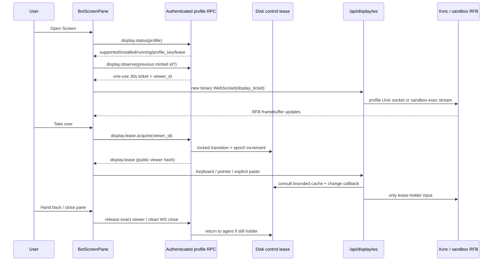
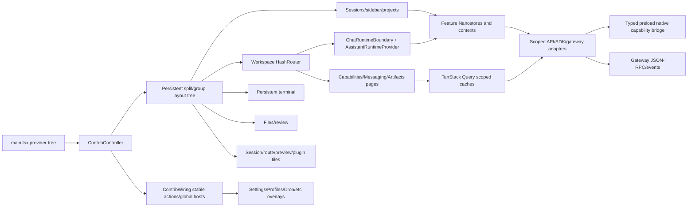
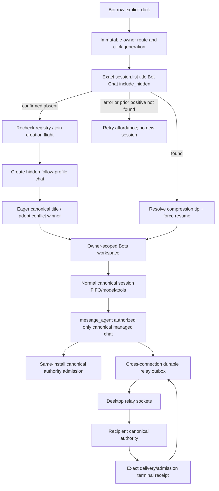
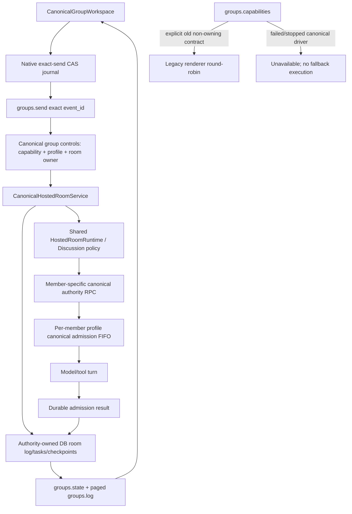

# Hermes renderer, projects, previews, Bot Mode, groups and remote screen reconstruction

Investigation date: 2026-10-24. Evidence type: **static local source inspection**. No Hermes application, tool, package installer, model call, relay or remote screen was executed. No private database rows, credentials or user conversation contents were read. Runtime and pixel parity are **UNVERIFIED**.

The absolute source root for every `S/…` reference below is `C:/Users/bharg/AppData/Local/hermes/hermes-agent/`. `D/…` means `S/apps/desktop/src/…`; `B/…` means `D/plugins/hermes-bots/…`. These prefixes make each citation an exact local file path, not a repository guess. Line anchors identify the inspected installed source revision. This annex accompanies the machine-readable frontend/component/store/RPC inventories in the main investigation; the tables here explain behavior and authority rather than pretending that a filename list proves execution.

## 1. Main conclusions and scope boundaries

1. Desktop is a standalone React renderer, not an embedded terminal UI. `D/main.tsx` mounts `App`, and `D/app/index.tsx` exports `ContribController` from `app/contrib`. Its active shell is the contribution registry plus a persistent split/group layout tree. `D/app/contrib/controller.tsx:194` registers the core sessions, workspace, terminal, files and review panes through the same registry used by bundled plugins.
2. The route table is small; the feature surface is much larger. Many views are query-param subpages or workspace tiles, many dialogs are global hosts, and tool/browser/screen panes are dynamic contributions rather than URL routes. Reimplementing only `APP_ROUTES` would omit much of Desktop.
3. The renderer uses feature-owned Nanostores, TanStack Query caches, React context and local component/ref state. Persistence is mixed: localStorage for UI preferences/drafts/layout, Electron's native prepared-submission journal for exact send intents, profile configuration/backend stores for shared truth. An atom's presence is not evidence it is durable.
4. Bot Mode is a shipped, disableable renderer plugin. A bot is a profile, and its main chat is identified by **profile + exact title `Bot Chat`**, resolved on the bot's owning connection. Canonical chat identity is not a saved session-ID pointer and never a most-recent-session heuristic.
5. Current canonical gateway groups and old renderer-coordinated groups coexist. **Do not reconstruct the old renderer loop as the current gateway authority.** Current groups route through `S/gateway/session_group_controls.py` and `CanonicalHostedRoomService`. Shared helpers under `tui_gateway/` remain required, but the old `tui_gateway/methods_groups.py` endpoint is not the whole active contract.
6. Screen is two transports: profile-scoped `display.*` JSON-RPC, plus a separate authenticated raw-RFB WebSocket consumed by noVNC. The server gates keyboard/pointer/clipboard/resize input using a persisted control lease. noVNC `viewOnly` is only the user-facing affordance.
7. Gateway-hosted Bot Desktop is Linux X11/TigerVNC/Xfce. A Windows Electron client can present a screen hosted elsewhere; a native Windows gateway does not magically become an Xvnc host. Sandbox placement has a separate policy and stream relay path. Availability on this particular running installation is **UNVERIFIED**.

## 2. Frontend bootstrap and composition

`D/main.tsx` first imports CSS and side-effect stores for active work/quit guard, battery/AC state, translucency, user bubble transparency, chat text scale and keep-awake. Dev instrumentation is imported before React DOM so its hooks observe commits. Clipboard and selection-copy-color shims install before rendering. The performance probe is included in non-production mode or explicit `VITE_PERF_PROBE=1`; ordinary production builds exclude that opt-in path.

The root branches by `?win=`:

| Window kind | Renderer root | Consequence |
|---|---|---|
| `overlay` | dynamically imported pet-overlay root | standalone transparent surface |
| `quick` | quick-entry root | standalone transparent entry surface |
| `wake` | wake-indicator root | standalone transparent indicator |
| `hud` | ordinary provider tree, HUD-aware shell | document title becomes Hermes HUD; transparent host styling |
| main, secondary, browser | ordinary provider tree | shell selects corresponding window experience |

Transparent root styling is applied before dynamically importing those roots so the theme stylesheet does not flash an opaque full-window rectangle. `secondary` and `browser` are explicitly opaque. Ordinary roots also install renderer animation pause state.

```text
StrictMode
└─ RootErrorBoundary
   └─ QueryClientProvider(queryClient)
      └─ ProfileI18nProvider
         └─ ThemeProvider
            └─ HapticsProvider
               └─ RootTooltipProvider (one global provider)
                  └─ HashRouter(useTransitions=false)
                     └─ ContribController
                        ├─ ContribWiring (gateway/session actions and global hosts)
                        ├─ fixed titlebar contribution slots
                        ├─ SidebarProvider / LayoutTreeRoot
                        │  ├─ sessions → SidebarSurface → ChatSidebar
                        │  ├─ workspace → ChatRoutesSurface → ChatView/pages
                        │  ├─ terminal → TerminalSurface → TerminalPaneChrome
                        │  ├─ files → FilesPane (idle mounted)
                        │  ├─ review → ReviewPaneContent (idle mounted)
                        │  └─ dynamically registered session/route/preview/plugin tiles
                        └─ StatusbarSurface
```

`HashRouter useTransitions={false}` is deliberate: route changes should not starve behind streaming updates. The one tooltip provider avoids per-tip provider churn. These are fidelity/performance requirements, not cosmetic details. Sources: `D/main.tsx`; `D/app/contrib/controller.tsx:140`; `D/app/contrib/surfaces.tsx:42`.

`D/app/contrib/wiring.tsx:305` owns connection/session orchestration and exposes stable actions through `ContribWiringContext`. `surfaces.tsx` memoizes each pane and subscribes at feature leaves; status polling does not need to re-render chat or terminal. `ChatRuntimeBoundary` in `D/app/chat/index.tsx:250` bridges the selected session view into `useIncrementalExternalStoreRuntime`, a message repository and `AssistantRuntimeProvider`. It also supplies composer scope, transcript-window state, history-window loading and transcript retention. `ChatView:472` gives every chat surface its own composer-surface identity; tiles must not share a single implicit composer owner.

### Shell behavior that must survive reconstruction

`D/app/contrib/layout-presets.ts` defines actual presets:

- Default: sessions left, workspace dominant, review/files beside one another on the right, terminal below the right tooling region; weights `[1, 3.4, 1.25]` at the root.
- Basic: sessions + workspace; terminal below workspace and review/files in their own resting right slots.
- Focus: sessions and workspace; files/review stack behind workspace, terminal remains a separate collapsed rail.
- Terminal deck: terminal across the bottom; files/review stacked together to the right above.
- Quad: sessions/files stack upper left, workspace upper right, terminal/review below.
- Simple mode exposes sidebar-left/right variants of Basic; advanced mode exposes the named decks. First-run demo is workspace alone with no tab strip.

Visibility and lifetime differ. Boot-hidden expensive panes idle-mount, then remain mounted while hidden. Terminal state, browser JS/cookies/history, RFB viewing and live tools must not be destroyed merely by hiding a pane. The tree store supports split/reorder/dock, hide-only standing chrome, dismissal, active/hovered group, tab strip visibility, close current/other/right/all, tab cycling/numeric activation, reload epochs and collapsed sides. See `D/components/pane-shell/tree/store.ts:72,203,367,491,650,716,854,898,1065`.

Workspace/session tabs can drag into a composer as session references or into zones/edges to split/stack. `workspaceDragPayload` and `workspaceTabDrag` in `controller.tsx:160` do not fabricate a session for a fresh draft or full-page route. Preview panes are dynamic panes placed beside the current file tree, not hard-coded members of the layout preset.

### Global hosts, auxiliary surfaces and quiet state

`D/app/contrib/wiring.tsx:1288–1441` mounts remote-display banner, installer/onboarding overlays, shared-metrics consent, free-tier sign-in, model/session pickers, model visibility, updates, gateway connecting/boot-failure/update-hold, command palette, plugin install, pet generation, session switcher, file-action dialogs, MCP deep-link install, remote folder picker, find bar, notifications, confirmations, send diagnostics and external-open-failed dialog. Floating pet and tips are excluded from HUD/browser windows. `PersistentTerminal` is outside conditional route views and receives terminal-selection-to-chat actions. A replacement root must retain these independent hosts.

## 3. Routes and screens

Exact route definitions: `D/app/routes.ts:15–83`; actual React routes: `D/app/contrib/surfaces.tsx:202`; overlay rendering: `D/app/contrib/wiring.tsx:1342`.

| Route/surface | Rendering and ownership | Important state and contract |
|---|---|---|
| `/` | fresh ChatView | a genuine new-chat route returns null for durable composer selection; never inherits the old selected session by accident |
| `/:sessionId` | stored ChatView | single decoded path segment only; reserved/contributed paths are excluded from session parsing |
| `/capabilities` | workspace page | `?tab=skills|plugins|connectors|toolsets`; capability scope selector; embedded/fixed-profile/fixed-connection mode for plugin dialogs |
| `/messaging` | workspace page | messaging page, not terminal embedding |
| `/artifacts` | workspace page | `?tab=all|…` artifact filter; recent transcript indexing, search, pagination |
| `/settings` | overlay | `?tab=…&page=…`, provider/key/billing subview params; scoped configuration |
| `/command-center` | overlay | command center view |
| `/session-import` | overlay | session import workflow |
| `/cron` | overlay | schedule/jobs surface with open-session callback |
| `/profiles` | overlay | profile management |
| `/agents` | overlay | agents view |
| `/starmap` | overlay | starmap view |
| `/webhooks` | overlay | webhooks management |
| contributed one-segment route | workspace page | registered in `routes` area; cannot override a reserved route; bounded by ContribBoundary |
| `/new` | redirect | replace with `/` |
| `/sessions/:sessionId` | legacy redirect | replace with canonical `/:sessionId` |
| unknown path | redirect | replace with `/` |
| Bot Chat, group, Screen, preview/session/route tiles | workspace surfaces | not equivalent to a new global URL route |

`syncWorkspaceRoute` and `navigateToWorkspacePage` (`routes.ts:301,324`) front the workspace pane for full-page routes, including re-clicks; an active session tile must not obscure an otherwise successful navigation. `$workspaceIsPage` suppresses the ordinary zone header while a page owns the workspace. Overlay views float over the underlying workspace and hide titlebar control clusters without destroying the session. Contributed page headers use `workspace.pageHeader`; titlebar slots remain separate and mounted.

### Conversation component contract

Sources: `D/app/chat/index.tsx:746`; `D/app/chat/composer/`; `D/components/assistant-ui/`; `D/app/chat/session-view.ts`; `D/app/chat/runtime-repository.ts`.

The conversation view contains backdrop, optional session header/actions, prompt overlays, runtime boundary, thread and composer, plus setup/intro/recovery handling. It reads a session-local view (`$runtimeId`, `$storedId`, `$messages`, `$cwd`, `$model`, `$provider`, busy/awaiting state) rather than assuming the foreground global socket owns every visible tile. Session focus and hover select keyboard ownership. A read-only transcript, exhausted resume, runtime gone, missing backend, hydration in progress, fresh draft ready and a live running turn are distinct states; a single generic spinner would be behaviorally wrong.

Composer is a feature cluster: file drops and uploads, image/screenshot capture, microphone recording and voice conversation, slash/at/emoji completions, command middleware, per-chat unsent draft, input history/undo, queued prompts, status drawer, subagent snapshots/control, goals/heartbeat/loop controls, preview/coding status rows, inline session/file/terminal references and popout/drag. Discovery and execution of slash commands are distinct gates (`D/lib/desktop-slash-commands.ts`, `D/app/session/hooks/use-prompt-actions/slash.ts`). Skill/quick-command extensions pass through curation even when not in the built-in allow-list; built-in terminal-only or messaging-only commands are hidden from Desktop discovery. Typed extension commands still dispatch.

### Major view implementation contract

| View | Load/empty/error/running and keyboard/persistence details |
|---|---|
| Chat | session-local transcript + composer scope; partial history/window loading; streaming messages update incremental runtime; hidden panes reduce subscriptions; draft adoption follows durable ID creation; recovery overlays distinguish exhausted resume from a blank new chat; focus owns cancel/submit keys |
| Sidebar | sessions/projects/profile/connection grouping, archive/pin/order/filter/row density and metadata preferences; backend membership is cached, not inferred solely from cwd; existing hidden canonical Bot Chats stay out; opening a group/project alone does not necessarily open a session |
| Capabilities | lazy tabs with per-feature query keys; explicit scope selector can target another registered gateway; embedded state stays local instead of changing route params; refresh invalidates relevant capabilities/slash caches; a fixed bot profile pins the entire view |
| Artifacts page | null data means loading; failed global refresh notifies then sets empty array; partial session-read failures are surfaced, not silently declared complete; kind filter lives in route; query and pages are local; image pages have 24 items, file/link pages 100 |
| Settings | overlay navigation/search; invalid tab/page redirects to valid defaults; current config is loaded with serving-origin binding; writes retain that exact owner; config import/export/reset are explicit; device capability gates hide unsupported native rows |
| Bot roster | last known roster and owner-qualified selection; offline/removed-source states are distinguishable from absence; click resolves canonical registry, metadata edits can be optimistic with CAS/retry; row activity/preview use canonical identity |
| Canonical group | mount freezes connection/profile/room identity; poll only while visible; hydrated exact-send journal locks composer until user resolves pending intent; read errors keep last successful content; errors are inline with refresh; Stop, exact approvals, retry and discard have separate semantics |
| Screen | unknown/loading, method unavailable, unsupported, missing stack/install, stopped/blocker/image switch, attaching/live/error, watching/self-controlled/other-controlled and evicted states; noVNC canvas focuses when control is acquired; hidden pane stays attached; explicit closure hands back |
| Preview | file/URL/artifact targets share tab entry point; source/render switch, missing-file tombstone, load error vs unreachable remote loopback, browser history/console, devtools, annotations; saved tabs omit transient bytes and generated artifact content |

## 4. Frontend state authority and persistence

`D/lib/persisted.ts:61` creates a Nanostore from the storage choke point and persists changes only. The initial subscribe emission is skipped to avoid writing a temporary empty bootstrap snapshot over durable data. Codecs sanitize booleans, text, arrays, string maps and JSON. Do not replace this with unconditional subscription writeback.

| Concern/store family | Authority | Durable/cached/UI meaning | Major consumer |
|---|---|---|---|
| `store/gateway*.ts`, `connections*.ts`, connection registry | Electron + gateway | renderer connection/cache state; registry capability descriptors are not credentials | boot, wiring, scoped APIs, bots |
| `store/profile.ts:55,60,296,307,320,484,494` | backend/Electron for actual owner; renderer for view scope | active/known profiles, new-chat route/profile/connection, swap/hydration target; per-connection profile map prevents collisions | settings, sidebar, composer, routing |
| `store/session.ts`, `session-states.ts`, transcript/tail/sync | backend | foreground/session-tile caches; durable and runtime IDs differ; cached messages are not an authoritative new resume | ChatView, tiles, sidebar |
| `store/composer.ts:86,239` | renderer | current draft and attachment occurrences; text drafts persisted under `hermes:composer-drafts:v3`; blobs/upload state memory-only; fresh-draft key persisted separately | composer and per-tile scopes |
| `store/composer-queue.ts:175,225,299,345,697` | backend for supported server queue, renderer fallback otherwise | `hermes.desktop.composerQueue.v1`, cross-window storage updates and drain claim; terminal selection content is never serialized; bounded auto drain attempts = 4 | queue UI and prompt drain |
| prepared submission/native journal | Electron durable file owner | exact intent exists before transmission; per-room CAS prevents windows replacing each other's send | canonical group send and normal prepared prompts |
| layout tree/store layout/panes/tab strip | renderer | mode-scoped persisted tree/preset/dismissal/collapse/strip choices, focus/drag refs transient | shell |
| `store/projects.ts:64–85`, `project-tree.ts` | per-profile backend | cached explicit projects and authoritative project/repo/lane tree; availability loading flags separate | grouped sidebar, project dialogs |
| `store/project-scope.ts:20` | renderer | localStorage `hermes.desktop.projectScope`; not the backend active-project pointer | sidebar, new-chat cwd |
| `store/artifacts.ts:51` | transcript durable; renderer registry | in-memory versioned generated content, rebuilt from messages | code cards, artifact preview |
| `store/preview.ts:259`, `preview-ownership.ts:23,29` | renderer with backend file facts | persisted file/URL tab descriptors; per-connection/profile/session scope, pending runtime and compression rotation mapping; transient/artifact bytes omitted | preview panes, popouts |
| approval/clarify/server-requests/parked-card-answers | gateway/runtime | cached request lifecycle + UI response state; a card must respond to its exact request/owner | prompt overlays/HITL |
| model/favorite/visibility/pricing/custom/preset stores | mixed | backend model choice/provider facts; renderer picker preferences; do not conflate friendly display names with provider identity | model menus, settings |
| `themes/context.tsx:122,492,505`, I18n contexts | profile preference/config + renderer preview | profile-qualified theme/mode and pre-paint restore; theme preview differs from committed theme; locale scopes to owner | all surfaces |
| notifications/native notifications/completion sound | renderer/Electron | toast host, native delivery and preference gating | wiring, completion/error listeners |
| `B/bot-state.ts`, `B/data.ts:192` | renderer cache plus profile backend | selected bot highlight persisted; profile UI metadata in server YAML/assets + local migration cache; no chat-ID pin | roster/routines/mentions |
| `B/screen-state.ts:22` | backend status/lease | memory-only per-bot cache/viewer capability; request generations reject stale status and lease epochs reject stale control | Screen portal/pane |
| `B/group-chat.ts` | legacy renderer room log + gateway mirror | legacy local storage/tombstones/holds; not the canonical driver execution authority | legacy group workspace only |
| `B/canonical-group-registry.tsx:8` | backend room identity | memory-only resolved aliases; re-query after restart; connection/profile-qualified binding | canonical group open |

This table is not a claim that every store declaration has been manually traced; the generated all-file/store catalog provides the remaining symbol-level inventory. IndexedDB as a first-party state authority is **UNVERIFIED** in this manual slice. Third-party libraries may use browser storage internally; no blanket negative claim is made.

## 5. Projects and workspaces: full authority chain

`D/store/projects.ts` explicitly describes first-class named multi-folder projects, per-profile `projects.db` and gateway-owned project membership. `$projects` is a cache; `$projectTree` is the authoritative overview projection fetched from `projects.tree`. The backend tree supplies repos, worktree/branch lanes and session counts; drill-in fetches `projects.project_sessions` lazily. `$projectOwnerBySessionId` is derived from that same tree, avoiding multiple competing cwd classifiers.

`enterProject:108` scopes the sidebar and best-effort calls `setActiveProject` only for actual persisted IDs (`p_<hex>`). Auto repo projects have path IDs and the synthetic Home bucket has no durable project row. Entering does not open a conversation. `goToProject:133` optionally creates a new draft/tab at the project root. `followEnteredProjectCwd:191` updates cwd only for a fresh draft; a stored conversation retains its own cwd/files/review context.

New-chat cwd precedence (`resolveNewSessionCwd:164`): explicit entered project root → configured default workspace directory; Home means detached and wins over the default. It does not inherit the most recently resumed conversation's cwd. `projectIdForCwd:204` longest-path matching includes repo roots and worktree-lane paths, so sibling worktrees outside a repo root still belong to that project.

Trace:

```text
Sidebar project creation / folder picker
 → D/store/projects.ts createProject:1107
 → captured gateway/profile request projects.create (name,folders,primary_path,…)
 → S/tui_gateway/methods_projects.py _projects_method / handler:91
 → S/hermes_cli/projects_db.py create_project / projects_db_path:23
 → <owning profile HERMES_HOME>/projects.db
 → {project} response, guarded against stale connection/profile generations
 → cached projects/tree refresh; UI reports created-in-previous-context when needed
```

`methods_projects.py:27` wraps every endpoint in profile scope, closes DB handles and maps errors: 5061 generic, 5062 missing project, 5063 invalid arguments. Routes include list/get/create/update/archive/delete/set_active/for_cwd/add_folder/remove_folder/set_primary, plus registered discovery/tree/session projection methods. `create` optionally `use`s the project. `for_cwd` resolves backend cwd and branch. This family is a shared metadata service called through Desktop's scoped gateway surface; the master gateway report establishes the exact canonical delegation entry.

Schema, `S/hermes_cli/projects_db.py:28`: `projects(id PK,slug UNIQUE,name,description,icon,color,board_slug,primary_path,created_at,archived DEFAULT 0)`, `project_folders(project_id FK ON DELETE CASCADE,path,label,is_primary,added_at; PK project_id/path)`, path index, `project_meta(key,value)` with `active_id`, and `discovered_repos(root PK,label,last_seen)`. Additive migrations restore optional columns; sqlite utility handles WAL with DELETE fallback.

Native/remote files and Git are selected through `D/lib/desktop-fs.ts` and `D/lib/desktop-git.ts`. `projects.ts:873` asks the connected backend to scan its roots in remote mode rather than scanning the user's Windows machine for a remote project. Operations include cached repo discovery, named-project updates, folder additions/removal, auto-project appearance, move-session-to-project, branch/base-branch listing, worktree creation/removal, reveal/copy paths, opening folders and project idea generation. Optimistic edits snapshot and restore caches on authoritative failure; async result generations prevent a save into one context from painting another.

## 6. Artifacts, files, browser and preview

There are **two different artifact concepts**:

1. Global Artifacts page (`D/app/artifacts/index.tsx:123` and `artifact-utils.ts`) indexes images/files/links from recent sessions and their messages. It initially lists 30 recent sessions across profiles, loads transcript pages oldest-first including compacted content, sorts by timestamp, warns on partial session failures/safe-load caps, and provides kind/search filtering. It opens files/media or their source chat. This is not the generated-code artifact registry.
2. Generated artifact registry (`D/store/artifacts.ts`) promotes substantial HTML/SVG/code produced in transcript cards into versioned content. Identity is `(sessionId,slug)` where slug derives from kind/language/title; repeated dashboard generations become versions of one artifact. Content hash deduplicates identical versions. The transcript remains durable; localStorage does not duplicate generated megabytes.

Registry bounds: 24 artifacts/session, 20 versions/artifact, 40 sessions, four million UTF-16 code units retained content. Pruning first removes globally oldest historical versions, then old whole records, while retaining the newest record even if oversized. Explicit selected versions follow content hash after pruning, falling back to newest if evicted. Sources: `artifacts.ts:55–73,132,198`.

`D/store/preview.ts:48` `PreviewTarget` is discriminated by `kind='artifact'|'file'|'url'` and includes source/url/label, optional path/mime/language/byte size/render mode/preview kind/transient data URL/missing tombstone. All entry points use `openPreview:920`. Tab descriptors (`:87`) include session ownership and explicit pinning. Focused session tabs plus pinned tabs are visible; hidden sessions retain their tabs. Draft tabs are adopted on first durable ID, runtime-only ownership bridges pre-persistence opens, and compression rotates ownership through explicit mappings. Profile/connection scope migrations and removals are implemented, not optional cleanup.

Saved tabs use `hermes.desktop.previewTabs.v2` per scope. Restore drops artifact targets because their memory registry does not exist yet; transient image bytes/data URLs are omitted, confirmed missing files are not endlessly re-probed after restart. Legacy unscoped rows are migrated to pinned. Browser tab location and page title are tracked separately. Browser popout marks IDs so the docked and popped views do not both own the same active surface (`preview.ts:742–802`).

`D/app/chat/right-rail/preview-pane.tsx:259` provides live URL/HTML browser guest, browser bar, console state, annotations/cards, page reader/script runner/input/nav registration, context menus, DevTools state, load-error recovery, source/render mode and external-browser handoff. A webview always runs on the user's computer; a remote gateway's `localhost` needs reachability handling and cannot be interpreted as the user's loopback (`:177`). Browser instance is created once and navigated with `loadURL`; ordinary navigation should not remount it and erase cookies/forms/history.

At `preview-pane.tsx:1139`, guest partition is exactly `persist:hermes-preview`, preferences `contextIsolation=yes,nodeIntegration=no,sandbox=yes`; no `allowpopups`. Guest events include console-message, trusted guest IPC external-open, context-menu, DevTools open/closed, did-fail-load, did-navigate/in-page, did-start/stop-loading, title and DOM-ready. Print is disabled with guidance to an external browser. Only trusted guest link intent admitted by the explicit external URL gate reaches OS openExternal; arbitrary page popup attempts are not permission to launch a browser.

Generated HTML uses `<iframe sandbox="allow-scripts" srcDoc=…>` with opaque origin, no same-origin/top navigation/popups; SVG is DOMPurify-sanitized with SVG/SVG-filter profile. It forces a white/light content canvas independent of app theme. Sources: `preview-artifact.tsx:77–106`. This differs from sandbox-empty iframes used for other preview cases; preserve the content-specific boundary. `preview-file.tsx` supports text/source, Markdown, images, HTML source/render, PDF and binary states and attachment/reference actions; the PDF path avoids Chromium's large data-URL issue. Full MIME-specific runtime behavior remains **UNVERIFIED**.

### Preview reconstruction checks

- Open same artifact twice, regenerate it, select old version, prune and reload: tab identity/content selection stays coherent.
- Two sessions with identical URL/file paths retain correct ownership; pinned tabs are cross-session explicitly.
- Draft/first send, compression and profile rename/remove transfer/drop tabs using owner scope.
- Hide browser pane and return: guest cookies/history/form/JS state survive.
- Remote localhost produces remote-aware recovery; a failed image or missing file does not produce a silently blank pane.
- Foreign guest popup/script cannot trigger OS browser; trusted HTTP(S) click can use the admitted external-open path.

## 7. Settings and capability contract

`D/app/settings/index.tsx:77` builds valid settings views from configuration sections plus providers/gateway/connections alias/keybinds/keys/vault/notifications/billing/sessions/plugins/about. Default is `config:model`. `tab=connections` redirects to gateway; moved old MCP links redirect to Capabilities. `page` selects a validated subpage; old `field`, `setting`, `aux`, archived-session/vault parameters map to current pages. `pview`, `kview`, `bview` carry provider/key/billing subview. Navigation mutates a single search snapshot and clears page-scoped params to avoid sequential stale-query overwrite.

| Setting family | Exact frontend subpages / fields |
|---|---|
| Appearance | general (language, intro splash, model pricing, resume-last-session, tips/tours); theme; typography (UI scale, chat scale/font, terminal font); window-layout (simple/advanced, density, strip/app actions, tray, translucency/backdrop, files-on-start, composer popout); chat-display (bubble alpha, text direction, timeline, reactions/hearts, tool display, diffs, reasoning collapse, embeds); pet |
| Model | main: `model`, `model_context_length`, `agent.reasoning_effort`, `agent.service_tier`; fallbacks: `fallback_providers`; auxiliary: `auxiliary.*`; delegation: `delegation.*`; MoA: `moa.*` |
| Chat | behavior: `display.personality`, `timezone`, `display.show_reasoning`; attachments: `agent.image_input_mode` |
| Workspace | projects: `terminal.cwd`, `desktop.repo_scan_*`; shell: `terminal.persistent_shell`, `terminal.env_passthrough`; files: `code_execution.mode`, `file_read_max_chars` |
| Safety | approvals `command_allowlist`, `approvals.*`; privacy `security.*`; checkpoints `checkpoints.*` |
| Browser | real-profile `browser.use_real_profile`; network `browser.allow_private_urls`, `browser.auto_local_for_private_urls` |
| Memory | persistent `memory.*`; context `context.*`, `compression.*`, `auxiliary.compression.*` |
| Voice | conversation `voice.voice_chat_mode`, `voice.max_recording_seconds`, `voice.client_direct`, `voice.gpt_live.*`; transcription `stt.*`; speech `voice.auto_tts`, `tts.*` |
| Advanced | desktop `updates.*`, keep-awake, disable-F12, quick-entry enable/shortcut; runtime max turns/API retries/service tier; tools `toolsets`, `agent.tool_use_enforcement`; terminal `terminal.*`; output `tool_output.*`/checkpoints |
| Gateway | connection, devices, managed-updates |
| Keys/provider/vault | provider accounts/API keys; tool keys; vault credentials/sources; secrets use dedicated endpoint paths, not a promise that config JSON contains them |
| Other | keybind shortcuts/HUD gesture/screen capture; notification master enable/per-kind toggles/mute sounds/completion sound; sessions archived/auto-archive/default-directory; gateway keychain-encryption/diagnostics; chat attachment-size limit; billing overview/plans capability-gated; plugin settings; about updates/uninstall |

Source: `D/app/settings/config-subpages.ts`, `appearance-subpages.ts`, `other-subpages.ts`, `settings-manifest.ts`. The manifest defines hand-built searchable rows, deep-link IDs and capability gates; dynamic config-schema fields, credential entries and plugin settings index themselves. This is not a finite hard-coded settings list independent of backend schema/plugins. Defaults are backend-schema dependent; **UNVERIFIED** defaults must not be invented from labels. Source-manifest extraction in the master catalog is the exact row inventory.

Configuration read/write trace: `D/api/config.ts:166` resolves capability-scoped `(connectionId,profile)` → private preload HTTP API → GET `/api/config` (optional `include_defaults=false`) → record gets a WeakMap origin binding → derived records preserve origin → `saveHermesConfig:196` / `saveHermesConfigRecord` PUT `{config}` back to the captured owner. An explicit connection/profile pin wins; an unbound reset-to-defaults uses live scope. This avoids saving a stale dialog's config into the gateway the user switched to meanwhile. Schema/defaults/status/logs/env have distinct API paths and timeouts. A failed authoritative save is an error, not a successful local preference update.

Settings supports JSON export via Blob/download, import and confirmation before reset. Appearance's device-level capabilities are distinct from backend profile settings; e.g. translucency and tray rows depend on preload support. Bot advanced dialogs embed the real Capabilities surface with `fixedProfile`/`fixedConnection`; they do not duplicate connector/toolset configuration logic.

## 8. Bot Mode: identity, roster and complete click-to-chat trace

### Registration and visible surfaces

`B/plugin.tsx:110` registers plugin `ID`, localized labels, face clock, cross-connection relay, opt-in Screen auto-raise, mention completion, Bot roster pane, focused-bot routines pane, empty-chat contribution and palette/middleware contributions. It hydrates bot metadata, selected roster highlight, activity-toast preference (default off), old group logs/tombstones and user sections. Disposal removes clocks/listeners/timers/relay/auto-raise. Turning a plugin off must stop its work, not only hide the pane.

The routines pane follows the **focused chat's owner** (`$focusedBotOwner`) rather than the primary socket's launch profile; multiple profiles may stream while the shell keeps the primary connection. Sidebar profile headers get a `ProfileGroupScreenPortal`. Opening Screen reuses a single workspace tab per `botSelectionKey` (`B/screen-open.tsx:18`), minimum width 28rem, with close bookkeeping. An already-open Screen is revealed rather than duplicated.

Bot UI includes custom title/description/soul/model/capabilities, vector face color/shape/eyes, image/pet avatar, creation/duplication/deletion, hidden/pinned rows, user sections/group memberships/order, unread/activity/error attention, routines and Screen portal. Exact row context-menu actions include Open Bot Chat, Screen, Screen auto-open checkbox, Pin/Unpin, Hide/Unhide, Edit Profile, Manage Groups, Duplicate, New chat with agent, Open Recent Session (disabled when absent), Move to existing/new section, remove from section and non-default deletion. The recent-session affordance is separate from canonical row click. Group rows offer open/pin/section move/delete. Roster toolbar has activity-toasts toggle, New Bot, capability-gated New Group Chat (at least two seatable bots), New Section, search and kind/activity/gateway filters. `BotRow` receives menu callbacks and reads roster/meta/focus/attention instead of fetching arbitrary session history. Sources: `B/bot-row.tsx:126,332,626`; `B/roster-pane-toolbar.tsx:34,76`; profile mutation/asset details `B/profile-ops.ts` and `B/data.ts:420`.

Roster identity is source-qualified. Two gateways' `default` profiles cannot borrow title/avatar/pin/group/unread or canonical chat identity. `routing.ts` resolves explicit immutable owner routes and alias `targetProfile`, rewrites profile-sensitive RPC operands, fails on a removed owner, and coerces malformed RPC error objects into string-named Errors for React Query. Explicit writes get foreground spawn priority (`profiles.configure/create/set_asset`); passive roster warmup does not consume the user's reserved foreground dial slot.

`B/data.ts:887` `useRoster` reads the rich active-source roster and union host routes; `primeRoster` seeds mention discovery before the Bots pane ever mounts. `profiles.list` supplies `canonical_session`, `last_session`, worker state and metadata. In `S/tui_gateway/methods_profiles.py:162`, the canonical registry reads exact title and compression tip; UI metadata and revisions/has-avatar are separate (`:257`). Current canonical gateway profile listing also has an authority-specific implementation in `S/gateway/session_group_controls.py` below its group dispatch. Do not assume the old method module alone owns current session admission.

### Canonical chat algorithm

`B/canonical-chat.ts` establishes `CANONICAL_CHAT_TITLE='Bot Chat'`, `PROFILE_SESSION_LIST_LIMIT=200`. The exact-title lookup is not the first 200 recent chats; the backend indexed title query must find hidden/old canonical rows.

```text
BotRow click
 → B/roster-actions.ts openRosterBot (generation/selection ownership)
 → prepareBotSource (validate routed-request capability; no global re-home)
 → B/canonical-chat.ts openBotCanonicalChat:610
 → findExistingCanonicalChat:280
 → B/routing.ts requestForBot
 → host.requestProfile(captured route,'session.list',
      {profile: backend target,title:'Bot Chat',limit:200,include_hidden:true},
      foreground priority)
 → exact registry row or confirmed absence
 → openStoredBotChat:118 with resolved_id || id
 → host.openSession(route, profile, intent:'in-place', forceResume:true,
      workspaceMode:'bots', workspaceOwnerKey, tabTitle:'Bot Chat',
      keepAllProfilesScope:true, awaitHydration:true,
      bot hydration budget or 60s fallback, retryHydrationTimeoutOnce:true)
 → normal Desktop resume/session view/streaming path
```

Lookup failure **throws**; it never becomes absence. A successful empty list is also unconfirmed absence if the roster already proved `canonical_session.id`; this avoids forking during backend restart/warm-up. A stale click generation cannot navigate after another click. Both durable registry ID and resolved lineage-tip ID are returned; comparing focus against only the old registry ID breaks compressed Bot Chats. Stale old-tip tiles are discarded owner-scoped without fronting unrelated background work.

Confirmed no row triggers `createCanonicalChat:408`:

1. Join one in-flight creation per owner. Re-run exact lookup before minting, adopting a concurrently created winner.
2. `session.create {profile,title:'Bot Chat',hidden:true,follow_profile_config:true}`. Bot chat model config follows the profile's current choice instead of restoring an obsolete stored provider pin.
3. Eager `session.title {session_id:runtime,title:'Bot Chat'}` materializes/labels a lazy row before UI open or intro; this prevents an untitled gap that could let a second click mint another canonical chat.
4. If title uniqueness says already in use, re-query/adopt winner and abandon the zero-message loser. Do not use auto-titler recency or repeatedly create.
5. Mount stored ID with owner route before submitting intro so the stream has a surface. New bot creation opts into localized kickoff; ordinary first open of an eagerly titled row lets the user speak first. Older eager-title-incompatible backends use prompt submission to persist the lazy row. Intro waits 400ms and uses `prompt.submit {session_id:runtime,text:kickoffText()}`.
6. Registry stays authoritative if the intro/open fails; next click resolves it. No stored pointer is updated.

Background refresh (`background:true`) uses refresh-in-place and never creates a missing chat. Canonical rows are always hidden in Sessions; reconciliation hide sweep also repairs legacy visible rows. Side chats started with New chat with this agent are normal visible sessions, never row-click target. Legacy `ui_meta['hermes-bots'].chat` is ignored/stripped.

### Bot metadata and assets

`B/data.ts:420` `saveBotMeta` paints local state, persists plugin cache, then writes profile `ui_meta['hermes-bots']`; avatar image bytes go through `profiles.set_asset` rather than bloating metadata returned on every roster query. Metadata uses server per-key revisions/CAS when available, protects local writes from older roster snapshots, and retries conflicts against fresh state. `S/tui_gateway/methods_profiles.py:605` merge holds a profile UI-meta lock, validates expected revisions, caps metadata at 64KB and returns `applied`/conflicts/revisions. Vector face rasterization backfills a 160px PNG for inter-agent notice avatars without replacing the live animated vector face in the roster. Migration from bare-name v1 to source-qualified v2 commits only under provable sole-local topology; ambiguous mixed topology does not smear names across connections.

### Mention behavior and bot delivery

`B/plugin.tsx:144` offers up to eight @ completions from cached union roster, matches friendly name/tag/handle, excludes the focused active bot, and connection-qualifies ambiguous tags. `default` surfaces as Hermes. Only own-source rows suppress duplicate raw gateway completions; same-named remote rows retain distinct routing. Composer middleware resolves mentioned teammates and inserts messaging context; it does not silently retarget an ambiguous handle.

Agent tool `message_agent` is not a core registry/toolset addition. `S/tools/bot_mode_dm.py:141` authorizes only protocol-enabled managed canonical Bot Chat sessions and `ensure_message_agent_tool` injects both schema and valid-tool-name dispatch state. The schema is stable per conversation to preserve model prompt cache. Message cap is 16,000 chars. Delivery is fire-and-forget with an acknowledgement/delivery ID; a background process completion carries reply/failure (or explicit poll fallback). Target resolution prefers exact handle/profile, supports friendly names and `handle@connection`, fails ambiguous identities, applies author attribution server-side and rechecks dispatch gate.

**Current execution authority:** `S/tools/bot_live_delivery.py:72` uses already-running gateway discovery/private session ticket and `GatewayClient` to call authority bot relay; no fallback owner is spawned. `S/gateway/session_bot.py` alone admits canonical Bot Chat delivery into the session FIFO. Old live-owner mailbox records are receipts/migration inputs, not a second execution queue. `PreDialError` distinguishes definite no-send before the RPC from ambiguous post-send failure. A current reply is tied to delivery/admission identity; a transient failure can receive one derived-ID retry. Deprecated module docstrings describing CLI chat commands do not override these active function calls.

### Cross-connection relay

`B/relay.ts` owns renderer relay lifecycle. Every supported gateway sees other connections' agents via `bot_relay.roster.sync`. `bot_relay.outbox.pending` triggers a 250ms debounced drain; 30s drain tick is backward-compatibility backstop, and roster refresh cadence is 60s. Route retention keeps reused profile sockets alive. Drains first claim all senders' durable envelopes, then deliver without holding the drain; target lanes serialize work. Claimed-but-unacknowledged envelopes remain pending across renderer restarts via sender storage and replay semantics.

```text
message_agent on gateway A
 → S/tools/bot_relay.py remote target + durable outbox
 → bot_relay.outbox.pending event
 → B/relay.ts claim bot_relay.outbox.drain on A
 → host.requestProfile(target route B,'bot_relay.deliver',exact envelope,
      timeout from relay-budget.ts)
 → B authority bot ingress / canonical session FIFO / model turn
 → same delivery/admission terminal receipt
 → bot_relay.reply on A, durable acknowledgement
 → sender background waiter wakes with reply/error
```

`S/tools/bot_relay.py` constants: 900s default queued-envelope TTL, 120s fallback turn wait, 600s per-attempt budget, max two attempts, 180s settlement margin; Desktop delivery deadline therefore 1500s. Re-offer is after that plus 60s, wait budget outlives replay and another full deadline, stale artifacts sweep after six hours, remote roster freshness 600s. These long waits are receipt/recovery policy, not permission to run duplicate model turns. The master protocol catalog should preserve these as source constants. Tool/runtime use and actual liveness are **UNVERIFIED**.

### Routines pane: scoped scheduled work

`B/cron.tsx:1171` resolves routine owner from the focused authoritative chat owner first, exact roster row required; absent authoritative row fails closed. Non-authoritative focus can fall through to explicitly selected bot. `RoutinesPane:1203` subscribes roster so late hydration unblocks the surface, renders ScreenHero and schedules, and pins an inspector by job ID rather than stale object snapshot. Queries refresh approximately every 20s; stale cached jobs can remain with a stale notice, distinct from loading/empty/read failure.

`loadRoutines:105` calls captured `requestForBot(owner,'cron.manage',{action:'list',include_disabled:true,profile})`. It detects old delegated-routine prefixes and attempts to pause unsafe old jobs. A failed pause does not turn a successful list into failure or falsely paint the job paused; only confirmed paused IDs get the local overlay. This is an active compatibility mutation, not just display filtering. Old backends that ignored profile scope are bounded by `[bot:<profile>]` name filtering.

`CreateRoutineDialog:955` collects title/instruction/schedule, validates them, captures bot owner, supports one-shot/daily/weekly/monthly/interval/advanced schedules and finite repeat count, and optional continuity (default false). Output destination defaults to run history; choosing Bot Chat sets `deliver:'bot-chat'`, which injects the run result into that bot's canonical chat and can cost an additional agent turn. Add request is `cron.manage {action:'add',name:'[bot:<profile>] <title>',schedule,prompt: routinePrompt(...),profile,repeat?,continuity?,deliver?}`; after ACK it invalidates only that routine owner, notifies success and clears/closes the form. Row controls use cron.manage, detail rows show schedule/next/last/run/delivery/model facts, and error/stale/legacy-unsafe status remains explicit. Backend scheduling, durable job store and output injection are the master runtime/cron annex's responsibility.

## 9. Groups: canonical versus old Desktop coordinator

### Capability-selected architecture

`B/canonical-group-capabilities.ts:9` returns:

- `canonical` only on `driver===true`.
- `legacy` only on explicit `driver===false && persistent_process===false` **without** protocol_version/authority_gateway_id/groups.create/canonical-owner markers.
- `unavailable` on malformed capability, failure, missing method or a room-owning authority whose driver is stopped.

Failure does not authorize falling back to a second coordinator. Group creation is fenced to connection/profile/socket activation epoch. Canonical picker permits same-connection seats only and honors authority `seatable_profiles`, excluding parked/retiring/unaddressable profiles and ghost rows. New canonical rooms require name, two to six members, unique profile IDs and unique non-reserved handles (`all`/`everyone` reserved). `B/canonical-groups.ts:115` validates same authority and sends UUID room ID plus local member targets.

`B/group-chat-view.tsx:594–699` first resolves saved canonical binding/room from `groups.list`; failed lookup is not missing. Binding keys include encoded connection/profile + room ID, name aliases are separately scoped, and free-text names resembling `canonical:…` are not parsed as keys unless the caller declares origin `'key'`. Restarted in-memory bindings rehydrate from authoritative list. Legacy history is shown with an explicit create-new-gateway-room offer; it is not replayed into the new room automatically.

### Canonical end-to-end send and recovery

`B/canonical-group-workspace.tsx` remounts on `(connectionId,profile,roomId)`, freezes captured authority, loads exact pending send intent and polls `groups.state` + paged `groups.log` while visible. Poll completes, then schedules next in 2s; pages request 100 and require monotone cursor. Stale/unmounted results drop. Read failures remain inline while last successful room/log stays usable.

```text
User sends text/committed attachment manifests
 → prepareCanonicalGroupSend (B/canonical-group-send.ts:88)
 → native preparedSubmissions.compareAndSet key
      ['canonical-group-send-v1',connection,profile,room]
 → exact event_id + payload(thread_id defaults to event_id) durably published
 → canonicalGroupRequest -> host.requestProfile(exact descriptor)
 → groups.send {room_id,event_id,payload,profile}
 → S/gateway/session_group_controls.py dispatch_group_control
 → capability/profile/path/field validation and room-principal authorization
 → CanonicalHostedRoomService.send
 → durable hosted-room user event + Discussion policy/task planning
 → HostedRoomRuntime executes fenced task
 → member-specific HostedRoomAuthorityRPC / HostedRoomOwnerRPC
 → owning profile canonical session FIFO authority.submit
 → member model/tools/result, durable admission result
 → fenced room event/task settlement
 → groups.state/log polling -> rendered history/status/actions
 → definitive Send ACK retires ONLY matching prepared event_id by CAS
```

Timeout/unknown retains identical send intent for explicit retry; another window's pending intent wins the room's one slot and this window holds its unsent draft for later. Native journal write failures never fall back to less-durable localStorage. Browser-only localStorage fallback guarantees reload recovery, not process-crash safety. Group composer disables while hydration/upload/send/pending state demands it.

`S/gateway/session_group_controls.py:13–45` canonical method/capability contract:

| Method | Capability | Fields (plus optional validated profile) |
|---|---|---|
| groups.capabilities | session:read | none; returns driver/persistent_process/protocol/authority/features/methods/max log/seatable profiles |
| groups.list | session:read | limit,offset,include_disbanded; actor-visible pagination |
| groups.state | session:read | room_id,include_disbanded; room + driver status/actions |
| groups.log | session:read | room_id,since_seq,limit,include_disbanded |
| groups.create | session:control | room_id,name,members |
| groups.rename | session:control | room_id,event_id,name |
| groups.disband | session:control | room_id,cancel_id |
| groups.send | session:submit | room_id,event_id,payload |
| groups.attachment.upload | session:submit | room_id,upload_id,kind,name,mime,data_base64 |
| groups.attachment.download | session:read | room_id,event_id,attachment_id |
| groups.stop | session:control | room_id,cancel_id |
| groups.retry / discard | session:control | room_id,member_id,task_id,execution_generation |
| groups.approve | session:approve | same exact attempt + choice once/deny + request_id |

Unknown fields and mismatched authority/profile/DB parent are refused. Room operations require exact principal ownership; create ownership is claimed in the insert transaction. A stopped driver returns runtime coordination failure for execution controls; metadata operations cannot silently destroy active/unknown work. Canonical service DB is **`authority.db.db_path`** (`S/gateway/session_hosted_service.py:17–22`), and control dispatch verifies that exact DB identity. The old standalone `tui_gateway/HostedRoomService` default `shared-state.db` path is a different lane; do not apply it indiscriminately to canonical groups.

`HostedRoomAuthorityRPC` (`S/gateway/session_hosted_rpc.py:23`) deterministically derives a member-session identity from room/member/profile; it creates/recovers hidden `Group: <roomId>` sessions with source/platform `bot_room`. A room has no clarification response API, so the trusted policy disables clarify; member questions must be regular room replies. It submits idempotently by task + execution generation, checks membership/owner against the FIFO writer snapshot, routes sibling profiles through attested owner RPC and recovers durable terminal receipts. It does not construct a legacy TUI session server.

Stop uses durable cancel IDs. `HostedControls` in `S/gateway/session_hosted_controls.py:9` verifies exact room/member/task/execution generation and current membership. Deferred idle tasks can retry. Indeterminate execution cannot be treated as definitely not run: explicit discard commits the canonical unknown outcome before the driver cancellation. Pending controls appear in `driver_status`; UI copies exact IDs, shows confirmation before discard and offers allow-once/deny for exact approval request. Group attachment upload commits an upload receipt before Send; Send uses only its manifest, later downloads must name the event-bound attachment. Download lifetimes abort on room/view change. Sources: `B/canonical-group-attachments.tsx:36–95`; `S/gateway/session_hosted_attachments.py`.

### Required shared backend and legacy distinction

Shared backend modules remain load-bearing: `S/gateway/hosted_rooms.py` durable room/log/authority, `hosted_room_driver.py` task generations/leases, `hosted_room_discussion.py` deterministic discussion policy, `hosted_room_policy_checkpoint.py`, attachments and member transport helpers; `S/tui_gateway/hosted_room_service.py` and `hosted_room_driver.py` are extended/reused by canonical service. Names containing `tui` do not make them presentation-only.

The old `B/group-rounds.ts` driver is active only in capability-approved legacy mode. It uses one plugin-owned ordered log, deterministic @mentions, bounded serial round-robin (not parallel or LLM routing), per-member persistent group sessions, watermarks of seen messages, `(pass)`/empty/failure silence, per-turn hard caps, thread stop/holds and stranded-reply harvesting. `B/group-chat.ts` persists old room maps, sessionOwners, holds, external cursors, image/order/pin/section, epoch/running ephemeral state and tombstones. On hydrate epoch/running reset; holds persist. Disband remembers tombstone before remote sync so a stale gateway mirror cannot resurrect a room; deleting a connection annotates orphaned members instead of silently removing history. These compatibility paths must be classified, not accidentally promoted to canonical behavior.

Legacy backend group endpoint has peer invite/revoke/register, log replica/promote/demote APIs (`S/tui_gateway/methods_groups.py`). Canonical capability explicitly says RoomLink disabled/canonical_driver_required and exposes its own current method list. Presence of peer-replica code is not proof that current canonical Desktop can create arbitrary cross-gateway peer rooms. That feature's active exposure is **UNVERIFIED**; current frontend create enforces same-connection seats.

## 10. Screen/noVNC: complete implementation trace

### RPC/stream split and identity

`B/screen-connection.ts:122` `displayRequest` resolves the bot owner, injects backend target profile at the single choke point, and calls `host.requestProfile`. Supplied params cannot override route profile. Screen events match **connection ID + profile_key**; two hosts with identical home paths are not the same screen. A removed owner settles to no screen; a legacy unscoped local row may use bare profile fallback. Profile socket is retained for the viewer/install lifetime so lease/install push events continue after a request returns.

`BotScreenPane` (`B/screen-pane.tsx:80`) starts with cached status/lease, refreshes with per-bot generation token, subscribes display.lease/status and renders explicit availability states. `$screenState` rejects lower lease epochs and stale delayed status responses; authoritative mutation/event invalidates outstanding status generations. It never persists raw viewer capability.

Attach (`screen-pane.tsx:170`): load noVNC before creating WebSocket → retain gateway profile socket → `display.observe` with this pane's prior minted viewer ID if present → receive ticket/viewer ID/status/lease → SHA-256 viewer ID to first 12 hex → resolve sibling `/api/display/ws`, stripping original gateway credential → append one-use `display_ticket` → binary WebSocket → `new RFB(host,ws,{shared:true})`. Settings: scaleViewport true, resizeSession false, focusOnClick true, transparent background, quality 7, viewOnly according to matching holder hash. Each attach generation owns its cleanup so delayed imports/dials cannot revive a closed pane.

`S/tui_gateway/methods_display.py:160` observe rejects a stopped screen, mints viewer ID per JSON-RPC transport connection and calls `dashboard_auth.ws_tickets.mint_ticket(provider='bot-desktop',extra={hermes_home,viewer_id})`. Ticket is single-use, 30s and profile-bound. A requested prior viewer ID is honored only if the same connection minted it; invented/stolen IDs cannot acquire control. Status/public lease returns viewer hash, not raw holder capability.

The active canonical-to-shared handler connection is source-established: `S/tui_gateway/ws.py:368` `_dispatch_request` first asks `AuthorityConnection.dispatch`; `S/gateway/session_controls.py:238` returns JSON-RPC -32601 for methods outside canonical handlers. Only that exact unknown-method response, and only `legacy_fallback_allowed(actor,method)`, permits `ws.py:384` to run `dispatch_legacy` in a thread. `S/tui_gateway/ws_legacy_fallback.py:52` requires the full interactive capability grant and excludes authority-owned session/prompt/message writers and process-global commands. `dispatch_legacy:147` carries the ticket's profile home into sidecar dispatch; server `_profile_scoped` consumes `connection_profile_home` for sessionless display methods (`S/tui_gateway/server.py:641`), and module registration at `server.py:2173` includes display methods/watch. Thus a shared module named legacy is **actively required for display**, while canonical session mutation is explicitly denied that fallback. The same scoped shared-services ladder covers project metadata and other non-session sidecars; it does not authorize a second session execution owner.

### Lease and trusted input

`S/tools/bot_desktop/lease.py` persists `<profile home>/bot-desktop/lease.json` with owner-only files/parent directory and sibling fcntl lock. Lease fields: holder agent/human, viewer_id, since, reason, epoch. Default absence means agent. Corrupt/unreadable existing file fails closed to human control. Writes use temp+replace; every real transition increments epoch. Public view removes raw viewer_id and gives 12-hex SHA-256 hash. Local callbacks and cross-process read agree on disk truth.

- `display.lease.acquire {viewer_id,reason?}` requires ID minted for this transport. Last human acquisition wins; same holder acquisition is no-op without epoch bump.
- `display.lease.release {viewer_id}` only releases matching holder. Empty-ID release cannot yank another human unless explicit `force:true`. Stale foreign supplied IDs are refused. `display.stop` similarly refuses while human holds unless forced, with atomic check-and-transition.
- `tools/computer_use/tool.py:332,360` and `tools/browser_tool_session.py:846` call `assert_agent_may_act`; screen actions **and captures** refuse while a human may type secrets. Post-admission epoch checks suppress stale results when control changes mid-action. Browser vault has the same fence (`browser_vault_tool.py:153`).
- This is a tool-level cooperative fence, not OS isolation from processes run as the same user. A manually started shell/script pointed at DISPLAY/XAUTHORITY remains inside the documented same-user trust boundary. Do not claim the lease is a kernel sandbox.

`S/hermes_cli/web_routers/display.py:71` checks ordinary Host/Origin/client-IP policy before WS accept. It accepts before ticket/state validation to send meaningful close codes: 4401 bad/spent/expired ticket, 4001 desktop gone, 4403 denied policy, 1003 nonbinary/protocol violation, 4000 control taken. It consumes only `provider='bot-desktop'` ticket with home, binds profile identity, opens profile Unix RFB socket or sandbox relay, and pumps 64KiB binary frames with awaited send/drain backpressure. It does not launch a public unauthenticated VNC port or websockify.

`RfbClientFilter` (`S/tools/bot_desktop/rfb_filter.py:45`) parses arbitrary fragmented client byte streams; it does not assume WS-frame/message alignment. It forces shared ClientInit. Nonholders can negotiate pixel format/encodings/frame updates/continuous updates/fence; keyboard(4), pointer(5), clipboard(6), desktop resize(251), QEMU extended key(255) are input-gated. Unknown unframeable message type closes the stream rather than blindly forwarding. Clipboard length is capped 256KiB including extended negative-length framing. Gateway input-gate state refreshes on local lease callback and at most 250ms after another process's disk change. noVNC viewOnly is an additional UX gate.

### Control handover/reconnect/cleanup

Pane uses explicit native paste event only, without clipboard polling/logging; sends text through `clipboardPasteFrom` only while current RFB client is not view-only and within cap. The Xvnc launcher explicitly sets `-SendCutText=0`: remote desktop clipboard is not broadcast out to viewers, while explicit paste into the screen remains supported. Acquiring control focuses canvas. UI resize scales viewport and does not automatically resize framebuffer.

A holder evicted by another human closes with 4000; the pane auto-observes afresh in watch mode, clears frozen frame and shows control-taken notice. More than three rapid evictions within 10s stops the loop in error with Reconnect. Ordinary stream loss reports error and refreshes status. Hidden pane stays attached; only unmount calls `detach(true)` and sends clean code 1000 before noVNC disconnect. Server clean close 1000/1001 releases only if that viewer still holds. Dropped network/1006 **keeps human lease** so agent cannot resume into a half-entered credential. Reconnect can reuse ID only while its retained authenticated RPC connection still proves it; reload may require explicit forced hand-back.

Bridge cancellation waits all pumps, unsubscribes lease callback, closes/drains writer and kills only sandbox exec relay client (the sandbox Xvnc remains). Pure watchers are not repeatedly evicted; handing back clears old held-history. Attached viewers stamp activity at most once/60s so idle stop does not terminate a watched screen. `methods_display_watch.py:16` daemon polls served homes every 0.5s for cross-process lease epoch/runtime file/liveness changes, emits `display.lease`/`display.status`, and stages one-shot agent context notes behind cached prompt prefix. Idle screen check is 30s cadence. Default idle stop is 30 minutes; a human-held screen is not stopped (`runtime.py:419,452`).

### Runtime, placement and process tree

`S/tools/bot_desktop/runtime.py:79` host support is Linux. Requirements include Xvnc, Xfce components, dbus-run-session and X11 utilities. Distro install supports apt/dnf/pacman with package mappings and installable/missing-binaries status. `display.install` launches a daemon installer worker under copied context, atomically claims install lock, asks masked `display.install.sudo` via `_ask` with 300s timeout, streams `display.install.log`, and ends with `display.install.done {code,status}`. It refuses gateway package install for sandbox placement. No package installation was run in this investigation.

`placement.py:78` reads terminal backend and `bot_desktop.placement` (`auto` default, `terminal`, `gateway`). Local terminal implies gateway host. Docker/SSH and compatible stream-capable plugin backends follow terminal sandbox in auto. Modal/Daytona/Vercel or opaque isolated plugin environment without usable stream resolves refused instead of quietly running computer/browser outside chosen sandbox. Explicit gateway setting opts into host placement. Current recorded sandbox owner wins for stopping even after policy changes.

Host start `runtime.py:655` checks support/packages/resource budget, locks profile start and global display allocation, validates/reuses recorded display when free or scans allocation band, reaps only identity-proven orphan Xvnc, and starts `bash launcher.sh` in own process session. It records PID + creation time, environment/display/Xauthority/RFB socket, waits up to 15s; timed-out launch tears down owned process group and removes stale publication. Stop sends TERM then KILL after grace to launcher session (Xvnc/dbus/Xfce) and guards against PID reuse. The child starts from `served_profile_child_env(inherit_credentials=False)`, restores real HOME for launched apps, removes inherited DISPLAY/XAUTHORITY/Wayland/DBus/session manager, and supplies explicit `HERMES_BD_PROFILE`, DISPLAY_NUM, SOCKET, XAUTH, ENV_FILE, CONFIG_HOME, GEOMETRY and optional resolved browser launch line. `launcher.sh` configures Xvnc with Unix RFB socket 0600, `-rfbport -1`, `-SecurityTypes None`, `-AlwaysShared`, `-AcceptSetDesktopSize`, `-FrameRate 30`, `-SendCutText=0`, `-MaxCutText 262144`; desktop-size acceptance still input-gated at bridge. Default launcher geometry is 1440x900 at depth 24/DPI 96. It pre-seeds profile-private Xfce settings and wallpaper, disables locker/screen saver/power-manager autostarts, starts components under private DBus instead of the full xfce4-session/login manager, and supervises Xvnc with EXIT cleanup. Browser has separate per-profile persistent directory and sandbox-aware executable invocation.

Sandbox `sandbox_host.py` copies same launcher into `<sandbox tmp>/hermes-bot-desktop/<profile>`, uses isolated browser/home, starts default display :20 under desktop user `pn`, records sandbox owner marker and proxies RFB through docker/SSH/streaming backend exec stdio. `_open_rfb` in HTTP router wraps relay pipes in asyncio streams; stopping relay is not stopping screen. Sandbox desktop stack/image prerequisites are surfaced as blocker/image-switch/install guidance rather than silently installing packages on the Windows/gateway host.



## 11. Frontend/Bot/Group architecture diagrams







## 12. Recovery and security matrix for this slice

| Failure | Detection and UI | Correct recovery / persistent effect |
|---|---|---|
| stale owner config save | captured read-origin binding | write to original owner; never ambient new gateway |
| project write after context swap | captured generation/connection/profile | complete original operation, do not repaint foreign context; explicit previous-context notice |
| project RPC unsupported | -32601/missing-method classification | mark unavailable and offer stale backend guidance, not local invented project authority |
| canonical bot lookup timeout/error | findExistingCanonicalChat throws | retry, never create duplicate |
| exact bot lookup empty despite known canonical row | roster positive ID guard | fail closed; hidden history preserved |
| concurrent bot creation/title collision | creation flight + registry recheck + title unique conflict | adopt winner; abandon zero-message loser |
| slow bot hydration | force resume / SDK bot hydration budget | retry same wait once before exhausted overlay |
| background bot wake | background refresh option | refresh in place, no focus/navigation/new chat |
| missing remote bot owner | typed route status / lifecycle remove push | no local fallback; annotate orphaned group members |
| group send ACK lost | prepared intent still durable | retry same event/payload; never new ID automatically |
| group execution unknown | indeterminate task + canonical unknown admission | explicit discard, cannot retry as definitely unexecuted |
| group deferred task | exact pending action | user retry only after generation/idle checks |
| group driver stopped | capabilities/driver_status | unavailable; do not start legacy coordinator |
| stale group mirror after disband | durable tombstone before publish | never resurrect old room via cache merge |
| Screen unavailable/method missing | -32601 + managed-cloud distinction | settled unavailable UI; do not give impossible self-update instruction to managed backend |
| Screen packages missing | status.installable/missing/blocker | explicit install or sandbox-image path, not unrequested host install |
| human takeover | lease epoch + public viewer hash | atomically block agent actions/captures; server gates RFB input |
| lease corrupt/unreadable | disk parse/read error | human-held fail closed, explicit hand-back can repair |
| RFB drop | close code/reason | retain human exclusion on dropped link; exact minted identity reconnect if connection still valid |
| repeated control eviction | 3 rapid evictions/10s budget | stop retry loop; Reconnect affordance |
| Xvnc crash | runtime file/liveness watcher | publish stopped status; identity-checked orphan cleanup before restart |
| malicious preview popup | no allowpopups / Electron deny handler / trusted click gate | no OS launch without admitted trusted HTTP(S) intent |
| oversized/unknown RFB input framing | server parser | protocol close; no blind passthrough/buffer bomb |

## 13. Build-ready frontend implementation order

This is the dependency order for this annex; master plan merges it with Electron/auth/session/runtime stages. These are requirements inferred from observed seams, not claims of implementation in our project.

| Stage | Modules/components/services to build | Required contract and tests | Done / not yet |
|---|---|---|---|
| F1 Renderer foundation | provider tree, theme/i18n pre-paint, root boundary, window-kind roots | hash-router priority, native capability detection, one tooltip root, paused animation | main/aux roots render without flash; do not yet implement bot or model logic in React |
| F2 State and ownership | scoped API, immutable connection/profile/session owner identity, storage helper, query keys | origin-preserving config save, stale response/generation rejection, no-op identity | two same-named remote profiles isolated; do not rely on foreground global owner for tiles |
| F3 Tree shell | contribution registry, LayoutTreeRoot, presets, standing chrome, dynamic pane lifecycle | hide vs dismiss vs close, persisted tree, focus/keyboard, drag/drop, replay restore | expensive surfaces survive hide; do not mount a fake terminal/browser in each route |
| F4 Chat integration | per-session view/runtime boundary, thread/composer, per-chat draft/queue/reference scope, all global request hosts | existing canonical prompt/session/HITL protocol, exact prepared-submission journal | durable first send, multi-tile streaming, approval/clarify recovery verified; no renderer model/tool execution |
| F5 Project/Capability/Settings | backend project projection/sidebar, all query-param subpages, schema/dynamic settings, connectors/skills/plugins/toolsets | projects.db APIs, remote fs/git adapters, scoped config/default/schema/secrets APIs | project scope never mutates existing session cwd; failed write rollback; do not use cached UI as backend authority |
| F6 Files/Artifacts/Preview | unified PreviewTarget/tabs, generated registry, transcript artifact page, guest webview, source/MIME previews, annotations | session/draft/compression ownership, safe iframes/SVG, native guest URL gate, persistence omit bytes | all target types and history survive hide; do not enable privileged guest navigation/popups |
| F7 Bots | roster rich/union cache, source-qualified metadata/assets/CAS, canonical exact-title open/create, routines/mentions | profiles registry + hidden follow-profile Bot Chat + force-resume SDK | click identity = preview identity across compression/restart/concurrency; no saved chat pin/recency target |
| F8 Canonical groups | room bindings/discovery, native send CAS, log/state UI, attachments, exact stop/approve/retry/discard | canonical group authority/task service + generation controls, member FIFO transport | restart/ACK-loss/unknown execution tests pass; do not implement legacy round-robin as primary owner |
| F9 Relay | per-connection roster sync, retained sockets, durable claim/deliver/reply, bounded lane delivery | target canonical admission receipts/idempotency and mirrored deadlines | renderer restart cannot duplicate accepted target turn; no arbitrary fallback owner/CLI runner |
| F10 Screen | portal/pane/noVNC/status cache/install UI; server ticket/RFB filter/lease/runtime placement | fresh ticket per attach, same-transport viewer mint, binary framing, clean/drop close distinction | Windows client vs Linux host/sandbox matrix, takeover/capture/paste/fragmentation/cleanup tests; do not claim native Windows Xvnc |
| F11 Parity evidence | source CSS/assets/fonts, exhaustive route/state scenarios, screenshots on actual app | source manifest coverage plus runtime screenshots and behavior fixtures | exact visual/running parity only after evidence; no screenshot-free declaration of pixel equivalence |

## 14. Tests discovered and verification plan

Existing source test files are evidence of intended contracts, **not a claim they were executed/passed here**:

- Bot canonical registry/creation/adopt-on-conflict/row-opens-canonical/hide-bot-chats tests under `B/`; backend `S/tests/tui_gateway/test_profiles_list_canonical_session.py`.
- Frontend route titlebar clusters/workspace reveal/late routes; group source/capability/recovery/send/attachment tests colocated with features; inspect generated test inventory for all exact paths.
- Screen `S/tests/tui_gateway/test_display_methods.py`, `test_display_watch.py`; HTTP ticket/drop-lease tests `S/tests/hermes_cli/test_display_ws_ticket.py`, `test_display_ws_drop_keeps_lease.py`; `S/tests/tools/test_bot_desktop_launcher_xvnc.py`; computer-use lease/display tests.
- Project schema/tree/scoping and settings origin/subpage/deep-link tests; preview/artifact registry ownership/budget/security tests.

Essential reconstruction acceptance scenarios: multiple connections with same profile names; profile switch while reads/saves in flight; hidden tile stream and terminal retention; first-send draft adoption; compressed canonical bot click; exact registry unavailable vs confirmed empty; two windows create/open/send concurrently; group ACK loss and unknown execution; stale task-generation controls; human lease takeover while tool/capture in flight; raw fragmented RFB injection by watcher; clean close vs network drop; sandbox-policy refusal; Xvnc orphan/PID reuse; malicious guest popup vs trusted link; huge artifact history prune; remote localhost and missing-file recovery.

## 15. Remaining unknowns and final bounded audit

| Item | Status |
|---|---|
| Active renderer composition/routes/layout/persistence authority | SOURCE-ESTABLISHED in inspected modules; exact all-file symbol inventory supplied separately |
| Canonical bot open/create/source isolation | SOURCE-ESTABLISHED; backend session implementation is master session annex scope |
| Current canonical group chain versus old methods | SOURCE-ESTABLISHED; explicit per-authority DB/current FIFO distinguished from legacy shared-state lane |
| Screen renderer/shared RPC/RFB/lease/process chain | SOURCE-ESTABLISHED, including canonical unknown-method → interactive-grant-gated profile-scoped shared fallback |
| Pixel-perfect colors/spacing/typography on installed executable | UNVERIFIED; no screenshots/runtime comparison in this pass |
| Source code equals executable actually launched by user's shortcut | UNVERIFIED in this annex; installation/packaging investigation must bind it |
| Current enabled plugins, user preferences, active profiles, service health | UNVERIFIED; no private state read or application executed |
| Real model/provider/tool behavior and external service availability | UNVERIFIED |
| Actual Windows-local Docker/SSH Bot Desktop support/configuration | UNVERIFIED; source policy/stream path exists, host Xvnc support remains Linux-only |
| Current canonical cross-gateway RoomLink creation in Desktop | UNVERIFIED/not exposed by inspected current creator; old peer API presence is not proof |
| Every dynamic settings default/plugin-contributed component | Must be generated from owning schema/registry and verified at runtime; not safely inferred from static labels |

The reconstruction should preserve source assets and real contracts, then prove routes and states with runtime evidence. This annex does not label static source inventory as complete runtime proof and does not implement or execute Hermes.
