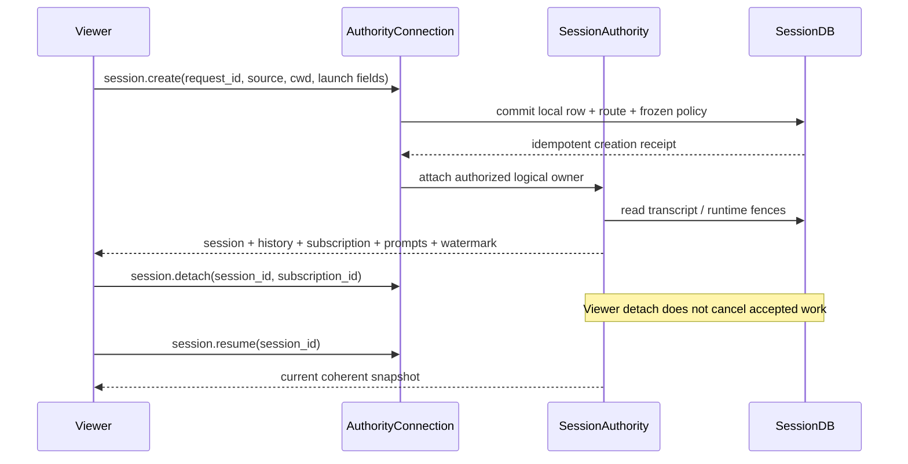
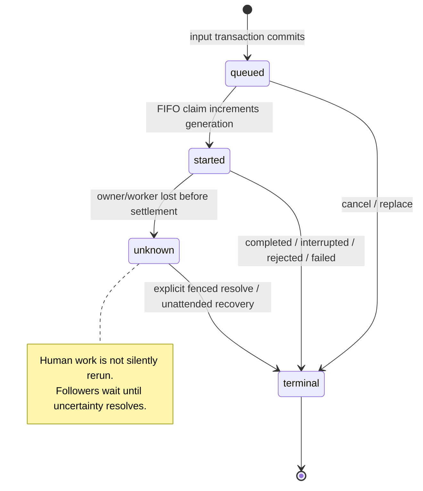
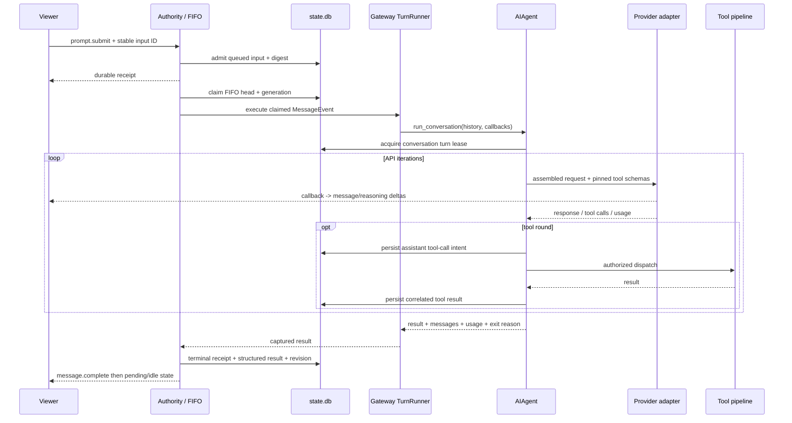
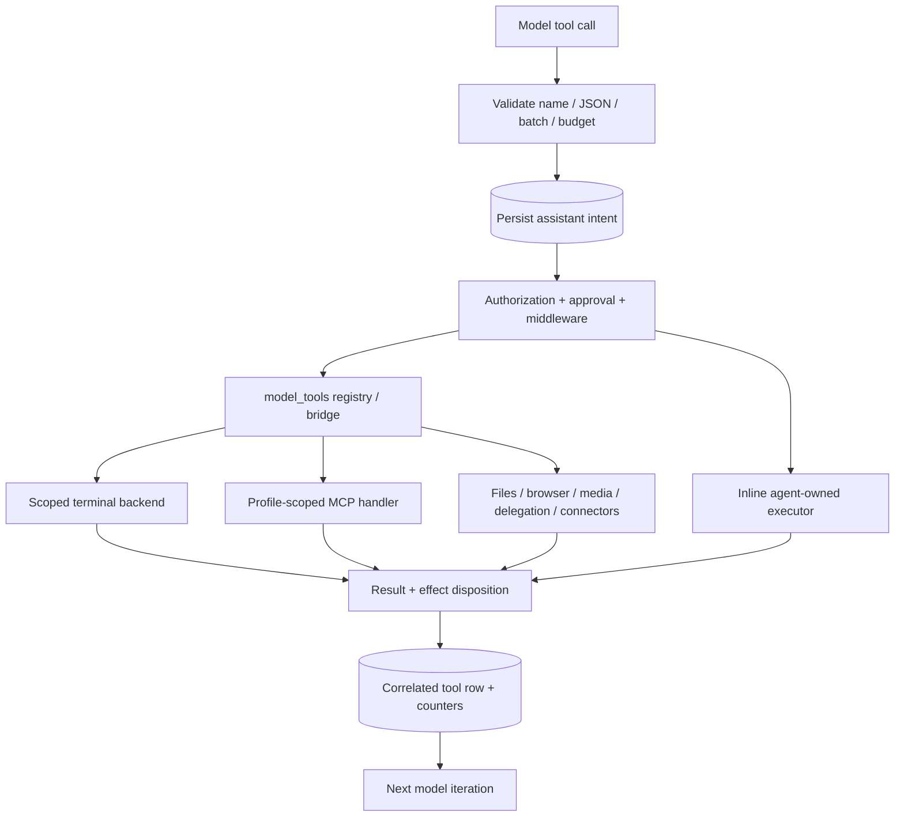
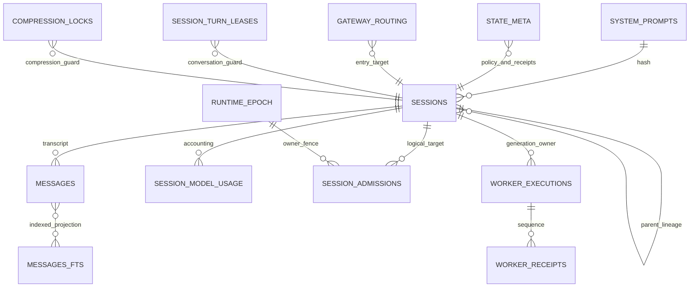

# Hermes gateway, agent runtime, and storage reconstruction

Source snapshot inspected: `C:\Users\bharg\AppData\Local\hermes\hermes-agent`, 24 October 2026. This is a static source investigation. No Hermes application, agent turn, terminal command through Hermes, network provider, MCP server, or personal database was executed. No credential values or personal transcript rows were read. Relative source references below resolve under that absolute source root. The source locations, symbols and line numbers describe this installed tree, rather than an upstream release inferred from documentation.

**Critical reconstruction decision:** the current production ownership path is the profile gateway's authenticated WebSocket session authority, with selected legacy sidecar handlers. It is not a fresh independent `tui_gateway.entry` process for every desktop window. `tui_gateway/entry.py:_claim_launch_home` (273) explicitly documents that no product surface launches its standalone stdio server anymore; that path remains for isolated development harnesses. Desktop, Ink and dashboard still share `tui_gateway` transport, contracts and numerous support modules. Porting a renderer while reproducing only the old JSON-RPC session handlers would create two incompatible owners of the same store.

## Evidence levels and reading rules

- **SOURCE-VERIFIED:** definitions and call sites inspected in the installed source. This establishes code behavior, not successful execution in this installation.
- **INFERENCE:** proposed Sirona implementation consequence derived from those definitions.
- **UNVERIFIED:** runtime reachability, actual configured provider/backend, successful startup, valid account credentials, live service availability, and visual behavior. Those require a controlled runtime pass. No absence of a configured service is inferred from this investigation.
- Canonical wire declarations are under `tui_gateway/contracts/canonical*.py`; standalone/legacy declarations are under the other contracts modules. Shared TypeScript is generated into `apps/shared/src/gateway-contract.generated.ts` and `gateway-contract.openrpc.json`. Same RPC name does not imply identical transport contracts. Use the complete contract inventory elsewhere in this dossier for every field and enum; this document explains ownership and effects behind those contracts.

Applicable source guides read: root `AGENTS.md`, `gateway/AGENTS.md`, `tui_gateway/AGENTS.md`, `agent/AGENTS.md`, and `tools/AGENTS.md`. Their caching, per-profile scope, persist-before-effect, and facade/sibling invariants are relevant architectural evidence. This document changes only the Sirona workspace.

## 1. Process ownership, startup, transport, and authentication

### Canonical entry and lifecycle

1. `gateway/run_bootstrap.py:start_gateway` (728) orchestrates startup. `_start_gateway_reserve_profiles` (622) reserves served homes; `_start_gateway_start_control_socket` (271) starts the private local discovery/bootstrap control listener. Failure to establish the ticket issuer aborts startup rather than silently starting an owner clients cannot attach to.
2. `gateway/runtime_ownership.py:ProfileOwnership.reserve` (152) owns the profile's `gateway.lock`. Ownership is stronger than an endpoint ticket. `start_writer` (199), `release` (191), and `close` (205) coordinate writer lifetimes and release. Maintenance obtains an explicit ownership scope; it is not a second opportunistic SQLite writer.
3. `gateway/session_authority.py:initialize_session_authority` (1374) runs after exclusive ownership and before adapters/API. It resolves the store path, increments the durable runtime epoch, recovers incomplete inputs, settles recovered unattended work, backfills legacy ownership/created-source metadata, adopts compression continuations, constructs an authority, binds cron, stamps the owning store's local epoch and restores local sessions.
4. `gateway/run_api.py:GatewayRuntimeAPI` (246) mounts native `/api/ws` alongside the existing dashboard HTTP/WebSocket gate. Its `_serve` (282) enforces ready/draining state, validates native attach provenance, selects the authority for the grant's served profile, and calls `tui_gateway.ws.handle_ws`.
5. `gateway/run_startup.py:GatewayStartupMixin` includes bounded warmup, previous-run recovery, durable reply redelivery, heartbeat/liveness tasks and hosted worker lifecycle. `gateway/run_shutdown.py` and `run_bootstrap.py:_start_gateway_shutdown_tail` (459) own the matching shutdown path. Full shutdown timing and every adapter-specific cleanup branch are **UNVERIFIED at runtime**.

```mermaid
flowchart LR
  C[Desktop / Ink / native CLI] --> B[Private bootstrap control]
  B --> T[One-use attach ticket]
  T --> W[/api/ws native gate]
  O[ProfileOwnership gateway.lock] --> G[GatewayRunner]
  G --> A[SessionAuthority per served home]
  A --> D[(profile state.db)]
  W --> X[tui_gateway.ws WSTransport]
  X --> R[AuthorityConnection]
  R --> A
  R --> F[Restricted legacy fallback]
  F --> S[tui_gateway.server registered handlers]
  U[Dashboard / remote access] --> H[Dashboard auth boundary]
  H --> X
```

### Native grants and authority capabilities

`gateway/runtime_bootstrap.py:TicketStore` (25) stores SHA-256 digests of random URL-safe tickets, has `TTL_SECONDS=30`, `MAX_ENTRIES=1024`, validates the profile/purpose/scope, and deletes a redeemed ticket. `mint` (37) and `redeem` (55) bind tickets to the owner instance and served profile. It is not a static API key. Purpose grants are:

| Purpose | Capability scope |
|---|---|
| interactive | `session:create`, `session:read`, `session:submit`, `session:control`, `session:approve`, `session:respond` |
| native-http | `http:owner` |
| native-profile-create | `profiles:create` |
| native-profile-registry | `profiles:registry` |
| exposure | `transport:delegate` |
| worker-adoption | `worker:adopt` |

Only interactive grants may have host scope. `run_api.py:_serve` accepts native tickets at the WebSocket subprotocol boundary, requires loopback and the expected host/client/origin checks, distinguishes interactive and worker-adoption grants, and refuses unavailable profiles. It passes server-produced identity `{user_id, provider, profile_id, instance_id, capabilities, native_bootstrap, profile_scope}` to the transport; RPC parameters cannot invent this identity. Readiness refusals use WS `1013` or HTTP 503 `gateway_not_ready`; native admission refusals can use `4403`.

`gateway/session_controls.py:AuthorityConnection.__init__` (114) creates a `Principal(subject, profile_id, capabilities, transport_id)`, uses a fresh transport ID, removes any caller-supplied `session:operator`, and adds that capability only when its trusted constructor receives `operator=True`. Missing identity or an instance mismatch yields no capabilities. `host_scoped` (142) and `_sibling_for` (147) allow an authorized host grant to reach a currently served sibling authority; a foreign profile otherwise returns `profile_mismatch`.

The dashboard/remote route is separate: `hermes_cli/web_server_chat.py:_ws_auth_reason` (200) accepts the appropriate dashboard single-use ticket, internal child credential, or verified user session access token in gated mode. Legacy `_SESSION_TOKEN` is only compared in the loopback/insecure path. It stamps identity after verification. Do not collapse this into a single permissive `?token=` check. Windows private bootstrap transport lives in `gateway/runtime_bootstrap_windows.py` (named pipe peer SID/session/security checks); it must be preserved as an OS boundary, not approximated by an open localhost endpoint.

### WS dispatch, concurrency, and legacy coexistence

`tui_gateway/ws.py:_authority_connection` (357), `_dispatch_request` (368), and `handle_ws` (406) choose the attached authority. `WSTransport` (132) is per connection and thread-safe; worker writes marshal to the event loop. It batches `message.delta`, `reasoning.delta` and `thinking.delta` on a 33 ms timer. A non-streaming frame flushes earlier token frames first. A 10-second worker-side flush wait does not itself mark the socket dead; real send backpressure has a separate 30-second deadline. These details prevent lost events and false reconnects during CPU/SQLite stalls.

The reader stays responsive while controls dispatch serially through a bounded queue (`256`). The narrow concurrent expensive-read exception is `session.context_breakdown`, with two running and eight waiting reads. JSON-RPC response frames and `clarify.lock` bypass that serial lane because the handler already occupying it may be waiting for the answer. `gateway.ready` is an event notification immediately after admission; capability/replay information allows consumers to choose recovery behavior.

`gateway/session_controls.py:handlers` (170) is the canonical method table; `dispatch` (237) validates params/results against canonical declarations first, scopes calls under the authority's profile, handles groups through the group dispatcher, and uses `DeferredReply` for work answered outside the serial lane. Error boundaries include:

| Error | Meaning |
|---|---|
| JSON-RPC `-32601` | unknown/unserved method; compatibility fallback may be considered |
| `4001 invalid_params` | canonical missing/unknown keys or invalid values |
| `4001` plus stable reason | permission/profile/revision/generation/admission/runtime refusal |
| `5001 storage_unavailable` | SQLite operation failed; source exception is logged, not leaked as successful work |
| legacy `4000` contract rejection | legacy dispatcher unknown param path; differs from canonical validation |

`tui_gateway/ws_legacy_fallback.py:legacy_fallback_allowed` (53) only permits fallback for the full interactive grant. Session/prompt/message namespaces are denied except narrow read/import exceptions; process-global stop/reload/delegation/list actions are also denied. A legacy `session.delete`, `session.branch_stored` or `session.workspace.move` must not mutate behind the authority's receipts. Account-owned connectors and other non-session sidecar services may retain legacy handlers. Secondary-profile fallback binds the ticket's own home and never silently reads launch-profile state.

The standalone path remains `tui_gateway/entry.py:_serve` (303) → `tui_gateway/rpc_dispatch.py:dispatch` (45) → registered `tui_gateway/server.py`/`methods_*.py` handlers. It is useful for compatibility analysis and isolated harnesses, not proof it is the current production owner.

### Other HTTP doors still converge on the owner

The dashboard FastAPI session routes are `hermes_cli/web_routers/sessions.py`: list (182), search (286), bulk-delete (466), import (492), empty count/delete (511/519), stats (538), detail (560), mutation-snapshot (586), latest-descendant (601), message page (739), timeline (801), around-message (823), delete (846), owner-backfill (890), patch (926), export (941), prune (977). Literal routes precede the unconstrained `/{session_id}` routes to prevent route shadowing. `hermes_cli/web_server_sessions.py:_session_mutation_context` (85) resolves the authenticated profile/authority; its mutation helper imports and awaits the same `gateway.session_mutations.mutate_session`, rather than independently writing behind the owner. Search deduplicates compression lineage, returns the current tip, supports ID/content matches and uses FTS rather than reading all rows in the renderer. Import is stream-budgeted at 25 MiB. Exact endpoint query/body contracts belong in the HTTP catalog; the authenticated dashboard boundary applies to these routes.

The separate messaging API adapter is `gateway/platforms/api_server.py` plus siblings. `api_server_runs.py` registers POST `/v1/runs`, GET run/status/events, and POST approval/clarify/steer/resolve-unknown/stop (243–249); `_admit_run_to_authority` (683) binds accepted API runs into the session authority FIFO. OpenAI-compatible HTTP request processing is composed through `api_server_openai_routes.py`; admission/auth wrappers live at `api_server.py:_admit_api_agent_request` (829). Do not assume this aiohttp adapter and the dashboard FastAPI server are the same application just because both expose HTTP.

`api_server_authority_runs.py:respond_run` uses body `{request_id, execution_generation, choice}` for approval or `{request_id, execution_generation, answer}` for clarification, resolves the exact run's durable admission, attaches a temporary authorized actor, verifies its pending prompt, calls `authority.respond`, then detaches. `stop_run` cancels queued work or stops the claimed generation; unknown requires explicit resolution. `store_error_response` maps invalid input to 400, draining/storage/chain retry refusals to 503, and ownership/generation/identity refusals to 409. Already accepted `admission_queued` carries `x-should-retry:false`, preventing SDK retries from duplicating acceptance. Run ID, session ID, admission ID and generation must remain distinct throughout these REST projections.

## 2. Session identity, create, attach, switch, mutate, and retire

### Identity types must remain distinct

`gateway/session_contract.py` declares `Principal`, `SessionRef`, `SessionHandle`, `Submission`, `AdmissionReceipt`, `PendingAdmission`, and `SubscriptionSnapshot` as the public owner boundary. The native protocol name is `hermes-gateway-v1`. A handle has profile/session ref, owner instance, authority epoch, runtime revision, execution generation, and state (`idle|running|waiting|unknown|terminal`). A viewer's transport/session tab, routing peer, durable logical conversation, physical compression transcript, input retry ID, admission ID, execution generation, and event sequence are **different identities**.

- `hermes_state_keys.py:local_identity` derives canonical local identity from profile, principal and create request; the exact algorithm is retained in the source appendix. `session_local.py:stage_local_session` (238) uses it and builds the server-owned source/routing key.
- `gateway/session.py:SessionSource` describes platform/chat/thread/user/profile/scope routing. Server-registered local source object identity is checked by `session_local.py:LocalSessionAdapter.authorize_source` (30) and `authorize_local_source` (117); a client cannot submit an arbitrary source descriptor to gain a route.
- Compression may move the physical transcript tip while retaining a logical authority owner and route. `session_local_recovery.py:transcript_target` (201), `local_history` (282), `restore_local_session` (137), and `hermes_state_compression.py:get_compression_tip` (895) bridge them.
- `conversation_generations` is a non-prunable monotonic routing-peer counter, specifically preventing identity reuse after resets/deletion. It is not `sessions.runtime_generation`, which fences one execution.

### Create and attach chain

Canonical `session.create` → `AuthorityConnection.create` (421) → `_create` (434) → `stage_local_session` → `hermes_state_local.commit_local_session` (12) → `restore_local_session` → `resume` (562).

The frozen launch policy is built by `gateway/session_policy.py:build_policy` (415), with a closed `CREATE_FIELDS` set (15). Supported launch surface labels are `cli`, `tui`, `gui`, `acp`, `tool`, `oneshot`; GUI maps to desktop platform capability. The policy governs cwd, route/model, toolsets, safe/bypass settings, prompt/skill context, hooks and per-session MCP/editor selections. Secrets and editor transport credentials must not be copied into a public receipt. Launch-only credentials have owner-memory references, explicit rebind/revocation rules and restart limitations.

`commit_local_session` reserves session row, routing entry and immutable local policy in the **same** epoch-checked write transaction. The `state_meta` key is `gateway.local_policy.v1:<sid>`. Exact retries compare profile/principal/request/session/route and the frozen create request; changed payload is refused. A retired-ID tombstone prevents a deleted create request resurrecting its conversation. On-create publication is withdrawn if transaction creation loses/fails. Creation does not need to construct the model agent merely to give the UI a new tab.

`_create` supports titled create convergence under an authority lock, hidden sessions, one-time launch skill rendering, accepted hook consent, and Bot Chat policy-follow behavior. A first named `Bot Chat` can follow profile config; safe-mode/bypass decisions and exact retried frozen requests retain their own rules. This is required even when the chat is hidden from the sidebar.

`session.resume` may select a session ID, title or latest/workspace target. It resolves abbreviated local IDs, local compression tips/legacy migration and messaging lineage owner. It optionally rebinds editor MCP or launch key with control permission, authorizes read, refreshes eligible settled launch policy, then attaches a subscriber. Merely opening an ended row leaves it ended; the next admitted real turn reopens it.

Resume returns history, optional display projection, running state, authority/replay epochs, sequence watermark, subscription ID, revision/generation, pending admission receipts, pending prompts, info, pending connector and restored todo state. `SessionAuthority.attach` (323) synchronizes the history/pending/prompts snapshot with event subscription; client code should not fetch pieces independently and assume they share a point in time.



Switching a desktop tab is therefore detach/attach/activate behavior in the client against the same logical owner, not a reason to instantiate an unrelated backend or silently copy transcript rows. `session.detach` (658) verifies the caller's exact subscription; optional validated `end_reason` means closing a conversation, with final row closure only when the last viewer leaves and the FIFO becomes idle. A transport disappearing alone is not an implicit destructive session stop.

### Mutations and side effects

Canonical `session.mutate` (`AuthorityConnection.mutate`, 772) requires `{session_id, request_id, expected_revision, operation, payload}` and optional `expected_generation`; policy actions require the generation fence; the store also requires it for delete, rewind, reset, branch and compress. `gateway/session_mutations.py:mutate_session` (101) shields the owned task from socket cancellation; `_owned_mutation` (110), `_mutate_session` (142), `write_mutation` (195) prepare, commit, and publish under the proper locks. Exact retries return the durable receipt and repair runtime projection without repeating effects.

| Operation | Durable/effective behavior |
|---|---|
| rename | user-sourced title update through title/lineage helpers |
| archive | boolean archive metadata across affected lineage |
| sidebar | closed subset of title, archived, hidden, pinned, unread; unread maps to last_read_at |
| model | prepared route resolution and optional confirmation; running turn keeps its route and a pick can defer to the next boundary |
| reasoning | session effort override/reset; preserves the current turn's route |
| workspace | updates frozen execution policy and metadata coherently, rather than only changing sessions.cwd |
| editor_mcp | owner memory retains transport credentials; receipt stores selection fingerprint |
| edit_policy | `ask`, `workspace_session`, or `session` policy |
| branch | independent child route, receipt, policy, transcript copy and title; no shared editor-MCP connection scope |
| compress | prepare summary off-loop, fenced transcript/policy commit and publication |
| rewind | validated active message boundary and compaction-aware transcript guard |
| reset | replacement conversation prepared in receipt transaction |
| delete | retire routing/live owners, transcript/media cleanup, durable terminal/adoption tombstones |
| import | authorized new history rows, not an unguarded overwrite |

The closed payload validator and action dispatch are `hermes_state_mutations.py:validate_action` (8), `_valid_branch_payload` (58), `_valid_compress_payload` (79), `apply_action` (89). The runtime receipt transaction is `hermes_state_runtime.py:mutate_runtime_session` (483). Refusals include `session_busy`, `revision_conflict`, `stale_generation`, `permission_denied`, `runtime_coordination_required`; fresh fences can ride revision/generation conflict responses so a client can retry without a separate read.

Branch: `hermes_state_mutation_branch.py:branch_in_transaction` (52) resolves the physical target, requires idle, creates a child identity/route, clones active message rows up to the requested boundary, includes directly following tool-result rows for an assistant tool-call boundary, copies prompt hash/counters, derives/sets a unique title, and writes a child local policy and routing entry. `_child_policy` (34) resets edit approval to ask and prepares separate editor MCP scope. `AuthorityConnection.mutate` automatically attaches the resulting child so its first submit is authorized.

Compression: `gateway/session_mutation_compress.py:prepare_compress` (31) resolves the session's actual provider, supports preview/full/partial/keep-last/focus options, protects configured head/tail, calls the compressor in the session policy scope, and may return preview/noop without a receipt. It refuses incompatible checkpoint/runtime coordination modes. `hermes_state_mutation_compress.py:compress_in_transaction` (6) commits either in-place or a new physical segment according to the prepared policy. `SessionCompressionMixin.publish_compression_child` (371) and `_publish_compression_child_on_conn` (400) maintain lineage; locks/leases prevent competing writers. Post-compaction hooks run only for newly committed compaction. A generic string claiming history was preserved is not equivalent.

Delete: `hermes_state_mutation_retirement.py:delete_in_transaction` owns terminal tombstones and related graph deletion. `gateway/session_mutations.py:_project_result` (281), `_project_committed` (325), `retire_live_sessions` (370) reconcile live sources, subscriptions and agent caches. Metadata operations can act on lineage owners; transcript/policy operations require their own idleness and coordination rules.

## 3. Durable prompt admission and execution

### Submit is acceptance, not final response

`AuthorityConnection.submit` (690) parses `submission` (750), requires that the viewer is subscribed, and forwards to `SessionAuthority.submit` (636). Minimal canonical request is:

```json
{"jsonrpc":"2.0","id":17,"method":"prompt.submit","params":{"session_id":"<logical-owner>","text":"Inspect this project","submission_id":"<stable-client-input-id>"}}
```

The closed allowed fields include `input_id` as retry-ID compatibility, queued/attachments/finite/unattended/surface/voice/display/title/turn-author/api-text/model-override/clarify-batch fields. These are validated and transformed by the owner; arbitrary source/routing/credential fields are refused. Canonical payload is `text`, whereas Sirona's current prototype sends `prompt`. Do not implement this as a long RPC that returns an assistant answer.

The response is an `AdmissionReceipt`: admission ID/ref, FIFO sequence, status, outcome, authority epoch, execution generation. The durable uniqueness key is **authenticated principal + target logical session + request ID**. `hermes_state_runtime.py:admit_session_input` (124) hashes normalized input plus intent, returns an exact existing receipt without new work, raises `admission_conflict` on changed payload, enforces queued cap 32, and inserts a queued row. Captured attachments are leased/canonicalized before commit; a failed admission releases its capture rather than leaving orphan blobs.



`SessionAuthority._schedule` (428) starts a per-session drain. `_claim_next` (1006) takes claim/mutation gates, checks unknown head and current authorization, applies deferred model/reasoning at boundaries, refreezes editor MCP when authorized, reopens ended local rows at real execution, and checks native/API source provenance. `claim_session_input` (200) atomically checks epoch/head/current worker exclusion, changes queued→started and increments `sessions.runtime_generation`. It records a transcript high-water mark. One exact generation owns each turn's effects and callbacks.

`_execute_claimed` (1145) → `gateway/session_finite.py:execute_finite_admission` (71) → `gateway/session_ingress.py:execute_admission` (226). That dispatcher handles unviewed completion notes, cron policy, managed worker policy, restored native media/envelopes or local MessageEvent, and calls `GatewayRunner._handle_message` under owner/profile/turn scopes. This is the common message execution pipeline, not a separate toy loop for desktop.

The turn flows through gateway inbound/admission/routing to `gateway/run_turn.py:GatewayTurnMixin._handle_message_with_agent` (215), `_run_agent` (994), `_run_agent_inner` (2293), and `gateway/run_turn_runner.py:TurnRunner`. `session_execution.py:_resolve_turn_agent` (191) chooses reusable cached agent versus fresh construction, checks dead/changed agent state and the frozen route. `_build_fresh_agent` (151) constructs the agent with that policy. A source/route-owned cache is not a global singleton selected by whichever tab is currently visible.

### Turn loop and model calls

`TurnRunner._run_sync_scoped` (1203) prepares history, wiring, media, route and callbacks; `_run_conversation_with_approval` (944) calls `AIAgent.run_conversation`. `run_agent.py:AIAgent` is a mixin facade; `agent/turn_facade.py:TurnFacadeMixin.run_conversation` (22) acquires the durable session-turn lease through `agent/turn_facade_lease.py:admit_durable_turn_lease` (297), binds accounting/cache/interrupt/parent scopes, then calls `agent/conversation_loop.py:run_conversation` (1785). The facade's balanced finally path releases leases/scopes and closes out instrumentation.

`conversation_loop.py:_run_conversation_turn` (1623) coordinates preflight/iteration phases. Relevant phase siblings are request preparation, API call/retry, response intake/check, tool round, overflow/truncation, context compaction, stop gates, usage, final response and finalizer. The system prompt and resolved tool schema prefix are pinned per conversation; `conversation_loop.py:_restore_or_build_system_prompt` (817), `_restore_pinned_tools` (764) and `tools/mcp_tool_agent.py` preserve this invariant on resume. Rebuilding all system instructions/tools at every token or tab switch is not parity.

Provider resolution is `hermes_cli/runtime_provider.py:resolve_runtime_provider` (1041), its ladder helpers, `resolve_runtime_with_fallback` (1152), and `runtime_provider_backends.py`. It returns a concrete provider, endpoint, API mode, credential source and model route. Explicit route/launch policy, configured custom routes, OAuth pools and fallback rules are not interchangeable with a hardcoded model-name substring router. `gateway/session_policy.py:policy_scope` (1066) binds home, secret and terminal scope; `client_lifecycle.py` handles primary/request clients, provider headers, refresh, rotation and abort/close ownership.

`agent/turn_api_request.py:build_api_request` (93) assembles messages/tools/provider kwargs. `agent/turn_api_call.py:perform_api_call` (72) routes streaming versus interruptible non-streaming through relay and LLM execution middleware. `agent/client_lifecycle.py` and API adapters handle OpenAI-compatible chat completions, Responses/Codex, Anthropic messages, Bedrock and other configured provider modes; Codex app-server has a dedicated turn branch (`conversation_loop.py:_codex_app_server_turn`, 1605). **UNVERIFIED:** which of these are configured, healthy or used by this installation. This document establishes extension and execution seams, not a validated compatibility result for every provider.



### Streaming, completion, stop and recovery

`TurnRunner._setup_stream_consumer` (214) publishes viewer text via `message.delta` (282). `_wire_turn_agent_callbacks` (431) supplies stream/tool/status/clarify callbacks. `gateway/run_turn_progress.py:combined_tool_start_callback` (847) publishes ID-bearing `tool.start`; `combined_tool_complete_callback` (859) publishes `tool.complete`, error and optional todo projection; step/status/notifications have their own events. This is distinct from legacy human-readable `tool.started` progress formatting. Results must correlate on tool-call ID rather than tool name alone.

`SessionAuthority.publish_execution` (964) only publishes for the currently executing generation, preventing late timed-out threads from adding output after completion. `gateway/session_events.py:SessionEvents.publish` (38) stamps session ID, epoch/seq and current execution stamps; the replay cache uses a private lifetime lookup key so equal session IDs in different profiles cannot read one another's frames. Bounded per-peer fanout overflow retires that subscription and emits `session.replay_gap`.

`SessionEvents.since` (77) returns events only if epoch/watermark/ring coverage is intact; otherwise `truncated`/`snapshot_required` tell the client to resume a coherent snapshot. Replay is memory-bounded, not an unbounded durable token journal. Durable transcript/admission state survives restart; streamed token history and open in-memory request machinery have different lifetimes.

`gateway/session_settlement_recovery.py:commit_and_publish` (166) / `settle_with_retry` commit result and terminal state before publishing completion; `completion_payload` (53) builds UI status/text/usage/persisted-turn binding and warning/error surface. `hermes_state_runtime.py:settle_session_input` (239) checks owner epoch/generation, retires linked workers, writes compact structured result under state_meta, marks terminal outcome and increments runtime revision. `_drain` (1182) publishes pending/idle after completion, resolves waiters and owed delivery, and clears execution stamp. It does not manufacture success when persistence fails.

`session.interrupt` is generation-bound, including managed workers. `prompt.cancel` cancels a queued admission or interrupts the exact claim if it raced into execution; `prompt.receipt` can return committed final result/usage; `prompt.resolve_unknown` requires the exact admission and generation. `recover_session_inputs` (447) marks lost started work unknown, and explicit resolution (`resolve_unknown_session_input`, 651) advances without blindly reexecuting side effects. Managed-worker registration/adoption/persist receipts add execution-ID and sequence/digest fencing (`hermes_state_runtime.py:register_worker_execution`, 728; `adopt_worker_execution`, 759; `apply_worker_receipt`, 947).

`gateway/session_managed_worker.py:managed_policy` (36) does **not** make every GUI turn a child process: bypass/config-only sessions and Kanban policies use managed execution, while ordinary local managed execution needs the explicit supported custom-provider CLI opt-in. It is the frozen creation policy that decides. The managed child introduces itself before receiving bootstrap data, has a 60-second hello budget and a 30-second Stop acknowledgement budget, carries its own execution/owner identity and scoped environment, and is supervised independently of viewer lifetime. A lost child can yield `ManagedExecutionUnknown` rather than forged failure or automatic retry.

### Busy input, queued edit, detached side work, and ancillary state

`gateway/session_busy_controls.py:handlers` serves `session.steer`/`session.redirect` and session-scoped busy/verbose/show-reasoning/service-tier/YOLO controls. Busy mode is `interrupt|steer|queue`; TUI defaults queue while other surfaces retain framework behavior unless configured. A config model write is explicitly refused (`use_session_mutation_model`) because a model selection requires revision-fenced `session.mutate`. These preferences must not rebuild a running conversation's system prompt or schemas.

`gateway/session_queued_controls.py:handlers` serves `prompt.steer_queued` and `prompt.replace_queued`. Steer transfers only eligible plain-text interactive input to the exact running generation; it can revert to its original FIFO place if never delivered. Replace retires the original and binds a durable replacement identity. Attachment/automation/finite/native rows are not silently stripped into text. The snapshot advertises allowed controls, so the renderer does not invent a reorder/edit operation unsupported by that owner. There is no arbitrary FIFO reorder verb in this implementation.

`gateway/session_tui_ops.py:handlers` owns save/export, reload-env, delegation pause, rollback list/diff/restore/session-diff, context breakdown and session history. Export returns client-writable content (JSON/Markdown/HTML) so remote clients save on their own machine; save writes a snapshot in the owning profile. These canonical wrappers reuse underlying helpers with owner/profile controls rather than invoking old sidecar-global operations. `gateway/session_tui_side.py:handlers` owns background/btw/preview-restart: immediate `{task_id}` response, later `background.complete`/`btw.complete`, separate side agent under the launch policy. It is not a parent FIFO admission or a new row inside the parent transcript, though the side agent can have its own task transcript. Its daemon-thread lifetime is not the same durability contract as accepted main prompts.

Replay caps from `tui_gateway/event_replay.py` are 512 events, 4 MiB serialized bytes per session, 64 retained sessions, and 64 MiB process total. These are hard bounds on retained event frames; a client that falls outside them must hydrate a snapshot.

## 4. Tool dispatch, shell families, MCP, and human input

### Tool pipeline and side-effect ordering

`tools/registry.py:discover_builtin_tools` (121; imported and invoked by `model_tools.py`) and `get_tool_definitions` expose the installed registry/toolset selection; `toolsets.py:TOOLSETS` and `_HERMES_CORE_TOOLS` decide model-visible bundles. Registry discovery alone does not expose a tool. Toolsets and capability selection are per session; reachability and credential checks are per profile. A desktop connected remotely must still receive its desktop UI/project capabilities without assuming `HERMES_DESKTOP=1` exists on the backend.

`agent/turn_tool_round.py:run_tool_round` (49) validates/caps/deduplicates calls and **persists the assistant tool-call intent before executing effects**. Failed canonical append ends the round. `agent/tool_executor.py` parses args, checkpoints files, serializes authorization, handles sequential/concurrent/segmented batches, emits correlated lifecycle callbacks, commits results and flushes after progress. Agent-owned inline tools go through `agent/inline_tool_executors.py` before generic dispatch. Generic `model_tools.py:handle_function_call` (873) passes through guards, pre/post hooks, middleware, bridge dispatch/registry handler, result transformations and sanitized errors. Porting only `registry[name](args)` loses these behaviors.

Major families evidenced by source/toolset architecture include terminal and process management; files/checkpoints; browser/computer/display/preview control; web/search/vision/media; skills/prompts; memory/todo/session search; delegation/MOA; cron/kanban; connectors; platform messaging/admin; project/desktop UI; MCP. Their exact names/schemas and feature availability must come from the generated contract/tool inventory and source registration, not this summary. Bot/group/relay execution shares these underlying scope and generation contracts.

Terminal chain: `tools/terminal_tool.py` → `_check_all_guards` (163), scoped task/cwd/environment selection, `tools/terminal_tool_backends.py:_create_environment` (274), backend execute, result/background process registration. Backend factories include local, docker, modal, SSH and plugin sandbox environments. `tools/environments/local.py:build_subprocess_env` / `served_profile_child_env` prevent launch-profile secrets or TERMINAL policy leaking into a child acting for another profile. Sudo is a separate interactive prompt bridge. Background processes, read/close terminal tools and process registry ownership are distinct from a single synchronous shell call. This document does not claim actual Bash, ConPTY or remote sandbox execution was observed.

MCP chain: `tools/mcp_tool_config.py` resolves per-profile config; `mcp_tool_discovery.py` discovers/joins server startup; `mcp_tool_transport.py` and `mcp_tool_server_run.py` own connections/requests; `mcp_tool_registration.py:_register_server_tools` (432) filters schemas/collisions, registers handlers and records profile-scoped trust/cost metadata; `mcp_tool_handlers.py` executes via trust gate, maps errors/content, and incorporates the tool into registry/toolsets; `mcp_tool_agent.py` freezes/restores the session's schema prefix. Lifecycle, OAuth, content conversion, health, sampling and node ABI are split into named siblings. Editor-provided MCP transport credentials remain private and are re-frozen under session policy rules; global reload is not permitted as an arbitrary sidecar fallback on a multi-session owner.



### Approvals are a native queue, projected to attached viewers

`tools/approval.py` manages actual waiters and grants: `register_gateway_notify` (126), `resolve_gateway_approval` (142), `list_gateway_approvals` (196), `_human_decision` (796), `_run_approval_gate` (968), `check_dangerous_command` (1095), `request_tool_approval` (1121). It includes explicit user deny, floor/smart policies, once/session/permanent choices and context-specific unattended behavior. Do not implement every tool as always-approve or every command as the same boolean modal.

`TurnRunner._approval_notify_sync` (677) / `_render_approval_sync` (688) project the active native approval into the owner. `SessionAuthority.register_approval` (978) validates generation; `PendingControls.register` (18) redacts displayed command/description, derives choices (`once`, `deny`, and permitted `session`/`always`; edits only once/deny), records `prompt_id` from the existing native request ID and publishes `approval.request`. An approval is present before a viewer tries to answer it.

`approval.respond` requires exactly session, execution_generation, prompt_id and choice. `SessionAuthority.respond` (990) requires approve/respond capability and an attached actor; it rejects stale generations. `PendingControls.respond` (66) validates kind/choice, resolves the exact native request, supports remote responders, and emits settled state through its snapshot reconciliation. A repeated already-completed response returns `already_resolved`; it cannot accidentally approve the next item in a FIFO. Responses containing secret/sudo material are not journaled in this public approval projection.

### Clarification supports whole batches and per-question routing

`tools/clarify_tool.py:clarify_tool` (111), `_normalize_questions` (50), `_result` (95) define the model contract: 1–5 independent questions, up to four choices each, optional multi-select, open-ended question when choices omitted, stable `q0...` IDs, recommended label applied to first option, free-text Other at UI, and explicit answered/skipped/unanswered results with outcome. Question choice length cap is 8000 characters. The actual callback is supplied by the surface; answer text stays in the tool result rather than the observer notification.

`TurnRunner._clarify_callback_sync` (553) chooses finite behavior, native batch or question-by-question messaging delivery. `gateway/session_clarify_batch.py:ask_clarify_batch` (16) sends the whole normalized form through `session_server_requests.ask_viewer_result`, with revisitable/locked qids and interrupt/timeout handling. `gateway/session_clarify_lock.py` authorizes incremental answer locks. `tools/clarify_gateway.py:register` (49), `wait_for_response` (61), `resolve_gateway_clarify` (103), text coercion and `clear_session` support adapter cards/text capture. `PendingControls.register_clarify` (40) / canonical `clarify.respond` expose a generation-bound question projection for native waiters. These request and event paths coexist; they are not a single interchangeable boolean approval API.

Generic canonical viewer requests are `gateway/session_server_requests.py:ask_viewer_result` (103), `_ask` (153), `resolve` (74), `may_settle` (51). The legacy machinery is separately `tui_gateway/server_requests.py:ServerRequest` (51), `send` (191), `resolve_response` (281), `lock_answer` (319), `cancel` (339), `open_requests` (365). It uses JSON-RPC server→client request IDs `srq-<n>`, advertises `client.capabilities {server_requests:true}`, fails fast when the client cannot answer, and withdraws questions with `request.cancel`. Open requests replay on reconnect. The owner validates which attached viewer may settle its request. Sudo/secret/vault and read/act browser/desktop bridges use related request mechanisms with their own typed result contracts.

```mermaid
sequenceDiagram
  participant Tool as Tool / approval gate
  participant Core as TurnRunner
  participant A as Generation-bound owner
  participant UI as Attached viewer
  Tool->>Core: needs human input
  Core->>A: register native prompt OR ask viewer request
  A-->>UI: approval.request / clarify.request OR JSON-RPC request
  Note over Tool,Core: Agent thread waits; WS reader stays available
  UI->>A: exact generation + prompt choice OR matching response ID
  A->>A: capability + subscriber + identity + generation validation
  A-->>Tool: resolve exact waiter / locked batch result
  A-->>UI: settled / cancellation event
  Tool-->>Core: authorized result / denial / answer / timeout
```

Finite context differs intentionally: `session_finite.py:admit_finite` (44) prevents arbitrary desktop clients requesting unattended autoapproval. Only the trusted native CLI principal on its own CLI policy may select that path. Finite clarification returns a structured unavailable/undelivered notice rather than waiting for a nonexistent person. This privilege must not become a generic GUI checkbox backed by an unchecked payload.

## 5. State store, schema, migrations and persistence invariants

`hermes_state.py:SessionDB` is the public SQLite facade assembled from sibling mixins. `hermes_state_common.py:SCHEMA_VERSION` (289) is **32 in this snapshot**; the main declared schema starts at `SCHEMA_SQL` (451). These are source facts, not an observation of the user's installed personal database schema. `hermes_state_schema.py:SessionSchemaMixin._init_schema` (940), `_reconcile_columns` (772), `_run_data_migrations` (1050), `apply_declared_schema` (1379), `reconcile_state_schema` (1392) define additive reconciliation, historical data migrations, primary-key repair and FTS recovery/version behavior. Copying only a create-tables string is insufficient for upgrading an existing install.

| Table | Role |
|---|---|
| schema_version | durable data migration level |
| system_prompts | hash-deduplicated frozen system prompt text |
| sessions | runtime revision/generation, source/origin/routing, model/prompt/cwd/git, parent/end/title/display/read state, usage/cost/compression metadata, frozen tool names and transcript revision |
| messages | ordered roles/content/tool calls/results; reasoning/provider-native items; active/compacted and API/display projections; stable message/tool-call UIDs |
| session_model_usage | per-session/model/provider/base-url/billing-mode/task token/cache/cost accounting |
| runtime_epoch | owner instance plus monotonically incrementing authority epoch |
| session_admissions | durable FIFO, retry identity/digest, normalized input payload, generation/status/outcome |
| worker_executions | generation-bound registered/running/unknown/terminal external/managed work |
| worker_receipts | exact execution sequence/payload-digest/result deduplication |
| state_meta | versioned local policies, mutation/results/retirement/migration records and other key/value state |
| gateway_routing | scoped routing-peer key to SessionEntry JSON; authority owns updates |
| gateway_hygiene_state | conversation hygiene failure streak |
| conversation_generations | non-prunable monotonic source/routing-key identity generation |
| gateway_heartbeats | backend PID/start/profile/host liveness for orphan recovery |
| compression_locks | timed compression holder |
| session_turn_leases | timed per-conversation execution lease, preventing cross-process interleaving |
| async_delegations | dispatch/result/delivery/owner/process/execution metadata for delegated work |

FTS tables/layouts and deferred indexes are declared separately in `hermes_state_common.py`; main/CJK/trigram search layouts and their source view/trigger versions have their own migration/recovery rules. The parent's separate read-only schema observation confirms `messages_fts` and `messages_fts_trigram` plus SQLite-managed shadow tables in the installed `state.db`. No search query or result content was executed/read here.

The separate [installed schema observation](installed-database-schemas.md) and [full schema catalog](catalogs/installed-database-schemas.json) record 28 tables/88 objects in installed `state.db`, four tables/10 objects in `projects.db`, 15 tables/35 objects in `shared-state.db`, and one table/five objects in `cron/executions.db`. These were schema-only transactions, with no conversation/credential/application rows. The state store's 28 includes FTS shadow tables and `sqlite_sequence`; it does not imply 28 independently authored business tables. Shared-state hosted-room and project/cron models are separate databases and must not be conflated with SessionDB's declared 17 main tables.

Three version values are distinct: source `SCHEMA_VERSION=32` is the application's target migration level; catalog `schema_version` is SQLite's `PRAGMA schema_version` schema-change cookie (76 for this observed `state.db`); `PRAGMA user_version=0` is a separate user-managed SQLite header field. The installed value inside the application `schema_version` **table** was not read and remains **UNVERIFIED**. Neither PRAGMA proves the application migration version.



Some edges above are logical rather than SQL foreign keys (state_meta, routing, leases and FTS). Never add cascades based only on this diagram. `conversation_generations` deliberately survives transcript pruning. Admissions/workers use restrictive foreign-key deletion because retirement first preserves terminal retry/adoption identities as tombstones.

Transcript writes: `agent/session_persistence.py:_db_flush_collect` (257), `_db_flush_write` (298), `SessionPersistenceMixin._persist_session` (443), `_flush_messages_to_session_db` (477), and `hermes_state_messages.py:SessionMessagesMixin` encode/guard/append rows and update session counts. Intrinsic `_DB_PERSISTED_MARKER` deduplicates a message object only while its content equals durable content; meaningful mutation must clear that marker. Ephemeral retry scaffolding is filtered. User display/API content, native image blocks, model reasoning and physical row identity survive as separate fields. `_close_durable_failed_turn` (`conversation_loop.py:1889`) closes accepted user turns even on early failure when needed.

Storage handling is broader than WAL: `hermes_state_wal.py`, `hermes_state_dbfile.py`, `hermes_state_holders.py`, `hermes_state_lockguard.py`, `hermes_state_health.py` and error classification detect replaced/unlinked generations, corruption, locks and WAL ownership. Writes use guarded `_execute_write` transactions; off-loop tracked writes keep one contended store from freezing every session and outlive canceled request sockets until commit/publication is accounted for. Read-only readers have a separate admission/connection path. Do not share a raw SQLite handle freely between arbitrary worker threads or reconstruct the store as an in-memory dict.

### Durable write matrix

| Trigger | Write boundary and persisted effect |
|---|---|
| gateway starts as owner | begin_runtime_epoch; lost-admission/worker recovery and compatibility backfills |
| create local conversation | commit_local_session: sessions + gateway_routing + immutable policy receipt atomically |
| attach/resume | primarily coherent reads/subscription; eligible policy/hook refresh has explicit owner writes; ended row is not reopened merely by read |
| submit | normalized input capture + session_admissions queued row and payload digest |
| claim | generation increment + started owner epoch/generation; high-water mark returned |
| tool call | assistant tool-call intent persisted before effects; tool result flush afterward |
| model iteration | usage/cost/model accounting and transcript checkpoints at defined phases |
| final result | structured final result + terminal status/outcome + runtime_revision; then completion event |
| mutation | fenced/idempotent receipt with operation-specific transcript/policy/metadata effect; then live projection |
| compression | guarded in-place rewrite or continuation child + lineage metadata/policy target; post-compaction hook after commit |
| worker persist | execution sequence + digest receipt + guarded operation; retry never duplicates append |
| delete | retired terminal receipt/worker tombstones, route/live retirement, graph/media cleanup |
| crash recovery | unknown execution fence for uncertain human work; no blind replay; unattended exceptions follow their own policy |

## 6. Reconstruction requirements and remaining verification

**INFERENCE for Sirona:** reuse this ownership and contract topology before implementing an exact renderer. A faithful backend adapter needs canonical create/resume/mutate/admission receipts, typed event envelopes and replay, request/answer correlation, provider-native tool histories, prompt/tool-prefix freezing, scoped secrets/terminal policy, native terminal/process ownership, and a migration/retirement story. Existing Sirona placeholders cannot satisfy these contracts merely by matching route names.

Required controlled verification, all **UNVERIFIED here**:

1. Start a disposable Hermes profile and prove the concrete desktop bootstrap command/WS subprotocol/authority advertisement and shutdown ownership release on Windows.
2. Capture create → resume → prompt accepted → token/tool progress → terminal result, then reconnect at each boundary. Verify stable input ID deduplication and changed-payload conflict.
3. Exercise denied/once/session/permanent approvals, stale prompt generations, answer by competing viewers, close/reopen and expiry; test batch single/multi/open clarification, incremental locks and cancellation.
4. Exercise real provider modes with valid disposable credentials and native tool-call histories; no placeholder success strings. Include provider failure/rate-window/overflow and user interruption.
5. Test Bash/PowerShell/cmd and actual local terminal behavior using the installed backend policy, background process read/stop/handoff and Windows process cleanup. Source presence is not evidence of working shell interoperability.
6. Test rename/archive/hide/pin/unread/branch/rewind/reset/workspace/model changes on idle/running/compacted conversation, plus delete and exact retry after retirement.
7. Test blocked writer, process restart during claim/tool/settlement, worker loss and unknown resolution; verify no duplicate external side effect and no lost accepted FIFO follower.
8. Test secondary profile with different model/MCP/terminal/secrets configuration; host-bound grant versus profile-bound grant; validate no launch-profile fallback.
9. Test MCP handshake/discovery/OAuth/trust and session schema pinning with controlled servers. Test bot/group/relay consumers against the same canonical ownership, rather than giving them a competing session engine.

This document establishes the source-level chains above. It is not a claim that all platform/provider/plugin combinations have been dynamically exercised, that every legacy handler is production-reachable, or that a personal installation's data/schema matches the fresh-install declaration.


## Appendix A. Exact static source ledger

[`gateway-runtime-symbols.json`](gateway-runtime-symbols.json) records full SHA-256, absolute source path, definition start/end lines, decorators and statically named call sites for the 96 core files indexed below. It is an index of source, not a dynamic call graph: a named call does not prove that branch ran. The companion [`state-schema-declared.sql`](state-schema-declared.sql) is the complete literal `SCHEMA_SQL` declaration extracted without importing Hermes; FTS/deferred-index declarations remain in the separately indexed source.

| Source file | Lines | Definition records | SHA-256 prefix |
|---|---:|---:|---|
| [gateway/run_bootstrap.py](<C:/Users/bharg/AppData/Local/hermes/hermes-agent/gateway/run_bootstrap.py:1>) | 937 | 18 | `e2a822312dcb0417` |
| [gateway/runtime_ownership.py](<C:/Users/bharg/AppData/Local/hermes/hermes-agent/gateway/runtime_ownership.py:1>) | 281 | 23 | `9e47af070cba5de4` |
| [gateway/runtime_bootstrap.py](<C:/Users/bharg/AppData/Local/hermes/hermes-agent/gateway/runtime_bootstrap.py:1>) | 83 | 6 | `35b5dda25294337a` |
| [gateway/runtime_bootstrap_windows.py](<C:/Users/bharg/AppData/Local/hermes/hermes-agent/gateway/runtime_bootstrap_windows.py:1>) | 538 | 32 | `7f39768e31e60827` |
| [gateway/run_api.py](<C:/Users/bharg/AppData/Local/hermes/hermes-agent/gateway/run_api.py:1>) | 376 | 19 | `77628713200032a9` |
| [gateway/run_startup.py](<C:/Users/bharg/AppData/Local/hermes/hermes-agent/gateway/run_startup.py:1>) | 1899 | 74 | `108a658cac645fa0` |
| [gateway/run_shutdown.py](<C:/Users/bharg/AppData/Local/hermes/hermes-agent/gateway/run_shutdown.py:1>) | 2249 | 96 | `5bd84b21bd49a9b0` |
| [gateway/session_contract.py](<C:/Users/bharg/AppData/Local/hermes/hermes-agent/gateway/session_contract.py:1>) | 97 | 19 | `a4ed0c9183a4a0ab` |
| [gateway/session_controls.py](<C:/Users/bharg/AppData/Local/hermes/hermes-agent/gateway/session_controls.py:1>) | 869 | 59 | `0def0802a4754052` |
| [gateway/session_authority.py](<C:/Users/bharg/AppData/Local/hermes/hermes-agent/gateway/session_authority.py:1>) | 1413 | 71 | `f6eba4d4e17f35e9` |
| [gateway/session_local.py](<C:/Users/bharg/AppData/Local/hermes/hermes-agent/gateway/session_local.py:1>) | 485 | 29 | `8597e45697177c3c` |
| [gateway/session_local_recovery.py](<C:/Users/bharg/AppData/Local/hermes/hermes-agent/gateway/session_local_recovery.py:1>) | 379 | 20 | `28b238a9c23df0b4` |
| [gateway/session_policy.py](<C:/Users/bharg/AppData/Local/hermes/hermes-agent/gateway/session_policy.py:1>) | 1173 | 69 | `f8daa799f7b2c16f` |
| [gateway/session_mutations.py](<C:/Users/bharg/AppData/Local/hermes/hermes-agent/gateway/session_mutations.py:1>) | 426 | 11 | `49fdba1016286553` |
| [gateway/session_mutation_compress.py](<C:/Users/bharg/AppData/Local/hermes/hermes-agent/gateway/session_mutation_compress.py:1>) | 133 | 4 | `2c462394d16ddb9c` |
| [gateway/session_pending_controls.py](<C:/Users/bharg/AppData/Local/hermes/hermes-agent/gateway/session_pending_controls.py:1>) | 101 | 6 | `c8ae36accdce384e` |
| [gateway/session_server_requests.py](<C:/Users/bharg/AppData/Local/hermes/hermes-agent/gateway/session_server_requests.py:1>) | 192 | 12 | `9aeb9332278f0aaf` |
| [gateway/session_clarify_batch.py](<C:/Users/bharg/AppData/Local/hermes/hermes-agent/gateway/session_clarify_batch.py:1>) | 42 | 1 | `36e3ce02ec9d07f2` |
| [gateway/session_clarify_lock.py](<C:/Users/bharg/AppData/Local/hermes/hermes-agent/gateway/session_clarify_lock.py:1>) | 38 | 1 | `547297e0ad7ddae8` |
| [gateway/session_events.py](<C:/Users/bharg/AppData/Local/hermes/hermes-agent/gateway/session_events.py:1>) | 89 | 5 | `a7d6493001bfd161` |
| [gateway/session_ingress.py](<C:/Users/bharg/AppData/Local/hermes/hermes-agent/gateway/session_ingress.py:1>) | 491 | 19 | `e8b038cbaff9eace` |
| [gateway/session_finite.py](<C:/Users/bharg/AppData/Local/hermes/hermes-agent/gateway/session_finite.py:1>) | 80 | 7 | `65b9ddd09dfabf23` |
| [gateway/session_managed_worker.py](<C:/Users/bharg/AppData/Local/hermes/hermes-agent/gateway/session_managed_worker.py:1>) | 704 | 38 | `0d2bed13ce549ac1` |
| [gateway/session_settlement_recovery.py](<C:/Users/bharg/AppData/Local/hermes/hermes-agent/gateway/session_settlement_recovery.py:1>) | 231 | 11 | `2591d66fbd9053e0` |
| [gateway/session_execution.py](<C:/Users/bharg/AppData/Local/hermes/hermes-agent/gateway/session_execution.py:1>) | 234 | 10 | `7c1e294795003b32` |
| [gateway/run_turn.py](<C:/Users/bharg/AppData/Local/hermes/hermes-agent/gateway/run_turn.py:1>) | 2403 | 63 | `d26c177a4c0edcdd` |
| [gateway/run_turn_runner.py](<C:/Users/bharg/AppData/Local/hermes/hermes-agent/gateway/run_turn_runner.py:1>) | 1418 | 36 | `04f76f4857a8ba25` |
| [gateway/run_turn_progress.py](<C:/Users/bharg/AppData/Local/hermes/hermes-agent/gateway/run_turn_progress.py:1>) | 1020 | 61 | `66dfcdb8696a3240` |
| [tui_gateway/entry.py](<C:/Users/bharg/AppData/Local/hermes/hermes-agent/tui_gateway/entry.py:1>) | 395 | 19 | `e58c125e3b5d7b2c` |
| [tui_gateway/ws.py](<C:/Users/bharg/AppData/Local/hermes/hermes-agent/tui_gateway/ws.py:1>) | 661 | 27 | `d798ccd9328709c8` |
| [tui_gateway/ws_legacy_fallback.py](<C:/Users/bharg/AppData/Local/hermes/hermes-agent/tui_gateway/ws_legacy_fallback.py:1>) | 161 | 6 | `7811a371f2d1d625` |
| [tui_gateway/rpc_dispatch.py](<C:/Users/bharg/AppData/Local/hermes/hermes-agent/tui_gateway/rpc_dispatch.py:1>) | 94 | 4 | `d81dd5b12e67305c` |
| [tui_gateway/server.py](<C:/Users/bharg/AppData/Local/hermes/hermes-agent/tui_gateway/server.py:1>) | 2190 | 120 | `a5502fddd35a1f82` |
| [tui_gateway/methods_session.py](<C:/Users/bharg/AppData/Local/hermes/hermes-agent/tui_gateway/methods_session.py:1>) | 2339 | 129 | `54a19fb9e1a93ed2` |
| [tui_gateway/methods_prompt.py](<C:/Users/bharg/AppData/Local/hermes/hermes-agent/tui_gateway/methods_prompt.py:1>) | 1544 | 53 | `fa5b75084d05a335` |
| [tui_gateway/prompt_turn.py](<C:/Users/bharg/AppData/Local/hermes/hermes-agent/tui_gateway/prompt_turn.py:1>) | 1244 | 35 | `b337057e7ee3fb29` |
| [tui_gateway/server_requests.py](<C:/Users/bharg/AppData/Local/hermes/hermes-agent/tui_gateway/server_requests.py:1>) | 394 | 23 | `10e64a801daf59ef` |
| [tui_gateway/event_replay.py](<C:/Users/bharg/AppData/Local/hermes/hermes-agent/tui_gateway/event_replay.py:1>) | 198 | 11 | `14f9cf157dae632c` |
| [tui_gateway/agent_factory.py](<C:/Users/bharg/AppData/Local/hermes/hermes-agent/tui_gateway/agent_factory.py:1>) | 693 | 40 | `c7d3cbea68653509` |
| [hermes_cli/web_server_chat.py](<C:/Users/bharg/AppData/Local/hermes/hermes-agent/hermes_cli/web_server_chat.py:1>) | 539 | 18 | `9517bf55c0ef1292` |
| [hermes_cli/runtime_provider.py](<C:/Users/bharg/AppData/Local/hermes/hermes-agent/hermes_cli/runtime_provider.py:1>) | 1198 | 73 | `d60a99f56c55f1d0` |
| [hermes_cli/runtime_provider_backends.py](<C:/Users/bharg/AppData/Local/hermes/hermes-agent/hermes_cli/runtime_provider_backends.py:1>) | 282 | 8 | `2f75c5e3dbf60abd` |
| [run_agent.py](<C:/Users/bharg/AppData/Local/hermes/hermes-agent/run_agent.py:1>) | 1563 | 87 | `33c7195fc6efa912` |
| [model_tools.py](<C:/Users/bharg/AppData/Local/hermes/hermes-agent/model_tools.py:1>) | 993 | 43 | `da5b7db1b05de615` |
| [toolsets.py](<C:/Users/bharg/AppData/Local/hermes/hermes-agent/toolsets.py:1>) | 495 | 22 | `7674a11eeebcc06b` |
| [agent/turn_facade.py](<C:/Users/bharg/AppData/Local/hermes/hermes-agent/agent/turn_facade.py:1>) | 224 | 3 | `e9176a8ae1d7822f` |
| [agent/turn_facade_lease.py](<C:/Users/bharg/AppData/Local/hermes/hermes-agent/agent/turn_facade_lease.py:1>) | 491 | 20 | `67c0aa57a489f3b5` |
| [agent/conversation_loop.py](<C:/Users/bharg/AppData/Local/hermes/hermes-agent/agent/conversation_loop.py:1>) | 1936 | 64 | `36dd6f02b169a544` |
| [agent/turn_api_request.py](<C:/Users/bharg/AppData/Local/hermes/hermes-agent/agent/turn_api_request.py:1>) | 185 | 4 | `fae43abf285e6f2b` |
| [agent/turn_api_call.py](<C:/Users/bharg/AppData/Local/hermes/hermes-agent/agent/turn_api_call.py:1>) | 293 | 8 | `809f38471e58b20d` |
| [agent/turn_tool_round.py](<C:/Users/bharg/AppData/Local/hermes/hermes-agent/agent/turn_tool_round.py:1>) | 313 | 3 | `1ccd3574528597f5` |
| [agent/tool_executor.py](<C:/Users/bharg/AppData/Local/hermes/hermes-agent/agent/tool_executor.py:1>) | 1966 | 87 | `1b1b67d4b88f73c5` |
| [agent/inline_tool_executors.py](<C:/Users/bharg/AppData/Local/hermes/hermes-agent/agent/inline_tool_executors.py:1>) | 337 | 17 | `6d48a7d3af3e154d` |
| [agent/client_lifecycle.py](<C:/Users/bharg/AppData/Local/hermes/hermes-agent/agent/client_lifecycle.py:1>) | 1046 | 55 | `4e8a80556184c415` |
| [agent/session_persistence.py](<C:/Users/bharg/AppData/Local/hermes/hermes-agent/agent/session_persistence.py:1>) | 541 | 26 | `b1a0a29ad4089c77` |
| [tools/approval.py](<C:/Users/bharg/AppData/Local/hermes/hermes-agent/tools/approval.py:1>) | 1290 | 63 | `6f19d962993e563e` |
| [tools/clarify_tool.py](<C:/Users/bharg/AppData/Local/hermes/hermes-agent/tools/clarify_tool.py:1>) | 201 | 8 | `72a7b207072f1a29` |
| [tools/clarify_gateway.py](<C:/Users/bharg/AppData/Local/hermes/hermes-agent/tools/clarify_gateway.py:1>) | 308 | 20 | `7052ea9832fc93e4` |
| [tools/terminal_tool.py](<C:/Users/bharg/AppData/Local/hermes/hermes-agent/tools/terminal_tool.py:1>) | 1721 | 70 | `1d52232332139e26` |
| [tools/terminal_tool_backends.py](<C:/Users/bharg/AppData/Local/hermes/hermes-agent/tools/terminal_tool_backends.py:1>) | 403 | 24 | `8467cebf8086ed8b` |
| [tools/environments/local.py](<C:/Users/bharg/AppData/Local/hermes/hermes-agent/tools/environments/local.py:1>) | 1178 | 60 | `35aa5b88d5252a1f` |
| [tools/mcp_tool_config.py](<C:/Users/bharg/AppData/Local/hermes/hermes-agent/tools/mcp_tool_config.py:1>) | 721 | 31 | `8b0c1885099a12f0` |
| [tools/mcp_tool_discovery.py](<C:/Users/bharg/AppData/Local/hermes/hermes-agent/tools/mcp_tool_discovery.py:1>) | 944 | 44 | `4cc0951ca7456917` |
| [tools/mcp_tool_transport.py](<C:/Users/bharg/AppData/Local/hermes/hermes-agent/tools/mcp_tool_transport.py:1>) | 706 | 28 | `5fa6c656a9f3a65d` |
| [tools/mcp_tool_server_run.py](<C:/Users/bharg/AppData/Local/hermes/hermes-agent/tools/mcp_tool_server_run.py:1>) | 583 | 26 | `fc05e142e0dedc88` |
| [tools/mcp_tool_registration.py](<C:/Users/bharg/AppData/Local/hermes/hermes-agent/tools/mcp_tool_registration.py:1>) | 654 | 32 | `ee1ca1f86cef125e` |
| [tools/mcp_tool_handlers.py](<C:/Users/bharg/AppData/Local/hermes/hermes-agent/tools/mcp_tool_handlers.py:1>) | 806 | 33 | `749d4c7ec5739a18` |
| [tools/mcp_tool_agent.py](<C:/Users/bharg/AppData/Local/hermes/hermes-agent/tools/mcp_tool_agent.py:1>) | 352 | 19 | `996b872c009d7ffa` |
| [hermes_state.py](<C:/Users/bharg/AppData/Local/hermes/hermes-agent/hermes_state.py:1>) | 1732 | 75 | `e507ebd78b870364` |
| [hermes_state_common.py](<C:/Users/bharg/AppData/Local/hermes/hermes-agent/hermes_state_common.py:1>) | 1496 | 39 | `1e089e97c9440647` |
| [hermes_state_schema.py](<C:/Users/bharg/AppData/Local/hermes/hermes-agent/hermes_state_schema.py:1>) | 1405 | 43 | `08abad090492db46` |
| [hermes_state_keys.py](<C:/Users/bharg/AppData/Local/hermes/hermes-agent/hermes_state_keys.py:1>) | 92 | 9 | `46a44bcc9a82552c` |
| [hermes_state_local.py](<C:/Users/bharg/AppData/Local/hermes/hermes-agent/hermes_state_local.py:1>) | 282 | 15 | `29db00d290cb8820` |
| [hermes_state_runtime.py](<C:/Users/bharg/AppData/Local/hermes/hermes-agent/hermes_state_runtime.py:1>) | 999 | 50 | `1553a9e509141309` |
| [hermes_state_runtime_workers.py](<C:/Users/bharg/AppData/Local/hermes/hermes-agent/hermes_state_runtime_workers.py:1>) | 112 | 11 | `0d239027f7ff99f5` |
| [hermes_state_messages.py](<C:/Users/bharg/AppData/Local/hermes/hermes-agent/hermes_state_messages.py:1>) | 1961 | 98 | `b3c5ad76a6d1a63c` |
| [hermes_state_sessions.py](<C:/Users/bharg/AppData/Local/hermes/hermes-agent/hermes_state_sessions.py:1>) | 1998 | 85 | `1eddb7aadd63ca88` |
| [hermes_state_compression.py](<C:/Users/bharg/AppData/Local/hermes/hermes-agent/hermes_state_compression.py:1>) | 944 | 46 | `b41cb7af654c38db` |
| [hermes_state_mutations.py](<C:/Users/bharg/AppData/Local/hermes/hermes-agent/hermes_state_mutations.py:1>) | 231 | 10 | `092ce3dd98553c2c` |
| [hermes_state_mutation_branch.py](<C:/Users/bharg/AppData/Local/hermes/hermes-agent/hermes_state_mutation_branch.py:1>) | 104 | 3 | `1d15d81f71a52355` |
| [hermes_state_mutation_compress.py](<C:/Users/bharg/AppData/Local/hermes/hermes-agent/hermes_state_mutation_compress.py:1>) | 27 | 1 | `a5c0f0f744479846` |
| [hermes_state_mutation_retirement.py](<C:/Users/bharg/AppData/Local/hermes/hermes-agent/hermes_state_mutation_retirement.py:1>) | 433 | 25 | `bee966ed661abdad` |
| [hermes_state_wal.py](<C:/Users/bharg/AppData/Local/hermes/hermes-agent/hermes_state_wal.py:1>) | 669 | 29 | `5fb152d748a37399` |
| [hermes_state_dbfile.py](<C:/Users/bharg/AppData/Local/hermes/hermes-agent/hermes_state_dbfile.py:1>) | 858 | 33 | `76351e8319a0697d` |
| [gateway/session_busy_controls.py](<C:/Users/bharg/AppData/Local/hermes/hermes-agent/gateway/session_busy_controls.py:1>) | 217 | 9 | `3d4bfe43bd12e547` |
| [gateway/session_queued_controls.py](<C:/Users/bharg/AppData/Local/hermes/hermes-agent/gateway/session_queued_controls.py:1>) | 240 | 13 | `0c4e6a7054a891c5` |
| [gateway/session_tui_ops.py](<C:/Users/bharg/AppData/Local/hermes/hermes-agent/gateway/session_tui_ops.py:1>) | 341 | 14 | `d9c498b5dec75758` |
| [gateway/session_tui_reads.py](<C:/Users/bharg/AppData/Local/hermes/hermes-agent/gateway/session_tui_reads.py:1>) | 167 | 7 | `393c7f6dcd7d18dc` |
| [gateway/session_tui_side.py](<C:/Users/bharg/AppData/Local/hermes/hermes-agent/gateway/session_tui_side.py:1>) | 297 | 15 | `f23304f02f15f76c` |
| [gateway/platforms/api_server.py](<C:/Users/bharg/AppData/Local/hermes/hermes-agent/gateway/platforms/api_server.py:1>) | 4611 | 229 | `71ac56c28683aa6b` |
| [gateway/platforms/api_server_runs.py](<C:/Users/bharg/AppData/Local/hermes/hermes-agent/gateway/platforms/api_server_runs.py:1>) | 1533 | 67 | `a9c3b02e51407ca3` |
| [gateway/platforms/api_server_authority_runs.py](<C:/Users/bharg/AppData/Local/hermes/hermes-agent/gateway/platforms/api_server_authority_runs.py:1>) | 189 | 9 | `6917612fbca612f4` |
| [gateway/platforms/api_server_openai_routes.py](<C:/Users/bharg/AppData/Local/hermes/hermes-agent/gateway/platforms/api_server_openai_routes.py:1>) | 1590 | 71 | `3da2a6483c0d9fd8` |
| [hermes_cli/web_routers/sessions.py](<C:/Users/bharg/AppData/Local/hermes/hermes-agent/hermes_cli/web_routers/sessions.py:1>) | 987 | 35 | `f1850450cb3060f2` |
| [hermes_cli/web_server_sessions.py](<C:/Users/bharg/AppData/Local/hermes/hermes-agent/hermes_cli/web_server_sessions.py:1>) | 539 | 15 | `14a9d412ca3d9a6b` |
| [tools/registry.py](<C:/Users/bharg/AppData/Local/hermes/hermes-agent/tools/registry.py:1>) | 1096 | 79 | `48c3875138ac9e18` |

## Appendix B. Canonical identity derivation

`hermes_state_keys.py:local_identity` (71) is the literal source below. This is a public identity algorithm, not credential material.

```python
def local_identity(profile_id, principal_id, request_id):
    """The deterministic session id of a LOCAL creation receipt."""
    identity = json.dumps([profile_id, principal_id, request_id], separators=(',', ':'))
    return 'local-' + hashlib.sha256(identity.encode()).hexdigest()
```
