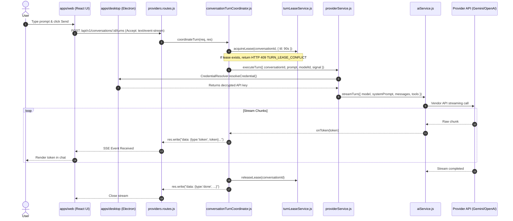

# Model Gateway Routing & End-to-End Execution

This document details the exact execution path of a user prompt through Sirona's Model Gateway.

---

## 1. End-to-End Sequence Diagram



---

## 2. Request Cancellation & Abort Propagation

If the user clicks "Stop" or navigates away during an active stream:
1. The browser closes the HTTP connection.
2. In `apps/server/routes/v1/providers.routes.js`:
   ```js
   res.on("close", () => {
     if (!completedNormally && !res.writableEnded) {
       abortController.abort(new Error("CLIENT_DISCONNECTED"));
     }
   });
   ```
3. The abort signal propagates through `ProviderService.executeTurn` to the underlying vendor stream in `AIService`, immediately terminating token billing with the upstream LLM provider.
4. `conversationTurnCoordinator.js` `finally` block releases the turn lease so the conversation is not locked.
