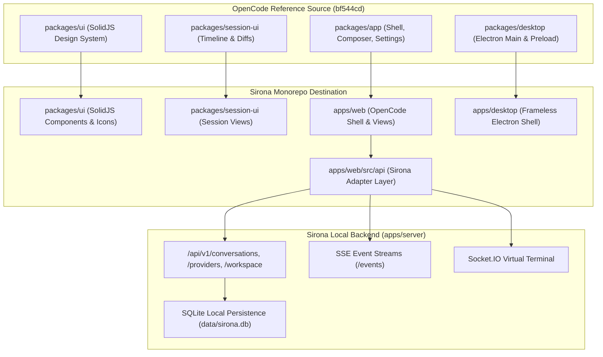

# Sirona Frontend Replacement Plan: OpenCode Desktop Migration

**Target Outcome:** Completely replace Sirona's legacy React frontend (`apps/web`) and Electron wrapper (`apps/desktop`) with the real OpenCode SolidJS desktop frontend from `anomalyco/opencode` (commit `bf544cd419c5f17535c0d5af929f7ecd41188320`), fully integrated with Sirona's local Express backend.

---

## 1. Safety & Rollback Baseline
- **Safety Git Tag:** `safety-before-opencode-frontend-migration`
- **Safety Backup Branch:** `backup-react-frontend-baseline`
- **Committed Monorepo Baseline:** `37aa8ae` (`chore: baseline monorepo restructuring before opencode frontend migration`)
- **Rollback Command:** `git reset --hard safety-before-opencode-frontend-migration`

---

## 2. Multi-Stage Migration Architecture

---

## 3. Implementation Stages & Gate Criteria

### Stage 1: Source Inspection & Reference Isolation
- Clone `anomalyco/opencode` into `.tmp/reference-opencode` (completed).
- Identify dependencies and exact commit SHA `bf544cd419c5f17535c0d5af929f7ecd41188320` (completed).

### Stage 2: Sirona Audit & Baseline Safety
- Created Git safety tag and branch backup (completed).
- Verified current working databases in `apps/server/data/` remain untouched (completed).

### Stage 3: Migration Blueprint & Documentation
- Author authoritative source map and API adapter matrices (in progress).

### Stage 4: Frontend Foundation
- Scaffold `packages/ui` and `packages/session-ui` into Sirona monorepo with SolidJS, Tailwind CSS v4, and Kobalte.
- Import design tokens, fonts (`IBM Plex`, `Inter`), CSS theme variables, and icon catalogs.
- Configure `vite-plugin-solid` and workspace TypeScript configurations.

### Stage 5: Desktop Shell Integration
- Migrate OpenCode desktop shell:
  - Custom frameless titlebar with Windows controls.
  - Collapsible sidebar with navigation items (`Home`, `Search sessions`, `New session`).
  - Vertical tab strip displaying active and pinned sessions.
  - Top hamburger menu `≡` and command palette triggers.

### Stage 6: Full View Migration
- **New Session View**: Centered Sirona wordmark, floating composer box, model dropdown pill, working directory and branch indicator.
- **Session Timeline**: Message list, code blocks, syntax highlighting, diff review, tool output accordions.
- **Settings Modal**: Appearance (Light/Dark mode), Provider keys (Anthropic, OpenAI, Gemini), General preferences.

### Stage 7: Sirona Backend Adapter Layer
- Implement OpenCode SDK client compatibility bridge:
  - Adapts OpenCode `session` calls to Sirona `/api/v1/conversations` and `/turns`.
  - Adapts `provider` calls to Sirona `/api/v1/providers` and `/models`.
  - Adapts SSE event stream to Sirona `/api/v1/projects/:projectId/events`.
  - Adapts workspace/fs operations to Sirona `/api/v1/projects/:projectId/files`.

### Stage 8: Retirement of Obsolete React Code
- Remove old React 19 files in `apps/web` only after SolidJS application builds, launches, and connects cleanly.
- Verify zero regressions to backend or desktop launch scripts.

### Stage 9: Verification & Packaging
- Verify `pnpm run build` and `npm test` across all packages.
- Launch Sirona Desktop via `start-desktop.bat` and visually verify exact match against user's Windows screenshot.
